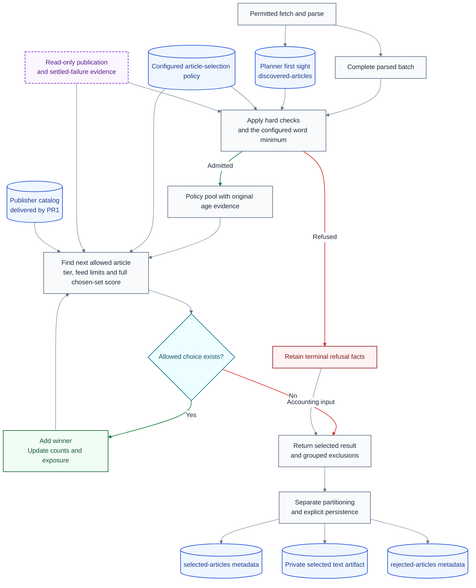

# Feed quality and article selection plan

**Last Updated**: 2026-10-26

**Level**: 5 - TypeScript ownership and breaking changes approved; implementation not started.

## 0. Operating contract

Deliver publisher identities first, then use them in the TypeScript article-selection changes.

### Table A - Scope and execution

| Id | Field | Requirement |
| --- | --- | --- |
| A1 | Permission | The plan-only commit and push directly to remote `main` are authorized. Application implementation, a PR and manual workflow dispatch are not authorized. |
| A2 | First delivery | Publisher curation is PR1. Ranking changes must consume that delivered catalog, not wait for publisher IDs afterward. |
| A3 | Ownership | TypeScript owns planner configuration validation, requests, private receipts, stage payloads and created ledgers. Do not maintain Python planner-schema mirrors. Existing Python consumers may remain; this plan owns the necessary artifact-boundary integration. |
| A4 | Compatibility | Current formats only. No migrations, old-row adapters, legacy aliases or historical backfills. Index cleanup is scoped in A5; deleting actual Parquet/article data is not authorized by breaking-code approval. |
| A5 | Index-removal ownership | The named raw-index workstream removes the four existing planner raw-day JSON indexes. This plan owns remaining planner index removal, including compact-index dependencies not covered there, and the reader/writer integration. Coordinate the shared boundary; do not duplicate that work or invent replacement manifests or history scans. |
| A6 | Storage | Reuse the existing Parquet codec. A gardener implemented in Python can consume TypeScript output artifacts; do not port the gardener or retire jobs merely because of its language. Adapt the artifact/contract boundary where it actually depends on a Python planner-row declaration. |
| A7 | Safety | Preserve access, sanitization, publication/failure exclusions, actual UTC clocks and content checks. Article text stays only in the selected handoff, never rejected metadata or public logs. |
| A8 | Execution | Execute per docs/how-to/execute-a-plan.md. Parallel N = 1 because these changes share planner contracts. AUTHOR-AND-STOP until the user approves the settled plan and authorizes execution and delivery. |
| A9 | Integration ownership | This session owns the remaining planner schema-authority, catalog, ledger-consumer and validation integration when implementation is authorized. It is not blocked on assigning another owner. Preserve unrelated consumers and checks; do not build Python schema mirrors or silently bypass validation. |

### Table B - Implementation requirements

| Id | Surface | Required behavior |
| --- | --- | --- |
| B1 | Selection settings | Rename `curate` to `curate_articles`; use `curate_articles.feed_quality_tiers`. Remove the old key, not retain an alias. |
| B2 | Fetch routing | Use `fetch_item_type` with `feed` or `article`; use fetched-item/fetch-parse helper terminology. Feed classification `kind` is a different field and is removed from planner decisions. |
| B3 | Admission | Remove `kind` / `source_kind` / `form` dependencies from loading, parsing, screening and ranking. Use validated `triage.min_words`, default 180 words, for every parsed item. Keep actual extraction/content checks; remove form-based exemptions. |
| B4 | Discovery | Use `batch.discovered`, `discovered_files`, `discovered_days` and `readDiscoveredEvidence`. Keep the existing planner-owned `discovered-articles` ledger, not Python `seen`. Parsing records discoveries through one shared stage; selection consumes them. |
| B5 | Discovery setting | Move `collect.seen_window_days` to planner-owned `discovered_articles.lookback_days`, preserving 90 prior UTC days plus the current day initially. This is a config setting, not another ledger or endpoint. |
| B6 | External outcomes | Read `published` under `state/raw/published/` and `state/compact/published/` for actual publication, and `item-health` under its corresponding roots for processing/publish outcomes and settled failures. These read-only inputs remain necessary for summarizer integration. |
| B7 | Cutoff evidence | Add `freshness_cutoff_at`, the UTC threshold actually applied, derived from the saved batch age-evaluation clock. Preserve publication provenance, first sight and existing unknown-time behavior. |
| B8 | Rejections | Persist `rejected-articles` for parsed candidates that lose during selection; retain grouped health counts too. Fetch/parse failures do not acquire invented selection records. |
| B9 | Identity limits | Populate reviewed publisher IDs before ranking delivery. Keep existing publisher scoring; a hard publisher cap or automatic domain discovery is not approved. Domain evidence remains optional and normally absent from the stage APIs. |
| B10 | Unavailable inputs | No kind, form, vertical, desk, lens or RSS-category score. Future summarizer labels need real per-article evidence before they can influence selection; no placeholder scorer, field or formula is included. |

### Selection calculation - real implementation, not an illustration

The existing [article selector](../services/feed-ingest-plan/src/curate-article-portfolio/editorial-selection.ts) already calculates configured authority and marginal score. PR4 must reuse and wire those calculations into actual winner selection, remove the kind term and verify the recorded score components. These formulas are implementation requirements, not display-only metrics.

```math
A_i = w_{\mathrm{authority}}\,w_{\mathrm{feed},i}\,w_{\mathrm{tier},i}
```

```math
M(i,S) = R_i + A_i + \Delta_{\mathrm{reliability},i}
         - \lambda_{\mathrm{publisher}} E_{\mathrm{publisher}}(i,S)
         - \lambda_{\mathrm{domain}} E_{\mathrm{domain}}(i,S)
```

`R` is the configured age bonus. `A` is feed authority. Reliability reduces authority only. `S` is the full chosen set, never reset between tiers or age windows. Publisher exposure uses actual publication linkage when available, otherwise the existing current-selection fallback. Missing publisher/domain evidence stays unknown; it is not fabricated as a measured zero.

Choose the first configured feed tier with an allowed candidate, then the largest `M` within its active age window, using the existing stable identity tie-break. Apply contribution rules during selection, not by creating and later deleting a fixed shortlist.

### Table C - Proposed configurable defaults

These are the concrete Fowler/original-proposal recommendations for review, not a claim of earlier numeric approval.

| Id | Tier priority | Per-feed allowance | Age windows |
| --- | --- | --- | --- |
| C1 | First: configured tier `1` | No extra feed ceiling; bounded by global output capacity and available candidates. | 24, then 36, then 48 hours. |
| C2 | Second: configured tier `2` | Existing base of 3 articles plus at most 1 earned evidence bonus, bounded by output capacity. | 24, then 30 hours. |
| C3 | Third: configured tier `3` | Same lower-tier allowance as C2. | 24 hours. |

The list sets priority explicitly; numeric tier IDs are not compared as priority values. Retain the existing ordered source-share relaxation. Exploration operates only among eligible candidates in the active tier/window. Do not add a hard publisher cap, a high-tier domain exemption or a domain producer without approval.

Finish a higher tier's permitted windows before descending: an eligible older high-tier article can precede a fresh lower-tier article. Widen only when output room remains and no viable choice remains in the active window after permitted relaxations. There is no reserved tier target or transferable quota. `article_limit` is a maximum, not a fill obligation. An explicit `freshness_hours` replaces all tier ladders for that run.

### Selection flow



## 1. Status Reckoner

### Table D - Delivery order

| Id | Row | PR outcome | Depends-on | Status | Readiness condition | Worktree | PR | Subagent |
| --- | --- | --- | --- | --- | --- | --- | --- | --- |
| D1 | 1 | Deliver reviewed publisher IDs | - | PENDING | A1; first delivery by user direction. | - | - | - |
| D2 | 2 | Finish TypeScript contract and ledger-IO integration | 1 | PENDING | Coordinate the existing raw-index change and complete remaining integration owned by this plan. | - | - | - |
| D3 | 3 | Remove feed labels and rename article/discovery controls | 2 | PENDING | Sole TypeScript contract authority is available. | - | - | - |
| D4 | 4 | Implement tier selection, cutoff and rejection persistence | 1, 2, 3 | PENDING | Consume PR1's catalog and approve the proposed defaults. | - | - | - |
| D5 | 5 | Apply freshness fallback through fetch and selection | 4 | PENDING | Shared tier policy and cutoff-bearing output exist. | - | - | - |

## 2. Row #1 - Deliver reviewed publisher IDs

- **Scope:** Review both `feeds` and `retired` in `config/sources.json` and deliver stable publisher mappings before ranking changes.
- **Files touched:** `config/sources.json`, `docs/architecture/contracts/publisher-identity.md`, and this plan's status/review outcome.
- **Acceptance gates:** Existing TypeScript catalog/reference validation and bounded same-publisher/different-publisher/unknown-identity fixtures. No live feed probes or fixed catalog-size assertions.
- **Oracle:** Every assigned ID is declared once, related feeds reuse it, and non-publisher feed fields remain unchanged; strings alone cannot prove identity, so unresolved cases must be reported.

### Table E - Review rules

| Id | Rule |
| --- | --- |
| E1 | Use URL host/path and feed ID as expert-review hints, not an automatic runtime classifier. |
| E2 | Reuse one stable publisher ID across section, language, active and retired variants belonging to that publisher. |
| E3 | Do not mistake shared platforms, RSS proxies or transport hosts for publishers. Conflicting clues remain null with an explicit feed-specific reason. |
| E4 | Add stable lowercase IDs and display names to the existing registry. Preserve feed IDs, URLs, status and retirement metadata. |
| E5 | Report assigned/reused groups and unresolved entries. Do not backfill historical selected or publication records. |

## 3. Row #2 - Finish TypeScript contract and ledger-IO integration

- **Scope:** Make the existing TypeScript schemas authoritative, remove remaining planner index dependencies, and adapt consumers to the TypeScript-owned artifacts without porting the Python gardener or creating schema mirrors.
- **Files touched:** `CLAUDE.md`, `config/idhazh_gardener.json`, `config/ledgers.json`, `packages/common-contracts/test/config.test.ts`, `packages/ledger-file-writer/src/registration.ts`, `packages/ledger-file-writer/src/row-identity.ts`, `services/feed-ingest-plan/src/load-plan-inputs.ts`, `services/feed-ingest-plan/src/read-ledger-history/read-planner-parquet.ts`, the existing TypeScript planner schemas and publication helpers, and the owning contract/ledger docs.
- **New files only where needed:** `config/feed-ingest-plan-ledgers.json` for static planner metadata and a narrow TypeScript validation/period adapter if the existing consumer needs one. Do not build a second scheduler or one-to-one ports of Python modules.
- **Acceptance gates:** TypeScript schema and actual Parquet/retention/ledger-file validation cases. No required Python planner-model comparison, JSON index recreation or replacement file-list store. Existing consumers must either consume the owned artifact contract correctly or use the adapted boundary.
- **Oracle:** Current planner data can be validated and maintained through the confirmed bounded IO without native schema mirrors; this does not certify unrelated producers.
- **Shared work boundary:** Reuse the existing agent's raw-day index removal. This plan owns the remaining compact-index removal and integration, plus any planner-specific authority/check mismatch that work does not resolve. Do not describe that responsibility as somebody else's unassigned work.
- **Confirmed IO constraints:** Only configured named UTC days for `discovered-articles`, `selected-articles`, `feed-health-state` and `plan-runs`, using a fixed Git revision or explicit validated Parquet paths. Exact-day Git-tree listing and named-file staging are permitted alternatives, not a chosen contract. This plan's owner must finish the exact run-input/API shape and completeness/error rules while integrating the raw-index change.
- **Preserved guarantees:** Keep lookbacks, compact year/month/day precedence, UUID/path/envelope/content integrity and exact immutable output receipts, retry and collision checks without relying on removed index files. Do not invent an archive walk, mutable JSON file list or manifest. This plan integrates the new rejection ledger; it does not add it to the other agent's assignment.
- **Specific catalog:** `config/ledgers.json` lists ledger families, names, prefixes, lifecycle and explorer-publication flags. It is static configuration, not article history. Add the TypeScript-owned planner catalog only where that existing boundary cannot accept a planner-owned ledger without a schema mirror.
- **Specific row lookup:** `packages/ledger-file-writer/src/registration.ts` maps planner ledger names to their Zod row contracts; planner metadata verification uses the corresponding TypeScript contracts. Keep that authority in TypeScript.
- **Ledger-file validation:** Check Parquet columns/types and the existing envelope/content-integrity rules before ledger files are exposed through the archive/site. `selected-articles` is one such ledger. This is not a decision to publish a news article, not summary-quality evaluation and not a new news-publication workflow.

## 4. Row #3 - Remove feed labels and rename article/discovery controls

- **Scope:** Apply B1-B5 throughout source loading, parser workers, stage payloads, scoring, API handlers, scripts and fixtures without compatibility aliases.
- **Files touched:** `config/feed-ingest-plan.json`, `config/feed-ingest-plan-service.json`, the existing TypeScript planner source/policy/config/stage schemas, `services/feed-ingest-plan/src/harvest-feeds/load-harvest-inputs.ts`, `services/feed-ingest-plan/src/harvest-feeds/extraction-quality.ts`, `services/feed-ingest-plan/src/screen-article-candidates/triage-gates.ts`, `services/feed-ingest-plan/src/select-articles.ts`, their TypeScript callers, tests and owning docs.
- **Acceptance gates:** Affected-package `bun run check` and recorded parse/select/API tests. Prove missing/changed content labels have no effect, while changing the configured word minimum changes admission.
- **Oracle:** No planner decision or required input depends on the removed labels; this does not assess journalistic quality.

### Table F - Required renames

| Id | Current | New |
| --- | --- | --- |
| F1 | `curate` | `curate_articles` |
| F2 | Routing `kind` | `fetch_item_type`, values `feed` and `article` |
| F3 | `batch.seen` | `batch.discovered` |
| F4 | `seen_files` / `seen_days` | `discovered_files` / `discovered_days` |
| F5 | `readSeenEvidence` | `readDiscoveredEvidence` |
| F6 | `collect.seen_window_days` | `discovered_articles.lookback_days` in planner configuration |

Rename related exported types/helpers and all current callers together. Do not rename native HTML-library APIs merely because they use a general HTML term.

## 5. Row #4 - Implement tier selection, cutoff and rejection persistence

- **Scope:** Use the real calculations above in the shared selector, consuming PR1's publisher identities, with full chosen-set scoring and explicit terminal explanations.
- **Files touched:** `config/feed-ingest-plan.json`, `services/feed-ingest-plan/src/curate-article-portfolio/editorial-selection.ts`, `services/feed-ingest-plan/src/select-articles.ts`, `services/feed-ingest-plan/src/api/selection-operation.ts`, `services/feed-ingest-plan/src/api/persistence-operation.ts`, TypeScript config/stage/selected-article schemas, ledger registration/publication helpers, existing curation/API/Parquet fixtures and owning docs.
- **New contract:** `packages/common-contracts/src/schemas/rejected-article.schema.ts`, declared before its reader/writer.
- **Acceptance gates:** Exact chosen identities, authority/marginal contributions, coefficient substitution, duplicate carriers, complete input larger than output, cutoff agreement, rejection coverage and zero-selected persistence. No network tests, mocks or new top-level test registrations.
- **Oracle:** The actual winners and stored components obey the same configured calculation, and every non-chosen parsed candidate has exactly one terminal rejection; this is a greedy selection rule, not a global-optimality claim.

### Table G - Result contract

| Id | Output | Required contents/behavior |
| --- | --- | --- |
| G1 | Selected metadata and text handoff | Preserve actual ranks, score components, allowances and age basis; add the same `freshness_cutoff_at` to both projections. Only the handoff contains article text. |
| G2 | `rejected-articles` | One row per losing parsed candidate, keyed by selection run/attempt and supplying candidate ID; include URL key, feed, terminal stage/reason and nullable actual cutoff when evaluated. No article body, title, full policy or score tree. |
| G3 | Explicit persistence | Write rejection metadata even when nothing was selected; return real receipts, retain grouped health counts and do not manufacture empty files or a hidden selection-write side effect. |
| G4 | Registry and maintenance | TypeScript-owned current schema; configurable maintenance using the selected-metadata policy initially. Explorer publication is off pending consent, but committed metadata is not private. |

Keep viable carriers until a permitted winner for a URL is chosen; then classify the others as duplicates. Never reset exposure/counts between tiers. Missing domain or publisher evidence stays explicit, not guessed.

## 6. Row #5 - Apply freshness fallback through fetch and selection

- **Scope:** Implement Table C's reviewed age policy with one TypeScript resolver shared by pre-download eligibility and selection.
- **Files touched:** `config/feed-ingest-plan.json`, `services/feed-ingest-plan/src/harvest-feeds/prepare-article.ts`, `services/feed-ingest-plan/src/api/fetch-operation.ts`, screening/freshness helpers, the selector, TypeScript policy schemas, existing early-age/curation/API fixtures and owning docs.
- **New helper:** `services/feed-ingest-plan/src/article-freshness-policy.ts`.
- **Acceptance gates:** No fetch outside the allowed envelope; actual older candidates survive preflight when permitted; test exact boundaries, unchanged unknown-time handling, earliest discovery, override replacement, finite steps and one terminal outcome.
- **Oracle:** The same age policy governs real preflight and selection, and cutoff evidence uses the saved age clock; this cannot decide whether the configured age preference is editorially desirable.

Count a candidate once after hard checks and its tier's maximum permitted age envelope pass, not once per window. Preserve the original evaluation instant, first-sight meaning, near-future handling and publication provenance. Never use selection time to rejuvenate age.

## 7. Additions still OPEN

### Table H - Do not implement without a further decision

| Id | Addition | Current baseline and trade-off |
| --- | --- | --- |
| H1 | Hard publisher cap | Correct publisher IDs enable the existing soft exposure preference. A hard maximum is a new refusal rule and can underfill; it is not approved. |
| H2 | Automatic website grouping or a high-tier domain exemption | The current control requires explicit optional evidence; ordinary stage APIs do not populate it. A URL-derived producer or bypass is new behavior, not a consequence of publisher curation. |

### Table I - Existing TypeScript schemas, not new ports

The files below are in `packages/common-contracts/src/schemas/`. Zod already validates these runtime values. The change is to remove the planner's mandatory Python-schema parity and native-row-model authority where present, and adapt consumers to the TypeScript-owned contract.

| Id | Existing TypeScript declarations | Files and planned change |
| --- | --- | --- |
| I1 | `FeedIngestConfigSchema`, `SourceSnapshotSchema`, `FeedIngestCandidateSchema` | `config.schema.ts`, `policy.schema.ts`, `source.schema.ts`, `candidate.schema.ts`: keep the existing schemas, apply the new names and remove feed content labels. |
| I2 | `FetchedDocumentSchema`, `PlannerOperationSchema`, `ParsedFeedBatchSchema`, `SelectedFeedBatchSchema`, `PartitionedFeedBatchSchema` | `planner-operation.schema.ts`, `planner-stage.schema.ts`: make current TypeScript request/receipt/stage contracts authoritative; use fetched-item/discovered naming and no old-format adapters. |
| I3 | `DiscoveredArticleRowSchema`, selected metadata/artifact schemas, `FeedHealthStateRowSchema`, `PlanRunRowSchema` | `discovered-article.schema.ts`, `selected-article.schema.ts`, `feed-health-state.schema.ts`, `plan-run.schema.ts`: retain TypeScript ownership, add cutoff evidence, and declare the new rejection schema before its writer. |

## See also

- [Current selection rules](../docs/architecture/sources/feed-curation.md)
- [Operator APIs](../docs/architecture/sources/feed-operator-api.md)
- [Planner ledger fields](../docs/reference/feed-planner-ledgers.md)
- [Publisher identity](../docs/architecture/contracts/publisher-identity.md)
- [Native diagram theme](../docs/reference/mermaid-diagrams.md)
- [Implementation gates](../docs/how-to/run-the-gates.md)
- [Output publication rules](../docs/architecture/publishing/committing.md)
