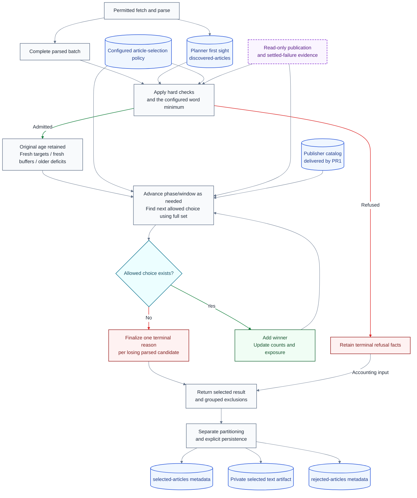

# Feed quality and article selection plan

**Last Updated**: 2026-10-27

**Level**: 5 - Design decisions approved; implementation authorized by the user on 2026-10-27 UTC.

## 0. Operating contract

Deliver publisher identities first, then use them in the TypeScript article-selection changes.

### Table A - Scope and execution

| Id | Field | Requirement |
| --- | --- | --- |
| A1 | Permission | The user authorized implementation of all four rows and delivery through reviewed pull requests to remote main on 2026-10-27 UTC. This supersedes the earlier plan-only permission and AUTHOR-AND-STOP wording, not the ESCALATE boundaries. No manual ingestion workflow dispatch is authorized. |
| A2 | First delivery | Publisher curation is PR1. Ranking changes must consume that delivered catalog, not wait for publisher IDs afterward. |
| A3 | Ownership | TypeScript owns planner configuration validation, requests, private receipts, stage payloads and created ledgers. Do not maintain Python planner-schema mirrors. Existing Python consumers may remain; this plan owns the necessary artifact-boundary integration. |
| A4 | Compatibility | Current formats only. No migrations, old-row adapters, legacy aliases or historical backfills. Index cleanup is scoped in A5; deleting actual Parquet/article data is not authorized by breaking-code approval. |
| A5 | Index-removal ownership | The named raw-index workstream removes active JSON-index dependencies for the four existing planner raw-day ledgers; historical derived JSON lists may remain inert. This plan owns remaining planner index removal, including compact-index dependencies not covered there, and the reader/writer integration. Do not duplicate that work, promise historical JSON purging or invent replacement manifests/history scans. |
| A6 | Storage | Reuse the existing Parquet codec. Minimal Python consumer hooks and retirement of planner-model bindings are approved; Python retains its scheduler and unrelated ledgers. Delegate planner row validation/maintenance to TypeScript, not compatible Python schema copies or a gardener rewrite. |
| A7 | Safety | Preserve access, sanitization, publication/failure exclusions, actual UTC clocks and content checks. Article text stays only in the selected handoff, never rejected metadata or public logs. |
| A8 | Execution | Execute per docs/how-to/execute-a-plan.md. One maintainer carries the rows sequentially; Parallel N = 1 because these changes share planner contracts. AUTO-merge each row on green gates and continue until all four rows are delivered. |
| A9 | Integration ownership | This session owns the remaining planner schema-authority, catalog, ledger-consumer and validation integration when implementation is authorized. It is not blocked on assigning another owner. Preserve unrelated consumers and checks; do not build Python schema mirrors or silently bypass validation. |
| A10 | ESCALATE | Stop for a user decision if work needs a persisted shape/meaning outside the approved contracts, changes selection policy/scope or unrelated consumers, adds compatibility/backfill or qualitative assessment, or meets a trust/platform boundary. Do not weaken the trust boundary or exceed the six-hour job/one-GB site limits: they cause job termination/deployment refusal. No silent scope or validation bypass. |

On 2026-10-27 UTC the user authorized a separate nested child to implement the
reusable TypeScript `safe_persist_data` API, its contracts, tests and planner
delivery integration. Selection rows 3 and 4 continue here while that child
works. The child owns removal of the planner-specific Git implementation and
its redundant delivery tests; these are not duplicated in the selection PRs.

On 2026-10-27 UTC the maintainer directed delivery of the agreed row 4 without
the proposed durable health-finalization snapshot or tests for that extension.
Original capture outcomes remain durable; health-write ownership retains its
existing process-local scope. This is not a new selection replay framework.

### Table B - Implementation requirements

| Id | Surface | Required behavior |
| --- | --- | --- |
| B1 | Selection settings | Rename `curate` to `curate_articles`; use `curate_articles.feed_quality_tiers`. Remove the old key, not retain an alias. |
| B2 | Fetch routing | Use `fetch_item_type` with `feed` or `article`; use fetched-item/fetch-parse helper terminology. Feed classification `kind` is a different field and is removed from planner decisions. |
| B3 | Admission | Remove `kind` / `source_kind` / `form` dependencies from loading, parsing, screening and ranking. Use validated `triage.min_words`, default 180 words, for every parsed item. Keep actual extraction/content checks; remove form-based exemptions. |
| B4 | Discovery | Use `batch.discovered`, `discovered_files`, `discovered_days` and `readDiscoveredEvidence`. Keep the existing planner-owned `discovered-articles` ledger, not Python `seen`. Parsing records discoveries through one shared stage; selection consumes them. |
| B5 | Discovery setting | Replace the planner's use of `collect.seen_window_days` with planner-owned `discovered_articles.lookback_days`, preserving 90 prior UTC days plus today initially. Retain the native setting for its remaining Python readers. No new ledger or endpoint. |
| B6 | External outcomes | Read `published` under `state/raw/published/` and `state/compact/published/` for actual publication, and `item-health` under its corresponding roots for processing/publish outcomes and settled failures. These read-only inputs remain necessary for summarizer integration. |
| B7 | Cutoff evidence | Add `freshness_cutoff_at`, the UTC threshold actually applied, derived from the saved batch age-evaluation clock. Preserve publication provenance, first sight and existing unknown-time behavior. |
| B8 | Rejections | Persist `rejected-articles` for parsed candidates that lose during selection; retain grouped health counts too. Fetch/parse failures do not acquire invented selection records. |
| B9 | Identity and grouping | Populate reviewed publisher IDs first. Derive website groups from validated canonical article URLs with private suffix rules enabled by default through `curate_articles.website_grouping.include_private_suffixes`. URL paths do not split website groups. Unavailable groups remain unknown; never infer publisher identity from this technical grouping. |
| B10 | Unavailable inputs | No kind, form, vertical, desk, lens or RSS-category score. Future summarizer labels need real per-article evidence before they can influence selection; no placeholder scorer, field or formula is included. |
| B11 | Quantitative evidence only | Use explicit configured numeric policy and measured outcomes, counters, timestamps and deterministic rules. Do not import qualitative article assessments, model/human ratings or inferred truth/importance from the iFEED proposal. |
| B12 | Fixed tiers | Do not move feeds between tiers in this plan. A measured feed-performance adjustment changes ordering only inside its configured tier. |

### Selection calculation - real implementation, not an illustration

The existing [article selector](../services/feed-ingest-plan/src/curate-article-portfolio/editorial-selection.ts) already calculates configured authority and marginal score. PR4 must reuse and wire those calculations into actual winner selection, remove the kind term and verify the recorded score components. These formulas are implementation requirements, not display-only metrics.

```math
A_i = w_{\mathrm{authority}}\,w_{\mathrm{feed},i}\,w_{\mathrm{tier},i}
```

```math
M(i,S) = R_i + A_i + \Delta_{\mathrm{article\ pass},i}
         - \lambda_{\mathrm{publisher}} E_{\mathrm{publisher}}(i,S)
         - \lambda_{\mathrm{domain}} E_{\mathrm{domain}}(i,S)
```

`R` is the configured age bonus, using the original age and recency half-life; opening an older window does not increase it. `A` is feed authority. The article-pass adjustment reduces authority only: `factor = max(configured floor, technical pass rate)` and `adjustment = -A * (1 - factor)`. Unknown rates supply no penalty; disabling the existing control gives zero adjustment. RSS-read reliability stays separate for access/rest. `S` is the full chosen set and is never reset. Publisher exposure uses actual publication linkage when available, otherwise the existing current-selection fallback. Missing publisher/domain evidence is not a measured zero.

Use the approved phase order below. Inside each active phase/tier, choose the largest `M` against the full selected set, using the existing stable identity tie-break. Apply limits during selection, not by creating and later deleting a fixed shortlist. Do not exhaust older high-tier candidates before considering fresh lower tiers.

### Table C - Percentage targets and fresh buffers

The user approved these initial defaults and the rules below on 2026-10-27 UTC. They replace absolute feed allowances and older-high-tier-first ordering. Keep them under `curate_articles.feed_quality_tiers`, not a second tier registry.

| Id | Configured tier | `share_pct` | `buffer_pct` | `ladder_hours` |
| --- | --- | --- | --- | --- |
| C1 | `1`, first in each phase | 60 | 10 | 24, 36, 48 |
| C2 | `2`, second in each phase | 30 | 5 | 24, 30 |
| C3 | `3`, third in each phase | 10 | 5 | 24 |

Let `L` be the positive finite integer limit from the saved batch request's existing `article_limit` override, otherwise the configured `curate_articles.article_limit`. An omitted request override uses the valid configuration; an explicitly invalid override never silently falls back. Configuration must provide a positive safe integer. Reject null/unlimited, zero, negative, fractional or non-finite limits by their field name; API input failures use the existing HTTP 400 `INVALID_INPUT` response, and invalid configuration fails load. Do not substitute candidate count for an absent limit or add a new override to the stage-reference API.

For each tier, derive its older-backfill target and upper base-pass ceiling:

```math
\mathrm{target}_t=L\,\frac{\mathrm{share\_pct}_t}{100},
\qquad
\mathrm{fresh\_ceiling}_t=L\,\frac{\mathrm{share\_pct}_t+\mathrm{buffer\_pct}_t}{100}
```

Buffers are upper percentage-point allowances: 60 plus 10 means 70 percent, not 66 percent. This is not a guaranteed lower `share_pct - buffer_pct` bound. Configure nonnegative percentages whose shares sum to 100 and whose share-plus-buffer does not exceed 100 per tier. Refuse duplicate/missing tier rules by name; age steps must be positive and strictly increasing. Percent allocation requires a finite limit; it does not cap input candidates.

Apportion integer targets by largest remainder, breaking ties by configured tier order, so targets sum to `L`. Round upper ceilings upward, never below the allocated target. Round only at these declared count boundaries. The global limit still controls total output when upper ceilings sum above `L`; do not rebase `L` or percentages to available candidates or eventual winners.

The user selected **fresh targets, fresh buffers, then older deficits**:

1. **Fresh targets:** select base-window candidates in configured tier order up to each tier's target, subject to all retained gates and concentration controls.
2. **Fresh buffers:** only when no permitted fresh-target choice remains, allow remaining base-window candidates in the same tier order up to each tier's upper ceiling.
3. **Older deficits:** only with global room remaining, revisit tiers below target and try their later age steps in order. Admit older candidates only while that tier's total selected count remains below its target. Stop that tier's older pass immediately when the deficit is filled.

For `L = 100`, ample fresh supply yields tier counts 60 / 30 / 10. Fresh supply 40 / 35 / 15 plus 20 available older tier-1 articles yields 50 / 35 / 15: the 90 fresh articles precede the ten older backfill places. These examples assume other caps do not bind.

Re-evaluate eligibility after each winner: no fresh overflow while a permitted fresh-target choice exists, and no older admission while a permitted base-window choice exists. Within a phase, choose the first tier with a permitted candidate, then its greatest marginal score. Apply configured relaxations only when the whole active phase has no choice, not merely because its highest tier is blocked.

Keep the same selected set, exposure, counts and applied relaxations throughout. The list, not numeric tier IDs, sets priority inside a phase. Exploration considers only permitted choices in the active phase/tier/window. Remove obsolete fixed-count pre-trimming and unique-evidence allowance bonuses; retain configured per-feed and website-share controls computed from `L`. Targets are not fill guarantees; shortages do not authorize exceeding ceilings.

**`freshness_hours` may only tighten normal tier windows**. Clamp each configured step to that value and remove repeated steps. A 30-hour override gives tier 1 steps 24 / 30, tier 2 steps 24 / 30, and tier 3 step 24. A larger override never widens the base window or a tier's maximum. Older admissions remain target-capped. Existing unknown-time handling stays unchanged; do not invent an age or call an unknown timestamp verified fresh.

### Selection flow



## 1. Status Reckoner

### Table D - Delivery order

| Id | Row | PR outcome | Depends-on | Status | Readiness condition | Worktree | PR | Subagent |
| --- | --- | --- | --- | --- | --- | --- | --- | --- |
| D1 | 1 | Deliver reviewed publisher IDs | - | DONE | Eight reviewed publisher IDs now bind 20 active and retired feeds; unreviewed entries remain unknown. | feed-selection-delivery | #1762 | - |
| D2 | 2 | Finish TypeScript contract and ledger-IO integration | 1 | DONE | Raw-day membership tests and all required PR checks passed; the change is merged. | feed-selection-delivery | #1763 | - |
| D3 | 3 | Remove feed labels and rename article/discovery controls | 2 | DONE | All required checks passed on source 3e612aa4f5d9092d345a9f2ef9790125cb8847c1; merged as d484600018cd9a4264266493d2a7522a3a5d12f7 and verified on remote main. | feed-selection-controls | #1766 | - |
| D4 | 4 | Implement allocation, freshness, cutoff and rejection persistence | 1, 2, 3 | IN REVIEW | Allocation, source outcomes and five-ledger persistence are implemented. Contract and writer suites plus targeted planner and native-hook cases pass; required CI and remote-main verification remain. | feed-selection-controls | - | - |

Implementation gates, not this documentation delivery: inspect `npm run test:changed -- --list` from `frontend/`, run the selected checks, and run each row's named Bun cases. Type-check affected packages with `bun run --cwd <package> check`. CI runs the full merge-candidate suite once. No row requires a live feed probe or a workflow dispatch.

## 2. Row #1 - Deliver reviewed publisher IDs

- **Scope:** Review both `feeds` and `retired` in `config/sources.json` and deliver stable publisher mappings before ranking changes.
- **Files touched:** `config/sources.json`, `packages/common-contracts/test/config.test.ts`, `services/feed-ingest-plan/test/harvest.test.ts`, `services/feed-ingest-plan/test/curate.test.ts`, `docs/architecture/contracts/publisher-identity.md`, `TODO/20261026-feed-quality-selection-plan.md`.
- **Acceptance gates:** Run `config.test.ts`, `harvest.test.ts` and `curate.test.ts` with affected-package checks. Use bounded same-publisher/different-publisher/unknown-identity cases against the real catalog/reference validator; no live feed probes or fixed catalog-size assertions.
- **Oracle:** Every assigned ID is declared once, related feeds reuse it, and non-publisher feed fields remain unchanged; strings alone cannot prove identity, so unresolved cases must be reported.

### Table E - Review rules

| Id | Rule |
| --- | --- |
| E1 | Use URL host/path and feed ID as expert-review hints, not an automatic runtime classifier. |
| E2 | Reuse one stable publisher ID across section, language, active and retired variants belonging to that publisher. |
| E3 | Do not mistake shared platforms, RSS proxies or transport hosts for publishers. Conflicting clues remain null with an explicit feed-specific reason. |
| E4 | Add stable lowercase IDs and display names to the existing registry. Preserve feed IDs, URLs, status and retirement metadata. |
| E5 | Report assigned/reused groups and unresolved entries. Do not backfill historical selected or publication records. |

## 3. Row #2 - Finish TypeScript contract and ledger-IO integration

- **Scope:** Make the existing TypeScript schemas authoritative, remove remaining planner index dependencies, and adapt consumers to the TypeScript-owned artifacts without porting the Python gardener or creating schema mirrors.
- **Configuration/workflow targets:** `CLAUDE.md`, `config/idhazh_gardener.json`, `config/ledgers.json`, `.github/workflows/idhazh-gardener.yml`, `.github/workflows/ci.yml`, `.github/workflows/feed-ingest-plan-test.yml`. Keep one static ledger catalog; do not create a second planner catalog.
- **TypeScript targets:** `packages/common-contracts/src/schemas/config.schema.ts`, `packages/common-contracts/src/schemas/feed-health.schema.ts`, `packages/common-contracts/src/schemas/envelope.schema.ts`, `packages/common-contracts/src/schemas/ledger-index.schema.ts`, `packages/common-contracts/src/schemas/planner-operation.schema.ts`, `packages/common-contracts/src/schemas/planner-stage.schema.ts`, `packages/common-contracts/src/index.ts`, `packages/ledger-file-writer/src/registration.ts`, `packages/ledger-file-writer/src/row-identity.ts`, `packages/ledger-file-writer/src/persist-compact.ts`, `packages/ledger-file-writer/src/index.ts`, `services/feed-ingest-plan/src/load-plan-inputs.ts`, `services/feed-ingest-plan/src/read-ledger-history/named-days.ts`, `services/feed-ingest-plan/src/read-ledger-history/read-planner-history.ts`, `services/feed-ingest-plan/src/read-ledger-history/read-planner-parquet.ts`.
- **Native consumer targets, planner branches only:** `backend/idhazh/cli.py`, `backend/idhazh/contracts/base.py`, `backend/idhazh/contracts/ledger_name.py`, `backend/idhazh/contracts/file_envelope.py`, `backend/idhazh/contracts/knobs/ledger.py`, `backend/idhazh/contracts/knobs/gardener.py`, `backend/idhazh/ledger/keys.py`, `backend/idhazh/ledger/persist.py`, `backend/idhazh/ledger/ledger_files.py`, `backend/idhazh/ledger/raw_files.py`, `backend/idhazh/ledger/published_columns.py`, `backend/idhazh/gardener/tasks/_compact_tree.py`, `backend/idhazh/gardener/tasks/_daily_period.py`, `backend/idhazh/gardener/tasks/_monthly_period.py`, `backend/idhazh/gardener/tasks/_reopened_month.py`, `backend/idhazh/gardener/tasks/_yearly_period.py`. Dispatch registered planner work to its TypeScript owner before native row/envelope lookup; retain native validation for other families.
- **Retire planner mirror/binding targets, not ports:** `backend/idhazh/contracts/feed_ingest_candidate.py`, `backend/idhazh/contracts/feed_ingest_diagnostics.py`, `backend/idhazh/contracts/feed_ingest_discovered_article.py`, `backend/idhazh/contracts/feed_ingest_selected_article.py`, `backend/idhazh/contracts/feed_health_state.py`, `backend/idhazh/contracts/feed_ingest_plan_run.py`, `backend/idhazh/contracts/planner_operation.py`, `backend/idhazh/contracts/planner_stage.py`, `backend/idhazh/contracts/knobs/feed_ingest.py`, `backend/idhazh/contracts/__init__.py`. Preserve any generic base/protocol used by non-planner ledgers; move its shared definition before retiring its planner-specific import home.
- **Test targets:** `packages/common-contracts/test/config.test.ts`, `packages/common-contracts/test/schema-binding.ts`, `packages/ledger-file-writer/test/parquet-parity.test.ts`, `packages/ledger-file-writer/test/persist-ledger.test.ts`, `packages/ledger-file-writer/test/reader-integrity.test.ts`, `services/feed-ingest-plan/test/ledger-history.test.ts`, `services/feed-ingest-plan/test/history-window.test.ts`, `services/feed-ingest-plan/test/compaction-recording.ts`, `services/feed-ingest-plan/test/feed-ingest-plan-publication.test.ts`, `backend/tests/contracts/_fixtures.py`, `backend/tests/contracts/test_feed_ingest_config.py`, `backend/tests/contracts/test_feed_ingest_contracts.py`, `backend/tests/contracts/test_feed_ingest_audit.py`, `backend/tests/contracts/test_gardener_config.py`, `backend/tests/ledger/test_feed_ingest_ledgers.py`, `backend/tests/ledger/test_published_columns.py`, `backend/tests/workflows/test_publish_ordering.py`, `backend/tests/council/_imports.py`.
- **Documentation targets:** `docs/architecture/contracts/schemas.md`, `docs/architecture/contracts/state-ledgers.md`, `docs/reference/feed-planner-ledgers.md`, `docs/architecture/publishing/committing.md`, `docs/architecture/publishing/ledger-compaction.md`, `docs/architecture/publishing/idhazh-gardener.md`, `docs/concepts/config/idhazh-gardener.md`.
- **New adapter:** `packages/common-contracts/src/schemas/planner-maintenance.schema.ts` declares the request/result; `packages/ledger-file-writer/src/planner-maintenance.ts` validates named files and compacts one named UTC period through the existing codec. The existing Python scheduler invokes this adapter for planner tasks only. Supply operator-owned paths/controls as typed input, never shell text from articles. Return ordinary validated receipts or explicit refusals; no second scheduler, row codec or database.
- **Acceptance gates:** Run the named TypeScript contract/writer/history cases and selected native consumer cases through the real adapter on bounded fixtures. Preserve non-planner parity and maintenance checks. Planner Python-model comparisons are retired, not made to pass with compatible copies or a skipped global check.
- **Oracle:** Current planner data can be validated and maintained through the confirmed bounded IO without native schema mirrors; this does not certify unrelated producers.
- **Delivered prerequisite:** Raw-day membership and immutable append were verified on main at `3714bd2cfd93529f9c80ef1ca4658d028a39305e`. [Raw-day membership](../docs/reference/feed-planner-ledgers.md#raw-day-membership) and [repository commits](../docs/architecture/publishing/committing.md) own that interface. Reuse it; do not duplicate it or claim historical JSON was purged. Its delivered scope is the four existing ledgers; this plan owns the rejection-ledger extension and residual integration.
- **Compact membership:** The adapter receives one explicit UTC daily/monthly/yearly period from the existing scheduler's bounded configured period selection, plus one captured full Git revision. Use exact canonical compact paths, not a directory walk or accumulated-history scan. At that revision, check the exact yearly, monthly and daily candidates covering each requested day, in that order. Successful absence may try the next level. A member present in Git but unavailable locally, changed, malformed or unsupported is a gap; do not silently fall through as a complete read.
- **Compact coverage:** A current-format compact file means that all its declared inputs validated. Add no `coverage_state` field, empty-period marker or zero-row compact file. Select the highest-precedence available current compact, restrict its rows to the requested UTC day, and join all captured raw siblings with the existing row-key settlement. A nonempty coarse period retains the existing represented-day meaning; no compact plus Git-proved empty raw membership means no retained facts at that revision, not proof that no article ever existed. Missing/refused members make accounting unknown, never a measured zero.
- **Compact write/failure contract:** Declare/version the complete-input compact protocol before its reader/writer; keep unchanged raw formats independent. Read one named period and every selected input from the same revision, validate identity/schema/digest, and fold with the prior compatible compact. Any needed input gap aborts that period with no replacement or source deletion. An empty result writes no file; a later wake may repeat the bounded existence check. Old index-dependent compact formats remain intact and are refused as gaps, without migration/backfill.
- **Safe replacement and cleanup:** A compact target may replace only the captured prior target bytes after fresh-main validation. Concurrent target changes cause an explicit conflict; preserve newly appended/unselected siblings. Delete only exact validated inputs included in the replacement after its durable receipt exists. If a retained higher-precedence compact would hide a subordinate replacement, update that coarsest period or refuse the subordinate cleanup; never remove the remaining visible raw facts. Keep current lookbacks, row keys, immutable-path collision/refusal and normal retry guarantees. No replacement manifest or retained empty-period bookkeeping.
- **Adapter cost:** Maintenance jobs need Bun and the two existing common-contracts/writer dependency installs. Python remains the orchestrator and non-planner implementation. Narrow dispatch/import/test changes are necessary integration, not one-to-one TypeScript ports of Python modules.
- **Specific catalog:** `config/ledgers.json` is the single static catalog of families, names, prefixes, lifecycle and explorer-publication flags, not article history. Adapt its native/TypeScript consumer boundary to accept planner-owned contracts without schema mirrors; do not add a second planner catalog.
- **Specific row lookup:** `packages/ledger-file-writer/src/registration.ts` maps planner ledger names to their Zod row contracts; planner metadata verification uses the corresponding TypeScript contracts. Keep that authority in TypeScript.
- **Ledger-file validation:** Check Parquet columns/types and the existing envelope/content-integrity rules before ledger files are exposed through the archive/site. `selected-articles` is one such ledger. This is not a decision to publish a news article, not summary-quality evaluation and not a new news-publication workflow.

## 4. Row #3 - Remove feed labels and rename article/discovery controls

- **Scope:** Apply B1-B5 throughout the TypeScript path without compatibility aliases, and populate B9's automatic website-group evidence during parsing for the shared selector.
- **Configuration/contracts:** `config/feed-ingest-plan.json`, `config/feed-ingest-plan-service.json`, `services/feed-ingest-plan/package.json`, `services/feed-ingest-plan/bun.lock`, `packages/common-contracts/src/schemas/config.schema.ts`, `packages/common-contracts/src/schemas/policy.schema.ts`, `packages/common-contracts/src/schemas/source.schema.ts`, `packages/common-contracts/src/schemas/candidate.schema.ts`, `packages/common-contracts/src/schemas/planner-operation.schema.ts`, `packages/common-contracts/src/schemas/planner-stage.schema.ts`, `packages/common-contracts/src/index.ts`.
- **Loader/policy callers:** `services/feed-ingest-plan/src/load-plan-inputs.ts`, `services/feed-ingest-plan/src/config/service-settings.ts`, `services/feed-ingest-plan/src/config/resolve-policy.ts`, `services/feed-ingest-plan/src/resolve-planning-inputs.ts`, `services/feed-ingest-plan/src/harvest-feeds/load-harvest-inputs.ts`, `services/feed-ingest-plan/src/harvest-feeds/extraction-quality.ts`, `services/feed-ingest-plan/src/harvest-feeds/harvest-article.ts`, `services/feed-ingest-plan/src/harvest-feeds/article-parser-worker.ts`, `services/feed-ingest-plan/src/screen-article-candidates/triage-gates.ts`, `services/feed-ingest-plan/src/curate-article-portfolio/editorial-selection.ts`.
- **Fetch/parse/stage callers:** `services/feed-ingest-plan/src/api/document-operations.ts`, `services/feed-ingest-plan/src/api/document-response.schema.ts`, `services/feed-ingest-plan/src/api/document-state.ts`, `services/feed-ingest-plan/src/api/operation-contracts.ts`, `services/feed-ingest-plan/src/api/operation-store.ts`, `services/feed-ingest-plan/src/api/fetch-operation.ts`, `services/feed-ingest-plan/src/api/parse-operation.ts`, `services/feed-ingest-plan/src/api/feed-offers.ts`, `services/feed-ingest-plan/src/api/plan-operation.ts`, `services/feed-ingest-plan/src/api/plan-request.ts`, `services/feed-ingest-plan/src/api/plan-response.schema.ts`, `services/feed-ingest-plan/src/api/stage-response.schema.ts`, `services/feed-ingest-plan/src/api/feed-health-state.schema.ts`, `services/feed-ingest-plan/src/api/stage-store.ts`, `services/feed-ingest-plan/src/api/routes/document.route.ts`.
- **Discovery/report callers:** `services/feed-ingest-plan/src/read-ledger-history/read-seen-evidence.ts`, `services/feed-ingest-plan/src/screen-article-candidates/seen-evidence.ts`, `services/feed-ingest-plan/src/select-articles.ts`, `services/feed-ingest-plan/src/run-feed-plan.ts`, `services/feed-ingest-plan/src/record-plan-run.ts`, `services/feed-ingest-plan/src/metrics/publication-evidence.ts`, `services/feed-ingest-plan/scripts/feed-ingest-plan-history.ts`, `services/feed-ingest-plan/scripts/feed-ingest-plan-policy-report.ts`.
- **Tests/fixtures:** `packages/common-contracts/test/config.test.ts`, `packages/common-contracts/test/rejection.test.ts`, `packages/common-contracts/test/schema-binding.ts`, `services/feed-ingest-plan/test/policy.test.ts`, `services/feed-ingest-plan/test/triage.test.ts`, `services/feed-ingest-plan/test/curate.test.ts`, `services/feed-ingest-plan/test/harvest.test.ts`, `services/feed-ingest-plan/test/plan-api.test.ts`, `services/feed-ingest-plan/test/plan-cli.test.ts`, `services/feed-ingest-plan/test/partition-fixtures.ts`, `services/feed-ingest-plan/test/feed-ingest-plan-workflow.test.ts`, `tests/fixtures/feed-ingest-plan/publication-evidence.json`.
- **Documentation:** `docs/architecture/sources/feed-operator-api.md`, `docs/architecture/sources/feed-screening.md`, `docs/architecture/sources/feed-curation.md`, `docs/architecture/sources/freshness.md`, `docs/architecture/sources/planner-feed-history.md`, `docs/reference/feed-planner-ledgers.md`.
- **Website helper/dependency:** Add `services/feed-ingest-plan/src/website-group.ts` using `tldts`, with private suffixes configured on by default. It runs locally in the API/backend: extra suffix-data/runtime dependency, no frontend bundle bytes or outbound lookup. Exact install size was not measured; no numeric size claim is a gate. Recompute groups from canonical URLs in both staged parsing and whole-plan composition; caller-supplied domain hints cannot override that result.
- **Acceptance gates:** Run the named config/policy/triage/harvest/API/CLI/curation/workflow cases. Prove missing/changed content labels have no effect, substitution changes admission, and private/public suffixes and subdomains produce the intended website groups. Preserve native source-catalog labels and fixtures used by other pipelines; do not rewrite them merely because they share an old spelling.
- **Oracle:** No planner decision or required input depends on the removed labels; this does not assess journalistic quality.

### Table F - Required renames

| Id | Current | New |
| --- | --- | --- |
| F1 | `curate` | `curate_articles` |
| F2 | Routing `kind` | `fetch_item_type`, values `feed` and `article` |
| F3 | `batch.seen` | `batch.discovered` |
| F4 | `seen_files` / `seen_days` | `discovered_files` / `discovered_days` |
| F5 | `readSeenEvidence` / `read-seen-evidence.ts` | `readDiscoveredEvidence` / `read-discovered-evidence.ts` |
| F6 | `collect.seen_window_days` | `discovered_articles.lookback_days` in planner configuration |

Rename related exported types/helpers and all named callers together; fetched-item helpers must not retain an old routing-field dependency. The prospective new discovery path is `services/feed-ingest-plan/src/read-ledger-history/read-discovered-evidence.ts`. Do not rename HTML-library APIs, generic execution-kind tags, or unrelated native `seen`/classification fields merely because they share a word.

## 5. Row #4 - Implement allocation, freshness, cutoff and rejection persistence

- **Scope:** Implement Table C's percentage targets, fresh ceilings and agreed phase order through the real fetch-to-selection path, consuming PR1's publisher identities, with full chosen-set scoring, Table J's derived metrics and explicit terminal explanations. No tier transitions.
- **Configuration/contracts:** `config/feed-ingest-plan.json`, `config/ledgers.json`, `config/idhazh_gardener.json`, `packages/common-contracts/src/schemas/config.schema.ts`, `packages/common-contracts/src/schemas/policy.schema.ts`, `packages/common-contracts/src/schemas/planner-operation.schema.ts`, `packages/common-contracts/src/schemas/planner-stage.schema.ts`, `packages/common-contracts/src/schemas/selected-article.schema.ts`, `packages/common-contracts/src/schemas/feed-health-state.schema.ts`, `packages/common-contracts/src/schemas/plan-run.schema.ts`, `packages/common-contracts/src/schemas/feed-health.schema.ts`, `packages/common-contracts/src/schemas/rejection.schema.ts`, `packages/common-contracts/src/index.ts`.
- **Selection/accounting:** `services/feed-ingest-plan/src/curate-article-portfolio/editorial-selection.ts`, `services/feed-ingest-plan/src/select-articles.ts`, `services/feed-ingest-plan/src/run-health.ts`, `services/feed-ingest-plan/src/read-ledger-history/read-feed-history.ts`, `services/feed-ingest-plan/src/read-ledger-history/health-summary.ts`, `services/feed-ingest-plan/src/attribute-ingest-outcomes.ts`, `services/feed-ingest-plan/src/harvest-feeds/harvest-article.ts`, `services/feed-ingest-plan/src/run-feed-plan.ts`.
- **API/persistence:** `services/feed-ingest-plan/src/api/operation-store.ts`, `services/feed-ingest-plan/src/api/document-state.ts`, `services/feed-ingest-plan/src/api/fetch-operation.ts`, `services/feed-ingest-plan/src/api/parse-operation.ts`, `services/feed-ingest-plan/src/api/feed-offers.ts`, `services/feed-ingest-plan/src/api/feed-health-state-operation.ts`, `services/feed-ingest-plan/src/api/selection-operation.ts`, `services/feed-ingest-plan/src/api/persistence-operation.ts`, `services/feed-ingest-plan/src/api/record-standalone-run.ts`, `services/feed-ingest-plan/src/record-plan-run.ts`, `packages/ledger-file-writer/src/registration.ts`, `packages/ledger-file-writer/src/row-identity.ts`.
- **Publication/reporting:** `services/feed-ingest-plan/scripts/feed-ingest-plan-current-files.ts`, `services/feed-ingest-plan/scripts/feed-ingest-plan-outputs.ts`, `services/feed-ingest-plan/scripts/feed-ingest-plan-metadata.ts`, `services/feed-ingest-plan/scripts/feed-ingest-plan-commit.ts`, `services/feed-ingest-plan/scripts/feed-ingest-plan-report.ts`, `services/feed-ingest-plan/scripts/feed-ingest-plan-report-format.ts`, `services/feed-ingest-plan/scripts/feed-ingest-plan-policy-report.ts`.
- **Tests/fixtures:** `packages/common-contracts/test/config.test.ts`, `packages/common-contracts/test/rejection.test.ts`, `packages/ledger-file-writer/test/parquet-parity.test.ts`, `packages/ledger-file-writer/test/planner-recordings.ts`, `services/feed-ingest-plan/test/curate.test.ts`, `services/feed-ingest-plan/test/early-age.test.ts`, `services/feed-ingest-plan/test/triage.test.ts`, `services/feed-ingest-plan/test/plan-api.test.ts`, `services/feed-ingest-plan/test/plan-engine.test.ts`, `services/feed-ingest-plan/test/logical-completion.test.ts`, `services/feed-ingest-plan/test/ledger-history.test.ts`, `services/feed-ingest-plan/test/feed-ingest-plan-report.test.ts`, `services/feed-ingest-plan/test/feed-ingest-plan-outputs.test.ts`, `services/feed-ingest-plan/test/feed-ingest-plan-publication.test.ts`, `services/feed-ingest-plan/test/feed-ingest-plan-workflow.test.ts`, `services/feed-ingest-plan/test/publication-recordings.ts`.
- **Documentation:** `docs/reference/feed-planner-ledgers.md`, `docs/architecture/sources/planner-feed-history.md`, `docs/architecture/sources/feed-curation.md`, `docs/architecture/sources/feed-screening.md`, `docs/architecture/sources/freshness.md`, `docs/architecture/sources/feed-operator-api.md`, `docs/architecture/sources/feed-ingest-audit.md`, `docs/how-to/run-feed-ingest-plan-test.md`, `docs/architecture/publishing/committing.md`.
- **New contract:** `packages/common-contracts/src/schemas/rejected-article.schema.ts`, declared before its reader/writer.
- **Acceptance gates:** Run the named contract/curation/API/Parquet/report cases. Cover exact winners/components, finite-limit refusal, rounding, target/buffer/older priority, target-capped older admissions, viable duplicate carriers, complete input larger than output, Table K precedence, zero-selected persistence, actual preflight envelopes, age boundaries, override clamps, unchanged unknown-time handling and earliest discovery. Metric cases cover original source captures, retries/reparse/reselection without recounting, attribution, incomplete/zero denominators, current-schema refusal and a deliberately different RSS ratio versus article-pass adjustment. No live network, mocks or new top-level registrations.
- **Oracle:** The actual winners and stored components obey the same configured calculation, and every non-chosen parsed candidate has exactly one terminal rejection; this is a greedy selection rule, not a global-optimality claim.

### Table G - Result contract

| Id | Output | Required contents/behavior |
| --- | --- | --- |
| G1 | Selected metadata and text handoff | Preserve actual ranks, score components, applied per-feed limits and age basis; add the same `freshness_cutoff_at` to both projections. Remove obsolete fixed-allowance/bonus evidence rather than mislabel it as a percentage budget. Only the handoff contains article text. |
| G2 | `rejected-articles` | One row per losing parsed candidate, keyed by selection run/attempt and supplying candidate ID; include URL key, feed, terminal stage/reason and nullable actual cutoff when evaluated. No article body, title, full policy or score tree. |
| G3 | Explicit persistence | Write rejection metadata even when nothing was selected; return real receipts, retain grouped health counts and do not manufacture empty files or a hidden selection-write side effect. |
| G4 | Registry and maintenance | TypeScript-owned current schema; configurable maintenance using the selected-metadata policy initially. Explorer publication is off pending consent, but committed metadata is not private. |

Keep viable carriers until a permitted winner for a URL is chosen; then classify the others as duplicates. Never reset exposure/counts between tiers. Missing domain or publisher evidence stays explicit, not guessed.

### Shared freshness integration in the same PR

The earlier separate freshness row is folded into row 4. `/select-articles` alone cannot backfill an article that pre-download filtering has already discarded. Ship maximum fetch eligibility and active selection windows together, not a live half-policy or a new temporary flag.

- **Additional files touched:** `services/feed-ingest-plan/src/harvest-feeds/prepare-article.ts`, `services/feed-ingest-plan/src/screen-article-candidates/triage-gates.ts`, `services/feed-ingest-plan/src/screen-article-candidates/freshness-decay.ts`, `services/feed-ingest-plan/src/screen-article-candidates/seen-evidence.ts`.
- **New helper:** `services/feed-ingest-plan/src/article-freshness-policy.ts`, one resolver shared by preflight and selection.
- **Required behavior:** Fetch only within the configured maximum envelope and tighter run clamp. Opening an older selection window still requires global room and a tier deficit. Preserve original evaluation time, first sight, near-future handling and publication provenance; never rejuvenate age at selection time or recount a source outcome for another age window. Reporting must label RSS access/rest measurements separately and use existing actual adjustment evidence for the article-pass ranking effect, not claim that the captured RSS factor was applied.

### Priority re-entry oracle

Extend `services/feed-ingest-plan/test/curate.test.ts`: limit 10, targets 6 / 3 / 1, ceilings 7 / 4 / 2, strict four-distinct-feed requirement, no relaxation and other caps nonbinding. Tier 1 has many fresh entries from feed A; tier 2 from B; tier 3 has one each from E and F, with E winning first. A / B / E initially supply three feeds; buffer choice F supplies the fourth. Fresh-target priority must resume, ending at tier counts 6 / 2 / 2, not the monotone-loop result 7 / 1 / 2. This tests a changed eligibility mechanism, not a presentation permutation.

## 6. Decisions and excluded additions

### Table H - User rulings, 2026-10-27 UTC

| Id | Decision | Current baseline and trade-off |
| --- | --- | --- |
| H1 | Hard publisher cap | Correct publisher IDs enable the existing soft exposure preference. A hard maximum is a new refusal rule and can underfill; it is not approved. |
| H2 | High-tier domain exemption | Automatic website grouping is approved and must be implemented. Bypassing the existing domain cap for higher tiers is a separate behavior and is not approved. |
| H3 | Initial percentage defaults | Approved: shares 60 / 30 / 10 percent and buffers 10 / 5 / 5 percentage points. Configurable policy, not a measured quality optimum. |
| H4 | Integer rounding | Approved: largest-remainder targets and upward-rounded ceilings, never below target. Downward rounding was rejected because it can remove small-bundle opportunities. |
| H5 | Terminal-reason precedence | Approved: section 8's eligibility-first order. Capacity-first was rejected because it hides an already closed older window. |
| H6 | Article metric and ranking | Approved semantic change: one technical outcome per original captured entry, using its pass rate instead of RSS reliability for within-tier ranking. Diagnostics-only and unchanged counters/RSS ranking were not selected. No automatic tier changes. |
| H7 | Website grouping | Approved: include private suffix rules so recognized tenant websites are separate groups. Registration-suffix-only grouping was not selected. |
| H8 | Native integration | Approved: minimal Python consumer hooks and retirement of planner-model bindings, with TypeScript authority. No compatible Python row models or gardener rewrite. |

H1-H2 are excluded additions, not unanswered prerequisites. No policy question blocks row 1. All four rows are authorized and remain subject to their named implementation/integration gates; the ESCALATE boundaries still apply.

### Table I - Existing TypeScript schemas, not new ports

The files below are in `packages/common-contracts/src/schemas/`. Zod already validates these runtime values. The change is to remove the planner's mandatory Python-schema parity and native-row-model authority where present, and adapt consumers to the TypeScript-owned contract.

| Id | Existing TypeScript declarations | Files and planned change |
| --- | --- | --- |
| I1 | `FeedIngestConfigSchema`, `SourceSnapshotSchema`, `FeedIngestCandidateSchema` | `config.schema.ts`, `policy.schema.ts`, `source.schema.ts`, `candidate.schema.ts`: keep the existing schemas, apply the new names and remove feed content labels. |
| I2 | `FetchedDocumentSchema`, `PlannerOperationSchema`, `ParsedFeedBatchSchema`, `SelectedFeedBatchSchema`, `PartitionedFeedBatchSchema` | `planner-operation.schema.ts`, `planner-stage.schema.ts`: current TypeScript request/receipt/stage authority, fetched-item/discovered names and the source-outcome receipt below; no old-format adapters. |
| I3 | `DiscoveredArticleRowSchema`, selected metadata/artifact schemas, `FeedHealthStateRowSchema`, `PlanRunRowSchema` | `discovered-article.schema.ts`, `selected-article.schema.ts`, `feed-health-state.schema.ts`, `plan-run.schema.ts`: retain TypeScript ownership, add cutoff evidence, and declare the new rejection schema before its writer. |
| I4 | Existing rejection reasons, stages and required details | `rejection.schema.ts`: declare the terminal vocabulary once and reuse it across API outcomes, grouped counts and rejected rows. Keep existing technical/content refusals; replace coarse selection-age/allocation outcomes with section 8's reasons. |

## 7. Derived metrics and documentation delivery

The A1-A6 metrics add no stored metric columns, metric ledger, confidence fields, policy snapshots or per-call cost tracing. Git keeps versions. A1 deliberately changes an existing counter's meaning and producer; it is not a rate derivable from old aggregates as they stand. The approved cutoff field and rejection ledger remain separate features.

### Table J - Existing fields and derived uses

| Id | Metric from the review | Existing ledger fields | Intended use |
| --- | --- | --- | --- |
| J1 | A1 - Technical article pass rate | `feed-health-state.article_candidates`, with the approved new unit, and source-attributed technical `rejection_counts` | Passed outcomes divided by passed plus known source-side technical refusals. This replaces the RSS-only within-tier adjustment; no second stored rate/score column. |
| J2 | A2 - RSS operational reliability | `reliability`, `feed_reads`, `productive_reads`, `failed_reads`, `availability` | Keep feed access/rest information. An RSS response is not proof that its article pages pass admission. Do not stack another correlated ranking penalty. |
| J3 | A3 - HTTP request totals | `feed_requests`, `article_requests`, `robots_requests` | Reuse the fetcher's aggregate totals for diagnostics, optionally deriving requests per admitted article. No new call log, model/CPU/memory cost blend or efficiency-score column. |
| J4 | A4 - Publisher and website concentration | `selected-articles.publisher_id`, `feed_id`, `canonical_url` | Derive distinct known groups and maximum shares using the approved URL-grouping helper. Keep unknown identities explicit; no duplicate stored totals or claim of viewpoint diversity. |
| J5 | A5 - Actual selection and score effect | `feed-health-state.articles_selected`, `plan-runs.selected_count`, `selected-articles.ratings.adjustments` | Explain chosen counts and record actual score contributions. Never use selected/admitted percentage as a feed-quality input: ranking and quotas control it. |
| J6 | A6 - Window and completeness | `feed-health-state.date`, `checked_at`, `counts_complete` and the existing configured health lookback | Sum counts over the bounded UTC window, then divide. Do not average daily percentages or add evidence/freshness-history columns. Incomplete accounting is not zero performance. |

### Approved A1 counter definition and ranking input

Currently `article_candidates` counts screening admissions during selection. Change it to technically admitted original captured entries, settled once before ranking. This is a versioned semantic change, not the current unit and not a distinct-URL statistic. Grouped counters cannot recover URL uniqueness across feeds or runs.

Use original fetch observation/offer identity, not parse request ID or selection run. Retries of one fetch, reparsing its saved body and reselecting its batch do not create more source outcomes; a genuinely new capture is new work. Apply the same deterministic access/extraction/word-minimum rules in source processing and selection, without moving publication, age, portfolio or qualitative decisions into source scoring.

For staged API work, extend the existing operation receipt JSON with nullable `source_outcome`: `disposition` (`admitted` or `source_refused`), nullable `reason_code`, and actual UTC `settled_at`. A known refusal requires its reason; unresolved source work remains null. Its existing fetch record identifies the capture. Declare/version this private shape in `planner-operation.schema.ts` before use. Settle the first known terminal outcome atomically with the operation journal; keep the saved fetch response/body immutable and never revise finalized health. Reconstruct per-capture counts from bounded known receipts so a crash between settlement and health persistence neither loses nor doubles work. No new database/table or journal-wide scan. Whole-plan work folds its original fetch observations once through the same outcome rule.

Reuse `article_candidates` for technical passes and existing attributed `rejection_counts` for known source technical refusals. A selection-only repeat never increments these source counts. Version/changelog the affected current TypeScript contract and its producer/readers/docs; do not reinterpret, migrate or backfill old aggregates. Unsupported history remains an explicit gap and yields no article-pass penalty during incomplete-history warm-up. Do not globally bump unrelated contracts.

Exclude policy/freshness/duplicate/publication/quota/ranking refusals and pipeline/unknown failures from the source-failure denominator. A technical refusal already counted during processing is not counted again when selection records its candidate's terminal explanation. Selection-only and per-source-work counts are different populations.

For example, eight passing entries and two known source-side technical refusals give an 80-percent pass rate. Selecting only three of those entries does not change it. With zero known outcomes, incomplete counts or unresolved applicable source outcomes, the rate is unknown and supplies no demotion.

Use this rate for the existing source-performance adjustment with the configured floor, window and enablement control. Replace the RSS-read-only ranking input, not stack a penalty or fall back to RSS when article data is unknown. Keep the RSS `reliability` structure as RSS health for access/rest; do not write an article rate into it. Store the actual chosen contribution in `ratings.adjustments`. Policy/report formatters must distinguish these meanings and never label a captured RSS factor as the applied article penalty. No automatic promotion/demotion between tiers.

### Canonical documentation gate

Row 4 is not done until these living pages describe the implemented definitions in the same PR; this plan is not their permanent substitute:

- [Ledger reference](../docs/reference/feed-planner-ledgers.md): counter units, source-work versus selection populations, attribution and unchanged/new-field boundaries.
- [Planner feed history](../docs/architecture/sources/planner-feed-history.md): rate numerator/denominator, aggregation window, unknown/zero handling, retries and diagnostic request totals.
- [Article selection](../docs/architecture/sources/feed-curation.md): percentage targets/buffers, phase priority, target-capped older backfill, override clamps, actual within-tier scoring and no duplicate operational penalty.
- [Planning completion](../docs/architecture/sources/feed-ingest-audit.md): selected totals, rejection accounting and persisted score-component agreement.

Do not add an evidence framework, decay/prior state, adaptive polling or qualitative assessment as part of this metric work.

## 8. Terminal selection reasons

These are reason values, not additional metric columns. Table G's selection-only population remains unchanged: an offer refused before parsing does not acquire a fabricated rejected-article row. Preserve existing non-age hard-gate reasons.

### Table K - Reasons supported by the actual planner

| Id | Reason | Terminal condition |
| --- | --- | --- |
| K1 | `REJECTED_SCREENING_MIN_WORDS` | Parsed words are below configured `triage.min_words`; no form/abstract exemption. |
| K2 | `REJECTED_AGE_EXCEEDS_MAX_TIER_ENVELOPE` | Known age exceeds the tier's normal final step, whether or not a run clamp also exists. |
| K3 | `REJECTED_RUN_FRESHNESS_OVERRIDE` | Known age fits the normal tier envelope but exceeds the explicit tighter run cutoff. |
| K4 | `REJECTED_DUPLICATE_CANONICAL_CARRIER` | Another permitted carrier of the same canonical URL has actually won. This is URL identity, not body/content-hash similarity. |
| K5 | `REJECTED_LADDER_WINDOW_NOT_ACTIVATED` | The candidate's first needed older step never opened because its tier target was already filled. This includes a later step made unnecessary by earlier backfill. |
| K6 | `REJECTED_SLACK_DEFICIT_FULFILLED` | That older step did open, but other winners filled the tier target before this candidate won. |
| K7 | `REJECTED_GLOBAL_CAPACITY_REACHED` | Eligibility is otherwise unresolved by an earlier final refusal and `L` is full. For an older candidate with a remaining tier deficit, this also covers global capacity preventing its step from opening. |
| K8 | `REJECTED_SOURCE_SHARE_LIMIT_REACHED` | The per-feed share cap still blocks the candidate after all allowed relaxation. |
| K9 | `REJECTED_DOMAIN_SHARE_LIMIT_REACHED` | The canonical article's website group reached its share cap. A website group is not a parent publisher or a hard publisher cap. |
| K10 | `REJECTED_TIER_BUFFER_CEILING_REACHED` | A base-window candidate is blocked by its tier's upper buffered ceiling. |
| K11 | `REJECTED_DISTINCT_SOURCE_REQUIREMENT_UNMET` | The candidate repeats a represented feed while the configured distinct-feed minimum remains unmet and its relaxation is not permitted. This covers an existing configurable rule omitted by the sample codes. |

Approved precedence: existing hard/content checks and word minimum, normal maximum age, tighter run clamp, winning duplicate carrier, closed older-window state, global capacity, distinct-feed requirement, source share, website share, then base-window ceiling. Emit exactly one final reason after allowed phase advances and relaxations, not a new refusal every time a candidate temporarily waits.

Track opened steps transiently; final counts alone cannot distinguish K5 from K6. Keep the original age clock. A selected cutoff is its actual admitted window; an age refusal uses the threshold that caused it. Do not present an unopened step as an applied admission cutoff. Neither age-refusal code is valid for an unknown age.

Do not add `REJECTED_EVENT_CLUSTER_SATURATED` or `REJECTED_MMR_SIMILARITY_EXCEEDED`: the planner has no event-cluster producer, semantic similarity measure or marginal-score admission threshold. Adding them would require a separately approved producer/rule, not an enum placeholder. Exact body-hash deduplication is also not included by the canonical-URL code.

## See also

- [Current selection rules](../docs/architecture/sources/feed-curation.md)
- [Operator APIs](../docs/architecture/sources/feed-operator-api.md)
- [Planner ledger fields](../docs/reference/feed-planner-ledgers.md)
- [Publisher identity](../docs/architecture/contracts/publisher-identity.md)
- [Native diagram theme](../docs/reference/mermaid-diagrams.md)
- [Implementation gates](../docs/how-to/run-the-gates.md)
- [Output publication rules](../docs/architecture/publishing/committing.md)
