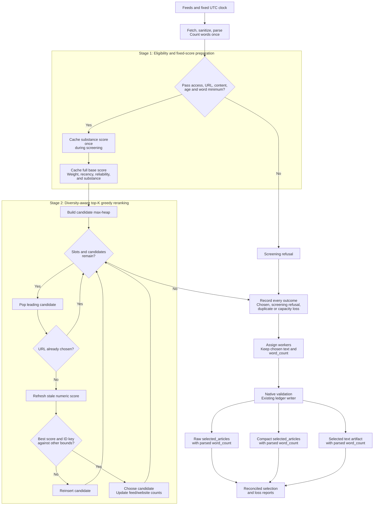

# Diversity-aware top-K greedy reranking

**Last Updated**: 2026-11-01
**Level**: 5 - selection design and current planner payloads.

## 0 - Operating contract

Table A

| Id | Field | Value |
| --- | --- | --- |
| A1 | Why this plan exists | Select the strongest available digest inputs without leaving article slots unused because of source allocations. K means the maximum number of articles to select. |
| A2 | In scope | Parse-time word-count reuse; cached substance scoring during screening; source-weight ranking; one global age policy; two-stage cached scoring and candidate-level lazy selection; complete losses; native contracts, input fingerprints, workflow controls and reports. |
| A3 | Chosen strategy | Follow the supplied scoring design and subsequent cache/weight instructions. Stage 1 prepares every eligible candidate's fixed numeric score; stage 2 uses a lazy max-heap with one entry per candidate. Do not substitute feed/website pair groups, equal-score lists or another optimizer. |
| A4 | Capacity contract | Select the smaller of K and the number of distinct eligible canonical URLs. Scores may be negative. No unstated minimum-score gate. |
| A5 | Current status | Design draft for refinement; application implementation has not started. The replacement includes the draft's article-shape rules, not an unchanged-score intermediate design. |
| A6 | Delivery | PRs are release units, not the work breakdown. Row 1 is the count-reuse PR; row 2 contains the eight implementation steps in Table N. Finish those steps on the same unmerged replacement branch, then release its contracts, readers, writers, scorer, selector, workflow and reports together. |
| A7 | Format rule | Current-only planner formats. Refuse older affected formats with diagnostics; preserve historical files unchanged. No conversions, bridges, dual readers, dual writers or legacy selector flags. |
| A8 | ESCALATE triggers | 1. A requested rule has two unresolved meanings. 2. A changing score could increase during selection. 3. A contract consumer outside the planner requires changes. 4. A new shared state store or runtime destination is proposed. 5. A scoring rule cannot be implemented from the declarations below. Do not replace or reject the supplied design to resolve one of these. |
| A9 | Execution | Execute per docs/how-to/execute-a-plan.md: one maintainer carries the plan and delegates a row where delegation pays; keep parallel N = 4 rows in flight, refilling a slot as soon as a worker returns and never waiting on a merge; consult a persona only where two answers would lead to different code; AUTO-merge on green gates; honor the ESCALATE triggers in section 0. AUTHOR-AND-STOP until the user authorizes. |
| A10 | Dispatch constraint | Row 2 consumes row 1's count. Table N declares its internal dependencies; these steps are not separately mergeable releases. Do not push a partial replacement or add a bridge to make one pass. Check named-file conflicts against work already in flight; do not edit the separate feed-health correction or either engineering-instruction file. |
| A11 | Source-tier rule | No source_tier/tier or applied_tier_weight is used to enroll, screen, score, rank, set quotas or fingerprint top-K inputs. Source authority comes from the configured source.weight through H16. Other subsystems may retain their catalog classifications. |
| A12 | Ledger word-count rule | The parser writes the count; selection copies that exact integer into every selected-article row. The existing native selected-row contract, raw Parquet and compact Parquet all require word_count. A missing count fails validation; no downstream recount, null fill or zero default. |
| A13 | Stage 1 in English | Read the configured feeds; fetch and sanitize article bodies; count the final body once. Apply access, URL, content, age and word-floor checks. For each survivor, calculate substance once during screening and attach it to freshness. Prepare and cache the full base score from source weight, recency, pass history and substance. |
| A14 | Stage 2 in English | Put every eligible candidate's cached score in the max-heap. Pop the leading candidate, skip an already-chosen URL, refresh only its current numeric diversity terms, and compare its complete key with the next cached upper bound. Reinsert if another candidate may outrank it; otherwise choose it and update only its feed/site counts. Repeat to the article limit or exhausted unique supply. |
| A15 | Delivery in English | Give every original unchosen candidate a duplicate or capacity loss. Derive metadata and original text from the same winners; assign workers without reranking. The existing TypeScript writer validates and writes the selected-article ledgers with the parsed count, then produces the text artifact and reconciled reports. |

Table B

| Id | Out of scope | Cost to leave it out | Condition to include it |
| --- | --- | --- | --- |
| B1 | A separately configured metadata top-M shortlist | The selected two-stage method is cached scoring followed by the lazy heap; cheap gates reduce N to eligible M without discarding that pool's tail. | An explicit instruction selecting the other coarse-shortlist pattern and defining its refill/tail behavior. Do not invent or forbid that variant. |
| B2 | A factual-quality model or semantic story deduplication | Shape scores do not verify facts; different URLs for the same story can remain. | A content-quality requirement, recorded evaluation inputs and an operator-controlled model destination. |
| B3 | Hard source concentration bounds or guaranteed topic coverage | A scarce pool can still produce one-source output; feed/site diversity is not topic diversity. | A defined coverage requirement and a decision about the resulting underfill. |
| B4 | Non-planner taxonomy, Python contracts and published-site redesign | Other readers can retain their own classification fields and format rules. | An identified affected consumer, not a shared field spelling alone. |
| B5 | Historical data rewriting or a new scoring ledger | Old affected planner files are unavailable to current readers; scores remain in existing selected output. | A different persistence requirement with its own cost and scope decision. |

### Complete stage flow



## 1 - Status Reckoner

Table C

| Id | # | Row title | Depends-on | Parallel-group | Status | Worktree | PR | Subagent |
| --- | --- | --- | --- | --- | --- | --- | --- | --- |
| C1 | 1 | Reuse the parsed word count | - | A | PENDING | - | - | - |
| C2 | 2 | Replace the complete selection design | 1 | B | PENDING | - | - | - |

## 2 - Row 1 - Reuse the parsed word count

- **Scope:** Count each extracted body once, reuse the winning body's count in parse output and extraction-quality checks, and preserve existing parse results.
- **Files touched:**
  - `services/feed-ingest-plan/src/harvest-feeds/dom-extractor.ts`
  - `services/feed-ingest-plan/src/harvest-feeds/extraction-quality.ts`
  - `services/feed-ingest-plan/test/harvest.test.ts`
  - `docs/architecture/sources/extraction-quality.md`
- **Acceptance gates:** Local: inspect the shared changed-test selection, run the service's declared type check and `harvest.test.ts`. Check the primary, fallback, empty, paywall and Unicode-whitespace recordings. CI: required checks on the complete PR candidate. Keep the named input and unchanged-result record for row 2.
- **Oracle:** The recorded parse cases retain identical text, word counts and extraction-quality results while every quality call receives the cached count. This proves output parity and the explicit count dependency, not a measured speed increase.

Table D

| Id | # | Decision | Authority |
| --- | --- | --- | --- |
| D1 | 1 | `word_count` is the authoritative count of the final sanitized body, produced during parse. Require it downstream; never calculate it again in screening or selection. | Stage ownership |
| D2 | 2 | Count the primary body once. If fallback produces a different body, count that body once, compare the cached values and retain the winner's count. | Existing fallback behavior |
| D3 | 3 | Pass the retained count into extraction-quality calculation instead of having that calculation call the word counter again. Do not add an optional recount fallback. | Single calculation |
| D4 | 4 | Independent corroboration remains an independent measurement. Do not replace its count with the extracted body's count or remove its contamination check. | Extraction trust boundary |
| D5 | 5 | Keep existing parsed payload meanings and shared extraction-quality fields unchanged in this structural PR. | Output parity |

Table E

| Id | # | Rejected alternative | Why rejected | Cost to take | Authority |
| --- | --- | --- | --- | --- | --- |
| E1 | 1 | Recount in every consumer | Repeats text work and allows count definitions to drift. | Additional body scans and another implementation to keep consistent. | Single calculation |
| E2 | 2 | Cache by text hash across articles | Adds retained state when one body's local count is enough. | Hashing, cache memory, lifetime rules and collision handling. | Smallest sufficient cache |

## 3. Mathematical Model & Scoring Specification

### A. Static Base Score (Computed Once per Candidate)

```math
\text{BaseScore}(d) = A(d) + R(d) + \Delta_{\text{pass}}(d) + Q(d)
```

#### 1. Source Authority Prior

```math
A(d) = \alpha \cdot w_{\text{feed}}
```

* `alpha`: Configured authority weight (default: `1.0`).
* `w_feed`: The configured `source.weight`. No source-tier or taxonomy multiplier.

#### 2. Continuous Recency

```math
R(d) = w_r \cdot \left(\frac{1}{2}\right)^{\frac{\max(0, \text{age\_hours})}{h}}
```

* `w_r`: Recency weight (default: `0.6`).
* `h`: Recency half-life (default: `18.0` hours).
* Age basis: Trusted published timestamp, or first-sight timestamp when published is unavailable.

#### 3. Technical Reliability Adjustment

```math
\Delta_{\text{pass}}(d) = -A(d) \cdot \left(1 - \max(f, p_s)\right)
```

* `f`: Reliability floor (default: `0.5`).
* `p_s`: 30-day technical pass rate of the feed. Incomplete/null history yields `0.0` for this calculation.

#### 4. Candidate Substance Quality

Designed to evaluate article depth without length or title bias:

```math
Q(d) = Q_{\text{bandpass}}(\text{words}) + Q_{\text{entity}}(\text{density}) - Q_{\text{hype}}(\text{headline})
```

**Length Guardrail (`Q_bandpass`):**

* Fewer than 250 words: Disqualified at screening.
* 250-399 words: Linear ramp from `0.0` to `1.0`.
* 400-1500 words: Flat full credit (`1.0`). Zero incentive to inflate word count.
* 1501-3000 words: Gradual decay from `1.0` down to `0.7`.
* More than 3000 words: Clamped at `0.5` (transcript/dump penalty).

**Factual Density (`Q_entity`):**

* Ratio of (Capitalized Multi-word Proper Nouns + Numerical Tokens) to (Total Sentences).
* Normalized between `0.0` and `0.30` score points. Factual, data-backed reporting scores high; speculative fluff scores near zero.

**Headline Hype Deduction (`Q_hype`):**

* Deducts up to `-0.25` points for:
  - Capitalization shouting: words in ALL-CAPS excluding known acronyms.
  - Exclamatory or sensational punctuation (`!!`, `?!`).
  - Curiosity-gap phrasing where headline keywords fail to appear in the opening text.

### B. Dynamic Marginal Score & Diversity Penalty

At step `t`, with already selected set `S_(t-1)`, the marginal score for an unselected candidate is:

```math
\begin{aligned}
\text{MarginalScore}(d) &= \text{BaseScore}(d) \\
&\quad - \text{Penalty}_{\text{domain}}(d, S_{t-1}) \\
&\quad - \text{Penalty}_{\text{feed}}(d, S_{t-1}) \\
&\quad + \text{Bonus}_{\text{novelty}}(d, S_{t-1})
\end{aligned}
```

#### 1. Quadratic Domain Penalty

```math
\text{Penalty}_{\text{domain}} = \lambda_{\text{domain}} \cdot \left[N_{\text{domain}}(d, S_{t-1})\right]^2
```

* `lambda_domain = 0.04`.
* `N_domain`: Number of articles already selected from the candidate's `website_group`.
* Scale effect: 1st article = `0.0`; 2nd = `-0.04`; 3rd = `-0.16`; 4th = `-0.36`; 5th = `-0.64`; 6th = `-1.00` score points.

#### 2. Quadratic Feed Penalty

```math
\text{Penalty}_{\text{feed}} = \lambda_{\text{feed}} \cdot \left[N_{\text{feed}}(d, S_{t-1})\right]^2
```

* `lambda_feed = 0.02`.
* `N_feed`: Number of articles already selected from the candidate's specific `feed_id`.

#### 3. Deterministic Novelty Bonus

```math
\text{Bonus}_{\text{novelty}} =
\begin{cases}
\beta_{\text{novelty}} & \text{if } N_{\text{feed}}(d, S_{t-1}) = 0 \\
0 & \text{otherwise}
\end{cases}
```

* `beta_novelty = 0.15`.
* Gives unrepresented feeds an initial boost so their best story can overcome the inertia of dominant sources.

## 4 - Row 2 - Replace the complete selection design

- **Scope:** Deliver the draft's scoring and eligibility with the requested cached-scoring/lazy-heap stages, converted current consumers and no obsolete planner allocation machinery.
- **Files touched:**
  - `config/feed-ingest-plan.json`
  - `config/feed-ingest-plan-service.json`
  - `packages/common-contracts/src/index.ts`
  - `packages/common-contracts/src/version.ts`
  - `packages/common-contracts/src/schemas/config.schema.ts`
  - `packages/common-contracts/src/schemas/policy.schema.ts`
  - `packages/common-contracts/src/schemas/source.schema.ts`
  - `packages/common-contracts/src/schemas/candidate.schema.ts`
  - `packages/common-contracts/src/schemas/event.schema.ts`
  - `packages/common-contracts/src/schemas/planner-stage.schema.ts`
  - `packages/common-contracts/src/schemas/planner-operation.schema.ts`
  - `packages/common-contracts/src/schemas/rejection.schema.ts`
  - `packages/common-contracts/src/schemas/rejected-article.schema.ts`
  - `packages/common-contracts/src/schemas/selected-article.schema.ts`
  - `packages/common-contracts/src/schemas/screened-article.schema.ts` (new)
  - `packages/common-contracts/test/config.test.ts`
  - `packages/common-contracts/test/rejection.test.ts`
  - `packages/common-contracts/test/article-identity-compatibility.test.ts`
  - `packages/common-contracts/test/schema-binding.ts`
  - `packages/ledger-file-writer/src/registration.ts`
  - `packages/ledger-file-writer/src/validate-planner-files.ts`
  - `packages/ledger-file-writer/test/planner-recordings.ts`
  - `packages/ledger-file-writer/test/parquet-parity.test.ts`
  - `services/feed-ingest-plan/package.json`
  - `services/feed-ingest-plan/bun.lock`
  - `services/feed-ingest-plan/src/article-freshness-policy.ts`
  - `services/feed-ingest-plan/src/config/resolve-policy.ts`
  - `services/feed-ingest-plan/src/config/resolve-run-policy.ts`
  - `services/feed-ingest-plan/src/config/service-settings.ts`
  - `services/feed-ingest-plan/src/harvest-feeds/load-harvest-inputs.ts`
  - `services/feed-ingest-plan/src/harvest-feeds/prepare-article.ts`
  - `services/feed-ingest-plan/src/load-plan-inputs.ts`
  - `services/feed-ingest-plan/src/resolve-planning-inputs.ts`
  - `services/feed-ingest-plan/src/screen-article-candidates/freshness-decay.ts`
  - `services/feed-ingest-plan/src/screen-article-candidates/screening-input.ts`
  - `services/feed-ingest-plan/src/screen-article-candidates/triage-gates.ts`
  - `services/feed-ingest-plan/src/screen-article-candidates/score-article-substance.ts` (new)
  - `services/feed-ingest-plan/src/curate-article-portfolio/editorial-selection.ts`
  - `services/feed-ingest-plan/src/curate-article-portfolio/select-diverse-articles.ts` (new)
  - `services/feed-ingest-plan/src/select-articles.ts`
  - `services/feed-ingest-plan/src/api/selection-operation.ts`
  - `services/feed-ingest-plan/src/api/plan-response.schema.ts`
  - `services/feed-ingest-plan/src/api/stage-response.schema.ts`
  - `services/feed-ingest-plan/src/api/persistence-operation.ts`
  - `services/feed-ingest-plan/src/partition-article-shards/shard-packer.ts`
  - `services/feed-ingest-plan/src/read-ledger-history/read-run-history.ts`
  - `services/feed-ingest-plan/src/read-ledger-history/read-publisher-publication.ts` (remove after its remaining exposure-only callers are converted)
  - `services/feed-ingest-plan/scripts/feed-ingest-plan-policy-report.ts`
  - `services/feed-ingest-plan/scripts/feed-ingest-plan-workflow-inputs.ts`
  - `services/feed-ingest-plan/scripts/feed-ingest-plan-verification.ts`
  - `.github/workflows/feed-ingest-plan-test.yml`
  - `services/feed-ingest-plan/test/triage.test.ts`
  - `services/feed-ingest-plan/test/curate.test.ts`
  - `services/feed-ingest-plan/test/run-policy.test.ts`
  - `services/feed-ingest-plan/test/policy.test.ts`
  - `services/feed-ingest-plan/test/harvest.test.ts`
  - `services/feed-ingest-plan/test/harvest-recordings.ts`
  - `services/feed-ingest-plan/test/plan-recordings.ts`
  - `services/feed-ingest-plan/test/partition-recordings.ts`
  - `services/feed-ingest-plan/test/file-baseline-recording.ts`
  - `services/feed-ingest-plan/test/ledger-history.test.ts`
  - `services/feed-ingest-plan/test/feed-reliability.test.ts`
  - `services/feed-ingest-plan/test/article-source-outcome.test.ts`
  - `services/feed-ingest-plan/test/history-window.test.ts`
  - `services/feed-ingest-plan/test/request-report.test.ts`
  - `services/feed-ingest-plan/test/plan-entry-points.test.ts`
  - `services/feed-ingest-plan/test/plan-api.test.ts`
  - `services/feed-ingest-plan/test/plan-engine.test.ts`
  - `services/feed-ingest-plan/test/file-baseline.test.ts`
  - `services/feed-ingest-plan/test/feed-ingest-plan-report.test.ts`
  - `services/feed-ingest-plan/test/feed-ingest-plan-workflow.test.ts`
  - `services/feed-ingest-plan/test/substance-score.test.ts` (new)
  - `services/feed-ingest-plan/test/diverse-selection.test.ts` (new)
  - `tests/fixtures/feed-ingest-plan/portfolio-cases.json`
  - `tests/fixtures/feed-ingest-plan/diverse-selection-cases.json` (new)
  - `tests/fixtures/feed-ingest-plan/entry-points/response.json`
  - `tests/fixtures/feed-ingest-plan/entry-points/selected-articles.json`
  - `tests/fixtures/feed-ingest-plan/entry-points/selected-articles.rows.json`
  - `tests/fixtures/feed-ingest-plan/entry-points/rejected-articles.rows.json`
  - `tests/fixtures/ledger-file-writer/feed-ingest-dispatch-row.json`
  - `tests/fixtures/ledger-file-writer/dispatch-arrow-schema.json`
  - `docs/architecture/sources/feed-curation.md`
  - `docs/architecture/sources/article-substance-scoring.md` (new with the real scorer)
  - `docs/architecture/sources/feed-plan-runner.md`
  - `docs/architecture/sources/feed-partitioning.md`
  - `docs/reference/feed-planner-ledgers.md`
- **Acceptance gates:** Local: use the selection and native checks in Table M; run numerical, schema and real loopback integration cases together by package. Validate actual Parquet fields, identifiers and canonical digests. Inspect one actual operator policy/selection report against the design requirements. CI: required complete merge-candidate suite once. Do not dispatch the data-committing live workflow as a test gate.
- **Oracle:** Against bounded recorded/generated inputs, each heap winner equals the draft's highest remaining full-scan greedy key, and every parsed candidate has one terminal outcome. Read back raw and compact selected rows and prove each word_count equals its chosen parsed candidate's count. This proves the specified winner sequence, capacity, accounting and count delivery, not global optimality or factual verification.

### Decisions and declared contracts

Table F

| Id | # | Decision | Authority |
| --- | --- | --- | --- |
| F1 | 1 | Use cheap eligibility checks on all parsed candidates, then score only their survivors in the same screening loop. N is the parsed count; M is the survivor count, not a configured multiple of K. | Exact capacity contract |
| F2 | 2 | The screening output requires a finite `ScreenedCandidate.freshness.substance_score`. Declare timing evidence and this extended screening evidence in the native schema; infer service types from it. No missing-score default. | Native contract |
| F3 | 3 | The numerical selector receives only identities, fixed numeric components and the derived website identity. It has no article-text input. The adapter creates one numerical record per survivor and joins chosen identities back to original content afterward. | Stage separation |
| F4 | 4 | Authority is the configured authority coefficient times `source.weight`. Equal configured feed weights provide uniform weighting through the same path. No taxonomy multiplier. | Source-weight design |
| F5 | 5 | Remove the planner's taxonomy read, source-tier activation/coverage gates and taxonomy contribution to its fingerprint. Feed lifecycle status still controls enrollment. Leave the shared taxonomy file and its non-planner readers unchanged. | Tier-independent planner |
| F6 | 6 | Apply the same global age envelope before download where age is known, and during screening. Use the original captured UTC evaluation clock; preserve trusted publication, first-sight fallback, signed future ages and unknown-age evidence. Unknown age receives no recency contribution, not a fabricated age. | Existing time evidence |
| F7 | 7 | Compile the configured text matchers once per screening invocation. Use the parsed word count and calculate the name/number and headline contributions once for each survivor. Never recount words or repeat text analysis in heap refreshes. | Cached screening |
| F8 | 8 | H19 declares the draft's complete cached and persisted base score. H24 adds only current diversity terms to it. Static adjustment entries are a breakdown of terms already in base, not another addition to marginal. Change this field meaning in the current native format; do not keep a legacy base convention. | Draft score decomposition |
| F9 | 9 | Follow the draft's pass calculation: use zero as the scoring input when measured history is missing/incomplete, then apply the configured floor. Observed history itself stays unavailable. Use the draft's adjustment term rather than introducing a different unknown-history score or term. | Draft reliability arithmetic |
| F10 | 10 | Use current-run website and feed counts, with the draft's absolute count-squared penalties. Remove normalized shares and current-day publisher-exposure ranking. Already-published URL checks remain. | Replacement diversity rule |
| F11 | 11 | The first-use bonus means an unrepresented feed in this selection, not a new story or a reserved exploration slot. | Accurate meaning |
| F12 | 12 | Preserve the original admitted array for terminal accounting. Remove duplicate carriers only from the working heap, not this array. Increment global counters only after committing the winner. | Complete accounting |
| F13 | 13 | Update affected native stamps, changelogs, consumers and row-version mappings together. Source snapshots occur in candidates, feed offers, feed outcomes and parsed batches. Check their enclosing private snapshots and receipts by declared model. A fetched-document body names a feed but does not embed its source snapshot; do not change its stamp for this reason alone. | Current-only cutover |
| F14 | 14 | Re-record current fixtures using the real API and writer. Keep bounded older-format refusal fixtures unchanged; never transform stored historical ledgers. | Current output proof |
| F15 | 15 | Delete retired mechanisms rather than deprecating them. There is no existing upward-transfer engine to remove; that was an earlier proposal, not current behavior. | Verified implementation |
| F16 | 16 | Treat the initial article-shape and penalty coefficients as policy defaults, not calibrated quality measurements. They implement preferences, not clickbait or monopoly guarantees. | Measurement boundary |
| F17 | 17 | Sections 3.A/3.B define the mathematical model. Tables G/H resolve its configuration, exact integer endpoints and lexical measurements; they must implement this model, not replace it. Table O checks draft coverage, Table P gives derived examples and Table N assigns work. No worker chooses a different curve, sign or stopping rule. | Complete implementation specification |

### Policy declarations

Table G

| Id | Config path under `curate_articles` unless stated | Formula symbol | Default and meaning | Validation |
| --- | --- | --- | --- | --- |
| G1 | `article_limit` | `K` | 100 maximum selected articles | Positive integer |
| G2 | `global_age_ceiling_hours` | `ageCeiling` | 36 hours of eligible age for every feed | Positive finite hours; one optional run override and one reported origin |
| G3 | `source_authority_weight` | `alpha` | 1.0 score-point scaling of configured feed weight | Finite, nonnegative |
| G4 | `source_reliability_penalty_enabled` | `passEnabled` | True: apply the technical article-pass adjustment | Boolean |
| G5 | `source_reliability_floor` | `f` | 0.5 minimum retained authority fraction | Finite fraction from zero through one |
| G6 | `recency.weight`, `recency.half_life_hours` | `w_r`, `h` | 0.6 maximum recency points; 18 hours to halve that contribution | Nonnegative finite weight; positive finite hours |
| G7 | `diversity.lambda_domain` | `lambda_website` | 0.04 points per squared prior website-group count | Finite, nonnegative |
| G8 | `diversity.lambda_feed` | `lambda_feed` | 0.02 points per squared prior feed count | Finite, nonnegative |
| G9 | `diversity.novelty_bonus` | `beta` | 0.15 points before a feed's first selected article | Finite, nonnegative |
| G10 | `website_grouping.include_private_suffixes` | - | True: retain the configured private-suffix grouping policy | Boolean; grouping recomputed from canonical URLs |
| G11 | `substance.word_count_min_ramp` | `minWords` | 250 words: inclusive screening floor and start of the short-article ramp | Positive integer; the single authority for both checks |
| G12 | `substance.word_count_target_min`, `substance.word_count_target_max` | `targetMin`, `targetMax` | 400 through 1,500 words: full length credit | Integers; targetMin >= minWords + 2 and targetMax >= targetMin |
| G13 | `substance.word_count_plateau` | `plateauWords` | 3,000 words: last word count in the long-article decline | Integer; plateauWords >= targetMax + 2 |
| G14 | `substance.length_scores.minimum`, `.full`, `.decline_end`, `.above_plateau` | `lengthMinimum`, `lengthFull`, `lengthDeclineEnd`, `lengthAbove` | 0.0, 1.0, 0.7 and 0.5 length points respectively | Finite nonnegative levels; minimum <= decline_end <= full and above_plateau <= decline_end |
| G15 | `substance.entity_density_weight` | `densityWeight` | 0.30 maximum name/number-density points | Finite, nonnegative |
| G16 | `substance.entity_density_full_credit` | `densityFull` | 1.0 counted name/number signal per sentence reaches full density credit; provisional default, not factual calibration | Positive finite signal density |
| G17 | `substance.headline_hype_penalty` | `hypeCap` | 0.25 maximum headline deduction | Finite, nonnegative magnitude |
| G18 | `substance.headline.shouting_weight`, `.punctuation_weight`, `.opening_mismatch_weight` | `hShouting`, `hPunctuation`, `hOpening` | 0.10, 0.10 and 0.05 deduction points for the three headline flags; provisional split | Finite, nonnegative; total deduction clamped by G17 |
| G19 | `substance.headline.opening_text_max_characters`, `.keyword_min_letters` | - | Inspect at most 2,000 opening Unicode characters; significant headline words have at least four letters | Positive integers |
| G20 | `substance.headline.shouting_min_letters` | - | At least two letters in a shouting token | Positive integer |
| G21 | Existing `collect.reliability_window_days` in `config/idhazh.json`, outside curation | `passWindow` | Retain the 30-day technical-history setting; no second curation window or fabricated complete history | Positive integer; retain its existing evidence-completeness rules |

Table H

| Id | Rule | Exact behavior |
| --- | --- | --- |
| H1 | Short-article length equation | With `w = candidate.word_count`, reject at screening if `w < minWords`. For `minWords <= w < targetMin`, `Q_length = lengthMinimum + (lengthFull - lengthMinimum) * (w - minWords) / (targetMin - 1 - minWords)`. For `targetMin <= w <= targetMax`, `Q_length = lengthFull`. Do not change the inclusive endpoints or use targetMin as the ramp denominator. |
| H2 | Long-article length equation | For `targetMax < w <= plateauWords`, `Q_length = lengthFull + (lengthDeclineEnd - lengthFull) * (w - targetMax - 1) / (plateauWords - targetMax - 1)`. For `w > plateauWords`, `Q_length = lengthAbove`. The first count after targetMax has full credit; the default drop after plateauWords is deliberate. |
| H3 | Sentence units | Reuse the existing extraction sentence-boundary convention through a configured `substance.sentence_separator_pattern`, default `(?<=[.!?])\s+`; count nonempty units, including the final unterminated unit. This is a lexical measurement, not a language-understanding claim. |
| H4 | Name signals | `substance.proper_name_pattern` counts each non-overlapping span of two or more capitalized words once. Default Unicode pattern: `(?<![\p{L}\p{N}_])\p{Lu}[\p{L}\p{M}'-]*(?:[ \t]+\p{Lu}[\p{L}\p{M}'-]*)+(?![\p{L}\p{N}_])`. |
| H5 | Numeric signals | `substance.numeric_token_pattern` counts non-overlapping numeric tokens once. Default Unicode pattern: `(?<![\p{L}\p{N}_])[+-]?\d+(?:[.,]\d+)*(?:%)?(?![\p{L}\p{N}_])`. |
| H6 | Density equation | Let `names` and `numbers` be H4/H5 hit counts and `sentences` be H3's count. `density = sentences == 0 ? 0 : (names + numbers) / sentences`. `Q_entity = densityWeight * min(1, max(0, density / densityFull))`. No units means no density contribution, not a claim of zero factual content. G16 explicitly supplies the normalization missing from the draft. |
| H7 | Headline tokens | `substance.headline.token_pattern`, default `[\p{L}\p{M}\p{N}]+`, supplies tokens. Case-fold with Unicode lowercase for keyword comparison; preserve case for shouting detection. |
| H8 | Acronyms and stop words | The draft's acronym exception prevents normal uppercase abbreviations from becoming a shouting penalty. Stop words are a keyword-matching detail: common grammar words must not count as topic evidence when comparing the headline with the opening. They add no score term. Initial `substance.headline.acronyms`: AI, ML, CPU, GPU, GDP, CPI, USD, EUR, GBP, API, HTTP, HTTPS, JSON, XML, RSS, HTML, PDF. Initial `.stop_words`: a, an, the, and, or, but, for, nor, so, yet, as, at, by, in, of, on, to, with, from, into, is, are, was, were, be, been, this, that, these, those. |
| H9 | Shouting flag | At least one letter-bearing token meets G20, equals its uppercase form, differs from its lowercase form and is not in H8's acronym list. |
| H10 | Punctuation flag | Any configured `substance.headline.punctuation_patterns` match; defaults are `!{2,}`, `\?!` and `!\?`. Each headline flag is one or zero and contributes once, not once per match. |
| H11 | Opening mismatch flag | At least one non-stop-word headline token contains G19's minimum number of Unicode letters, but none appears as a complete normalized token in the bounded opening text. Count letters, not digits or UTF-16 units. No significant tokens means no mismatch deduction. |
| H12 | Headline and final substance equations | Let `shouting`, `punctuation` and `openingMismatch` be H9/H10/H11's one-or-zero flags. `Q_hype = min(hypeCap, hShouting * shouting + hPunctuation * punctuation + hOpening * openingMismatch)`. `Q = Q_length + Q_entity - Q_hype`. Q_hype is a nonnegative magnitude, never a negative value subtracted twice. Q is signed and not a probability; its default range is -0.25 through 1.30 points. |
| H13 | Regex handling | Validate and compile trusted config patterns at load/screening entry. Use Unicode matching and non-overlapping hit enumeration; reset mutable regex state between candidates. Invalid patterns fail by field name, never by substituting a zero score. |
| H14 | Reliability arithmetic | `p_for_scoring = p == null ? 0 : p`. With authority A, `passAdjustment = -A * (1 - max(f, p_for_scoring))`. If the adjustment is disabled, use zero adjustment. This is the draft's incomplete-history scoring rule; it does not turn unavailable observed history into a measured zero. |
| H15 | Timing and eligibility equations | `T` is the parsed batch's captured UTC evaluation instant in milliseconds. Use trusted publication within the existing `collect.max_future_hours` tolerance; otherwise use recorded first sight; otherwise timing is unavailable. With effective instant `t`, `ageHours = (T - t) / MILLISECONDS_PER_HOUR`, where this named unit constant is 3,600,000 milliseconds per hour. Admit age when it is unavailable or `ageHours <= ageCeiling`. Preserve signed ages and the existing publication-trust rule. |
| H16 | Authority equation | `A(d) = alpha * d.source.weight`. The removed taxonomy weight is not another factor. Each configured feed weight remains in the unit interval; equal weights use this same equation. |
| H17 | Recency equation | `R(d) = ageHours == null ? 0 : w_r * (0.5 ** (max(0, ageHours) / h))`. Use H15's original age and G6's coefficients. Unknown age remains null; near-future timing cannot increase R above w_r. |
| H18 | Technical pass fraction | For the feed's complete G21 window, `p = passed / (passed + refused)`. Count only original captures passing technical checks and known source-attributed technical refusals. Do not count publication, age, category, content-policy or selection losses. Missing coverage or a zero denominator gives an unavailable p, not measured zero. H14 uses `f = G5`; if G4 is false its adjustment is zero. |
| H19 | Draft base score and cache | `BaseScore = ((A + R) + passAdjustment) + Q`. Cache it once from screening evidence and captured history; persist `ratings.base_article_score = BaseScore`. `feed_authority_score = A`; `recency_score = R`. No component changes after heap setup. This replaces the older field meaning rather than preserving it through a bridge. |
| H20 | Counts before a choice | `S` is the already-chosen population, excluding the next winner. `n_feed(d,S)` counts S members with d.feed_id; `n_website(d,S)` counts S members with d.website_group. Both maps are global across the candidate pool. Missing website identity has no counted key. Counts start at zero and change only under I6. |
| H21 | Website penalty equation | For a known website, `P_website = lambda_website * (n_website ** 2)` and its signed adjustment is `-P_website`. For unavailable website identity use numeric P_website zero and retain a null adjustment. Do not divide by K or the current selected count. |
| H22 | Feed penalty equation | `P_feed = lambda_feed * (n_feed ** 2)`; its signed adjustment is `-P_feed`. The first article has zero penalty because the count is measured before the choice. |
| H23 | First-use bonus equation | `B_feed = n_feed == 0 ? beta : 0`. This bonus disappears after the feed's first unique-URL winner; skipped duplicate carriers do not remove it. |
| H24 | Marginal score equation | `M(d,S) = ((BaseScore - P_website) - P_feed) + B_feed`. Evaluate in this order with native finite numbers; reject a non-finite result explicitly. The score is not clamped to zero, rounded for ranking, normalized by selected size or recomputed from text. |
| H25 | Complete ordering key | `key(d,S) = (M(d,S), d.candidate_id)`. Greater numeric M wins; exactly equal M uses the smaller candidate_id under direct ASCII comparison. No tolerance or display rounding defines a tie. Retain one key per candidate; do not replace this with static-score pair ordering. |
| H26 | Capacity equation | Let `U = size(set(admitted.map(d => d.url_key)))`. The chosen count is `K_chosen = min(K, U)`. This is a maximum unique-URL count, not a source reservation or a positive-score threshold. Exhaustion means no remaining unchosen, unseen-URL candidate. |
| H27 | Accounting equation | Parsed identities are the disjoint union of screening rejections and admitted identities. Admitted identities are the disjoint union of chosen identities, duplicate-carrier losses and capacity losses. Thus `parsed_count = screening_rejections + chosen_count + duplicate_losses + capacity_losses`. Use original arrays, not only the survivors left inside queue working lists. |

### Heap and output contracts

Table I

| Id | Contract | Required behavior |
| --- | --- | --- |
| I1 | Candidate membership | One numerical record per eligible original candidate, including distinct carriers of the same URL. Preserve the complete admitted array outside the heap. Keep original text in the owning stage, not in numerical records. |
| I2 | Initial keys | Evaluate H20-H25 once with empty counts for every record, using cached BaseScore rather than article text. Bulk-initialize the library's max-heap from these complete keys; do not sort into feed/site groups or prune to K entries. |
| I3 | Heap entry | One candidate entry containing its numerical record, last evaluated score/terms, complete key and selection-step number. A stale key is an upper bound for this candidate. There is no queue ceiling or fixed ranked shortlist. |
| I4 | Refresh | Pop the heap root and discard an already-chosen identity or URL before scoring. If its step is stale, evaluate H20-H25 using current global counts and mark it current. Choose only if its complete key outranks or equals the remaining root's cached bound; otherwise reinsert it. A current entry needs no repeat calculation while S is unchanged. |
| I5 | Bounds | BaseScore and candidate identity are fixed. Counts only increase, penalties have nonnegative coefficients, and a first-use bonus can only disappear. Each candidate's score and complete key therefore cannot improve. Its previous key is a valid upper bound; comparing the refreshed key with the greatest other bound proves the same winner as full-scan greedy. Fail explicitly on a non-finite computed score. |
| I6 | Commit | Commit the popped, freshly evaluated winner, not the last candidate inspected. Record its exact terms, add its URL/identity, then increment its feed count and any known website count. Do not reinsert the winner. Other entries become stale because the chosen count increased. Skipped duplicate carriers change no counts and consume no slot. |
| I7 | Completion | Continue to A4's count even when all scores are negative. Preserve all original identities for one final loss pass; duplicate-of-selected-URL takes precedence over capacity loss. |
| I8 | Draft adjustment terms | Use exactly `article_pass_rate`, `substance_quality_score`, `domain_diversity_penalty`, `feed_diversity_penalty` and `novelty_bonus`. The screening cache remains named `freshness.substance_score`; its ledger breakdown term is the draft's `substance_quality_score`. Use the same article-pass term for known, unavailable and disabled history, with H14's numeric value. Values are signed; an unavailable website term is null and contributes numeric zero. |
| I9 | Required selected word count | Add required `word_count: CountSchema` to the shared MetadataFields in `packages/common-contracts/src/schemas/selected-article.schema.ts`. This non-null integer belongs to SelectedArticleMetadataSchema, SelectedArtifactArticleSchema and SelectedArticleRowSchema. Copy candidate.word_count through selectedArticleMetadata, API/stage payloads, partition and both raw and compact selected_articles ledgers. No optional value, recount, null fill or default. Preserve the other retained identities, text, timing, raw weight and work fields. |
| I10 | Retired source/selected fields | Remove `tier` and `applied_tier_weight` from planner source snapshots and selected metadata; remove `feed_limit`, `exploration_slot` and `cap_relaxations` from selected projections. Shared catalog fields that other products read are not replacement planner inputs. |
| I11 | Retired configuration | Remove `source_based_quality_buckets`, `soft_caps`, `mmr_weights`, `exploration_slot_share`, per-tier age overrides and their helpers. Move recency to G6; remove the separate triage word minimum in favor of G11. No old-key aliases. |
| I12 | Active loss causes | Duplicate carrier: `REJECTED_DUPLICATE_CANONICAL_CARRIER`; eligible but unchosen: `REJECTED_GLOBAL_CAPACITY_REACHED`; global age refusal: `REJECTED_SCREENING_AGE_CEILING`. Retain the other safety/content causes and actual stage attribution. Remove retired quota/ladder/cap reasons from active producers and their enum. |
| I13 | Output projection | Derive metadata and the text artifact from the same chosen population. Join by chosen candidate identity, not the first matching URL. Partition assigns it without reranking or changing text/count. The existing native writer's raw and compact row projections both retain I9; prove this from actual Parquet readback, not schema presence alone. |
| I14 | Diagnostic counts | Expose actual `heap_entry_count`, `score_refreshes` and `heap_pops` in the selection report, without a new ledger. The entry count is initial eligible M; refreshes count I4's stale numeric reevaluations, excluding initialization and duplicate discards; pops count every removal attempt. Reports replace quota tables with global policy, eligible/unique supply, selected count and reconciled terminal losses. |
| I15 | Input digest | Hash only the validated inputs this planner uses. Include the effective scoring policy and source weights; exclude the removed registry input. Preserve existing exclusion of reporting-only settings. |
| I16 | Exact numeric ties | Keep H25's complete score/ASCII-ID key on each candidate. If unequal base scores round to an equal marginal score after penalties, the smaller ID still wins. Apply that same comparator to heap bounds and refreshed entries; no grouped tie resolver, tolerance or score quantization. |
| I17 | Score projection order | Write signed adjustments in I8's order. Reconstruct base as `((feed_authority_score + recency_score) + article_pass_rate) + substance_quality_score`. Reconstruct marginal as `((base_article_score + domain_diversity_penalty) + feed_diversity_penalty) + novelty_bonus`, treating null domain as zero. Static adjustments already belong to base; never add all five adjustments to it. |
| I18 | Numerical input/output | The numerical input record contains only `candidate_id`, `url_key`, `feed_id`, `website_group` and `base_score`, the H19 cache. Validate finite base and identity fields; infer service types from the native declaration. Output is an ordered list of chosen identities with H24's numeric score and H21/H22/H23's terms. The adapter retains other cached components and original content for I9/I17 projection. |

#### Reference greedy sequence

```text
Inputs: all admitted numerical records, effective policy.
State: chosen = [], chosen_ids = {}, seen_urls = {},
       feed_counts = {}, website_counts = {}.
Map lookups for a not-yet-selected feed or known website return count zero.
evaluate(record, state) means precisely H20-H25, never text analysis.
ahead(left, right) means the complete ordering rule in H25.

while chosen.length < K:
    best = null
    for record in all_admitted_records:
        if record.candidate_id in chosen_ids or record.url_key in seen_urls:
            continue
        evaluated = evaluate(record, state)
        if best is null or ahead(evaluated.key, best.key):
            best = { record, evaluated, key: evaluated.key }
    if best is null:
        break
    append best to chosen
    add best.record.candidate_id to chosen_ids
    add best.record.url_key to seen_urls
    increment feed_counts[best.record.feed_id]
    if best.record.website_group is known:
        increment website_counts[best.record.website_group]

losses = []
for record in all_admitted_records:
    if record.candidate_id in chosen_ids:
        continue
    if record.url_key in seen_urls:
        append duplicate-carrier loss for record to losses
    else:
        append capacity loss for record to losses
return chosen, losses
```

#### Candidate-level lazy sequence

```text
Inputs and chosen/count state are the same as the reference sequence.
For each original admitted record, evaluate(record, empty chosen state).
Bulk-initialize a max-heap with:
    { record, evaluated, bound_key: evaluated.key, step: 0 }
Order bound_key by H25, not by insertion order or internal array position.
heap_entry_count = number of admitted numerical records
score_refreshes = 0
heap_pops = 0

while chosen.length < K and heap is not empty:
    entry = heap.pop()
    increment heap_pops
    if entry.record.candidate_id in chosen_ids
       or entry.record.url_key in seen_urls:
        continue

    if entry.step != chosen.length:
        evaluated = evaluate(entry.record, state)
        increment score_refreshes
        entry = { record: entry.record, evaluated,
                  bound_key: evaluated.key,
                  step: chosen.length }

    other = heap.peek()
    if other exists and ahead(other.bound_key, entry.bound_key):
        heap.push(entry)
        continue

    winner = entry
    append winner to chosen
    add winner.record.candidate_id to chosen_ids
    add winner.record.url_key to seen_urls
    increment feed_counts[winner.record.feed_id]
    if winner.record.website_group is known:
        increment website_counts[winner.record.website_group]

Produce losses by the reference sequence's final original-record pass.
```

Table J

| Id | Cost | Meaning and limit |
| --- | --- | --- |
| J1 | Screening | One cheap pass over N parsed candidates, plus text-rule work over M survivors. Parsing all fetched bodies has already happened; this change does not claim to avoid their download or parse cost. |
| J2 | Setup | Stage 1 caches fixed numeric scores in `O(M)` after screening's text work; the library's bulk heap initialization is also `O(M)`. No pair sort, equal-score-list build or repeated body analysis. |
| J3 | Selection | Stage 2 performs constant-size numeric refreshes and logarithmic heap operations. Let K' be the chosen count, D discarded duplicate carriers and R stale score refreshes. Cost is `O((K' + D + R) * log(M + 1))`. The requested `O(K log N)` target applies when D + R scales with K, not as an unconditional worst-case bound: up to M entries can need refresh at each choice. Account for refreshes explicitly; do not change the draft's winner sequence to claim a lower bound. |
| J4 | Space | `O(M)` candidate entries/references and bounded per-pool count maps; original article text remains in the owning stage. |
| J5 | Queue dependency | `heap-js` 2.7.1 supplies the typed priority queue. One pure-JavaScript service dependency, no runtime dependency chain, native build, model download or browser bundle. Update only the service manifest and lockfile. |
| J6 | Exactness | The same sequence as deterministic full-scan greedy, not a globally optimal set. Soft count penalties discourage repetition but do not guarantee a publisher or topic share. |

### Required bounded checks

Table K

| Id | Case | Failure it must expose |
| --- | --- | --- |
| K1 | At least 100 distinct eligible URLs from one feed/website | Any remaining quota, hard cap, negative-score stop or hidden shortlist leaves slots unused. |
| K2 | Six candidates; five share a feed/site with weight 1.0, the sixth has another feed/site with weight 0.99; choose two | Initial base ordering must not remain final ordering. With recency 0.6, substance 1.0 and reliability disabled, the next repeat scores 2.54 while the alternative scores 2.74. The lazy heap must select the alternative. |
| K3 | K2's first five instead carry one URL with distinct offered ordinals | Duplicate carriers must not consume capacity, counts or the first-use bonus. Preserve all original identities and fill both slots from distinct URLs. |
| K4 | Repeated ties, negative scores and changed input order | Any insertion-order or locale dependence; any accidental minimum-quality rejection. |
| K5 | A feed spans several websites; a website spans several feeds; missing website identity | Counters isolated to candidate pairs or a synthetic shared null website produce incorrect winners. |
| K6 | Duplicate entry encountered before the final pick, and winner not last scanned | Lost rejection records, wrong winner counters or wrong content joins. |
| K7 | Cheap-gate failures and length boundaries | Failed candidates receive no text-score work; inclusive floor and all ramp/decline/cliff endpoints match H1/H2. |
| K8 | Name/number hits, abbreviations, shouting, ordinary acronyms, punctuation and opening overlap | Sign errors, reused global regex state, substring false matches and headline deduction exceeding its configured cap. These are rule checks, not quality calibration. |
| K9 | Known zero rate, unavailable history, disabled adjustment and opposing RSS ratios | H14's scoring input replaces measured-history evidence, the draft's article-pass term is renamed, or RSS history replaces article-pass evidence. |
| K10 | Change only catalog tier data; change each retained coefficient separately | Taxonomy still affects planner eligibility/hash/ranking, or a tunable has no actual consumer. |
| K11 | One feed/site, distinct equal-base candidates and 100 choices | Instrument the real heap: all candidates start as entries; stale numeric refreshes/pops reconcile with I14. No text rescoring, pair grouping or claimed fixed refresh count. Compare every winner with the reference; no mocked scorer. |
| K12 | Real screening -> selection -> partition -> native output | Read raw and compact Parquet and the text artifact; every selected word_count must be a required integer equal to the chosen parsed count, including duplicate carriers with different bodies/counts. Expose lost cache, count omission, changed text, missing losses or wrong health totals. |
| K13 | Current replay and one named older-format refusal per changed family | A reader/writer date mapping disagrees, a digest is invalid, or an old-format bridge remains. |
| K14 | Two distinct base values rounding to the same marginal value under a shared penalty | Comparing only base numbers or ignoring the ID in a stale-bound comparison selects the wrong winner. Table P gives the bounded example. |
| K15 | Every derived example in Table P and each changed scoring knob | Missing exponent, denominator, clamp, floor, sign, adjustment order or actual configured reader. Numeric checks use the fixture's declared tolerance; winner comparisons never use that tolerance. |

### Rejected alternatives

Table L

| Id | # | Option | Why rejected | What it would cost to take | Authority |
| --- | --- | --- | --- | --- | --- |
| L1 | 1 | Substitute a different optimizer for the requested lazy heap | Changes the chosen implementation instead of completing the supplied design. | A separate design instruction; pair grouping and its extra tie machinery are not part of this plan. | Draft and subsequent algorithm input |
| L2 | 2 | Recompute every remaining score after every choice in production | Does not apply the requested lazy-heap refinement. | `O(M * K')` numeric evaluations after caching; retain full-scan greedy only as the test reference for winner equivalence. | Two-stage lazy selection |
| L3 | 3 | Keep normalized website shares | Selecting another website can reduce the penalty, so a cached score is no longer an upper bound. | Replace the lazy-bound proof and queue updates, or retain full rescoring. | Monotone score requirement |
| L4 | 4 | Dual selector, feature switch or old-schema adapter | Leaves two production implementations for one replacement. | Another behavior matrix, activation/removal process and format handling. | Single cutover |
| L5 | 5 | Preserve the old base meaning or add static terms to full base again | Either disagrees with the draft's BaseScore or double-counts substance/reliability. | One explicit versioned meaning and reader conversion under I17, without a bridge. | Draft arithmetic contract |
| L6 | 6 | Keep unused tier registry or daily publisher-exposure inputs | Maintains reads, eligibility constraints and fingerprints for removed ranking behavior. | A named remaining planner consumer and its own purpose. Publication-URL safety history is not this rejected input. | Smallest used input set |
| L7 | 7 | More elaborate language analysis before delivering the rules | The current task asks for configured lexical measurements, not a new quality model. | A mature language-analysis dependency, its service footprint and recorded cases proving a needed improvement over the defined patterns. | Scoped heuristic implementation |
| L8 | 8 | Live workflow dispatch as the merge gate | The workflow publishes committed data and is not a repeatable fixture check. | A separately named production observation and handling of real published output. | Repeatable native gates |

### Local and delivery gates

Table M

| Id | Gate | Named command or requirement |
| --- | --- | --- |
| M1 | Selection | From the repository root: `npm --prefix .\frontend run test:changed -- --list`. Inspect the selected inputs; do not execute Python-backed groups as a planner prerequisite. |
| M2 | Types | Run `bun run --cwd .\packages\common-contracts check`, `bun run --cwd .\packages\ledger-file-writer check` and `bun run --cwd .\services\feed-ingest-plan check`. |
| M3 | Numeric/schema cases | Common package: `config.test.ts`, `rejection.test.ts`, `article-identity-compatibility.test.ts` and its declared schema-binding command. Service: `harvest.test.ts`, `triage.test.ts`, `run-policy.test.ts`, `curate.test.ts`, `substance-score.test.ts`, `diverse-selection.test.ts`. Combine cases in one declared runner invocation per package. |
| M4 | Integration | Service: `plan-entry-points.test.ts`, `plan-api.test.ts`, `plan-engine.test.ts`, `file-baseline.test.ts`, `feed-ingest-plan-report.test.ts`, `feed-ingest-plan-workflow.test.ts`, plus changed named history/accounting callers from the selector. Writer: `parquet-parity.test.ts`. Use actual recorded inputs, loopback APIs and Parquet bytes. |
| M5 | Fixture renewal | Use the existing entry-point recording mechanism only when updating the current recordings, then unset its capture switch. Revalidate recorded model fields and real writer output; no data conversion utility. |
| M6 | Operator report | Inspect one actual generated policy/selection report: global age and article count are explained, raw weights are distinguished from shape scores, losses reconcile, and retired controls are absent. Review the changed operator surface with Susan before merge; no published-site/browser expansion for this backend-only change. |
| M7 | Canonical documentation | Curation owns selection and diversity; the new substance page owns lexical rules; extraction owns parse measurements; the ledger reference owns field disposition and format refusal. Remove stale rejection-migration wording and obsolete allocation claims in place. |
| M8 | Final candidate | Required CI passes on the complete candidate. Record exact revision, named selections and results; do not repeat unchanged worker checks. No historical state edits, instruction-file edits, debugging markers or unsynchronized lockfiles. |

### Implementation steps inside the replacement release

Table N

| Id | Step | Depends-on | Deliverable and exact ownership | Completion check |
| --- | --- | --- | --- | --- |
| N1 | Declare native contracts and effective policy | Row 1 | Declare every G/H input and I18's numeric projection before logic. Change the existing config, source, candidate, event, stage, rejection and selected schemas under `packages/common-contracts/src/schemas/`; add `packages/common-contracts/src/schemas/screened-article.schema.ts`; update `packages/common-contracts/src/index.ts`, `packages/common-contracts/src/version.ts` and `config/feed-ingest-plan.json`. Declare tier removals, the full base-score meaning and I9's required word_count on shared metadata, artifact and selected row; update affected current-only dates/changelogs. | Named schema cases reject missing/null/noninteger word_count, obsolete tier fields and older formats; validate finite scores and ordered length bounds. Do not release schemas without their converted consumers. |
| N2 | Implement substance calculations and screening cache | N1 | Implement H1-H13 in `services/feed-ingest-plan/src/screen-article-candidates/score-article-substance.ts`. Compile configured matchers once. Infer timing/substance types in `services/feed-ingest-plan/src/screen-article-candidates/freshness-decay.ts`; attach Q only after admission in `services/feed-ingest-plan/src/screen-article-candidates/triage-gates.ts`. Write the real scorer's rules in `docs/architecture/sources/article-substance-scoring.md`. | `services/feed-ingest-plan/test/substance-score.test.ts` checks Table P boundaries, density, headline flags, caps and invalid config. No word recount, missing-Q default, model or text-scoring code in selection. |
| N3 | Replace eligibility and remove tier inputs | N1, N2 | Convert `services/feed-ingest-plan/src/article-freshness-policy.ts`, the config resolvers, screening input/gates and `services/feed-ingest-plan/src/harvest-feeds/prepare-article.ts` to the single age envelope and cached word minimum. Remove taxonomy loading/gates/hash data from `services/feed-ingest-plan/src/harvest-feeds/load-harvest-inputs.ts`, `services/feed-ingest-plan/src/load-plan-inputs.ts`, `services/feed-ingest-plan/src/resolve-planning-inputs.ts`, `services/feed-ingest-plan/src/config/service-settings.ts` and `config/feed-ingest-plan-service.json`. Keep lifecycle enrollment and URL safety. | Age, trust/fallback, word-floor and taxonomy-substitution cases pass in the named policy/triage/harvest tests. Changing only catalog tier data changes neither eligibility, input digest nor ranking. |
| N4 | Implement the candidate-level lazy numeric selector | N1 | Implement I1-I7/I16 and the candidate-level pseudocode in `services/feed-ingest-plan/src/curate-article-portfolio/select-diverse-articles.ts`. Add J5's dependency to the service manifest/lockfile. Keep one entry per candidate, complete keys, global counts and stale-step handling; accept only I18 inputs. | `services/feed-ingest-plan/test/diverse-selection.test.ts` compares every winner with an independent full-scan reference over `tests/fixtures/feed-ingest-plan/diverse-selection-cases.json`. Include negatives, shared counts, duplicates and K14's numeric tie. No production second selector or pair-group machinery. |
| N5 | Wire cached base scores, sole selection path and complete losses | N2, N3, N4 | Replace `services/feed-ingest-plan/src/curate-article-portfolio/editorial-selection.ts` with H19's cached full-base adapter and identity-based projection; wire `services/feed-ingest-plan/src/select-articles.ts` and `services/feed-ingest-plan/src/api/selection-operation.ts`. Apply H14/H18 to captured article-pass evidence, not RSS ratios. Delete allocation phases, buffers, caps, exploration and exposure-only reads/callers in the named history files. | `services/feed-ingest-plan/test/curate.test.ts` proves H26/H27 and I17's score arithmetic. At least 100 eligible unique URLs yield 100 choices even from one feed/site; every admitted identity has one terminal outcome. |
| N6 | Convert output readers, writers and partition projection | N5 | Convert selected/stage API responses, selectedArticleMetadata and persistence/partition projection. Wire I9's count through `services/feed-ingest-plan/src/partition-article-shards/shard-packer.ts`, `packages/ledger-file-writer/src/registration.ts` and `packages/ledger-file-writer/src/validate-planner-files.ts`, retaining it in both raw and compact selected_articles output. Renew named native recordings/fixtures through the existing recorder. Document counts, scores and refusal in `docs/reference/feed-planner-ledgers.md` and population-only partitioning in `docs/architecture/sources/feed-partitioning.md`. | Real API/artifact output and raw/compact Parquet readback agree on chosen identity, original text, exact parsed word_count, versions and digests. Missing/null/noninteger counts fail the native writer. Partition cannot replace, rerank or recount choices. Older affected files refuse without conversion. |
| N7 | Replace operator controls, reporting and live documentation | N6 | Update the policy-report, workflow-input and verification scripts in the outer file inventory, `.github/workflows/feed-ingest-plan-test.yml`, `docs/architecture/sources/feed-curation.md` and `docs/architecture/sources/feed-plan-runner.md`. Expose the effective global policy and reconciled supply/loss counts; remove old tier-window controls and quota tables. | The named report/workflow tests exercise real entry points. An actual operator report explains why chosen count is below K without obsolete allocation terms. Complete the M6 design review before merge. |
| N8 | Prove the complete replacement and close the release | N7 | Run M1-M5 on the assembled candidate; include the named history, source-outcome and health-accounting dependants from the outer file list. Apply Table O's draft coverage checklist and K1-K15. Run M7/M8 closure, verify intended files and lockfile, and record the full replacement's exact tested revision. | All local native gates and the complete CI candidate pass. No legacy implementation, old-key alias, historical rewrite, debug marker, half-wired scorer or undocumented formula remains. Only then is release row 2 complete. |

### Draft equation coverage

Table O

| Id | Draft item | Complete declaration | Disposition |
| --- | --- | --- | --- |
| O1 | Authority prior | Section 3.A.1; H16 with G3 | Preserve the coefficient and raw feed weight; remove the taxonomy factor and planner dependency. |
| O2 | Exponential recency | Section 3.A.2; H15/H17 with G6 | Preserve the exponent, zero-age clamp, half-life and original captured time basis. |
| O3 | Technical pass fraction and floor adjustment | Section 3.A.3; H14/H18 with G4/G5/G21 | Preserve the fraction and floor arithmetic. Unknown-rate scoring uses the floor policy without inventing a measured zero. |
| O4 | Short ramp, flat band, long decline and final drop | H1/H2 with G11-G14 | Preserve all mathematical endpoints. The inclusive word floor resolves the draft's contradictory greater-than wording. |
| O5 | Name/number density | H3-H6 with G15/G16 | Preserve hit-count ratio and maximum contribution. G16 explicitly supplies the draft's unspecified normalization. |
| O6 | Headline deduction and substance total | H7-H13 with G17-G20 | Preserve bounded deduction and addition/subtraction signs. Matcher details and weight split are explicit provisional rules, not inferred choices. |
| O7 | Static BaseScore | Section 3.A; H19; I17 | Preserve the complete draft arithmetic in the cache and persisted base field. Do not retain the older authority-plus-recency meaning or add static adjustments twice. |
| O8 | Marginal score | Section 3.B; H20-H24 | Preserve both signed penalties and the first-use term. Do not normalize or stop on negative values. |
| O9 | Squared website penalty and escalating examples | H21; P7 | Preserve the pre-choice squared count and coefficient; unavailable identity is not a shared website. |
| O10 | Squared feed penalty | H22; P8 | Preserve the pre-choice squared count and coefficient across the candidate pool. |
| O11 | Novelty bonus | H23; I8 | Preserve the first-use arithmetic and draft term novelty_bonus; it is not a reserved slot or a story-novelty claim. |
| O12 | Greedy winner, tie, count updates and termination | H25/H26; reference and candidate-level pseudocode | Preserve the draft's winner sequence through the later lazy-heap refinement. Commit the actual winner's counts and retain duplicate records for terminal accounting. |
| O13 | Terminal losses and recorded score terms | H27; I8/I9/I13/I17 | Preserve original identities for one final loss pass and derive text/metadata from the same winners. Delete obsolete fields/reasons instead of retaining compatibility machinery. |
| O14 | Later parsed-count requirement | D1-D4; A12; I9/I13; K12; N1/N6 | Count the body during parse and copy that required integer through raw and compact selected_articles ledgers and the text artifact. No downstream recount. |
| O15 | Later cached-substance requirement | F2/F3/F7; H12/H19; I18; N2/N5 | Compute substance once during screening; selection uses cached numbers and never analyzes text. |
| O16 | Later two-stage/lazy-heap requirement | A13/A14; I1-I7; candidate-level pseudocode; J1-J4 | Fixed-score preparation followed by candidate-level lazy reranking; retain full eligible supply, exact winners and explicit refresh-cost accounting. |
| O17 | Later source-weight-only and replacement requirements | A7/A11; F4/F5/F13; I10-I12; N1/N3/N6 | Remove tier weighting/dependencies and compatibility machinery. Use raw source.weight as the source prior and current-only affected formats; do not rewrite historical ledgers. |

### Derived arithmetic examples

Table P

| Id | Input using Table G defaults | Required result |
| --- | --- | --- |
| P1 | Known signed ages: near-future, zero, 18 hours, 36 hours | Recency is respectively 0.6, 0.6, 0.3 and 0.15 points. An unavailable age gives zero recency but remains null; a past age above the global ceiling fails screening. |
| P2 | Word counts 249, 250, 325 and 399 | Respectively screening refusal, 0.0 length points, `75 / 149 = 0.5033557046979866` length points, and 1.0 length points. |
| P3 | Word counts 400, 1,500 and 1,501 | Each receives 1.0 length points. The first count after the flat band begins the decline at full credit. |
| P4 | Word counts 2,250, 3,000 and 3,001 | Respectively 0.8501000667111407, 0.7 and 0.5 length points. The last transition is a drop, not a continuous extrapolation. |
| P5 | Two name/number signals in four sentence units; then at least one signal per unit | Density contributions are 0.15 and 0.30 points respectively; additional density stays capped. |
| P6 | Each headline flag alone, then all three; length 1.0 and density 0.30 with all three | Deductions are 0.10, 0.10, 0.05, then 0.25 points. Combined substance is 1.05 points, not 1.55 points. |
| P7 | Website's first six articles, meaning pre-choice counts zero through five | Signed website deductions are `[0.0, -0.04, -0.16, -0.36, -0.64, -1.00]` points. |
| P8 | Feed's first six articles, meaning pre-choice counts zero through five | Signed feed deductions are `[0.0, -0.02, -0.08, -0.18, -0.32, -0.50]` points. Its first-use bonus is 0.15 points only on the first choice. |
| P9 | Authority 1.0; pass fractions 1.0, 0.8, 0.0, then unavailable history and disabled adjustment | Pass adjustments are respectively 0.0, -0.2, -0.5, -0.5 and 0.0 points. Known zero and unknown history use the same article_pass_rate term and numeric rule; unknown observed rate remains null. |
| P10 | Authority 1.0, recency 0.6, substance 1.0, reliability disabled; first and second choices from the same feed/site | Cached and persisted base both equal 2.6 points. Marginal scores are 2.75 then 2.54 points. Substance and pass adjustment already belong to base and must not be added again. |
| P11 | P10's alternative feed/website has authority 0.99 and no prior choice | Its 2.74-point marginal score beats the repeat's 2.54 points after the first winner. The lazy heap returns the same alternative as the reference. |
| P12 | All remaining scores are negative; unique eligible supply is at least K | Continue selecting to K. If unique supply is smaller, select precisely that supply, not a positive-score subset. |
| P13 | Shared pre-choice feed/site counts of ten; base scores 1.0 and 1.0000000000000002; lower-base record has lower ASCII ID | Under H24 both numeric marginal scores become -5.0. The lower-ID record must win. Generate ten higher-base valid numerical records to reach these counts; do not mock count state or change the tie rule. |
| P14 | Numeric example assertion versus ordering | Approximate expected values use an absolute 0.000000000001-point fixture tolerance. This tolerance is only for arithmetic assertions and never makes unequal ranking scores a tie. Reconstruct metadata in I17's order and preserve actual native values in output. |

## See also

- [Feed curation](../docs/architecture/sources/feed-curation.md)
- [Extraction quality](../docs/architecture/sources/extraction-quality.md)
- [Planner formats](../docs/reference/feed-planner-ledgers.md#typescript-current-format-refusal)
- [Native gates](../docs/how-to/run-the-gates.md#independent-typescript-packages-and-services)
- [Plan execution](../docs/how-to/execute-a-plan.md)
