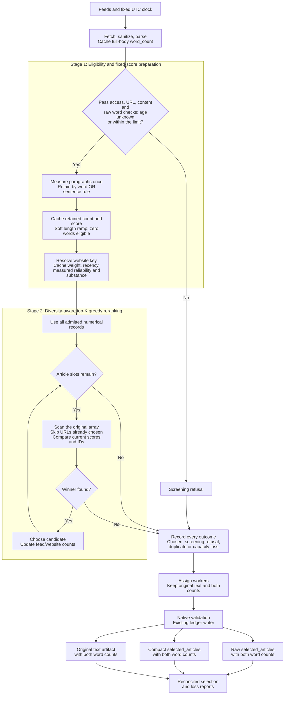

# Diversity-aware top-K greedy reranking

**Last Updated**: 2026-11-02
**Level**: 5 - selection design and current planner payloads.

## 0 - Operating contract

Table A

| Id | Field | Value |
| --- | --- | --- |
| A1 | Why this plan exists | Select the strongest available digest inputs without leaving article slots unused because of source allocations. K means the maximum number of articles to select. |
| A2 | In scope | Parse-time full-body count reuse; retained-paragraph scoring with a separate cached count; source-weight ranking; one global age policy; fixed-score preparation followed by a direct greedy array scan; complete losses; native contracts, input fingerprints, workflow controls and reports; explicit retirement of the old selector, its tests and obsolete documentation under Tables W/X. |
| A3 | Chosen strategy | Cache each eligible candidate's fixed numeric score once. For each next winner, scan all admitted numerical records and compare current feed/website penalties and the first-use bonus. Use one array, not a heap, pair groups, equal-score lists or a second selector. |
| A4 | Capacity contract | Select the smaller of K and the number of distinct eligible canonical URLs. Scores may be negative. No unstated minimum-score gate. |
| A5 | Current status | Execution-ready plan; application implementation has not started. Rows 1-4 are separate PRs, and each must leave its current producers, consumers and tests working. |
| A6 | Delivery | Four sequential PRs: contract/configuration readiness; substance scorer and screening cache; selection-engine replacement including old-code/test removal and canonical documentation; run metrics and audit reports. Declare new shapes before their logic, but remove a live field only with the last producer and consumer that use it. Tests and affected fixtures ship in every PR, not only row 4. Retirement is a row 3 release condition, not a later cleanup PR. |
| A7 | Format rule | Current-only planner formats. Refuse older affected formats with diagnostics; preserve historical files unchanged. No conversions, bridges, dual readers, dual writers or legacy selector flags. |
| A8 | ESCALATE triggers | 1. A requested rule has two unresolved meanings. 2. A changing contract has a consumer not named in this plan. 3. A new shared state store or runtime destination is proposed. 4. A scoring rule cannot be implemented from the declarations below. The known catalog-probe dependency is handled in row 1; it is not an undiscovered consumer. |
| A9 | Execution | Execute per docs/how-to/execute-a-plan.md: one maintainer carries the plan and delegates a row where delegation pays; keep parallel N = 4 rows in flight, refilling a slot as soon as a worker returns and never waiting on a merge; consult a persona only where two answers would lead to different code; AUTO-merge on green gates; honor the ESCALATE triggers in section 0. AUTHOR-AND-STOP until the user authorizes. |
| A10 | Dispatch constraint | Rows depend on the preceding merged PR and overlap named files. Their effective parallelism is one, regardless of the execution stamp's pool ceiling. Do not remove active bucket fields in row 1 or leave row 3's readers broken until row 4. Check conflicts against other work; do not edit either engineering-instruction file. |
| A11 | Source-tier rule | From row 3, no source_tier/tier or applied_tier_weight is used to enroll, screen, score, rank, set quotas or fingerprint top-K inputs. Authority uses source.weight through H16. Rows 1-2 retain the existing selector until its single replacement; other subsystems retain their catalog classifications. |
| A12 | Ledger word-count rule | word_count remains the parser's count of the complete sanitized article body. substance_word_count counts only H28's retained paragraphs and drives substance scoring. Row 3 requires both integers in selected metadata, the unchanged text artifact, raw Parquet and compact Parquet under I9. Neither count is guessed, substituted for the other or recalculated downstream. |
| A13 | Stage 1 in English | Read the configured feeds; fetch and sanitize article bodies; retain the full body's parsed count. Apply cheap access, URL, content and raw technical-word checks; reject over-age articles only when age is known. Unknown age earns zero recency. Measure paragraphs once with compromise and cache their count and substance without changing the body. Zero retained words stays eligible with zero length/density points. Resolve a website key from the canonical URL and cache the full base from weight, recency, measured pass history and substance; missing history adds no penalty. |
| A14 | Stage 2 in English | Scan every admitted numerical record for the next winner, skipping URLs already chosen. Compare current numeric scores; exactly equal scores use the smaller candidate ID. Choose the best record, save its score terms and update only its feed/site counts. Repeat to the article limit or exhausted unique supply, including through negative scores. Do not rescan article text, rebuild a sorted/filtered array or keep stale score state. |
| A15 | Delivery in English | Give every original unchosen candidate a duplicate or capacity loss. Derive metadata, both counts and original text from the same winners; assign workers without reranking or changing their full-body work estimate. The existing TypeScript writer validates and writes the selected-article ledgers, then produces the text artifact and reconciled reports. |

Table B

| Id | Out of scope | Cost to leave it out | Condition to include it |
| --- | --- | --- | --- |
| B1 | A separately configured metadata top-M shortlist | The two-stage method is cached scoring followed by a complete numerical scan; cheap gates reduce N to eligible M without discarding that pool's tail. | An explicit instruction selecting a shortlist and defining its refill/tail behavior. Pool-size examples are not admission limits. |
| B2 | A factual-quality model or semantic story deduplication | Shape scores do not verify facts; different URLs for the same story can remain. | A content-quality requirement, recorded evaluation inputs and an operator-controlled model destination. |
| B3 | Hard source concentration bounds or guaranteed topic coverage | A scarce pool can still produce one-source output; feed/site diversity is not topic diversity. | A defined coverage requirement and a decision about the resulting underfill. |
| B4 | Non-planner taxonomy redesign, Python contracts and published-site redesign | Other readers retain their classification fields and format rules. The catalog probe's existing shared-snapshot dependency is removed without changing catalog behavior in row 1. | An affected consumer beyond that named dependency. |
| B5 | Historical data rewriting or a new scoring ledger | Old affected planner files are unavailable to current readers; scores remain in existing selected output. | A different persistence requirement with its own cost and scope decision. |

### Complete stage flow



## 1 - Status Reckoner

Table C

| Id | # | Row title | Depends-on | Parallel-group | Status | Worktree | PR | Subagent |
| --- | --- | --- | --- | --- | --- | --- | --- | --- |
| C1 | 1 | Prepare contracts and configuration | - | A | PENDING | - | - | - |
| C2 | 2 | Add substance scoring during screening | 1 | B | PENDING | - | - | - |
| C3 | 3 | Replace the selection engine and its consumers | 2 | C | PENDING | - | - | - |
| C4 | 4 | Add diversity run metrics and audit reporting | 3 | D | PENDING | - | - | - |

## 2 - Row 1 - Prepare contracts and configuration

- **Scope:** Declare the new scoring inputs, share the existing word counter, reuse the parser's count and remove the catalog probe's dependence on planner snapshots without changing current selection.
- **Files touched:**
  - `TODO/20261101-diversity-aware-top-k-selection-plan.md`
  - `config/feed-ingest-plan.json`
  - `packages/common-contracts/src/index.ts`
  - `packages/common-contracts/src/version.ts`
  - `packages/common-contracts/src/schemas/config.schema.ts`
  - `packages/common-contracts/src/schemas/policy.schema.ts`
  - `packages/common-contracts/src/schemas/screened-article.schema.ts` (new)
  - `packages/common-contracts/test/config.test.ts`
  - `packages/common-contracts/test/schema-binding.ts`
  - `packages/common-contracts/test/screened-article.test.ts` (new)
  - `packages/feed-probe/src/source-selection.ts`
  - `packages/feed-probe/test/feed-probe.test.ts`
  - `packages/feed-probe/test/feed-probe-cli.test.ts`
  - `services/feed-ingest-plan/src/config/resolve-policy.ts`
  - `services/feed-ingest-plan/src/count-article-words.ts` (new)
  - `services/feed-ingest-plan/src/harvest-feeds/corroborated-words.ts`
  - `services/feed-ingest-plan/src/harvest-feeds/dom-extractor.ts`
  - `services/feed-ingest-plan/src/harvest-feeds/extraction-quality.ts`
  - `services/feed-ingest-plan/src/screen-article-candidates/freshness-decay.ts`
  - `services/feed-ingest-plan/test/harvest.test.ts`
  - `services/feed-ingest-plan/test/policy.test.ts`
  - `docs/architecture/sources/feed-curation.md`
  - `docs/architecture/sources/feed-ingest-policies.md`
  - `docs/architecture/sources/extraction-quality.md`
- **Acceptance gates:** Local: M1, the common-contracts, feed-probe and service type checks, and the named schema/probe/harvest/policy cases in this file list. Check primary, fallback, empty, paywall and Unicode-whitespace recordings. CI: required checks on this PR candidate. Keep the named parity record for row 2.
- **Oracle:** Bounded before/after recordings have the same parse text/count/quality results, accepted and refused catalog inputs, and current selected identities while extraction-quality calculation receives the cached full-body count. This proves preparation without changed selection, not the final scoring design or a speed increase.

Table D

| Id | # | Decision | Authority |
| --- | --- | --- | --- |
| D1 | 1 | `word_count` is the authoritative count of the complete final sanitized body, produced during parse. Require it downstream; never derive that full-body count again. H28's distinct paragraph measurement does not replace it or the extraction-quality count. | Stage ownership |
| D2 | 2 | Count the primary body once. If fallback produces a different body, count that body once, compare the cached values and retain the winner's count. | Existing fallback behavior |
| D3 | 3 | Move the existing countWords implementation unchanged into count-article-words.ts; update its parser, corroboration and test imports without a re-export bridge. Screening can then share the definition without importing another stage's internals. Pass the retained full-body count into extraction-quality calculation instead of recounting there; no optional fallback. | Shared definition and single raw calculation |
| D4 | 4 | Independent corroboration remains an independent measurement. Do not replace its count with the extracted body's count or remove its contamination check. | Extraction trust boundary |
| D5 | 5 | Keep existing parsed payload meanings and shared extraction-quality fields unchanged in this structural PR. | Output parity |
| D6 | 6 | Add G2/G7-G9 and G11-G20/G22-G25's scoring configuration, F2's raw/admitted screening declarations and I18's numerical declaration. Infer the existing freshness helper's raw type from the native declaration without changing its results. The current policy resolver must exclude new global-only blocks from source overrides. Keep active bucket/cap/source/selected shapes until their named replacement rows. | Working intermediate release |
| D7 | 7 | `packages/feed-probe/src/source-selection.ts` calls SourceSnapshotSchema for catalog validation today. Remove that planner coupling and validate through its existing CatalogSourceSchema; preserve field bounds, defaults, lifecycle placement, URL rules and duplicate checks. Keep catalog tier classification unchanged. | Verified external consumer |
| D8 | 8 | Do not remove tier, applied_tier_weight or selected fields in this PR. Do not declare an unused second selected-row format. Row 3 changes the one native format together with all active producers/readers. | Reader/writer coherence |
| D9 | 9 | Keep the existing recency, reliability and raw technical-word settings at G5/G6/G21/G26 unchanged. G11-G14 define soft retained-word scoring, not another admission floor. Do not change technical capture classification to implement article-shape preferences. | Separate measurement meanings |

Table E

| Id | # | Rejected alternative | Why rejected | Cost to take | Authority |
| --- | --- | --- | --- | --- | --- |
| E1 | 1 | Recount in every consumer | Repeats text work and allows count definitions to drift. | Additional body scans and another implementation to keep consistent. | Single calculation |
| E2 | 2 | Cache by text hash across articles | Adds retained state when one body's local count is enough. | Hashing, cache memory, lifetime rules and collision handling. | Smallest sufficient cache |
| E3 | 3 | Delete required contracts/configuration before replacing their callers | The current selector still reads buckets and writes required tier/cap fields; a removal-only PR fails runtime validation. | Convert the selector and every affected caller in that same PR, recreating the large release this phasing removes. | Working intermediate release |
| E4 | 4 | Add legacy optional fields or a second schema to make early removal pass | Creates the compatibility machinery this replacement does not need. | Two format paths, test matrices and a later deletion. | One native format |

## 3. Mathematical Model & Scoring Specification

### A. Static Base Score (Computed Once per Candidate)

```math
\text{BaseScore}(d) = A(d) + R(d) + \Delta_{\text{pass}}(d) + Q(d)
```

#### 1. Source Authority Prior

```math
A(d) = \alpha \cdot w_{\text{feed}}
```

* `alpha`: Configured authority weight (default: `1.0`).
* `w_feed`: The configured `source.weight`. No source-tier or taxonomy multiplier.

#### 2. Continuous Recency

```math
R(d) =
\begin{cases}
0 & \text{if age is unknown} \\
w_r \cdot \left(\frac{1}{2}\right)^{\frac{\max(0, \text{age\_hours})}{h}} & \text{otherwise}
\end{cases}
```

* `w_r`: Recency weight (default: `0.6`).
* `h`: Recency half-life (default: `18.0` hours).
* Age basis: Trusted publication, otherwise the recorded `first_seen_at` instant from captured discovery evidence. If neither is usable, retain null timing/age, admit subject to the other checks and give zero recency points. The 36-hour ceiling applies only to known age; unknown age can still win on other terms and is not proof of freshness.

#### 3. Technical Reliability Adjustment

```math
\Delta_{\text{pass}}(d) =
\begin{cases}
0 & \text{if disabled or history is unmeasured} \\
-A(d)\cdot\left(1-\max(f,p_s)\right) & \text{otherwise}
\end{cases}
```

* `f`: Reliability floor (default: `0.5`).
* `p_s`: The measured technical article-pass fraction over the configured 30-day window.
* Missing or incomplete coverage, a null fraction or a zero denominator is unmeasured: the adjustment is `0.0`, and the observed fraction remains null. A measured zero fraction still receives the configured floor penalty.

#### 4. Candidate Substance Quality

Configured evidence of depth, not factual verification or an unbiased quality measurement:

```math
Q(d) = Q_{\text{bandpass}}(\text{retained words}) + Q_{\text{entity}}(\text{retained density}) - Q_{\text{hype}}(\text{headline})
```

**Length Guardrail (`Q_bandpass`):**

* Use only H28's retained-paragraph word count, never the full-body count.
* Zero retained words: Zero length and density points, not a screening refusal. There is no retained-word minimum.
* 0-749 retained words: Linear ramp from `0.0` at zero words toward `1.0` at 750 words. Concise prose receives partial credit instead of rejection.
* 750-3500 retained words: Flat full credit (`1.0` length points).
* 3501-6000 retained words: Continuous linear taper from `1.0` at 3500 words to `0.80` at 6000 words.
* More than 6000 retained words: Clamped at `0.80` length points. This changes the length component, not the complete score by a fixed percentage.

```math
Q_{\text{bandpass}}(w)=
\begin{cases}
\frac{w}{750} & 0\leq w<750 \\
1 & 750\leq w\leq3500 \\
1-\frac{0.2(w-3500)}{2500} & 3500<w\leq6000 \\
0.8 & w>6000
\end{cases}
```

**Factual Density (`Q_entity`):**

* Ratio of recognized proper-name spans plus numerical quantities to sentence count, using only retained paragraphs. Reuse compromise's per-paragraph analysis; discarded navigation/footer fragments contribute nothing. One-word names count; overlapping spans do not earn duplicate credit.
* Normalize between `0.0` and `0.30` score points under H6. This is a lexical-density signal, not proof that a statement is factual.

**Headline Hype Deduction (`Q_hype`):**

* Deducts up to `-0.25` points for:
  - Capitalization shouting: at least two unexempt ALL-CAPS words that make up at least half of all headline terms containing two or more letters. Only library-recognized acronyms are exempt from the uppercase count; they remain in the denominator. No short-word exemption.
  - Exclamatory or sensational punctuation (`!!`, `?!`).
  - Headline/retained-opening mismatch after noun and verb inflection normalization, only when both sides have comparison terms. No retained opening means no mismatch evidence. This is a weak lexical signal, not a semantic clickbait classifier.

### B. Dynamic Marginal Score & Diversity Penalty

At step `t`, with already selected set `S_(t-1)`, the marginal score for an unselected candidate is:

```math
\begin{aligned}
\text{MarginalScore}(d) &= \text{BaseScore}(d) \\
&\quad - \text{Penalty}_{\text{domain}}(d, S_{t-1}) \\
&\quad - \text{Penalty}_{\text{feed}}(d, S_{t-1}) \\
&\quad + \text{Bonus}_{\text{novelty}}(d, S_{t-1})
\end{aligned}
```

#### 1. Quadratic Domain Penalty

```math
\text{Penalty}_{\text{domain}} = \lambda_{\text{domain}} \cdot \left[N_{\text{domain}}(d, S_{t-1})\right]^2
```

* `lambda_domain = 0.04`.
* `N_domain`: Number of articles already selected from the candidate's `website_group`.
* Resolve the group from the validated canonical URL, falling back to its normalized hostname. No eligible candidate has a missing penalty key.
* Scale effect: 1st article = `0.0`; 2nd = `-0.04`; 3rd = `-0.16`; 4th = `-0.36`; 5th = `-0.64`; 6th = `-1.00` score points.

#### 2. Quadratic Feed Penalty

```math
\text{Penalty}_{\text{feed}} = \lambda_{\text{feed}} \cdot \left[N_{\text{feed}}(d, S_{t-1})\right]^2
```

* `lambda_feed = 0.02`.
* `N_feed`: Number of articles already selected from the candidate's specific `feed_id`.

#### 3. Deterministic Novelty Bonus

```math
\text{Bonus}_{\text{novelty}} =
\begin{cases}
\beta_{\text{novelty}} & \text{if } N_{\text{feed}}(d, S_{t-1}) = 0 \\
0 & \text{otherwise}
\end{cases}
```

* `beta_novelty = 0.15`.
* Gives unrepresented feeds an initial boost so their best story can overcome the inertia of dominant sources.

## 4 - Row 2 - Add substance scoring during screening

- **Scope:** Implement retained-paragraph measurement and the real compromise-based scorer, caching every existing survivor's measured count/score without adding an admission gate or changing selection and original article text.
- **Files touched:**
  - `TODO/20261101-diversity-aware-top-k-selection-plan.md`
  - `services/feed-ingest-plan/package.json`
  - `services/feed-ingest-plan/bun.lock`
  - `services/feed-ingest-plan/src/screen-article-candidates/triage-gates.ts`
  - `services/feed-ingest-plan/src/screen-article-candidates/measure-substantive-paragraphs.ts` (new)
  - `services/feed-ingest-plan/src/screen-article-candidates/score-article-substance.ts` (new)
  - `services/feed-ingest-plan/src/screen-article-candidates/normalize-article-terms.ts` (new)
  - `services/feed-ingest-plan/scripts/feed-ingest-plan-policy-report.ts`
  - `services/feed-ingest-plan/test/triage.test.ts`
  - `services/feed-ingest-plan/test/curate.test.ts`
  - `services/feed-ingest-plan/test/substance-score.test.ts` (new)
  - `services/feed-ingest-plan/test/feed-ingest-plan-report.test.ts`
  - `tests/fixtures/feed-ingest-plan/screening-cases.json`
  - `tests/fixtures/feed-ingest-plan/substance-score-cases.json` (new)
  - `docs/architecture/sources/article-substance-scoring.md` (new with the real scorer)
  - `docs/architecture/sources/feed-curation.md`
  - `docs/architecture/sources/feed-screening.md`
- **Acceptance gates:** Local: M1/M6, the service check and named screening/scoring/report cases; reuse row 1's unchanged common-contract record. Run the real library against recorded language/paragraph cases, every H1/H2 endpoint and invalid settings. Check K19-K21's unknown-age/empty-view admission, cheap-gate precedence and unchanged technical counts. Run the existing recorded API/CLI journey for output parity; no selected/rejection format or fixture rewrite is introduced here. CI: required checks on this PR candidate.
- **Oracle:** Recorded articles and bounded boundary inputs produce H1-H13/H28/H29's exact retained counts/components and F2's required evidence. The admitted/refused identities, full-body text/counts and existing selector output stay unchanged, including unknown age and measured zero retained words. Cheap refusals still exit before paragraph analysis. This proves real measurement/cache and admission parity, not complete boilerplate removal, factual quality or final-ranking activation.

### Shared decisions and declared contracts

Table F

| Id | # | Decision | Authority |
| --- | --- | --- | --- |
| F1 | 1 | Apply cheap eligibility checks to all N parsed candidates. Measure paragraphs and compute substance once for every survivor in that screening loop. M is the admitted count after the existing access/content/raw-word and applicable known-age checks, not a configured multiple of K. Unknown age and measured zero retained words add no refusal. | Exact capacity contract |
| F2 | 2 | Declare raw timing evidence once and reuse it in admitted freshness and the screened-candidate refinement in screened-article.schema.ts. Known timing requires UTC timing_at, finite signed age_hours and timing_source of published_at or first_seen; unknown timing requires null instant/age, source unknown and zero recency_bonus. Admitted freshness also requires finite substance_score and substance_word_count: CountSchema, including measured zero. Validate retained <= candidate.word_count and infer service types from these declarations. Row 1 declares them; row 2 constructs measured admitted evidence. No cast, fabricated time or missing count/score default. | Native contract |
| F3 | 3 | The numerical selector receives only I18's identity fields, cached base score and resolved website key. It has no article-text input. The adapter creates one numerical record per survivor and joins chosen identities back to original content afterward. | Stage separation |
| F4 | 4 | Authority is the configured authority coefficient times `source.weight`. Equal configured feed weights provide uniform weighting through the same path. No taxonomy multiplier. | Source-weight design |
| F5 | 5 | Remove the planner's taxonomy read, source-tier activation/coverage gates and taxonomy contribution to its fingerprint. Feed lifecycle status still controls enrollment. Leave the shared taxonomy file and its non-planner readers unchanged. | Tier-independent planner |
| F6 | 6 | Preserve unknown-age admission with zero recency in row 2. Row 3 applies the global ceiling before download where time is known, and during screening; unknown timing stays eligible and explicitly null/unknown through selection. Use the captured UTC clock, trusted publication or recorded first sight and signed future ages. Never invent time evidence. This preserves coverage but cannot exclude old undated articles; source authority can still select them. | Evidence-neutral timing |
| F7 | 7 | Use J7's compromise version for paragraph sentence boundaries, proper-name/quantity spans and noun/verb normalization. Compile trusted punctuation patterns once per screening invocation. H28 parses each nonempty block once and reuses retained documents for density; H29 supplies the bounded opening for overlap. Do not parse the joined full body again, recalculate either count downstream or analyze text in the numerical selection loop. | Cached screening |
| F8 | 8 | H19 declares the draft's complete cached and persisted base score. H24 adds only current diversity terms to it. Static adjustment entries are a breakdown of terms already in base, not another addition to marginal. Change this field meaning in the current native format; do not keep a legacy base convention. | Draft score decomposition |
| F9 | 9 | Missing/incomplete article-pass history contributes a numeric zero adjustment, not a measured zero pass fraction. Apply the floor only to a measured fraction. Preserve the existing article_pass_rate adjustment term and observed null evidence. | Evidence-neutral cold start |
| F10 | 10 | Use current-run website and feed counts, with the draft's absolute count-squared penalties. Remove normalized shares and current-day publisher-exposure ranking. Already-published URL checks remain. | Replacement diversity rule |
| F11 | 11 | The first-use bonus means an unrepresented feed in this selection, not a new story or a reserved exploration slot. | Accurate meaning |
| F12 | 12 | Keep the original admitted array unchanged for selection and terminal accounting. Skip already-chosen URLs during each sweep; never remove their other carriers from the original population. Increment feed/site counters only after committing the actual winner. | Complete accounting |
| F13 | 13 | In each release, update its affected native stamps, changelogs, consumers and row-version mappings together. Row 3 changes source snapshots in candidates, feed offers, feed outcomes, parsed batches and enclosing private snapshots/receipts. A fetched-document body does not embed the snapshot. Row 4 changes plan-run rows and their responses independently. Do not postpone a required reader or fixture to a later PR. | Current-only formats |
| F14 | 14 | Re-record current fixtures using the real API and writer. Keep bounded older-format refusal fixtures unchanged; never transform stored historical ledgers. | Current output proof |
| F15 | 15 | Table W declares the exact old-code, test and fixture disposition; Table X declares the current documentation replacing obsolete rules. Complete their row 3 work in the selector cutover, not row 4 or an unspecified cleanup. No existing upward-transfer engine or heap implementation needs deletion; neither was shipped. | Verified implementation |
| F16 | 16 | Treat the initial article-shape and penalty coefficients as policy defaults, not calibrated quality measurements. They implement preferences, not clickbait or monopoly guarantees. | Measurement boundary |
| F17 | 17 | Sections 3.A/3.B define the mathematical model. Tables G/H resolve its configuration, exact integer endpoints and lexical measurements; they must implement this model, not replace it. Table O checks draft coverage, Table P gives derived examples and Table N assigns work. No worker chooses a different curve, sign or stopping rule. | Complete implementation specification |
| F18 | 18 | No finite acronym allowlist, hand-written sentence/name/number tokenizer, naive suffix stripping or substring matching. Use the supported library calls in H3-H11, not the nonexistent entities() call. The library handles English inflections, not arbitrary derivational pairs, synonyms or factual correctness. | Verified API and limits |
| F19 | 19 | Row 2 retains the existing selector and its active required fields. The new screening measurement is a complete capability; it becomes a ranking input only in row 3. No second selector, shadow pipeline or legacy switch is introduced. | Incremental real delivery |
| F20 | 20 | Row 2 adds no unavailable-age or retained-length rejection, rejection-format change or new technical outcome. A measured empty retained view earns zero length/density points and no opening-mismatch deduction; other observed headline flags still apply. Missing required count/score evidence remains an explicit validation failure, never a success-shaped zero. Preserve original technical counts and existing known-age limits until row 3. | Soft evidence, unchanged admission |
| F21 | 21 | The paragraph helper returns only serializable substance_word_count, sentence_count, name_count, number_count and opening_text under H28/H29. Counts are measured nonnegative integers; no library document crosses the helper boundary. Reuse D3's shared Unicode-whitespace definition per block. This is one additional structural measurement, not a replacement for raw word_count, independent corroboration or full-body worker estimates. | Distinct cached evidence |
| F22 | 22 | A paragraph is a nonempty newline-delimited block, not a semantic guarantee. Short two-sentence footers and long disclaimers can remain; short single-sentence prose and soft-wrapped lines can be lost. Keep these cases explicit without site rules, raw-text fallback or scraper changes. Removal percentages remain unmeasured, not acceptance claims. | Heuristic limits |
| F23 | 23 | The shared recordedPlan fixture's existing raw technical-word override remains. No fixture scoring override or article padding is needed for a soft curve. Update direct ScreenedCandidate test constructors through the real scorer, not a fixed substitute. Keep API/CLI selected and rejection recordings unchanged in row 2; row 3 renews the formats it changes. | Real scoring and output parity |
| F24 | 24 | Row 2's effective-policy report separates the raw technical minimum from the retained-word scoring curve and shows the paragraph/curve settings without a retained admission floor. It must not claim cached substance already drives the old selector. Keep its still-active allocation controls until row 3 removes that selector; report changes and their tests ship with each release. | Truthful intermediate reporting |

### Policy declarations

Table G

| Id | Config path under `curate_articles` unless stated | Formula symbol | Default and meaning | Validation |
| --- | --- | --- | --- | --- |
| G1 | `article_limit` | `K` | 100 maximum selected articles | Positive integer |
| G2 | `global_age_ceiling_hours` | `ageCeiling` | 36 hours maximum known age for every feed; unknown age stays eligible with zero recency | Positive finite hours; one optional run override and one reported origin |
| G3 | `source_authority_weight` | `alpha` | 1.0 score-point scaling of configured feed weight | Finite, nonnegative |
| G4 | `source_reliability_penalty_enabled` | `passEnabled` | True: apply the technical article-pass adjustment | Boolean |
| G5 | Existing `collect.reliability_floor` in `config/idhazh.json`, outside curation | `f` | 0.5 minimum retained authority fraction for measured pass history | Finite fraction from zero through one; no duplicate curation setting |
| G6 | Existing `triage.recency_weight`, `triage.recency_half_life_hours`, outside curation | `w_r`, `h` | 0.6 maximum recency points; 18 hours to halve that contribution | Nonnegative finite weight; positive finite hours; retain these existing keys |
| G7 | `diversity.lambda_domain` | `lambda_website` | 0.04 points per squared prior website-group count | Finite, nonnegative |
| G8 | `diversity.lambda_feed` | `lambda_feed` | 0.02 points per squared prior feed count | Finite, nonnegative |
| G9 | `diversity.novelty_bonus` | `beta` | 0.15 points before a feed's first selected article | Finite, nonnegative |
| G10 | `website_grouping.include_private_suffixes` | - | True: retain the configured private-suffix grouping policy | Boolean; grouping recomputed from canonical URLs |
| G11 | `substance.word_count_ramp_end` | `rampEnd` | 750 retained words: full credit after a soft ramp from zero words and zero length points | Positive integer; no retained-word admission floor |
| G12 | `substance.word_count_sweet_spot_max` | `sweetSpotMax` | 3,500 retained words: last full-credit word count | Integer; sweetSpotMax >= rampEnd |
| G13 | `substance.word_count_plateau_start` | `plateauStart` | 6,000 retained words: end of the gentle long-form taper | Integer; plateauStart > sweetSpotMax |
| G14 | `substance.length_scores.full`, `substance.long_form_floor_score` | `lengthFull`, `longFormFloor` | 1.0 full length points and 0.80 long-form length points | Finite nonnegative levels; longFormFloor <= full. No offset setting: zero retained words means zero length evidence. |
| G15 | `substance.entity_density_weight` | `densityWeight` | 0.30 maximum name/number-density points | Finite, nonnegative |
| G16 | `substance.entity_density_full_credit` | `densityFull` | 1.0 counted name/number signal per sentence reaches full density credit; provisional default, not factual calibration | Positive finite signal density |
| G17 | `substance.headline_hype_penalty` | `hypeCap` | 0.25 maximum headline deduction | Finite, nonnegative magnitude |
| G18 | `substance.headline.shouting_weight`, `.punctuation_weight`, `.opening_mismatch_weight` | `hShouting`, `hPunctuation`, `hOpening` | 0.10, 0.10 and 0.05 deduction points for the three headline flags; provisional split | Finite, nonnegative; total deduction clamped by G17 |
| G19 | `substance.headline.opening_text_max_characters`, `.keyword_min_letters` | - | Inspect at most 2,000 opening Unicode characters; significant headline words have at least four letters | Positive integers |
| G20 | `substance.headline.shouting_min_letters`, `.shouting_min_words` | - | At least two Unicode letters per counted headline term; require at least two unexempt uppercase terms for the flag | Positive integers; the letter minimum applies to numerator and denominator |
| G21 | Existing `collect.reliability_window_days` in `config/idhazh.json`, outside curation | `passWindow` | Retain the 30-day technical-history setting; no second curation window or fabricated complete history | Positive integer; retain its existing evidence-completeness rules |
| G22 | `substance.headline.shouting_min_uppercase_fraction` | - | 0.50: unexempt uppercase terms must make up at least half of H9's qualifying headline terms | Finite fraction from zero through one; inclusive comparison; no acronym-length exemption |
| G23 | `substance.headline.stop_words` | - | Grammar-only keyword exclusions: a, an, the, and, or, but, for, nor, so, yet, as, at, by, in, of, on, to, with, from, into, is, are, was, were, be, been, this, that, these, those | Distinct nonempty lowercase terms; not an authority or quality list |
| G24 | `substance.headline.punctuation_patterns` | - | `!{2,}`, `\?!`, `!\?`: repeated exclamation or mixed question/exclamation punctuation | Trusted nonempty Unicode regular expressions; reject invalid patterns by field name |
| G25 | `substance.substantive_paragraph_min_words`, `substance.substantive_paragraph_min_sentences` | - | Retain a block with at least 25 words OR at least two library sentences | Positive integers; inclusive OR, not AND |
| G26 | Existing `triage.min_words`, outside curation | `technicalMinWords` | Keep the current 180 full-body words for raw technical triage and capture classification | Positive integer; no retained-word admission alias or filtered-count substitution |

Table H

| Id | Rule | Exact behavior |
| --- | --- | --- |
| H1 | Short-article length equation | Let w be F21's measured nonnegative substance_word_count, required in F2. For 0 <= w < rampEnd, Q_length = lengthFull * (w / rampEnd). For rampEnd <= w <= sweetSpotMax, Q_length = lengthFull. Zero is measured evidence earning zero length points, not a missing value or refusal. No lower-word offset, hard retained-word cutoff or raw-count substitution. |
| H2 | Long-article length equation | For sweetSpotMax < w <= plateauStart, Q_length = lengthFull + (longFormFloor - lengthFull) * (w - sweetSpotMax) / (plateauStart - sweetSpotMax). For w > plateauStart, Q_length = longFormFloor. Both joins are continuous; no extra full-credit word or final jump. |
| H3 | Sentence units | H28 uses each block's nlp(text).sentences().length for retention, then sums only retained blocks for density. Reuse that measurement. The library handles U.S./Dr. abbreviations and final unterminated sentences under its own behavior; do not change the independent extraction-quality sentence rule. |
| H4 | Name signals | On each retained block's existing document, use doc.match('#ProperNoun+') and sum its non-overlapping spans. The plus means one or more proper-noun terms. A recognized one-word name counts once; a multiword name counts once. Discarded blocks earn no credit. Recognition remains the library's English heuristic, not a complete entity database. |
| H5 | Numeric signals | On each retained block's existing document, use doc.numbers().not('#ProperNoun') and sum its remaining non-overlapping quantity spans. Each returned span counts once; a multiword quantity counts once when retained as one span. Exclude proper-noun terms before counting. Use the public string selector, not a View argument or an assumed whole-quantity discard rule. Discarded blocks earn no credit. |
| H6 | Density equation | Let `names` and `numbers` be H4/H5 hit counts and `sentences` be H3's count. `density = sentences == 0 ? 0 : (names + numbers) / sentences`. `Q_entity = densityWeight * min(1, max(0, density / densityFull))`. No units means no density contribution, not a claim of zero factual content. G16 explicitly supplies the normalization missing from the draft. |
| H7 | Headline and opening terms | Preserve an original-case headline document for shouting. For comparison, create lowercase headline and H29 bounded retained-opening documents, run `nouns().toSingular()` then `verbs().toInfinitive()`, and use public `doc.json()` output. Treat the output as unknown, validate the consumed text/normal/tags fields in each entry's terms with a local Zod schema, then read normal for whole-term comparison. Ignore unused metadata; do not access internal term storage or use punctuation-bearing display output as a normalized key. Lowercase before tagging; never mutate stored title/body text. |
| H8 | Acronyms and stop words | Only terms recognized by the original headline's `acronyms()` are exempt from the uppercase numerator; the public JSON Acronym tag identifies that membership. Keep them in the denominator. No length-based exemption or finite allowlist. G23 excludes grammar words from opening-keyword comparison only: stop words remain in both shouting counts when otherwise eligible. Library recognition is heuristic; do not claim every abbreviation is recognized. |
| H9 | Shouting flag | Let letter_words be original-case headline terms containing at least G20's minimum Unicode letters. Let uppercase_words be those terms equal to their uppercase form, different from their lowercase form, and not exempt under H8. Flag exactly when letter_words.length > 0, uppercase_words.length >= G20's minimum word count, and uppercase_words.length / letter_words.length >= G22. Empty input never flags. Use the original case and inclusive fraction threshold; neither stop words nor acronyms leave the denominator. |
| H10 | Punctuation flag | Any G24 pattern matches. Each headline flag is one or zero and contributes once, not once per match. |
| H11 | Opening mismatch flag | Keep distinct H7-normalized headline terms containing G19's minimum Unicode letters after G23 exclusions. Flag only when that set and the normalized opening set are both nonempty and have no whole-term intersection. Missing opening evidence cannot prove mismatch. This matches ordinary inflections without substring matching. It does not equate every derivational pair, such as scrutiny/scrutinize, or synonyms; that residual limit remains explicit and never becomes a screening refusal. |
| H12 | Headline and final substance equations | Let `shouting`, `punctuation` and `openingMismatch` be H9/H10/H11's one-or-zero flags. `Q_hype = min(hypeCap, hShouting * shouting + hPunctuation * punctuation + hOpening * openingMismatch)`. `Q = Q_length + Q_entity - Q_hype`. Q_hype is a nonnegative magnitude, never a negative value subtracted twice. Q is signed and not a probability; its default range is -0.25 through 1.30 points. |
| H13 | Analysis handling | Compile G24 once per screening call and keep library documents local to their article. Use only declared public APIs; do not call entities(), an unverified root computation, or hand-written suffix stripping. Parsing/configuration failures are explicit, not zero-score fallbacks. Library grammar tags and match syntax are protocol selectors, not tunable scoring weights. |
| H14 | Reliability arithmetic | `passAdjustment = !passEnabled || p == null ? 0 : -A * (1 - max(f, p))`. H18 supplies null for missing/incomplete coverage or a zero denominator. Do not substitute zero for p before this branch. A measured p of zero still receives the floor penalty; an unmeasured feed retains its first-use bonus without a history penalty. |
| H15 | Timing and eligibility equations | `T` is the parsed batch's captured UTC evaluation instant in milliseconds. Use trusted publication within collect.max_future_hours; otherwise use captured discovery evidence's first_seen_at. If neither is usable, timing_at and ageHours stay null, timing_source is unknown and the candidate passes the age gate. Do not substitute fetched_at, selection time or T. With usable instant t, ageHours = (T - t) / MILLISECONDS_PER_HOUR; the named unit constant is 3,600,000 milliseconds per hour. Age admission is ageHours == null OR ageHours <= ageCeiling. Preserve signed ages and publication trust. Trusted publication does not require first sight; malformed timestamps fail native validation, not an unknown-age fallback. |
| H16 | Authority equation | `A(d) = alpha * d.source.weight`. The removed taxonomy weight is not another factor. Each configured feed weight remains in the unit interval; equal weights use this same equation. |
| H17 | Recency equation | `R(d) = ageHours == null ? 0 : w_r * (0.5 ** (max(0, ageHours) / h))`. Known age must be finite and signed under F2/H15; unknown age explicitly earns zero, not the age-zero maximum. Near-future timing cannot increase R above w_r. Use G6's existing coefficients. |
| H18 | Technical pass fraction | For the feed's complete G21 window, `p = passed / (passed + refused)`. Count only original captures passing technical checks and known source-attributed technical refusals. Do not count publication, age, category, content-policy or selection losses. Missing coverage or a zero denominator gives an unavailable p, not measured zero. H14 uses `f = G5`; if G4 is false its adjustment is zero. |
| H19 | Draft base score and cache | `BaseScore = ((A + R) + passAdjustment) + Q`. Cache it once from screening evidence and captured history; persist `ratings.base_article_score = BaseScore`. `feed_authority_score = A`; `recency_score = R`. No fixed component changes during selection. This replaces the older field meaning rather than preserving it through a bridge. |
| H20 | Website identity and counts | Resolve every numerical record's nonempty website_group from its validated canonical URL using the existing website-group.ts and tldts policy: registrable domain, otherwise lowercase hostname with a trailing DNS dot removed. Recompute consistently rather than mixing supplied grouping and fallback keys. Invalid URLs fail validation. A valid HTTP URL has a hostname, so no feed-ID escape or shared null key is needed. Count prior winners by this key and by feed_id across the full pool. |
| H21 | Website penalty equation | `P_website = lambda_website * (n_website ** 2)` and its signed adjustment is numeric `-P_website` for every candidate. A not-yet-selected key has count zero, not missing identity. Do not divide by K or the current selected count. |
| H22 | Feed penalty equation | `P_feed = lambda_feed * (n_feed ** 2)`; its signed adjustment is `-P_feed`. The first article has zero penalty because the count is measured before the choice. |
| H23 | First-use bonus equation | `B_feed = n_feed == 0 ? beta : 0`. This bonus disappears after the feed's first unique-URL winner; skipped duplicate carriers do not remove it. |
| H24 | Marginal score equation | `M(d,S) = ((BaseScore - P_website) - P_feed) + B_feed`. Evaluate in this order with native finite numbers; reject a non-finite result explicitly. The score is not clamped to zero, rounded for ranking, normalized by selected size or recomputed from text. |
| H25 | Deterministic choice | Replace the current best when the candidate's numeric M is greater, or when M is exactly equal and candidate_id is smaller under direct ASCII comparison. No tolerance, display rounding or locale comparison defines a tie. This is one direct comparison; do not retain per-candidate key tuples or replace it with static-base ordering. |
| H26 | Capacity equation | Let `U = size(set(admitted.map(d => d.url_key)))`. The chosen count is `K_chosen = min(K, U)`. This is a maximum unique-URL count, not a source reservation or a positive-score threshold. Exhaustion means no remaining unchosen, unseen-URL candidate. |
| H27 | Accounting equation | Parsed identities are the disjoint union of screening rejections and admitted identities. Admitted identities are the disjoint union of chosen identities, duplicate-carrier losses and capacity losses. Thus `parsed_count = screening_rejections + chosen_count + duplicate_losses + capacity_losses`. Use the unchanged original arrays, not a pruned working population. |
| H28 | Retained paragraphs | Split sanitized article_text with /\n+/u, trim blocks and ignore empty ones. Count each block once with D3's shared word counter and parse it once with nlp. Retain it when either G25 threshold is met. Reuse its document for H3-H5; sum only retained words/sentences/names/numbers. The two-sentence branch requires analysis before retention. Measure every block, even after length reaches full credit, so density and the delivered count stay complete. Sum cached counts; never recount joined text or fall back to raw text. |
| H29 | Retained opening and unchanged body | Build H7's opening from retained blocks in source order, separated by two newlines and bounded by G19's Unicode-character limit. Keep documents local and return only F21's evidence. No retained blocks produces measured zero counts and an empty opening; H1/H6/H11 define its zero body contributions without a refusal. Keep the original sanitized article_text, raw word_count, extraction-quality evidence and full-body worker estimates unchanged. |

### Selection and output contracts

Table I

| Id | Contract | Required behavior |
| --- | --- | --- |
| I1 | Candidate membership | One numerical record per admitted original candidate identity, including distinct carriers of the same URL. The parsed boundary already refuses repeated candidate IDs. Keep this complete array unchanged through selection and accounting. Original text stays in the owning stage, not in numerical records. |
| I2 | Setup | Receive every record's cached H19 base and resolved website key. Start with empty chosen identities, chosen URLs and feed/site count maps; missing counts mean zero. Do not sort, group, shortlist or compute an initial queue of scores. |
| I3 | Sweep state | Each sweep needs only its current best record and numeric score in addition to the chosen collections and count maps. Do not store per-candidate refreshed keys, bounds or selection-step stamps. Retain no second mutable copy of the admitted array. |
| I4 | Full numerical sweep | Visit the original admitted array once for each next winner. Skip any record whose URL is already chosen. For every other record, calculate H21-H24 from its cached base and current counts, and compare it with the best under H25. Do not analyze text or allocate a filtered/sorted candidate array per choice. |
| I5 | Winner proof | Complete the sweep before choosing. The saved best must outrank every other remaining unseen-URL record under H25, including when all scores are negative. A null best means unique eligible supply is exhausted, not that no score reached zero. H24 refuses a non-finite computed score explicitly. |
| I6 | Commit | Commit the saved best record, not the last record inspected. Save its exact numeric score and H21-H23 terms from the pre-choice counts, add its URL/identity, then increment only its feed count and resolved website count. Skipped duplicate carriers change no counts and consume no slot. |
| I7 | Completion | Continue to A4's count even when all scores are negative. Preserve all original identities for one final loss pass; duplicate-of-selected-URL takes precedence over capacity loss. |
| I8 | Adjustment terms | Use exactly `article_pass_rate`, `substance_quality_score`, `domain_diversity_penalty`, `feed_diversity_penalty` and `novelty_bonus` in ratings.adjustments. The screening cache is freshness.substance_score; its ledger term is substance_quality_score. All five values are finite signed numbers under H12/H14/H21-H23, including numeric zero for unmeasured/disabled history. Observed unavailable pass history remains null in its own evidence. |
| I9 | Required selected word counts | Add required word_count: CountSchema and substance_word_count: CountSchema to the shared MetadataFields in packages/common-contracts/src/schemas/selected-article.schema.ts. Both belong to SelectedArticleMetadataSchema, SelectedArtifactArticleSchema and SelectedArticleRowSchema; refine retained <= raw in every shape. Copy the parser's raw count and F2's measured retained count, including zero, through selectedArticleMetadata, API/stage payloads, partition and raw/compact selected_articles. No optional value, recount, null fill or missing-value default. Keep original text, identity, raw weight and full-body work fields; I19 owns timing. |
| I10 | Retired source/selected fields | In row 3, remove tier and applied_tier_weight from planner source snapshots and selected metadata; remove feed_limit, exploration_slot and cap_relaxations from selected projections. Convert native stage/API/partition/writer callers in the same PR. The catalog probe was decoupled in row 1; retain no legacy optional metadata or compatibility reader. |
| I11 | Retired configuration | In row 3, remove source_based_quality_buckets, soft_caps, mmr_weights, exploration_slot_share, per-tier age overrides and their helpers. Retain G5/G6/G21/G26 as the existing authorities and G11-G14/G25 as the distinct scoring policy. No old-key aliases, duplicate recency/reliability settings, retained-word admission/offset setting or unused decline_end setting. |
| I12 | Active loss causes | Duplicate carrier: REJECTED_DUPLICATE_CANONICAL_CARRIER; eligible but unchosen: REJECTED_GLOBAL_CAPACITY_REACHED. Keep REJECTED_SCREENING_MIN_WORDS for raw technical failure only. Row 3 adds global known-over-age REJECTED_SCREENING_AGE_CEILING. Unknown age and measured zero retained words have no new rejection cause. Retain safety/content causes and actual attribution; retire quota/ladder/cap causes with their callers. Editorial age and selection losses never enter technical pass counts. |
| I13 | Output projection | Derive metadata and the unchanged text artifact from the same chosen population. Join by chosen candidate identity, not the first matching URL. Partition assigns it without reranking or changing text, either count or full-body work estimates. The existing writer's raw and compact row projections both retain I9; prove this from actual Parquet readback, not schema presence alone. |
| I14 | Selection report | Row 3 uses the existing population/outcome counts, selected evidence and effective policy to explain global supply, unknown age, measured zero retained words and terminal losses. Underfill means all distinct eligible URLs were selected; no diversity penalty refuses a candidate. Add no queue diagnostics or per-step implementation counters. Row 4 adds U1-U5's saved run metrics, not a new ledger. |
| I15 | Input digest | Hash only the validated inputs this planner uses. Include the effective scoring policy and source weights; exclude the removed registry input. Preserve existing exclusion of reporting-only settings. |
| I16 | Exact numeric ties | Apply H25 directly to each current numeric score and candidate ID. Unequal bases can round to an equal marginal score after penalties; the smaller ID still wins. No cached key tuple, grouped tie resolver, tolerance or score quantization is needed. |
| I17 | Score projection order | Write signed adjustments in I8's order. Reconstruct base as `((feed_authority_score + recency_score) + article_pass_rate) + substance_quality_score`. Reconstruct marginal as `((base_article_score + domain_diversity_penalty) + feed_diversity_penalty) + novelty_bonus`. Static adjustments already belong to base; never add all five adjustments to it. There is no null domain adjustment. |
| I18 | Numerical input/output | The numerical input record contains only candidate_id, url_key, feed_id, website_group and base_score, the H19 cache. Require a nonempty website key and finite base; infer service types from the native declaration. Output is ordered chosen identities with H24's numeric score and H21/H22/H23's terms. The adapter retains other cached components and original content for I9/I17 projection. |
| I19 | Selected timing | Preserve both native timing variants in metadata, artifact and ledger output. Known timing requires a UTC timing_at, finite signed age_hours and timing_basis of published_at or first_seen. Unknown timing requires null instant/age, basis unavailable and zero recency_score. Require the UTC freshness_cutoff_at derived from T and the global ceiling for either variant; this states the policy, not proof of known age. Keep existing source-versus-selection published_at provenance separate: a selection publication timestamp never becomes admission age evidence or earns recency. Refuse inconsistent fields, not unknown timing. |

#### Production greedy sequence

```text
Inputs: all admitted numerical records, effective policy.
State: chosen = [], chosen_ids = {}, seen_urls = {},
       feed_counts = {}, website_counts = {}.
Map lookups for a not-yet-selected feed or resolved website return count zero.
Website identities and base scores are already cached.
evaluate_score(record, state) means H21-H24, never text analysis.

while chosen.length < K:
    best_record = null
    best_score = null
    for record in all_admitted_records:
        if record.url_key in seen_urls:
            continue
        score = evaluate_score(record, state)
        if best_record is null
           or score > best_score
           or (score == best_score
               and record.candidate_id < best_record.candidate_id):
            best_record = record
            best_score = score
    if best_record is null:
        break
    append { record: best_record, score: best_score,
             terms: H21-H23 using current pre-choice counts } to chosen
    add best_record.candidate_id to chosen_ids
    add best_record.url_key to seen_urls
    increment feed_counts[best_record.feed_id]
    increment website_counts[best_record.website_group]

losses = []
for record in all_admitted_records:
    if record.candidate_id in chosen_ids:
        continue
    if record.url_key in seen_urls:
        append duplicate-carrier loss for record to losses
    else:
        append capacity loss for record to losses
return chosen, losses
```

Table J

| Id | Cost | Meaning and limit |
| --- | --- | --- |
| J1 | Screening | One cheap pass over N parsed candidates, then a paragraph count/analysis pass over the M survivors. Every survivor gets measured Q, including an empty retained view. Reuse retained block documents for density and bounded copies for headline/opening comparison; no extra full-body NLP pass. Fetch/extraction costs have already been paid. |
| J2 | Setup | Stage 1 caches M fixed numeric scores after screening's text work. Numerical preparation is O(M); Stage 2 starts with empty maps/sets and uses the same admitted array. No sort, grouped lists or repeated body analysis. |
| J3 | Selection | For K' chosen articles and M admitted records, scan M records per winner and at most once more to detect exhaustion: O((K' + 1) * M) record inspections, with at most K' * M numeric evaluations. A sizing example with K = 100 and M = 1,500 permits at most 150,000 numeric evaluations. That is an operation bound, not a measured runtime or pool cap. No millisecond claim or benchmark gate is needed for this simplification. |
| J4 | Space | O(M) numerical records/references plus chosen/loss collections and feed/site count maps bounded by this pool. Original article text remains in the owning stage. |
| J5 | Selection implementation | select-diverse-articles.ts contains the one direct greedy loop above, using ordinary arrays, maps and sets. No queue module, optimizer package, stale-score machinery or alternate production path. The complexity is the complete numeric sweep, not hidden text work. |
| J6 | Exactness | Fixed expected sequences, H24/H25's per-step winner property, permutation invariance, capacity and identity accounting check the sole selector. Do not retain a second selector just for differential testing. Greedy choice is not global set optimality; soft count penalties do not guarantee a publisher or topic share. |
| J7 | Language-analysis dependency | compromise 14.19.0 provides the scorer's abbreviation-aware sentences, proper names, quantities and inflection handling. It has two direct JavaScript dependencies, efrt and suffix-thumb; do not call it dependency-free. It is service-only, with no native build, model download or browser payload. No sub-millisecond or installed-byte claim is a gate. |

### Required bounded checks

Table K

| Id | Case | Failure it must expose |
| --- | --- | --- |
| K1 | At least 100 distinct eligible URLs from one feed/website | Any remaining quota, hard cap, negative-score stop or hidden shortlist leaves slots unused. |
| K2 | Six candidates; five share a feed/site with weight 1.0, the sixth has another feed/site with weight 0.99; choose two | Initial base ordering must not remain final ordering. With recency 0.6, substance 1.0 and reliability disabled, the next repeat scores 2.54 while the alternative scores 2.74. The next complete sweep must select the alternative. |
| K3 | K2's first five instead carry one URL with distinct offered ordinals | Duplicate carriers must not consume capacity, counts or the first-use bonus. Preserve all original identities and fill both slots from distinct URLs. |
| K4 | Repeated ties, negative scores and changed input order | Any insertion-order or locale dependence; any accidental minimum-quality rejection. |
| K5 | A feed spans several websites; a website spans several feeds; grouping unavailable and mixed supplied evidence | Counters isolated to pairs, penalty-free missing groups, a shared null key or inconsistent grouping for the same canonical host produce incorrect winners. Use valid hosts for which registrable-domain lookup returns null and prove hostname fallback receives growing penalties. |
| K6 | Duplicate entry encountered before the final pick, and winner not last scanned | Lost rejection records, wrong winner counters or wrong content joins. |
| K7 | Cheap-gate failures and retained-length boundaries | Cheap access/raw-word/known-over-age failures receive no paragraph analysis. Every survivor is scored, including unknown age and zero retained words. Check 0, 150, 300, 449/450, 749/750, 3500/3501 and 6000/6001 against H1/H2, never the raw count. There is no rejection discontinuity at the former short-article boundary. |
| K8 | Recorded names, quantities and headlines | Include one-word/multiword names, overlapping proper-noun/quantity terms, U.S./Dr./decimal punctuation and ordinary abbreviations. P16-P18 cover all-short uppercase headlines, acronym-heavy normal headlines, the exact half/less-than-half boundary, one uppercase word and empty input. Verify the public JSON term reader, punctuation-free normalized keys, inflections, shared-state isolation, substring false matches and the deduction cap against the actual library, not hardcoded parser outputs. |
| K9 | Complete measured zero, null/missing/incomplete history, zero denominator, disabled adjustment and opposing RSS ratios | Every unmeasured case must give zero adjustment and retain null evidence; measured zero gives the configured floor penalty. A cold-start and an established feed both receive the first-use bonus when unrepresented. RSS success must not substitute for article-pass evidence. |
| K10 | Change only catalog tier data; change each retained coefficient separately | Taxonomy still affects planner eligibility/hash/ranking, or a tunable has no actual consumer. |
| K11 | Frozen admitted numerical pool larger than J3's sizing example, with its strongest record last | The real selector must choose that record first and preserve input order, identities and cached bases through every sweep and final accounting. Expose an implicit pool cap, in-place sorting, pruning, duplicate-carrier deletion or per-record score mutation. Use one bounded generated case, not an instrumented queue or mocked scorer. |
| K12 | Real screening -> selection -> partition -> native output | Read raw/compact Parquet and the original-text artifact. Each required raw count equals the chosen parsed count; each required retained count equals screening's measurement and is no greater than raw. Include duplicate carriers with different bodies/counts and reject missing, fractional, negative or retained-greater-than-raw counts. Expose lost caches, changed text/work estimates, missing losses or wrong health totals. |
| K13 | Current replay and one named older-format refusal per changed family | A reader/writer date mapping disagrees, a digest is invalid, or an old-format bridge remains. |
| K14 | Two distinct base values rounding to the same marginal value under a shared penalty | Comparing only bases or ignoring candidate ID when the current scores are equal selects the wrong winner. Table P gives the bounded example; no key/bound state is involved. |
| K15 | Every derived example in Table P and each changed scoring knob | Missing exponent, denominator, clamp, floor, sign, adjustment order or actual configured reader. Numeric checks use the fixture's declared tolerance; winner comparisons never use that tolerance. |
| K16 | Catalog probe before and after snapshot decoupling | A classification, lifecycle, weight, URL, duplicate or default rule is lost while removing its dependency on planner snapshots. Keep the existing accepted/refused catalog recordings. |
| K17 | Every separately released row | A removal precedes its live caller, correctness fixtures are deferred, or a stale report/API response survives a contract change. Run the row's actual producer-to-consumer path before merge, not only isolated schema parsing. |
| K18 | Run metrics on nonempty, empty, not-reached and failed-after-selection cases | U1-U5 confuses no selections with unavailable selection, labels all first-use feeds as historically new, drops failed-run evidence or averages missing scores as zero. |
| K19 | Trusted publication, recorded first sight and unavailable time | Row 2 preserves unknown-age admission with null timing/age, source unknown and zero recency; missing/untrusted publication still uses recorded first sight when present. Trusted publication alone is usable. Malformed timestamps fail native validation, not an unknown fallback. Row 3 proves the inclusive known-age ceiling and preserves unknown evidence, its zero recency and I19's separate publication provenance in metadata, artifact and actual raw/compact output. Inconsistent timing fields fail; unknown age has no rejection or technical-history effect. |
| K20 | Paragraph boundaries, padding and retained-only density | Cover 24/25 words, one/two library sentences, inclusive OR, empty/whitespace blocks, CRLF and abbreviations. P21-P24 expose chrome-only inflation, lost long-form credit, raw-text fallback and discarded-name/quantity credit. Exercise long disclaimers, short two-sentence footers and soft-wrapped prose as the specified heuristic's limits, not semantic-removal guarantees. Change each G25 threshold and prove its consumer while raw text/counts stay unchanged. |
| K21 | Raw technical failure versus measured empty retained view | A raw failure keeps its existing reason and technical outcome. A raw-pass/empty-view input stays admitted with measured count zero, zero length/density and no opening mismatch; observed shouting/punctuation can still deduct points. Missing count/score evidence is refused by validation, never replaced with zero. Preserve original technical capture/pass counts. Row 3 reads a selected zero retained count through metadata, artifact and actual raw/compact Parquet without turning it into null or a refusal. |
| K22 | Old selector retirement | Every Table W item has a recorded disposition in row 3. Deleted modules have no remaining imports/exports, retired controls fail native validation, current queries use current fields, and no skipped test or alternate selector preserves old behavior. Keep the unrelated guarantees named in W7/W11. |
| K23 | Current documentation matches each released path | Each Table X page describes the behavior actually active in that release. Row 3 replaces old selection prose, equations, examples, diagrams and controls in place; references resolve to the new explanation. No obsolete appendix, copied rule or page claiming the old selector remains current survives. |

### Rejected alternatives

Table L

| Id | # | Option | Why rejected | What it would cost to take | Authority |
| --- | --- | --- | --- | --- | --- |
| L1 | 1 | Lazy max-heap with stale upper bounds and reinsertion | Adds candidate keys, refresh steps and queue state where a direct numeric scan expresses the same greedy rule. | Another data structure and edge-case suite; reconsider only when measured selection cost changes a real implementation choice. No unmeasured speed claim settles that question. | Smallest sufficient selection |
| L2 | 2 | Reanalyze text or rebuild a filtered/sorted array for every winner | Only diversity counts change; fixed article evidence is already cached and a full numeric sweep needs neither operation. | Repeated text work or temporary arrays without a different result. | Cached scores, direct sweep |
| L3 | 3 | Keep normalized website shares | Changes the declared absolute squared-count penalty as the selected population grows. | A different scoring rule, its explicit requirements and derived winner examples. | Count-based diversity |
| L4 | 4 | Dual selector, feature switch or old-schema adapter | Leaves two production implementations for one replacement. | Another behavior matrix, activation/removal process and format handling. | Single cutover |
| L5 | 5 | Preserve the old base meaning or add static terms to full base again | Either disagrees with the draft's BaseScore or double-counts substance/reliability. | One explicit versioned meaning and reader conversion under I17, without a bridge. | Draft arithmetic contract |
| L6 | 6 | Keep unused tier registry or daily publisher-exposure inputs | Maintains reads, eligibility constraints and fingerprints for removed ranking behavior. | A named remaining planner consumer and its own purpose. Publication-URL safety history is not this rejected input. | Smallest used input set |
| L7 | 7 | Regex-only sentence/name parsing, a finite acronym list or naive suffix stripping | Recreates the known abbreviation, one-word-name, acronym and inflection failures. | Maintain an English lexical system and its edge cases instead of J7's service dependency; a different parser needs recorded evidence of better behavior. | Library-based lexical analysis |
| L8 | 8 | Live workflow dispatch as the merge gate | The workflow publishes committed data and is not a repeatable fixture check. | A separately named production observation and handling of real published output. | Repeatable native gates |
| L9 | 9 | Release all preparation, language analysis, selection and audit work together | Couples independently verifiable outcomes and prevents the scorer and contract preparation from landing first. | A larger review, rollback and conflict surface without a required runtime dependency between every part. | Four sequential releases |

### Local and delivery gates

Table M

| Id | Gate | Named command or requirement |
| --- | --- | --- |
| M1 | Selection | From the repository root: `npm --prefix .\frontend run test:changed -- --list`. Inspect the selected inputs; do not execute Python-backed groups as a planner prerequisite. |
| M2 | Types | Select affected packages per row: `bun run --cwd .\packages\common-contracts check`, `bun run --cwd .\packages\feed-probe check`, `bun run --cwd .\packages\ledger-file-writer check`, `bun run --cwd .\services\feed-ingest-plan check`. Do not repeat unchanged package records. |
| M3 | Numeric/schema cases | Common package: config.test.ts, screened-article.test.ts, rejection.test.ts, article-identity-compatibility.test.ts and `bun run --cwd .\packages\common-contracts schema-binding`. Service: the row's named harvest/triage/policy/curate/substance/diverse cases. Run each package's selected files together through its declared Bun test command; add no fixture-wide tree scan. |
| M4 | Integration | Service: `plan-entry-points.test.ts`, `plan-api.test.ts`, `plan-engine.test.ts`, `file-baseline.test.ts`, `feed-ingest-plan-report.test.ts`, `feed-ingest-plan-workflow.test.ts`, plus changed named history/accounting callers from the selector. Writer: `parquet-parity.test.ts`. Row 3 also checks `early-age.test.ts`, `collection-work.test.ts` and the existing selected-metadata case in `ledger-door.spec.ts`, selected with `npm --prefix frontend run test:changed -- --spec ledger-door.spec.ts`. Use actual recorded inputs, loopback APIs and Parquet bytes; add no browser case or matrix. |
| M5 | Fixture renewal | Each PR renews the recordings it changes, using the existing recorder, then unsets its capture switch. Row 3 carries the required selection/Parquet fixtures; row 4 carries new metric/report fixtures. Revalidate model fields and real writer output; no historical-data conversion utility. |
| M6 | Operator report | Row 2 shows the raw technical minimum and soft retained-word scoring policy without claiming the ranking changed. Row 3 shows the known-age ceiling/unknown-age rule, capacity, both counts including measured zero, weights versus shape scores and complete losses without retired controls. Row 4 adds diversity metrics and empty/unavailable wording. Use one representative generated report and Susan's distinct ship-quality review per changed surface; no published-site/browser expansion for this backend-only work. |
| M7 | Canonical documentation | Complete the named page changes in Table X with their release, not after implementation. Check the named pages and direct links with the existing `backend/utilities/doc_load.py`; inspect its findings. Curation owns the new algorithm, substance owns lexical rules, extraction owns parse measurements and the ledger reference owns fields/formats. Replace obsolete answers in place rather than adding an old/new appendix or approval narrative. |
| M8 | Final candidate | Required CI passes on the complete candidate. Record exact revision, named selections and results; do not repeat unchanged worker checks. No historical state edits, instruction-file edits, debugging markers or unsynchronized lockfiles. |
| M9 | Retirement review | Compare the pinned pre-cutover revision with row 3's candidate over the exact Table W file lists. Record each removed test's obsolete rule and each surviving guarantee's current case; inspect imports, exports, fixtures, active configuration, reports and documentation links. References in this manifest, explicit refusal cases, historical data or unrelated catalog/Python rules are not active planner behavior or advertised controls. This is a bounded change review, not a new whole-tree scan test or utility. |

### Implementation steps and release ownership

Table N

| Id | Release row | Step | Depends-on | Deliverable | Completion check |
| --- | --- | --- | --- | --- | --- |
| N1 | 1 | Prepare declarations and parsed inputs | - | D1-D9: declare distinct raw/scoring policy and native screening/numerical types; reuse parsed counts; decouple the catalog probe. Keep active formats and current selection intact. | Row 1's parity oracle and K16 pass; no removal-only contract/config break. |
| N2 | 2 | Implement cached substance without new gates | N1 | H28/H29's helper, H1-H13's scorer, F2/F20's measured evidence and J7's dependency. Use G11-G14/G25 without changing G26, known-age limits or unknown-age admission; F23/F24 keep constructors, output parity and report claims accurate. | Row 2's real-library oracle, K19-K21's admission/accounting, existing API/CLI output and effective-policy report pass without a new rejection format. |
| N3 | 3 | Replace age limits and tier inputs | N2 | One global ceiling for known age while unknown age keeps zero recency; no planner taxonomy load, activation gate, coverage rule or hash input; H20's nonempty website fallback. | Age/trust/fallback, taxonomy-substitution and hostname-penalty cases pass. |
| N4 | 3 | Implement the direct greedy scan | N1 | I1-I7/I16/I18 and the single production sequence in J5; no queue module or second selector. | Fixed winner sequences, per-step H24/H25 properties, permutation invariance, negatives, duplicates, crossed feed/site counts and numeric ties pass. |
| N5 | 3 | Wire the sole selector and remove old runtime paths | N2, N3, N4 | Cache H19 once, apply neutral unmeasured history, join original content by identity and complete W1-W4's runtime/configuration retirement. | At least K eligible unique URLs yield K winners; H27 accounts for every identity; deleted modules and helpers have no callers. |
| N6 | 3 | Change active formats and all required callers | N5 | I8-I19: source/candidate/stage/rejection/selected contracts, native stamps, API/partition/writer projections and current raw/compact/artifact recordings together. | Both required counts, measured zero, retained <= raw and consistent known/unknown timing survive actual Parquet readback; original body/work estimates stay unchanged. Obsolete fields and older affected formats refuse without a bridge. |
| N7 | 3 | Complete old-test removal and new documentation | N6 | Complete W5-W11 and Table X's row 3 work. Remove old-only cases, helpers and fixture expectations; repair current queries/reports; replace old prose, mathematics, flow diagrams and operator instructions with the new algorithm. | K22/K23 and M6/M7/M9 pass. No old selector, disabled legacy test, obsolete current guide or unconverted consumer is deferred to row 4. |
| N8 | 3 | Release the complete engine change | N7 | Row 3's local oracle, required dependant checks and complete CI candidate. | Selection works end to end before row 4 begins; audit work is not needed to repair it. |
| N9 | 4 | Add saved diversity metrics and audit output | N8 | U1-U5 in the existing plan-run contract, real run writers, native row mappings, responses and report renderer. | Nonempty, empty, not-reached and failed-after-selection cases preserve truthful metrics. |
| N10 | 4 | Release audit and fixture closure | N9 | Renew row 4's changed current recordings and remove only dead helpers exposed by this audit change. | Row 4's readback/report oracle and CI pass; no earlier required tests were deferred here. |

### Draft equation coverage

Table O

| Id | Draft item | Complete declaration | Disposition |
| --- | --- | --- | --- |
| O1 | Authority prior | Section 3.A.1; H16 with G3 | Preserve the coefficient and raw feed weight; remove the taxonomy factor and planner dependency. |
| O2 | Exponential recency | Section 3.A.2; H15/H17 with G6 | Preserve the exponent, zero-age clamp, half-life and captured time basis. Unknown age stays eligible with zero recency; only known age is checked against the global ceiling. |
| O3 | Technical pass fraction and floor adjustment | Section 3.A.3; H14/H18 with G4/G5/G21 | Keep the measured fraction/floor; correct unmeasured history to zero adjustment. |
| O4 | Retained-word ramp, flat band and long taper | H1/H2 with G11-G14 | Use retained words: soft ramp from zero at zero words to full credit at 750, full through 3500, gentle taper to 0.80 length points at 6000, then clamp. Preserve continuous joins without a retained-word rejection gate. |
| O5 | Name/number density | H3-H6/H28 with G15/G16 | Count only retained paragraphs' library sentence/name/quantity spans with one-word support and no overlap credit. G16 supplies the normalization. |
| O6 | Headline deduction and substance total | H7-H13 with G17-G20/G22-G24 | Keep bounded deduction and signs; use the headline-wide uppercase fraction with only recognized-acronym numerator exemptions, public JSON term output and normalized whole-term comparison. |
| O7 | Static BaseScore | Section 3.A; H19; I17 | Preserve the complete draft arithmetic in the cache and persisted base field. Do not retain the older authority-plus-recency meaning or add static adjustments twice. |
| O8 | Marginal score | Section 3.B; H20-H24 | Preserve both signed penalties and the first-use term. Do not normalize or stop on negative values. |
| O9 | Squared website penalty and escalating examples | H20/H21; P7 | Preserve the pre-choice squared count and coefficient; canonical-host fallback prevents missing identity from bypassing the penalty. |
| O10 | Squared feed penalty | H22; P8 | Preserve the pre-choice squared count and coefficient across the candidate pool. |
| O11 | Novelty bonus | H23; I8 | Preserve the first-use arithmetic and draft term novelty_bonus; it is not a reserved slot or a story-novelty claim. |
| O12 | Greedy winner, tie, count updates and termination | H25/H26; production greedy sequence | Scan the whole numerical pool for each winner and break exact ties by ASCII ID. Commit the actual winner's counts and retain duplicate records for terminal accounting. |
| O13 | Terminal losses and recorded score terms | H27; I8/I9/I13/I17 | Preserve original identities for one final loss pass and derive text/metadata from the same winners. Delete obsolete fields/reasons instead of retaining compatibility machinery. |
| O14 | Later parsed-count requirement | D1-D4; A12; I9/I13; K12; N1/N6 | Keep the complete body's parsed count and carry it beside the distinct retained count through raw/compact selected_articles and the original-text artifact. Neither count is recalculated downstream. |
| O15 | Later cached-substance requirement | F2/F3/F7/F21; H12/H19/H28/H29; I18; N2/N5 | Measure paragraphs and cache the admitted retained count/substance once during screening. Selection uses numbers, never text. |
| O16 | Two-stage selection and its simplification | A13/A14; I1-I7; production greedy sequence; J1-J5 | Fixed-score preparation followed by a direct O(K * M) numeric sweep, with no text rescoring, queue state or implicit pool cap. Operation counts do not claim a measured runtime. |
| O17 | Later source-weight-only and replacement requirements | A7/A11; F4/F5/F13; I10-I12; N1/N3/N6 | Remove tier weighting/dependencies and compatibility machinery. Use raw source.weight as the source prior and current-only affected formats; do not rewrite historical ledgers. |
| O18 | Paragraph filter and unchanged body | F21/F22; G25; H28/H29; K20 | Retain newline blocks meeting the word OR sentence threshold. Reuse their analysis for density/opening; keep full source text and expose the rule's limits without an unmeasured removal percentage. |
| O19 | Separate technical admission and soft substance scoring | D9; F20; G11/G26; K21 | Keep the raw technical minimum unchanged. A measured empty retained view stays eligible with zero body contributions; absent required evidence still fails validation. No retained-word refusal or new technical outcome. |

### Derived arithmetic examples

Table P

| Id | Input using Table G defaults | Required result |
| --- | --- | --- |
| P1 | Known signed ages: near-future, zero, 18 hours, 36 hours; then unknown age | Recency is respectively 0.6, 0.6, 0.3, 0.15 and 0.0 points. Unknown age stays eligible with null timing evidence. Only a known past age above the global ceiling fails the age gate. |
| P2 | Retained word counts 0, 150, 300, 449, 450, 600 and 749 | Length points are respectively 0.0, 0.20, 0.40, `449 / 750 = 0.5986666666666667`, 0.60, 0.80 and `749 / 750 = 0.9986666666666667`. All are scoring inputs, not refusals; the raw technical check remains separate. |
| P3 | Retained word counts 750, 2,500 and 3,500 | Each gets 1.0 length points. Full credit includes the taper's starting endpoint. |
| P4 | Retained word counts 3,501, 4,750, 5,000, 5,999, 6,000, 6,001 and 7,000 | Length points are respectively 0.99992, 0.90, 0.88, 0.80008, 0.80, 0.80 and 0.80. These are length-component points, not percentage deductions from the complete score. |
| P5 | Two name/number signals in four sentence units; then at least one signal per unit | Density contributions are 0.15 and 0.30 points respectively; additional density stays capped. |
| P6 | Each headline flag alone, then all three; length 1.0 and density 0.30 with all three | Deductions are 0.10, 0.10, 0.05, then 0.25 points. Combined substance is 1.05 points, not 1.55 points. |
| P7 | Website's first six articles, meaning pre-choice counts zero through five | Signed website deductions are `[0.0, -0.04, -0.16, -0.36, -0.64, -1.00]` points. |
| P8 | Feed's first six articles, meaning pre-choice counts zero through five | Signed feed deductions are `[0.0, -0.02, -0.08, -0.18, -0.32, -0.50]` points. Its first-use bonus is 0.15 points only on the first choice. |
| P9 | Authority 1.0; pass fractions 1.0, 0.8, 0.0, then unavailable history and disabled adjustment | Pass adjustments are respectively 0.0, -0.2, -0.5, 0.0 and 0.0 points. Known zero differs from unknown evidence; the observed unknown fraction remains null. |
| P10 | Authority 1.0, recency 0.6, substance 1.0, reliability disabled; first and second choices from the same feed/site | Cached and persisted base both equal 2.6 points. Marginal scores are 2.75 then 2.54 points. Substance and pass adjustment already belong to base and must not be added again. |
| P11 | P10's alternative feed/website has authority 0.99 and no prior choice | Its 2.74-point marginal score beats the repeat's 2.54 points after the first winner. The next full sweep chooses the alternative rather than following initial base order. |
| P12 | All remaining scores are negative; unique eligible supply is at least K | Continue selecting to K. If unique supply is smaller, select precisely that supply, not a positive-score subset. |
| P13 | Shared pre-choice feed/site counts of ten; base scores 1.0 and 1.0000000000000002; lower-base record has lower ASCII ID | Under H24 both numeric marginal scores become -5.0. The lower-ID record must win. Generate ten higher-base valid numerical records to reach these counts; do not mock count state or change the tie rule. |
| P14 | Numeric example assertion versus ordering | Approximate expected values use an absolute 0.000000000001-point fixture tolerance. This tolerance is only for arithmetic assertions and never makes unequal ranking scores a tie. Reconstruct metadata in I17's order and preserve actual native values in output. |
| P15 | Authority 1.0, recency 0.6, substance 1.0; both feeds unrepresented; one has no history and the other has measured pass fraction 0.6 | The cold-start marginal is 2.75 points; the measured-history marginal is 2.35 points. Both receive 0.15 first-use points. The bonus is about representation in this selection, not feed age. |
| P16 | Headlines US TECH GIANTS FACE HUGE NEW FINES; WAR IN GAZA AS UN CHIEF CALLS FOR PEACE | With J7, respectively five unexempt uppercase terms out of seven qualifying terms, and eight out of nine. Both reach the two-word minimum and half-headline threshold, so each incurs the 0.10-point shouting deduction. Short uppercase words do not escape it. |
| P17 | Headlines NATO and EU Agree on AI Defense Strategy; BIG NEWS calm words; BIG NEWS calm words today | With J7, uppercase fractions after acronym exemption are respectively zero out of eight, two out of four and two out of five. Shouting flags are false, true and false. Exactly half qualifies; less than half does not. Acronyms and grammar words remain in the denominator. |
| P18 | Headlines ALARMING report; NATO EU AI; numeric-only, punctuation-only or empty input | Respectively one unexempt uppercase term, only recognized acronyms, or no qualifying letter terms. None triggers shouting, including a one-word numerator that reaches half the headline. Empty input cannot divide by zero. |
| P19 | Missing publication and discovery; then publication beyond the trusted future tolerance with no discovery | Both have unknown timing, null age and zero recency. Subject to other gates, both receive measured substance/base scores and remain selectable. A high source weight can still select them; the 36-hour ceiling cannot establish their age and no current-time substitute is allowed. |
| P20 | Trusted publication 18 hours before T with no first sight; then missing/untrusted publication with recorded first sight 18 hours before T | Both have known age 18 hours and recency 0.30 points. Subject to the other gates, both pass the final 36-hour ceiling. Screening never manufactures a first-sight timestamp. |
| P21 | One retained 150-word paragraph plus 250 words in one-sentence navigation blocks, each below G25's word minimum; repeat with 1,000 padding words | Raw counts are 400 and 1,150, both above G26. Each retains 150 words and earns 0.20 length points, so padding cannot provide full credit or contribute names/numbers to density. Neither is refused for retained length. Original technical outcomes remain unchanged. |
| P22 | Fifty retained 50-word report paragraphs plus 1,000 discarded sidebar words; repeat with 5,000 discarded sidebar words | Raw counts stay 3,500 and 7,500. Both retain 2,500 words and earn 1.0 length points; using raw count would wrongly taper the second case. The worker receives each full original body/work estimate; both counts survive selected outputs in row 3. |
| P23 | A 24-word one-sentence block; a 25-word one-sentence block; Subscribe now. Terms apply. | Retained counts are respectively zero, 25 and four words. The short footer's two sentences deliberately satisfy the OR predicate; do not relabel it as semantic cleaning. Abbreviations alone must not manufacture a second sentence. |
| P24 | Empty body or a technically admitted body made only of discarded fragments | Empty/raw technical failure exits cheaply. A raw-pass empty filtered view measures zero retained words/sentences/names/numbers, remains eligible and earns zero length/density points with no opening mismatch. Other observed headline deductions still apply. The actual zero count and computed score are required; neither is a missing-value default or a raw-text fallback. |

## 5 - Row 3 - Replace the selection engine and its consumers

- **Scope:** Activate the sole diversity-aware selector, delete the retired runtime and old-only tests, replace obsolete documentation with the new algorithm, and change required contracts and callers in the same cutover.
- **Files touched:**
  - `TODO/20261101-diversity-aware-top-k-selection-plan.md`
  - `config/feed-ingest-plan.json`
  - `config/feed-ingest-plan-service.json`
  - `packages/common-contracts/src/index.ts`
  - `packages/common-contracts/src/version.ts`
  - `packages/common-contracts/src/schemas/config.schema.ts`
  - `packages/common-contracts/src/schemas/policy.schema.ts`
  - `packages/common-contracts/src/schemas/source.schema.ts`
  - `packages/common-contracts/src/schemas/candidate.schema.ts`
  - `packages/common-contracts/src/schemas/event.schema.ts`
  - `packages/common-contracts/src/schemas/planner-stage.schema.ts`
  - `packages/common-contracts/src/schemas/planner-operation.schema.ts`
  - `packages/common-contracts/src/schemas/rejection.schema.ts`
  - `packages/common-contracts/src/schemas/rejected-article.schema.ts`
  - `packages/common-contracts/src/schemas/selected-article.schema.ts`
  - `packages/common-contracts/test/config.test.ts`
  - `packages/common-contracts/test/rejection.test.ts`
  - `packages/common-contracts/test/article-identity-compatibility.test.ts`
  - `packages/common-contracts/test/schema-binding.ts`
  - `packages/common-contracts/test/screened-article.test.ts` (created in row 1)
  - `packages/ledger-file-writer/src/registration.ts`
  - `packages/ledger-file-writer/src/validate-planner-files.ts`
  - `packages/ledger-file-writer/test/planner-recordings.ts`
  - `packages/ledger-file-writer/test/parquet-parity.test.ts`
  - `services/feed-ingest-plan/src/article-freshness-policy.ts`
  - `services/feed-ingest-plan/src/config/resolve-policy.ts`
  - `services/feed-ingest-plan/src/config/resolve-run-policy.ts`
  - `services/feed-ingest-plan/src/config/service-settings.ts`
  - `services/feed-ingest-plan/src/harvest-feeds/harvest-types.ts`
  - `services/feed-ingest-plan/src/harvest-feeds/load-harvest-inputs.ts`
  - `services/feed-ingest-plan/src/harvest-feeds/prepare-article.ts`
  - `services/feed-ingest-plan/src/load-plan-inputs.ts`
  - `services/feed-ingest-plan/src/resolve-planning-inputs.ts`
  - `services/feed-ingest-plan/src/website-group.ts`
  - `services/feed-ingest-plan/src/screen-article-candidates/screening-input.ts`
  - `services/feed-ingest-plan/src/screen-article-candidates/triage-gates.ts`
  - `services/feed-ingest-plan/src/curate-article-portfolio/editorial-selection.ts`
  - `services/feed-ingest-plan/src/curate-article-portfolio/publisher-exposure.ts` (delete)
  - `services/feed-ingest-plan/src/curate-article-portfolio/select-diverse-articles.ts` (new)
  - `services/feed-ingest-plan/src/select-articles.ts`
  - `services/feed-ingest-plan/src/api/selection-operation.ts`
  - `services/feed-ingest-plan/src/api/plan-response.schema.ts`
  - `services/feed-ingest-plan/src/api/stage-response.schema.ts`
  - `services/feed-ingest-plan/src/api/persistence-operation.ts`
  - `services/feed-ingest-plan/src/partition-article-shards/shard-packer.ts`
  - `services/feed-ingest-plan/src/read-ledger-history/read-run-history.ts`
  - `services/feed-ingest-plan/src/read-ledger-history/read-publisher-publication.ts` (delete)
  - `services/feed-ingest-plan/src/read-ledger-history/classify-publication-history-error.ts` (delete)
  - `services/feed-ingest-plan/src/reporting/selection-exclusions-markdown.ts`
  - `services/feed-ingest-plan/scripts/feed-ingest-plan-policy-report.ts`
  - `services/feed-ingest-plan/scripts/feed-ingest-plan-workflow-inputs.ts`
  - `services/feed-ingest-plan/scripts/feed-ingest-plan-verification.ts`
  - `.github/workflows/feed-ingest-plan-test.yml`
  - `services/feed-ingest-plan/test/triage.test.ts`
  - `services/feed-ingest-plan/test/curate.test.ts`
  - `services/feed-ingest-plan/test/run-policy.test.ts`
  - `services/feed-ingest-plan/test/policy.test.ts`
  - `services/feed-ingest-plan/test/harvest.test.ts`
  - `services/feed-ingest-plan/test/early-age.test.ts`
  - `services/feed-ingest-plan/test/collection-work.test.ts`
  - `services/feed-ingest-plan/test/harvest-recordings.ts`
  - `services/feed-ingest-plan/test/plan-recordings.ts`
  - `services/feed-ingest-plan/test/partition-recordings.ts`
  - `services/feed-ingest-plan/test/file-baseline-recording.ts`
  - `services/feed-ingest-plan/test/ledger-history.test.ts`
  - `services/feed-ingest-plan/test/feed-reliability.test.ts`
  - `services/feed-ingest-plan/test/article-source-outcome.test.ts`
  - `services/feed-ingest-plan/test/history-window.test.ts`
  - `services/feed-ingest-plan/test/request-report.test.ts`
  - `services/feed-ingest-plan/test/plan-entry-points.test.ts`
  - `services/feed-ingest-plan/test/plan-api.test.ts`
  - `services/feed-ingest-plan/test/plan-engine.test.ts`
  - `services/feed-ingest-plan/test/file-baseline.test.ts`
  - `services/feed-ingest-plan/test/feed-ingest-plan-report.test.ts`
  - `services/feed-ingest-plan/test/feed-ingest-plan-workflow.test.ts`
  - `services/feed-ingest-plan/test/diverse-selection.test.ts` (new)
  - `tests/fixtures/feed-ingest-plan/portfolio-cases.json`
  - `tests/fixtures/feed-ingest-plan/screening-cases.json`
  - `tests/fixtures/feed-ingest-plan/diverse-selection-cases.json` (new)
  - `tests/fixtures/feed-ingest-plan/entry-points/response.json`
  - `tests/fixtures/feed-ingest-plan/entry-points/selected-articles.json`
  - `tests/fixtures/feed-ingest-plan/entry-points/selected-articles.rows.json`
  - `tests/fixtures/feed-ingest-plan/entry-points/rejected-articles.rows.json`
  - `tests/fixtures/ledger-file-writer/feed-ingest-dispatch-row.json`
  - `tests/fixtures/ledger-file-writer/dispatch-arrow-schema.json`
  - `frontend/tests/ledger-door.spec.ts`
  - `docs/architecture/contracts/publisher-identity.md`
  - `docs/architecture/sources/article-substance-scoring.md` (created in row 2)
  - `docs/architecture/sources/feed-curation.md`
  - `docs/architecture/sources/feed-harvesting.md`
  - `docs/architecture/sources/feed-ingest-policies.md`
  - `docs/architecture/sources/feed-plan-runner.md`
  - `docs/architecture/sources/feed-partitioning.md`
  - `docs/architecture/sources/feed-screening.md`
  - `docs/architecture/sources/planner-feed-history.md`
  - `docs/architecture/sources/freshness.md`
  - `docs/architecture/sources/i-feed.md`
  - `docs/how-to/run-feed-ingest-plan-test.md`
  - `docs/reference/feed-planner-ledgers.md`
- **Acceptance gates:** Local: M1-M7/M9 for the named selector, policy, workflow, native-writer, current frontend query and real loopback/API dependants; include K1-K15/K17/K19-K23 and row 1's unchanged probe record. Validate actual raw/compact Parquet, original text, both counts including zero, consistent known/unknown timing and current-only format refusal. Complete every row 3 item in Tables W/X before release. CI: required checks on this complete PR candidate; no live data-writing workflow dispatch.
- **Oracle:** Bounded recorded/generated cases have fixed expected winner sequences and satisfy H24/H25's per-step best-score/ID property, permutation invariance and H26/H27's capacity/accounting equations. Raw/compact/artifact counts equal the chosen parsed and screening measurements, including measured zero, without losing unknown-age evidence. This proves the specified greedy sequence and output conservation, not global optimality, factual accuracy or topic coverage; no second selector is needed.

Table Q

| Id | # | Decision | Authority |
| --- | --- | --- | --- |
| Q1 | 1 | N3-N8 are one coherent engine release because removing an active required shape must include its producer/readers. Count reuse, policy preparation and language analysis already shipped separately; new run metrics do not block this release. | Dependency boundary |
| Q2 | 2 | Table W's old runtime, tests, helpers, fixtures and controls are removed or replaced in this PR. Table X's row 3 pages explain the new algorithm before release. Keep publication-URL and safety history; do not add a cleanup release or an archive of superseded rules. | Complete single cutover |
| Q3 | 3 | Source snapshots, candidate/stage/API outputs, selected metadata/artifact/rows, shard-packer and the native writer are the direct contract chain. SourceSnapshotSchema's outside-planner probe caller was removed in row 1. The existing frontend query test explicitly selects a retired metadata column and must change under W9; no frontend runtime redesign is needed. Recheck named consumers before dispatch. | Verified consumer map |
| Q4 | 4 | Add I9's two required nonnegative counts and their inequality, preserve I19's consistent known/unknown timing and remove I10's selected/source fields in this PR only. Declare the native shape before projection. Keep each changed family's current recordings, refusal cases, row mapping and canonical documentation in this PR. | One active format |
| Q5 | 5 | Replace only retired selection reasons; retain access, content, extraction, URL, publication and age refusals. The two terminal curation losses are not the complete rejection vocabulary. | Safety and accounting |
| Q6 | 6 | Use H20's shared website resolver for both evidence and numerical preparation. A caller-supplied missing/different group cannot bypass or split the canonical host's penalty. | Consistent identity |

Table R

| Id | # | Rejected alternative | Why rejected | Cost to take | Authority |
| --- | --- | --- | --- | --- | --- |
| R1 | 1 | Leave selected fields optional until later cleanup | Reintroduces a legacy bridge despite complete native conversion being available. | A second format and later removal/testing work. | One active format |
| R2 | 2 | Delay API/Parquet fixtures or obsolete policy reports until row 4 | Ships broken dependants or untruthful controls with the engine. | A knowingly failing intermediate release. | Working release |
| R3 | 3 | Persist or accept a missing website penalty key | Grants unclassified hosts a diversification bypass. | Weaker concentration behavior and special cases in counts, scores and reports. | Canonical identity |

## 6 - Row 4 - Add diversity run metrics and audit reporting

- **Scope:** Save the selected population's diversity/substance summary in the existing plan-run ledger and expose truthful audit reports without changing winners.
- **Files touched:**
  - `TODO/20261101-diversity-aware-top-k-selection-plan.md`
  - `packages/common-contracts/src/index.ts`
  - `packages/common-contracts/src/version.ts`
  - `packages/common-contracts/src/schemas/plan-run.schema.ts`
  - `packages/common-contracts/test/schema-binding.ts`
  - `packages/ledger-file-writer/src/registration.ts`
  - `packages/ledger-file-writer/src/validate-planner-files.ts`
  - `packages/ledger-file-writer/test/planner-recordings.ts`
  - `packages/ledger-file-writer/test/parquet-parity.test.ts`
  - `services/feed-ingest-plan/src/summarize-selection-metrics.ts` (new)
  - `services/feed-ingest-plan/src/record-plan-run.ts`
  - `services/feed-ingest-plan/src/run-feed-plan.ts`
  - `services/feed-ingest-plan/src/api/record-standalone-run.ts`
  - `services/feed-ingest-plan/src/api/persistence-operation.ts`
  - `services/feed-ingest-plan/src/api/plan-response.schema.ts`
  - `services/feed-ingest-plan/src/read-ledger-history/read-run-history.ts`
  - `services/feed-ingest-plan/src/reporting/run-facts-markdown.ts`
  - `services/feed-ingest-plan/test/selection-metrics.test.ts` (new)
  - `services/feed-ingest-plan/test/plan-recordings.ts`
  - `services/feed-ingest-plan/test/file-baseline-recording.ts`
  - `services/feed-ingest-plan/test/plan-entry-points.test.ts`
  - `services/feed-ingest-plan/test/plan-api.test.ts`
  - `services/feed-ingest-plan/test/plan-engine.test.ts`
  - `services/feed-ingest-plan/test/file-baseline.test.ts`
  - `services/feed-ingest-plan/test/feed-ingest-plan-report.test.ts`
  - `tests/fixtures/feed-ingest-plan/entry-points/response.json`
  - `docs/architecture/sources/feed-ingest-audit.md`
  - `docs/architecture/sources/feed-plan-runner.md`
  - `docs/reference/feed-planner-ledgers.md`
- **Acceptance gates:** Local: M1, affected common-contracts/writer/service checks, K18 and the named actual run/API/report/Parquet cases. Read back the saved metrics and inspect M6's representative report. Renew only changed current recordings. CI: required checks on this PR candidate; preserve row 3's unchanged winner record.
- **Oracle:** Real selected rows produce U1-U5's exact counts and arithmetic mean, survive native raw/compact plan-run readback and appear consistently in the run response/report while selected identities/order stay unchanged. This proves persisted audit accuracy and unchanged selection, not source quality or historical novelty.

Table S

| Id | # | Decision | Authority |
| --- | --- | --- | --- |
| S1 | 1 | Declare U1-U5 in PlanRunRowSchema and infer callers from that native contract. The actual writer is record-plan-run.ts; do not create or target a nonexistent feed-ingest-audit.ts service module. | Verified run writer |
| S2 | 2 | Build metrics from the validated selected metadata and configured website resolver, using the existing substance_quality_score adjustment. No article-text analysis, reranking, new ledger or second state store. | Existing evidence |
| S3 | 3 | Update complete, empty, not-reached and failed-after-selection recording paths, both full-run and standalone API paths, plus current row mappings/readers/responses. Preserve computed metrics when later partition/persistence fails. | Complete outcome coverage |
| S4 | 4 | Current plan-run rows do not contain bucket-deficit fields. Add the new metrics; do not claim to replace nonexistent fields. Row 3 already removed quota controls and repaired required readers. | Verified current shape |
| S5 | 5 | Keep schema stamps/changelogs, native readback and response/report fixtures with this change. Delete only now-dead audit helpers; do not reopen selection semantics. | Independent audit release |

Table T

| Id | # | Rejected alternative | Why rejected | Cost to take | Authority |
| --- | --- | --- | --- | --- | --- |
| T1 | 1 | A new scoring ledger or rewritten historical metrics | Duplicates current evidence and implies measurements old runs did not record. | Another contract, registry, writer, retention and migration path. | Existing plan-run ledger |
| T2 | 2 | Zero-filled unknown metrics or average of only available scores | Makes incomplete evidence look measured and biases the reported mean. | A false audit result; unavailable evidence must stay explicit. | Measurement meaning |

### Saved run metrics

Table U

| Id | Native field or rule | Exact meaning |
| --- | --- | --- |
| U1 | `selection_metrics` | A required nullable object on the plan-run row. Null means selection did not complete. Once selection completes, save the object even if a later stage fails; do not infer completion from an empty array, run status or a started-at timestamp alone. |
| U2 | `selection_metrics.selected_website_groups` | Count of distinct H20 website keys in the chosen population. Integer zero for completed empty selection; otherwise at least one and no greater than selected_count. |
| U3 | `selection_metrics.selected_feeds` | Count of distinct selected feed_id values. This is also the number of first-use events, including when beta is configured to zero; it is not the number of historically new feeds or positive bonuses. Bounds match U2. |
| U4 | `selection_metrics.mean_substance_score` | Arithmetic sum of the chosen rows' required substance_quality_score values divided by selected_count. Null for completed empty selection. A nonempty population requires one finite substance term per row; missing/duplicate/non-finite terms fail rather than being skipped or zero-filled. |
| U5 | Validation and projection | The schema enforces zero counts/null mean for a completed empty population and positive bounded counts/finite mean for a nonempty one. Use the same native object in the response and raw/compact plan-run projection. Label null selection metrics as selection not completed, not zero diversity. |

### Correction coverage

Table V

| Id | Concern | Resolution and release |
| --- | --- | --- |
| V1 | Missing-history penalty | H14/H18 and P9/P15 distinguish unmeasured from measured failure. Row 3 applies zero unmeasured adjustment; every unrepresented feed still receives the first-use bonus. |
| V2 | One-word names | H4 uses library proper-name spans of one or more terms. Row 2's real recorded cases include one-word names. |
| V3 | Acronyms and short-word shouting bypass | H8/H9 and G20/G22 require both the unexempt uppercase-word minimum and the inclusive headline-wide fraction. Only recognized acronyms leave the numerator, never the denominator. Row 2 checks P16-P18 with the real library; no short-word exemption remains. |
| V4 | Abbreviation sentence splits | H3 uses compromise sentence boundaries without changing extraction-quality rules. Row 2 checks abbreviations and decimal punctuation. |
| V5 | Raw-token opening mismatch | H7/H11 normalize noun and verb inflections before whole-term overlap. Row 2 checks inflections and substring false matches; arbitrary derivations/synonyms remain an explicit heuristic limit, not a claimed library capability. |
| V6 | Short-article exclusion and long-article score jump | H1/H2 and P2-P4 use a soft ramp from zero retained words, a wider full-credit band and continuous taper to 0.80 length points at 6000 words, then clamp. Row 2 checks every endpoint without a retained-length refusal; no complete-score percentage penalty is implied. |
| V7 | Excess selection machinery | I1-I7/J2-J6/N4 specify one cached-score array sweep, with fixed sequence/property checks and no queue module, stale bounds, step counters or second selector. Row 3 owns it. The sizing example is an operation bound, not a measured latency or pool limit. |
| V8 | Shared-contract blast radius | D7 decouples the actual catalog-probe consumer in row 1. Q3/Q4 convert the native selected/stage/API/partition/writer chain in row 3; no legacy optional tier metadata or historic conversion. |
| V9 | Missing website bypass | H20/H21 require canonical-URL grouping with normalized-host fallback. Row 3 tests absent supplied grouping and actual registrable-domain lookup failure. |
| V10 | Large single release and late tests | C1-C4/N1-N10 define four sequential working PRs. Every row carries its required tests/fixtures/docs; removals stay with their callers, and row 4 adds audit capability rather than repairing earlier releases. |
| V11 | Internal lexical API and View-based exclusion | H7 reads validated public JSON term output; H5 uses the public ProperNoun string selector. Row 2's recorded cases prove normalization, numeric/name separation and explicit failure on invalid library output without internal method access or unsafe casts. |
| V12 | Unknown-age refusal and invented freshness | H15/H17/F6/K19 preserve unknown-age admission with zero recency and null timing evidence. Row 3 applies the global ceiling only to known age and keeps I19's consistent unknown variant in every selected projection/readback. No current-time substitute or technical-history penalty; old undated articles remain an explicit coverage trade-off. |
| V13 | Boilerplate-inflated scoring | H28/H29 and K20/P21/P22 exclude discarded blocks from length, density and opening evidence without changing extraction or the worker's body. F22/P23 make retained-noise and short-prose limits explicit; no removal percentage is asserted. Row 2 owns measurement, row 3 owns both counts in selected output. |
| V14 | Raw versus retained count drift | A12/F2/I9/K12 preserve both meanings and validate retained <= raw. G11's ramp has no admission floor; G26 and original technical history stay unchanged. Measured zero is valid and delivered, while missing count/score evidence fails validation instead of receiving a default. |
| V15 | Incomplete retirement instructions | Table W names runtime deletions, helper removal, obsolete test/fixture disposal and surviving guarantees. N5/N7 and K22/M9 make their completion part of row 3, not optional later cleanup. |
| V16 | New algorithm missing from living documentation | Table X assigns every current page and inbound-link repair to its release. K23/M7 require the new explanation, mathematics, examples, diagram and operator controls in place of obsolete answers; the plan is not the final algorithm reference. |

## 7 - Required retirement and documentation closure

### Old code, tests and fixture disposition

Table W

| Id | Release row | Named surface | Required removal or replacement | Surviving guarantee |
| --- | --- | --- | --- | --- |
| W1 | 3 | `services/feed-ingest-plan/src/curate-article-portfolio/editorial-selection.ts` | Replace the old body, including `phase`, budget/count targets, fresh/older passes, mutable remaining-pool pruning, hard feed/site checks, relaxations, reserved exploration and exposure scoring. Retain `curateArticles` only as the typed adapter to J5's sole numerical selector and current projections. | H19/H24-H27, exact chosen-content joins and complete losses; no old loop, copied selector or feature-switch fallback. |
| W2 | 3 | `services/feed-ingest-plan/src/article-freshness-policy.ts` | Delete `SourceBasedQualityBucketRule`, `allocateSourceBasedQualityBucketBudgets`, `resolveSourceBasedQualityBucketWindows` and `requireSourceBasedQualityBucket`. Replace `rejectArticleAge` with H15's global known-age rule and update its harvest/screening callers. Keep `freshnessCutoff` only for I19's current policy cutoff. | One known-age ceiling, captured UTC clock, signed age and eligible unknown timing; no tier envelope or unused budget helper. |
| W3 | 3 | I10-I12's native source/selected fields, configuration and rejection families; `services/feed-ingest-plan/src/config/resolve-run-policy.ts`; named workflow/report adapters | Remove the retired declarations, defaults, exports and live callers together. Delete `AgeWindowsSchema`, `parseAgeWindows` and the three source-specific array controls; retain the run-policy wrapper for G2's single positive-hour override. Remove bucket-rounding/coverage validation. Current native loaders reject retired controls by field name rather than silently ignoring them. | Validated request isolation, real override origin, current-only format diagnostics and the unchanged safety vocabulary. |
| W4 | 3 | `services/feed-ingest-plan/src/curate-article-portfolio/publisher-exposure.ts`; `services/feed-ingest-plan/src/read-ledger-history/read-publisher-publication.ts`; `services/feed-ingest-plan/src/read-ledger-history/classify-publication-history-error.ts` | Delete all three files and their imports, including `PublisherPublicationHistory`, `readPublisherPublication` and its dedicated error classifier. Remove the exposure-only `publications` capture/result from `readRunHistory`, its selection argument and test constructors. | Keep publication-URL/settled-failure exclusion reads, their shared readers/contracts, publisher IDs and technical health history. Removing ranking exposure must not remove safety evidence. |
| W5 | 3 | `services/feed-ingest-plan/test/curate.test.ts` | Delete the old-only cases for fresh targets/buffers, older-target-only backfill, cap-relaxation order, reserved exploration and normalized/published saturation. Delete `tierArticles` and exposure-only setup. Do not retain renamed, skipped or disabled assertions of those rules. | `diverse-selection.test.ts` owns K1-K6/K10/K11/K14/K15's new numerical behavior; retain real screening-to-output integration in the existing curation suite without duplicating those cases. |
| W6 | 3 | `tests/fixtures/feed-ingest-plan/portfolio-cases.json`; the current curation fixture reader; `services/feed-ingest-plan/test/run-policy.test.ts`; common-contract config/rejection tests | Remove `publisher_exposure_cases`, `expected.each_saturation_coefficient_one` and the unused `story_pairs`/`recorded_format` blocks instead of archiving them. Recalculate still-used recordings with real scoring. Delete bucket-allocation/list-order tests and replace per-tier age-list assertions with G2's actual override validation, isolation and fingerprint behavior. | Keep the bounded article corpus, measured/unmeasured reliability distinction, current schema refusal cases and actual private-child policy propagation. No fake score or fixture-padding workaround. |
| W7 | 3 | `services/feed-ingest-plan/test/ledger-history.test.ts` | Split the mixed completed-file/publisher-join case. Delete exposure-join/count/fallback assertions and classifier-only data/imports; do not delete the whole case or its shared helpers merely because one consumer is retired. | Preserve explicit-file integrity, missing versus empty membership and genuine publication-corruption refusal through surviving readers. Keep unrelated native identity, raw/compact precedence and digest checks. |
| W8 | 3 | `services/feed-ingest-plan/test/early-age.test.ts`; `services/feed-ingest-plan/test/collection-work.test.ts`; named harvest/triage/accounting cases | Replace tier-envelope assumptions, obsolete age reasons and retired configuration setup with the global known-age rule. Preserve the existing transport-driven cases rather than deleting preflight coverage. | Known-over-age entries cause no article HTTP work, boundary equality passes, unknown age remains eligible, discoveries/original ordinals survive, and grouped losses are counted once without a technical failure. |
| W9 | 3 | `frontend/tests/ledger-door.spec.ts`, existing current-selected-metadata case | Replace its SQL request and expected retired column with I9's current count fields and actual generated native output. Its fixture already calls the real writer through `frontend/tests/support/feed-ledgers.ts` and `packages/ledger-file-writer/test/feed-ledger-delivery-recording.ts`; keep that path, not a copied row or new browser case. | Current compact metadata remains queryable with both counts and no article bodies; retain the case's quiet/missing/bounded/unreachable outcomes. |
| W10 | 3 | `services/feed-ingest-plan/src/reporting/selection-exclusions-markdown.ts`; named policy, workflow, response and verification tests/recordings | Remove retired reason labels and advertised controls. Re-record required current outputs under F14; replace obsolete assertions in the existing tests. A historical reason can still use the existing generic display path; it does not justify retaining the old engine. | I12's current reasons, truthful effective policy, explicit unavailable evidence and actual metadata/artifact/Parquet agreement. |
| W11 | 3 | Remaining named curation, timing, reliability, identity, partition, API and writer checks | Keep shared coverage while removing old setup and expected components: update null-ranking, base-score, tie and metadata assertions to H14/H19/H25/I9/I19. Retain byline independence without asserting that retained length has no scoring effect. Complete M9's per-case disposition before merge. | Original text, both measured counts, exact URL identity, timing provenance, UTC work-day ownership, technical denominators, run isolation and safe persistence. Non-planner catalog tiers, Python ranking and historical files are unchanged. |

### New algorithm in canonical documentation

Table X

| Id | Release row | Exact page | Required current answer |
| --- | --- | --- | --- |
| X1 | 1, 2, 3 | `docs/architecture/sources/feed-curation.md` | Rows 1-2 state preparation/measurement without claiming the selector changed. Row 3 replaces the old allocation narrative, exposure equations, count examples, phase diagram and obsolete rationale with A13-A15's full flow, H15-H27's base/marginal equations, exact ties and negative-score completion. Include a worked diversity choice and full/exhausted-capacity examples. Explain why underfill now means exhausted distinct eligible supply. Describe configured inputs and limits, link lexical details to X2 and record the current design reason, not approval history. No old-model appendix. |
| X2 | 2, 3 | `docs/architecture/sources/article-substance-scoring.md` | Row 2 documents F21/H1-H13/H28/H29: paragraph retention, separate counts, soft length curve, density, headline deductions, real library API, empty/unknown evidence and heuristic limits. State that the old selector does not yet consume Q. Row 3 updates that activation statement and links to X1's actual base calculation. Keep lexical rules here, not copied into every guide. |
| X3 | 2, 3 | `docs/architecture/sources/feed-screening.md` | Row 2 adds the real measured cache after unchanged cheap gates; distinguish raw technical admission from retained-word score evidence. Row 3 replaces tier-envelope and cannot-widen-ladder statements with H15's global policy, known/unknown timing and matching preflight behavior. Delete the stale claim that quotas remain unchanged. Preserve technical denominators, content checks and timing provenance. |
| X4 | 1, 3 | `docs/architecture/sources/feed-ingest-policies.md` | Row 1 describes new declared settings as preparation. Row 3 removes tier weights/windows, source/domain shares, relaxation and reserved exploration as active controls. Explain the global ceiling, source-weight authority and new configurable score/diversity terms through their owning pages; unsupported retired controls are errors, not aliases. |
| X5 | 3 | `docs/architecture/sources/feed-harvesting.md` | Replace planner taxonomy-loading, applied-tier-weight and tier-envelope claims with the actual retained source facts, effective known-age preflight and content-affecting fingerprint inputs. Keep catalog lifecycle and fetch/extraction safety unchanged. |
| X6 | 3 | `docs/architecture/sources/planner-feed-history.md` | Remove exposure-only publisher/selected-metadata linkage as a planner input. Keep captured health, discovery, publication-URL and settled-failure evidence, their completeness rules and run clocks. No current guide requires the deleted reader. |
| X7 | 3 | `docs/architecture/contracts/publisher-identity.md` | Remove current soft-publication-exposure claims and links to the retired exposure section. State that recorded publisher identity remains metadata, not this selector's count key or penalty. Preserve the identity creation/null/history contract and link current selection behavior to X1. |
| X8 | 3, 4 | `docs/architecture/sources/feed-plan-runner.md` | Row 3 replaces three age arrays and exposure capture with the actual single override and remaining captured inputs. Explain selection versus partition, capacity, current output and failure handling. Row 4 adds U1-U5's completed/empty/unavailable audit semantics without changing the engine description. |
| X9 | 3 | `docs/how-to/run-feed-ingest-plan-test.md` | Replace the three age-list workflow labels, comma-list examples and bucket percentages with G2's actual single override, default/origin and invalid-input behavior. Keep the real offline commands, separate worker controls and warning that live dispatch writes data. Link X1 for algorithm detail rather than copying it. |
| X10 | 3 | `docs/architecture/sources/feed-partitioning.md` | Document that assignment carries selected identities, original text, both counts, scores and known/unknown timing without changing selection decisions. Partition never backfills or reranks; delete any retired selected-field expectations. |
| X11 | 3, 4 | `docs/reference/feed-planner-ledgers.md` | Row 3 updates the exact source/selected/rejection fields, five adjustment meanings, both word counts, timing variants, versions and current-format refusal. Remove retired field rows and reasons instead of leaving them optional or deprecated. Row 4 adds only U1-U5's saved run-metric fields and empty/unavailable meanings. |
| X12 | 4 | `docs/architecture/sources/feed-ingest-audit.md` | Explain saved diversity/substance metrics from actual winners, complete/empty/not-completed distinctions and failed-after-selection evidence. Link X1 for selection; do not describe an obsolete allocation diagnostic or invent an old deficit field. |
| X13 | 3 | `docs/architecture/sources/freshness.md` | Replace only the isolated planner's introductory tier-window description and obsolete section link with the global known-age/unknown-age rule and X1. Preserve this page's separate Python pipeline policy. |
| X14 | 3 | `docs/architecture/sources/i-feed.md` | Repair the current curation link when the superseded priority-review section is removed. Keep the statement scoped to separate catalog work, without claiming that the replaced algorithm is unchanged. Do not rewrite or implement the independent proposal. |
| X15 | 1 | `docs/architecture/sources/extraction-quality.md` | Document D1-D5's parser-produced full-body count, primary/fallback count reuse and independent corroboration measurement. Retained-paragraph scoring does not change this count, extraction thresholds or technical outcomes. |

## See also

- [Feed curation](../docs/architecture/sources/feed-curation.md)
- [Extraction quality](../docs/architecture/sources/extraction-quality.md)
- [Planner formats](../docs/reference/feed-planner-ledgers.md#typescript-current-format-refusal)
- [Native gates](../docs/how-to/run-the-gates.md#independent-typescript-packages-and-services)
- [Plan execution](../docs/how-to/execute-a-plan.md)
