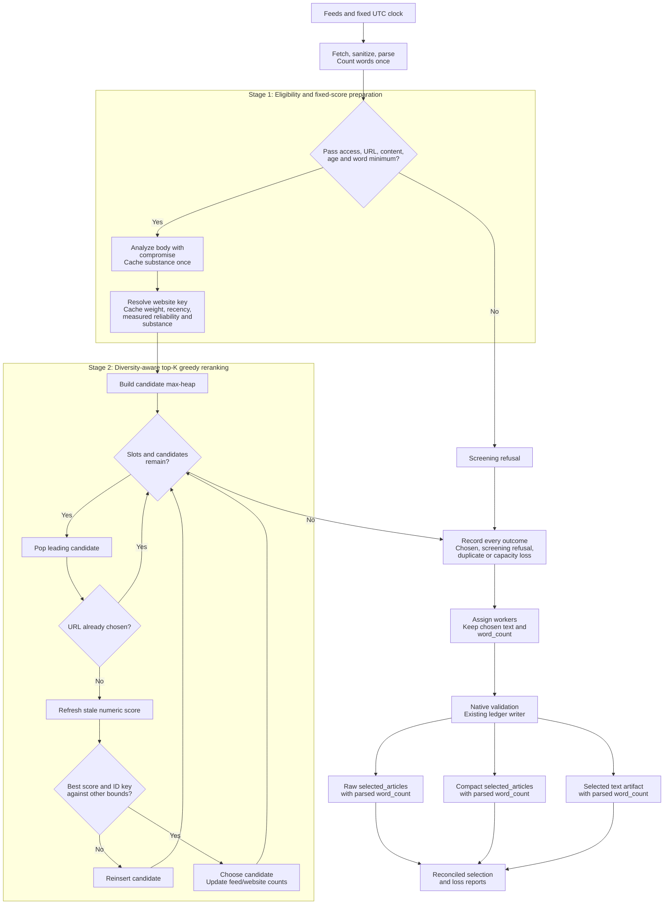

# Diversity-aware top-K greedy reranking

**Last Updated**: 2026-11-02
**Level**: 5 - selection design and current planner payloads.

## 0 - Operating contract

Table A

| Id | Field | Value |
| --- | --- | --- |
| A1 | Why this plan exists | Select the strongest available digest inputs without leaving article slots unused because of source allocations. K means the maximum number of articles to select. |
| A2 | In scope | Parse-time word-count reuse; cached substance scoring during screening; source-weight ranking; one global age policy; two-stage cached scoring and candidate-level lazy selection; complete losses; native contracts, input fingerprints, workflow controls and reports. |
| A3 | Chosen strategy | Prepare each eligible candidate's fixed numeric score, then use a lazy max-heap with one entry per candidate. Apply the corrected reliability, continuous length and language-analysis rules below. Do not substitute feed/website pair groups, equal-score lists or another optimizer. |
| A4 | Capacity contract | Select the smaller of K and the number of distinct eligible canonical URLs. Scores may be negative. No unstated minimum-score gate. |
| A5 | Current status | Execution-ready plan; application implementation has not started. Rows 1-4 are separate PRs, and each must leave its current producers, consumers and tests working. |
| A6 | Delivery | Four sequential PRs: contract/configuration readiness; substance scorer and screening cache; selection-engine replacement with its required consumer changes; run metrics and audit reports. Declare new shapes before their logic, but remove a live field only with the last producer and consumer that use it. Tests and affected fixtures ship in every PR, not only row 4. |
| A7 | Format rule | Current-only planner formats. Refuse older affected formats with diagnostics; preserve historical files unchanged. No conversions, bridges, dual readers, dual writers or legacy selector flags. |
| A8 | ESCALATE triggers | 1. A requested rule has two unresolved meanings. 2. A changing score could increase during selection. 3. A changing contract has a consumer not named in this plan. 4. A new shared state store or runtime destination is proposed. 5. A scoring rule cannot be implemented from the declarations below. The known catalog-probe dependency is handled in row 1; it is not an undiscovered consumer. |
| A9 | Execution | Execute per docs/how-to/execute-a-plan.md: one maintainer carries the plan and delegates a row where delegation pays; keep parallel N = 4 rows in flight, refilling a slot as soon as a worker returns and never waiting on a merge; consult a persona only where two answers would lead to different code; AUTO-merge on green gates; honor the ESCALATE triggers in section 0. AUTHOR-AND-STOP until the user authorizes. |
| A10 | Dispatch constraint | Rows depend on the preceding merged PR and overlap named files. Their effective parallelism is one, regardless of the execution stamp's pool ceiling. Do not remove active bucket fields in row 1 or leave row 3's readers broken until row 4. Check conflicts against other work; do not edit either engineering-instruction file. |
| A11 | Source-tier rule | From row 3, no source_tier/tier or applied_tier_weight is used to enroll, screen, score, rank, set quotas or fingerprint top-K inputs. Authority uses source.weight through H16. Rows 1-2 retain the existing selector until its single replacement; other subsystems retain their catalog classifications. |
| A12 | Ledger word-count rule | Row 1 makes the parser's retained count reusable. Row 3 adds that exact required integer to selected metadata, the text artifact, raw Parquet and compact Parquet together. A missing count fails validation; no downstream recount, null fill or zero default. |
| A13 | Stage 1 in English | Read the configured feeds; fetch and sanitize article bodies; retain the final body's parsed count. Apply access, URL, content, age and word-floor checks. Analyze each survivor with compromise once during screening and cache substance. Resolve a website key from its canonical URL. Cache the full base from source weight, recency, measured pass history and substance; missing history adds no penalty. |
| A14 | Stage 2 in English | Put every eligible candidate's cached score in the max-heap. Pop the leading candidate, skip an already-chosen URL, refresh only its current numeric diversity terms, and compare its complete key with the next cached upper bound. Reinsert if another candidate may outrank it; otherwise choose it and update only its feed/site counts. Repeat to the article limit or exhausted unique supply. |
| A15 | Delivery in English | Give every original unchosen candidate a duplicate or capacity loss. Derive metadata and original text from the same winners; assign workers without reranking. The existing TypeScript writer validates and writes the selected-article ledgers with the parsed count, then produces the text artifact and reconciled reports. |

Table B

| Id | Out of scope | Cost to leave it out | Condition to include it |
| --- | --- | --- | --- |
| B1 | A separately configured metadata top-M shortlist | The selected two-stage method is cached scoring followed by the lazy heap; cheap gates reduce N to eligible M without discarding that pool's tail. | An explicit instruction selecting the other coarse-shortlist pattern and defining its refill/tail behavior. Do not invent or forbid that variant. |
| B2 | A factual-quality model or semantic story deduplication | Shape scores do not verify facts; different URLs for the same story can remain. | A content-quality requirement, recorded evaluation inputs and an operator-controlled model destination. |
| B3 | Hard source concentration bounds or guaranteed topic coverage | A scarce pool can still produce one-source output; feed/site diversity is not topic diversity. | A defined coverage requirement and a decision about the resulting underfill. |
| B4 | Non-planner taxonomy redesign, Python contracts and published-site redesign | Other readers retain their classification fields and format rules. The catalog probe's existing shared-snapshot dependency is removed without changing catalog behavior in row 1. | An affected consumer beyond that named dependency. |
| B5 | Historical data rewriting or a new scoring ledger | Old affected planner files are unavailable to current readers; scores remain in existing selected output. | A different persistence requirement with its own cost and scope decision. |

### Complete stage flow



## 1 - Status Reckoner

Table C

| Id | # | Row title | Depends-on | Parallel-group | Status | Worktree | PR | Subagent |
| --- | --- | --- | --- | --- | --- | --- | --- | --- |
| C1 | 1 | Prepare contracts and configuration | - | A | PENDING | - | - | - |
| C2 | 2 | Add substance scoring during screening | 1 | B | PENDING | - | - | - |
| C3 | 3 | Replace the selection engine and its consumers | 2 | C | PENDING | - | - | - |
| C4 | 4 | Add diversity run metrics and audit reporting | 3 | D | PENDING | - | - | - |

## 2 - Row 1 - Prepare contracts and configuration

- **Scope:** Declare the new scoring inputs, reuse the parser's count and remove the catalog probe's dependence on planner snapshots without changing current selection.
- **Files touched:**
  - `TODO/20261101-diversity-aware-top-k-selection-plan.md`
  - `config/feed-ingest-plan.json`
  - `packages/common-contracts/src/index.ts`
  - `packages/common-contracts/src/version.ts`
  - `packages/common-contracts/src/schemas/config.schema.ts`
  - `packages/common-contracts/src/schemas/policy.schema.ts`
  - `packages/common-contracts/src/schemas/screened-article.schema.ts` (new)
  - `packages/common-contracts/test/config.test.ts`
  - `packages/common-contracts/test/schema-binding.ts`
  - `packages/common-contracts/test/screened-article.test.ts` (new)
  - `packages/feed-probe/src/source-selection.ts`
  - `packages/feed-probe/test/feed-probe.test.ts`
  - `packages/feed-probe/test/feed-probe-cli.test.ts`
  - `services/feed-ingest-plan/src/config/resolve-policy.ts`
  - `services/feed-ingest-plan/src/harvest-feeds/dom-extractor.ts`
  - `services/feed-ingest-plan/src/harvest-feeds/extraction-quality.ts`
  - `services/feed-ingest-plan/test/harvest.test.ts`
  - `services/feed-ingest-plan/test/policy.test.ts`
  - `docs/architecture/sources/feed-curation.md`
  - `docs/architecture/sources/extraction-quality.md`
- **Acceptance gates:** Local: M1, the common-contracts, feed-probe and service type checks, and the named schema/probe/harvest/policy cases in this file list. Check primary, fallback, empty, paywall and Unicode-whitespace recordings. CI: required checks on this PR candidate. Keep the named parity record for row 2.
- **Oracle:** Bounded before/after recordings have the same parse text/count/quality results, accepted and refused catalog inputs, and current selected identities while quality calculation receives the retained count. This proves preparation without changed selection, not the final scoring design or a speed increase.

Table D

| Id | # | Decision | Authority |
| --- | --- | --- | --- |
| D1 | 1 | `word_count` is the authoritative count of the final sanitized body, produced during parse. Require it downstream; never calculate it again in screening or selection. | Stage ownership |
| D2 | 2 | Count the primary body once. If fallback produces a different body, count that body once, compare the cached values and retain the winner's count. | Existing fallback behavior |
| D3 | 3 | Pass the retained count into extraction-quality calculation instead of having that calculation call the word counter again. Do not add an optional recount fallback. | Single calculation |
| D4 | 4 | Independent corroboration remains an independent measurement. Do not replace its count with the extracted body's count or remove its contamination check. | Extraction trust boundary |
| D5 | 5 | Keep existing parsed payload meanings and shared extraction-quality fields unchanged in this structural PR. | Output parity |
| D6 | 6 | Add G2/G7-G9 and G12-G20/G22-G24's scoring configuration, F2's native screening declaration and I18's numerical declaration. The current policy resolver must exclude new global-only blocks from source overrides. Keep active bucket/cap/source/selected shapes and the current triage minimum until their named replacement rows. | Working intermediate release |
| D7 | 7 | `packages/feed-probe/src/source-selection.ts` calls SourceSnapshotSchema for catalog validation today. Remove that planner coupling and validate through its existing CatalogSourceSchema; preserve field bounds, defaults, lifecycle placement, URL rules and duplicate checks. Keep catalog tier classification unchanged. | Verified external consumer |
| D8 | 8 | Do not remove tier, applied_tier_weight or selected fields in this PR. Do not declare an unused second selected-row format. Row 3 changes the one native format together with all active producers/readers. | Reader/writer coherence |
| D9 | 9 | Keep the existing recency and reliability settings at G5/G6/G21. Add no second spelling of their values. Row 2 changes the one existing triage.min_words setting to G11's final value. | Single policy authority |

Table E

| Id | # | Rejected alternative | Why rejected | Cost to take | Authority |
| --- | --- | --- | --- | --- | --- |
| E1 | 1 | Recount in every consumer | Repeats text work and allows count definitions to drift. | Additional body scans and another implementation to keep consistent. | Single calculation |
| E2 | 2 | Cache by text hash across articles | Adds retained state when one body's local count is enough. | Hashing, cache memory, lifetime rules and collision handling. | Smallest sufficient cache |
| E3 | 3 | Delete required contracts/configuration before replacing their callers | The current selector still reads buckets and writes required tier/cap fields; a removal-only PR fails runtime validation. | Convert the selector and every affected caller in that same PR, recreating the large release this phasing removes. | Working intermediate release |
| E4 | 4 | Add legacy optional fields or a second schema to make early removal pass | Creates the compatibility machinery this replacement does not need. | Two format paths, test matrices and a later deletion. | One native format |

## 3. Mathematical Model & Scoring Specification

### A. Static Base Score (Computed Once per Candidate)

```math
\text{BaseScore}(d) = A(d) + R(d) + \Delta_{\text{pass}}(d) + Q(d)
```

#### 1. Source Authority Prior

```math
A(d) = \alpha \cdot w_{\text{feed}}
```

* `alpha`: Configured authority weight (default: `1.0`).
* `w_feed`: The configured `source.weight`. No source-tier or taxonomy multiplier.

#### 2. Continuous Recency

```math
R(d) = w_r \cdot \left(\frac{1}{2}\right)^{\frac{\max(0, \text{age\_hours})}{h}}
```

* `w_r`: Recency weight (default: `0.6`).
* `h`: Recency half-life (default: `18.0` hours).
* Age basis: Trusted published timestamp, or first-sight timestamp when published is unavailable.

#### 3. Technical Reliability Adjustment

```math
\Delta_{\text{pass}}(d) =
\begin{cases}
0 & \text{if disabled or history is unmeasured} \\
-A(d)\cdot\left(1-\max(f,p_s)\right) & \text{otherwise}
\end{cases}
```

* `f`: Reliability floor (default: `0.5`).
* `p_s`: The measured technical article-pass fraction over the configured 30-day window.
* Missing or incomplete coverage, a null fraction or a zero denominator is unmeasured: the adjustment is `0.0`, and the observed fraction remains null. A measured zero fraction still receives the configured floor penalty.

#### 4. Candidate Substance Quality

Configured evidence of depth, not factual verification or an unbiased quality measurement:

```math
Q(d) = Q_{\text{bandpass}}(\text{words}) + Q_{\text{entity}}(\text{density}) - Q_{\text{hype}}(\text{headline})
```

**Length Guardrail (`Q_bandpass`):**

* Fewer than 250 words: Disqualified at screening.
* 250-399 words: Linear ramp from `0.0` to `1.0`.
* 400-1500 words: Flat full credit (`1.0`). Zero incentive to inflate word count.
* 1501-3500 words: Continuous linear decay from `1.0` at 1500 words to `0.50` at 3500 words.
* More than 3500 words: Clamped at `0.50`; no jump at word 3001 or 3501.

```math
Q_{\text{bandpass}}(w)=
\begin{cases}
\text{screening refusal} & w<250 \\
\frac{w-250}{149} & 250\leq w<400 \\
1 & 400\leq w\leq1500 \\
1-\frac{0.5(w-1500)}{2000} & 1500<w\leq3500 \\
0.5 & w>3500
\end{cases}
```

**Factual Density (`Q_entity`):**

* Ratio of recognized proper-name spans plus numerical quantities to sentence count, using compromise's analysis. One-word names count; overlapping spans do not earn duplicate credit.
* Normalize between `0.0` and `0.30` score points under H6. This is a lexical-density signal, not proof that a statement is factual.

**Headline Hype Deduction (`Q_hype`):**

* Deducts up to `-0.25` points for:
  - Capitalization shouting: at least two unexempt ALL-CAPS words, with library-recognized and short uppercase abbreviations exempt.
  - Exclamatory or sensational punctuation (`!!`, `?!`).
  - Headline/opening mismatch after noun and verb inflection normalization. This is a weak lexical signal, not a semantic clickbait classifier.

### B. Dynamic Marginal Score & Diversity Penalty

At step `t`, with already selected set `S_(t-1)`, the marginal score for an unselected candidate is:

```math
\begin{aligned}
\text{MarginalScore}(d) &= \text{BaseScore}(d) \\
&\quad - \text{Penalty}_{\text{domain}}(d, S_{t-1}) \\
&\quad - \text{Penalty}_{\text{feed}}(d, S_{t-1}) \\
&\quad + \text{Bonus}_{\text{novelty}}(d, S_{t-1})
\end{aligned}
```

#### 1. Quadratic Domain Penalty

```math
\text{Penalty}_{\text{domain}} = \lambda_{\text{domain}} \cdot \left[N_{\text{domain}}(d, S_{t-1})\right]^2
```

* `lambda_domain = 0.04`.
* `N_domain`: Number of articles already selected from the candidate's `website_group`.
* Resolve the group from the validated canonical URL, falling back to its normalized hostname. No eligible candidate has a missing penalty key.
* Scale effect: 1st article = `0.0`; 2nd = `-0.04`; 3rd = `-0.16`; 4th = `-0.36`; 5th = `-0.64`; 6th = `-1.00` score points.

#### 2. Quadratic Feed Penalty

```math
\text{Penalty}_{\text{feed}} = \lambda_{\text{feed}} \cdot \left[N_{\text{feed}}(d, S_{t-1})\right]^2
```

* `lambda_feed = 0.02`.
* `N_feed`: Number of articles already selected from the candidate's specific `feed_id`.

#### 3. Deterministic Novelty Bonus

```math
\text{Bonus}_{\text{novelty}} =
\begin{cases}
\beta_{\text{novelty}} & \text{if } N_{\text{feed}}(d, S_{t-1}) = 0 \\
0 & \text{otherwise}
\end{cases}
```

* `beta_novelty = 0.15`.
* Gives unrepresented feeds an initial boost so their best story can overcome the inertia of dominant sources.

## 4 - Row 2 - Add substance scoring during screening

- **Scope:** Implement the real compromise-based substance scorer, apply the 250-word screening floor and cache each survivor's score without changing the selection algorithm.
- **Files touched:**
  - `TODO/20261101-diversity-aware-top-k-selection-plan.md`
  - `config/feed-ingest-plan.json`
  - `packages/common-contracts/src/schemas/screened-article.schema.ts`
  - `packages/common-contracts/test/screened-article.test.ts`
  - `services/feed-ingest-plan/package.json`
  - `services/feed-ingest-plan/bun.lock`
  - `services/feed-ingest-plan/src/screen-article-candidates/freshness-decay.ts`
  - `services/feed-ingest-plan/src/screen-article-candidates/triage-gates.ts`
  - `services/feed-ingest-plan/src/screen-article-candidates/score-article-substance.ts` (new)
  - `services/feed-ingest-plan/src/screen-article-candidates/normalize-article-terms.ts` (new)
  - `services/feed-ingest-plan/test/triage.test.ts`
  - `services/feed-ingest-plan/test/curate.test.ts`
  - `services/feed-ingest-plan/test/substance-score.test.ts` (new)
  - `services/feed-ingest-plan/test/plan-recordings.ts`
  - `tests/fixtures/feed-ingest-plan/substance-score-cases.json` (new)
  - `docs/architecture/sources/article-substance-scoring.md` (new with the real scorer)
  - `docs/architecture/sources/feed-curation.md`
- **Acceptance gates:** Local: M1, common-contracts/service checks, and the named screening/scoring/schema cases. Run the real library against the recorded language cases, all H1/H2 endpoints and invalid settings. CI: required checks on this PR candidate. Renew any affected current fixtures here.
- **Oracle:** Real recorded articles produce H1-H13's expected components and a finite required freshness.substance_score; every cheap refusal exits before substance analysis. The existing selector retains its behavior on a comparison pool whose articles pass the new word floor. This proves the measurement/cache and intended floor, not that the final ranking is active or that the library understands every paraphrase.

### Shared decisions and declared contracts

Table F

| Id | # | Decision | Authority |
| --- | --- | --- | --- |
| F1 | 1 | Use cheap eligibility checks on all parsed candidates, then score only their survivors in the same screening loop. N is the parsed count; M is the survivor count, not a configured multiple of K. | Exact capacity contract |
| F2 | 2 | The screening output requires a finite `ScreenedCandidate.freshness.substance_score`. Declare timing evidence and this extended screening evidence in the native schema; infer service types from it. No missing-score default. | Native contract |
| F3 | 3 | The numerical selector receives only identities, fixed numeric components and the derived website identity. It has no article-text input. The adapter creates one numerical record per survivor and joins chosen identities back to original content afterward. | Stage separation |
| F4 | 4 | Authority is the configured authority coefficient times `source.weight`. Equal configured feed weights provide uniform weighting through the same path. No taxonomy multiplier. | Source-weight design |
| F5 | 5 | Remove the planner's taxonomy read, source-tier activation/coverage gates and taxonomy contribution to its fingerprint. Feed lifecycle status still controls enrollment. Leave the shared taxonomy file and its non-planner readers unchanged. | Tier-independent planner |
| F6 | 6 | Apply the same global age envelope before download where age is known, and during screening. Use the original captured UTC evaluation clock; preserve trusted publication, first-sight fallback, signed future ages and unknown-age evidence. Unknown age receives no recency contribution, not a fabricated age. | Existing time evidence |
| F7 | 7 | Use J7's compromise version for sentence boundaries, proper-name/quantity spans and noun/verb normalization. Compile only the remaining trusted punctuation patterns once per screening invocation. Analyze each survivor's body once for density; use bounded headline/opening copies for overlap. Never recount words or analyze text in heap refreshes. | Cached screening |
| F8 | 8 | H19 declares the draft's complete cached and persisted base score. H24 adds only current diversity terms to it. Static adjustment entries are a breakdown of terms already in base, not another addition to marginal. Change this field meaning in the current native format; do not keep a legacy base convention. | Draft score decomposition |
| F9 | 9 | Missing/incomplete article-pass history contributes a numeric zero adjustment, not a measured zero pass fraction. Apply the floor only to a measured fraction. Preserve the existing article_pass_rate adjustment term and observed null evidence. | Evidence-neutral cold start |
| F10 | 10 | Use current-run website and feed counts, with the draft's absolute count-squared penalties. Remove normalized shares and current-day publisher-exposure ranking. Already-published URL checks remain. | Replacement diversity rule |
| F11 | 11 | The first-use bonus means an unrepresented feed in this selection, not a new story or a reserved exploration slot. | Accurate meaning |
| F12 | 12 | Preserve the original admitted array for terminal accounting. Remove duplicate carriers only from the working heap, not this array. Increment global counters only after committing the winner. | Complete accounting |
| F13 | 13 | In each release, update its affected native stamps, changelogs, consumers and row-version mappings together. Row 3 changes source snapshots in candidates, feed offers, feed outcomes, parsed batches and enclosing private snapshots/receipts. A fetched-document body does not embed the snapshot. Row 4 changes plan-run rows and their responses independently. Do not postpone a required reader or fixture to a later PR. | Current-only formats |
| F14 | 14 | Re-record current fixtures using the real API and writer. Keep bounded older-format refusal fixtures unchanged; never transform stored historical ledgers. | Current output proof |
| F15 | 15 | Delete retired mechanisms rather than deprecating them. There is no existing upward-transfer engine to remove; that was an earlier proposal, not current behavior. | Verified implementation |
| F16 | 16 | Treat the initial article-shape and penalty coefficients as policy defaults, not calibrated quality measurements. They implement preferences, not clickbait or monopoly guarantees. | Measurement boundary |
| F17 | 17 | Sections 3.A/3.B define the mathematical model. Tables G/H resolve its configuration, exact integer endpoints and lexical measurements; they must implement this model, not replace it. Table O checks draft coverage, Table P gives derived examples and Table N assigns work. No worker chooses a different curve, sign or stopping rule. | Complete implementation specification |
| F18 | 18 | No finite acronym allowlist, hand-written sentence/name/number tokenizer, naive suffix stripping or substring matching. Use the supported library calls in H3-H11, not the nonexistent entities() call. The library handles English inflections, not arbitrary derivational pairs, synonyms or factual correctness. | Verified API and limits |
| F19 | 19 | Row 2 retains the existing selector and its active required fields. The new screening measurement is a complete capability; it becomes a ranking input only in row 3. No second selector, shadow pipeline or legacy switch is introduced. | Incremental real delivery |

### Policy declarations

Table G

| Id | Config path under `curate_articles` unless stated | Formula symbol | Default and meaning | Validation |
| --- | --- | --- | --- | --- |
| G1 | `article_limit` | `K` | 100 maximum selected articles | Positive integer |
| G2 | `global_age_ceiling_hours` | `ageCeiling` | 36 hours of eligible age for every feed | Positive finite hours; one optional run override and one reported origin |
| G3 | `source_authority_weight` | `alpha` | 1.0 score-point scaling of configured feed weight | Finite, nonnegative |
| G4 | `source_reliability_penalty_enabled` | `passEnabled` | True: apply the technical article-pass adjustment | Boolean |
| G5 | Existing `collect.reliability_floor` in `config/idhazh.json`, outside curation | `f` | 0.5 minimum retained authority fraction for measured pass history | Finite fraction from zero through one; no duplicate curation setting |
| G6 | Existing `triage.recency_weight`, `triage.recency_half_life_hours`, outside curation | `w_r`, `h` | 0.6 maximum recency points; 18 hours to halve that contribution | Nonnegative finite weight; positive finite hours; retain these existing keys |
| G7 | `diversity.lambda_domain` | `lambda_website` | 0.04 points per squared prior website-group count | Finite, nonnegative |
| G8 | `diversity.lambda_feed` | `lambda_feed` | 0.02 points per squared prior feed count | Finite, nonnegative |
| G9 | `diversity.novelty_bonus` | `beta` | 0.15 points before a feed's first selected article | Finite, nonnegative |
| G10 | `website_grouping.include_private_suffixes` | - | True: retain the configured private-suffix grouping policy | Boolean; grouping recomputed from canonical URLs |
| G11 | Existing `triage.min_words`, outside curation | `minWords` | 250 words from row 2: inclusive screening floor and start of the short-article ramp | Positive integer; the single authority for both checks |
| G12 | `substance.word_count_target_min`, `substance.word_count_target_max` | `targetMin`, `targetMax` | 400 through 1,500 words: full length credit | Integers; targetMin >= minWords + 2 and targetMax >= targetMin |
| G13 | `substance.word_count_plateau` | `plateauWords` | 3,500 words: last word count in the continuous long-article decline | Integer; plateauWords > targetMax |
| G14 | `substance.length_scores.minimum`, `.full`, `.above_plateau` | `lengthMinimum`, `lengthFull`, `lengthAbove` | 0.0, 1.0 and 0.50 length points respectively | Finite nonnegative levels; minimum <= above_plateau <= full; no decline_end setting |
| G15 | `substance.entity_density_weight` | `densityWeight` | 0.30 maximum name/number-density points | Finite, nonnegative |
| G16 | `substance.entity_density_full_credit` | `densityFull` | 1.0 counted name/number signal per sentence reaches full density credit; provisional default, not factual calibration | Positive finite signal density |
| G17 | `substance.headline_hype_penalty` | `hypeCap` | 0.25 maximum headline deduction | Finite, nonnegative magnitude |
| G18 | `substance.headline.shouting_weight`, `.punctuation_weight`, `.opening_mismatch_weight` | `hShouting`, `hPunctuation`, `hOpening` | 0.10, 0.10 and 0.05 deduction points for the three headline flags; provisional split | Finite, nonnegative; total deduction clamped by G17 |
| G19 | `substance.headline.opening_text_max_characters`, `.keyword_min_letters` | - | Inspect at most 2,000 opening Unicode characters; significant headline words have at least four letters | Positive integers |
| G20 | `substance.headline.shouting_min_letters`, `.shouting_min_words` | - | At least two letters per shouting token and at least two unexempt shouted tokens for the flag | Positive integers |
| G21 | Existing `collect.reliability_window_days` in `config/idhazh.json`, outside curation | `passWindow` | Retain the 30-day technical-history setting; no second curation window or fabricated complete history | Positive integer; retain its existing evidence-completeness rules |
| G22 | `substance.headline.acronym_min_characters`, `.acronym_max_characters` | - | Exempt uppercase letter/digit tokens of 2-5 characters as short abbreviations, in addition to library-recognized acronyms | Positive integers; maximum >= minimum; no word allowlist |
| G23 | `substance.headline.stop_words` | - | Grammar-only keyword exclusions: a, an, the, and, or, but, for, nor, so, yet, as, at, by, in, of, on, to, with, from, into, is, are, was, were, be, been, this, that, these, those | Distinct nonempty lowercase terms; not an authority or quality list |
| G24 | `substance.headline.punctuation_patterns` | - | `!{2,}`, `\?!`, `!\?`: repeated exclamation or mixed question/exclamation punctuation | Trusted nonempty Unicode regular expressions; reject invalid patterns by field name |

Table H

| Id | Rule | Exact behavior |
| --- | --- | --- |
| H1 | Short-article length equation | With `w = candidate.word_count`, reject at screening if `w < minWords`. For `minWords <= w < targetMin`, `Q_length = lengthMinimum + (lengthFull - lengthMinimum) * (w - minWords) / (targetMin - 1 - minWords)`. For `targetMin <= w <= targetMax`, `Q_length = lengthFull`. Do not change the inclusive endpoints or use targetMin as the ramp denominator. |
| H2 | Long-article length equation | For `targetMax < w <= plateauWords`, `Q_length = lengthFull + (lengthAbove - lengthFull) * (w - targetMax) / (plateauWords - targetMax)`. For `w > plateauWords`, `Q_length = lengthAbove`. Both joins are continuous. No extra full-credit word, final jump or unused decline_end coefficient. |
| H3 | Sentence units | Analyze the sanitized body with `nlp(text)` and use `doc.sentences().length`. The library handles abbreviations such as U.S. and Dr.; this scorer does not reuse or change the independent extraction-quality sentence rule. A final unterminated sentence counts under the library's behavior. |
| H4 | Name signals | Use `doc.match('#ProperNoun+')` and count its non-overlapping spans. The plus means one or more proper-noun terms, not two capitalized words. A one-word recognized name counts once, and a multiword name counts once. Recognition is the library's English heuristic, not a complete entity database. |
| H5 | Numeric signals | Use `doc.numbers().not(properNames)` and count its non-overlapping quantity spans. A recognized multiword quantity counts once; a quantity overlapping H4's name span earns no second signal. This replaces raw numeric-token counting deliberately. |
| H6 | Density equation | Let `names` and `numbers` be H4/H5 hit counts and `sentences` be H3's count. `density = sentences == 0 ? 0 : (names + numbers) / sentences`. `Q_entity = densityWeight * min(1, max(0, density / densityFull))`. No units means no density contribution, not a claim of zero factual content. G16 explicitly supplies the normalization missing from the draft. |
| H7 | Headline and opening terms | Preserve an original-case headline document for shouting. For comparison, create lowercase headline and bounded-opening documents, run `nouns().toSingular()` then `verbs().toInfinitive()`, and read `termList()` normal values. Lowercasing before tagging avoids treating every title-cased headline word as a name. Never mutate the stored title or article body. |
| H8 | Acronyms and stop words | Exempt spans returned by the headline's `acronyms()` plus G22's uppercase letter/digit tokens. Library tags alone are insufficient: ordinary abbreviations can be missed. G23 removes grammar words from keyword comparison only and adds no score term. Short-word exemption is conservative and can miss some short shouted words; it is not an unlimited exemption for every uppercase token. |
| H9 | Shouting flag | Count original-case letter-bearing terms meeting G20's letter minimum, equal to uppercase and different from lowercase, after H8's exemptions. Flag only when the count reaches G20's minimum shouted-word count. One unrecognized uppercase word cannot cause this deduction. |
| H10 | Punctuation flag | Any G24 pattern matches. Each headline flag is one or zero and contributes once, not once per match. |
| H11 | Opening mismatch flag | Keep distinct H7-normalized headline terms containing G19's minimum Unicode letters after G23 exclusions. Flag only if that set is nonempty and has no whole-term intersection with the normalized opening set. This matches ordinary inflections without substring matching. It does not equate every derivational pair, such as scrutiny/scrutinize, or synonyms; that residual limit remains explicit and never becomes a screening refusal. |
| H12 | Headline and final substance equations | Let `shouting`, `punctuation` and `openingMismatch` be H9/H10/H11's one-or-zero flags. `Q_hype = min(hypeCap, hShouting * shouting + hPunctuation * punctuation + hOpening * openingMismatch)`. `Q = Q_length + Q_entity - Q_hype`. Q_hype is a nonnegative magnitude, never a negative value subtracted twice. Q is signed and not a probability; its default range is -0.25 through 1.30 points. |
| H13 | Analysis handling | Compile G24 once per screening call and keep library documents local to their article. Use only declared public APIs; do not call entities(), an unverified root computation, or hand-written suffix stripping. Parsing/configuration failures are explicit, not zero-score fallbacks. Library grammar tags and match syntax are protocol selectors, not tunable scoring weights. |
| H14 | Reliability arithmetic | `passAdjustment = !passEnabled || p == null ? 0 : -A * (1 - max(f, p))`. H18 supplies null for missing/incomplete coverage or a zero denominator. Do not substitute zero for p before this branch. A measured p of zero still receives the floor penalty; an unmeasured feed retains its first-use bonus without a history penalty. |
| H15 | Timing and eligibility equations | `T` is the parsed batch's captured UTC evaluation instant in milliseconds. Use trusted publication within the existing `collect.max_future_hours` tolerance; otherwise use recorded first sight; otherwise timing is unavailable. With effective instant `t`, `ageHours = (T - t) / MILLISECONDS_PER_HOUR`, where this named unit constant is 3,600,000 milliseconds per hour. Admit age when it is unavailable or `ageHours <= ageCeiling`. Preserve signed ages and the existing publication-trust rule. |
| H16 | Authority equation | `A(d) = alpha * d.source.weight`. The removed taxonomy weight is not another factor. Each configured feed weight remains in the unit interval; equal weights use this same equation. |
| H17 | Recency equation | `R(d) = ageHours == null ? 0 : w_r * (0.5 ** (max(0, ageHours) / h))`. Use H15's original age and G6's coefficients. Unknown age remains null; near-future timing cannot increase R above w_r. |
| H18 | Technical pass fraction | For the feed's complete G21 window, `p = passed / (passed + refused)`. Count only original captures passing technical checks and known source-attributed technical refusals. Do not count publication, age, category, content-policy or selection losses. Missing coverage or a zero denominator gives an unavailable p, not measured zero. H14 uses `f = G5`; if G4 is false its adjustment is zero. |
| H19 | Draft base score and cache | `BaseScore = ((A + R) + passAdjustment) + Q`. Cache it once from screening evidence and captured history; persist `ratings.base_article_score = BaseScore`. `feed_authority_score = A`; `recency_score = R`. No component changes after heap setup. This replaces the older field meaning rather than preserving it through a bridge. |
| H20 | Website identity and counts | Resolve every numerical record's nonempty website_group from its validated canonical URL using the existing website-group.ts and tldts policy: registrable domain, otherwise lowercase hostname with a trailing DNS dot removed. Recompute consistently rather than mixing supplied grouping and fallback keys. Invalid URLs fail validation. A valid HTTP URL has a hostname, so no feed-ID escape or shared null key is needed. Count prior winners by this key and by feed_id across the full pool. |
| H21 | Website penalty equation | `P_website = lambda_website * (n_website ** 2)` and its signed adjustment is numeric `-P_website` for every candidate. A not-yet-selected key has count zero, not missing identity. Do not divide by K or the current selected count. |
| H22 | Feed penalty equation | `P_feed = lambda_feed * (n_feed ** 2)`; its signed adjustment is `-P_feed`. The first article has zero penalty because the count is measured before the choice. |
| H23 | First-use bonus equation | `B_feed = n_feed == 0 ? beta : 0`. This bonus disappears after the feed's first unique-URL winner; skipped duplicate carriers do not remove it. |
| H24 | Marginal score equation | `M(d,S) = ((BaseScore - P_website) - P_feed) + B_feed`. Evaluate in this order with native finite numbers; reject a non-finite result explicitly. The score is not clamped to zero, rounded for ranking, normalized by selected size or recomputed from text. |
| H25 | Complete ordering key | `key(d,S) = (M(d,S), d.candidate_id)`. Greater numeric M wins; exactly equal M uses the smaller candidate_id under direct ASCII comparison. No tolerance or display rounding defines a tie. Retain one key per candidate; do not replace this with static-score pair ordering. |
| H26 | Capacity equation | Let `U = size(set(admitted.map(d => d.url_key)))`. The chosen count is `K_chosen = min(K, U)`. This is a maximum unique-URL count, not a source reservation or a positive-score threshold. Exhaustion means no remaining unchosen, unseen-URL candidate. |
| H27 | Accounting equation | Parsed identities are the disjoint union of screening rejections and admitted identities. Admitted identities are the disjoint union of chosen identities, duplicate-carrier losses and capacity losses. Thus `parsed_count = screening_rejections + chosen_count + duplicate_losses + capacity_losses`. Use original arrays, not only the survivors left inside queue working lists. |

### Heap and output contracts

Table I

| Id | Contract | Required behavior |
| --- | --- | --- |
| I1 | Candidate membership | One numerical record per eligible original candidate, including distinct carriers of the same URL. Preserve the complete admitted array outside the heap. Keep original text in the owning stage, not in numerical records. |
| I2 | Initial keys | Evaluate H20-H25 once with empty counts for every record, using cached BaseScore rather than article text. Bulk-initialize the in-repository max-heap from these complete keys; do not sort into feed/site groups or prune to K entries. |
| I3 | Heap entry | One candidate entry containing its numerical record, last evaluated score/terms, complete key and selection-step number. A stale key is an upper bound for this candidate. There is no queue ceiling or fixed ranked shortlist. |
| I4 | Refresh | Pop the heap root and discard an already-chosen identity or URL before scoring. If its step is stale, evaluate H20-H25 using current global counts and mark it current. Choose only if its complete key outranks or equals the remaining root's cached bound; otherwise reinsert it. A current entry needs no repeat calculation while S is unchanged. |
| I5 | Bounds | BaseScore and candidate identity are fixed. Counts only increase, penalties have nonnegative coefficients, and a first-use bonus can only disappear. Each candidate's score and complete key therefore cannot improve. Its previous key is a valid upper bound; comparing the refreshed key with the greatest other bound proves the same winner as full-scan greedy. Fail explicitly on a non-finite computed score. |
| I6 | Commit | Commit the popped, freshly evaluated winner, not the last candidate inspected. Record its exact terms, add its URL/identity, then increment both its feed count and resolved website count. Do not reinsert the winner. Other entries become stale because the chosen count increased. Skipped duplicate carriers change no counts and consume no slot. |
| I7 | Completion | Continue to A4's count even when all scores are negative. Preserve all original identities for one final loss pass; duplicate-of-selected-URL takes precedence over capacity loss. |
| I8 | Adjustment terms | Use exactly `article_pass_rate`, `substance_quality_score`, `domain_diversity_penalty`, `feed_diversity_penalty` and `novelty_bonus` in ratings.adjustments. The screening cache is freshness.substance_score; its ledger term is substance_quality_score. All five values are finite signed numbers under H12/H14/H21-H23, including numeric zero for unmeasured/disabled history. Observed unavailable pass history remains null in its own evidence. |
| I9 | Required selected word count | Add required `word_count: CountSchema` to the shared MetadataFields in `packages/common-contracts/src/schemas/selected-article.schema.ts`. This non-null integer belongs to SelectedArticleMetadataSchema, SelectedArtifactArticleSchema and SelectedArticleRowSchema. Copy candidate.word_count through selectedArticleMetadata, API/stage payloads, partition and both raw and compact selected_articles ledgers. No optional value, recount, null fill or default. Preserve the other retained identities, text, timing, raw weight and work fields. |
| I10 | Retired source/selected fields | In row 3, remove tier and applied_tier_weight from planner source snapshots and selected metadata; remove feed_limit, exploration_slot and cap_relaxations from selected projections. Convert native stage/API/partition/writer callers in the same PR. The catalog probe was decoupled in row 1; retain no legacy optional metadata or compatibility reader. |
| I11 | Retired configuration | In row 3, remove source_based_quality_buckets, soft_caps, mmr_weights, exploration_slot_share, per-tier age overrides and their helpers. Retain the existing G5/G6/G11/G21 settings as their single authorities. No old-key aliases, duplicate recency/floor settings or unused decline_end setting. |
| I12 | Active loss causes | Duplicate carrier: `REJECTED_DUPLICATE_CANONICAL_CARRIER`; eligible but unchosen: `REJECTED_GLOBAL_CAPACITY_REACHED`; global age refusal: `REJECTED_SCREENING_AGE_CEILING`. Retain the other safety/content causes and actual stage attribution. Remove retired quota/ladder/cap reasons from active producers and their enum. |
| I13 | Output projection | Derive metadata and the text artifact from the same chosen population. Join by chosen candidate identity, not the first matching URL. Partition assigns it without reranking or changing text/count. The existing native writer's raw and compact row projections both retain I9; prove this from actual Parquet readback, not schema presence alone. |
| I14 | Diagnostic counts | Declare the current selection response's heap_entry_count, score_refreshes and heap_pops in planner-stage.schema.ts before exposing them. Entry count is initial eligible M; refreshes count I4's stale numeric reevaluations, excluding initialization/duplicate discards; pops count every removal attempt. Row 3 removes quota controls/reports and explains global supply/losses. Row 4 adds U1-U5's saved run metrics, not a new ledger. |
| I15 | Input digest | Hash only the validated inputs this planner uses. Include the effective scoring policy and source weights; exclude the removed registry input. Preserve existing exclusion of reporting-only settings. |
| I16 | Exact numeric ties | Keep H25's complete score/ASCII-ID key on each candidate. If unequal base scores round to an equal marginal score after penalties, the smaller ID still wins. Apply that same comparator to heap bounds and refreshed entries; no grouped tie resolver, tolerance or score quantization. |
| I17 | Score projection order | Write signed adjustments in I8's order. Reconstruct base as `((feed_authority_score + recency_score) + article_pass_rate) + substance_quality_score`. Reconstruct marginal as `((base_article_score + domain_diversity_penalty) + feed_diversity_penalty) + novelty_bonus`. Static adjustments already belong to base; never add all five adjustments to it. There is no null domain adjustment. |
| I18 | Numerical input/output | The numerical input record contains only candidate_id, url_key, feed_id, website_group and base_score, the H19 cache. Require a nonempty website key and finite base; infer service types from the native declaration. Output is ordered chosen identities with H24's numeric score and H21/H22/H23's terms. The adapter retains other cached components and original content for I9/I17 projection. |

#### Reference greedy sequence

```text
Inputs: all admitted numerical records, effective policy.
State: chosen = [], chosen_ids = {}, seen_urls = {},
       feed_counts = {}, website_counts = {}.
Map lookups for a not-yet-selected feed or resolved website return count zero.
evaluate(record, state) means precisely H20-H25, never text analysis.
ahead(left, right) means the complete ordering rule in H25.

while chosen.length < K:
    best = null
    for record in all_admitted_records:
        if record.candidate_id in chosen_ids or record.url_key in seen_urls:
            continue
        evaluated = evaluate(record, state)
        if best is null or ahead(evaluated.key, best.key):
            best = { record, evaluated, key: evaluated.key }
    if best is null:
        break
    append best to chosen
    add best.record.candidate_id to chosen_ids
    add best.record.url_key to seen_urls
    increment feed_counts[best.record.feed_id]
    increment website_counts[best.record.website_group]

losses = []
for record in all_admitted_records:
    if record.candidate_id in chosen_ids:
        continue
    if record.url_key in seen_urls:
        append duplicate-carrier loss for record to losses
    else:
        append capacity loss for record to losses
return chosen, losses
```

#### Candidate-level lazy sequence

```text
Inputs and chosen/count state are the same as the reference sequence.
For each original admitted record, evaluate(record, empty chosen state).
Bulk-initialize a max-heap with:
    { record, evaluated, bound_key: evaluated.key, step: 0 }
Order bound_key by H25, not by insertion order or internal array position.
heap_entry_count = number of admitted numerical records
score_refreshes = 0
heap_pops = 0

while chosen.length < K and heap is not empty:
    entry = heap.pop()
    increment heap_pops
    if entry.record.candidate_id in chosen_ids
       or entry.record.url_key in seen_urls:
        continue

    if entry.step != chosen.length:
        evaluated = evaluate(entry.record, state)
        increment score_refreshes
        entry = { record: entry.record, evaluated,
                  bound_key: evaluated.key,
                  step: chosen.length }

    other = heap.peek()
    if other exists and ahead(other.bound_key, entry.bound_key):
        heap.push(entry)
        continue

    winner = entry
    append winner to chosen
    add winner.record.candidate_id to chosen_ids
    add winner.record.url_key to seen_urls
    increment feed_counts[winner.record.feed_id]
    increment website_counts[winner.record.website_group]

Produce losses by the reference sequence's final original-record pass.
```

Table J

| Id | Cost | Meaning and limit |
| --- | --- | --- |
| J1 | Screening | One cheap pass over N parsed candidates, plus text-rule work over M survivors. Parsing all fetched bodies has already happened; this change does not claim to avoid their download or parse cost. |
| J2 | Setup | Stage 1 caches fixed numeric scores in `O(M)` after screening's text work; bottom-up bulk heap construction is also `O(M)`. No pair sort, equal-score-list build or repeated body analysis. |
| J3 | Selection | Stage 2 performs constant-size numeric refreshes and logarithmic heap operations. Let K' be the chosen count, D discarded duplicate carriers and R stale score refreshes. Cost is `O((K' + D + R) * log(M + 1))`. The requested `O(K log N)` target applies when D + R scales with K, not as an unconditional worst-case bound: up to M entries can need refresh at each choice. Account for refreshes explicitly; do not change the draft's winner sequence to claim a lower bound. |
| J4 | Space | `O(M)` candidate entries/references and bounded per-pool count maps; original article text remains in the owning stage. |
| J5 | Queue implementation | A narrow typed binary max-heap in manage-candidate-heap.ts supplies bulk construction, peek, pop and push under the one complete-key comparator. No heap-js dependency or generic queue framework. Cost: maintaining this small algorithm and differential heap/selection tests; no line-count or unmeasured runtime target. |
| J6 | Exactness | The same sequence as deterministic full-scan greedy, not a globally optimal set. Soft count penalties discourage repetition but do not guarantee a publisher or topic share. |
| J7 | Language-analysis dependency | compromise 14.19.0 provides the scorer's abbreviation-aware sentences, proper names, quantities and inflection handling. It has two direct JavaScript dependencies, efrt and suffix-thumb; do not call it dependency-free. It is service-only, with no native build, model download or browser payload. No sub-millisecond or installed-byte claim is a gate. |

### Required bounded checks

Table K

| Id | Case | Failure it must expose |
| --- | --- | --- |
| K1 | At least 100 distinct eligible URLs from one feed/website | Any remaining quota, hard cap, negative-score stop or hidden shortlist leaves slots unused. |
| K2 | Six candidates; five share a feed/site with weight 1.0, the sixth has another feed/site with weight 0.99; choose two | Initial base ordering must not remain final ordering. With recency 0.6, substance 1.0 and reliability disabled, the next repeat scores 2.54 while the alternative scores 2.74. The lazy heap must select the alternative. |
| K3 | K2's first five instead carry one URL with distinct offered ordinals | Duplicate carriers must not consume capacity, counts or the first-use bonus. Preserve all original identities and fill both slots from distinct URLs. |
| K4 | Repeated ties, negative scores and changed input order | Any insertion-order or locale dependence; any accidental minimum-quality rejection. |
| K5 | A feed spans several websites; a website spans several feeds; grouping unavailable and mixed supplied evidence | Counters isolated to pairs, penalty-free missing groups, a shared null key or inconsistent grouping for the same canonical host produce incorrect winners. Use valid hosts for which registrable-domain lookup returns null and prove hostname fallback receives growing penalties. |
| K6 | Duplicate entry encountered before the final pick, and winner not last scanned | Lost rejection records, wrong winner counters or wrong content joins. |
| K7 | Cheap-gate failures and length boundaries | Failed candidates receive no substance analysis; the inclusive floor, ramp and both continuous long-curve joins match H1/H2. Check 1500/1501, 3000/3001 and 3500/3501 explicitly. |
| K8 | Recorded names, quantities and headlines | Include single-word names such as Bitcoin and France; multiword names; overlapping signals; U.S., Dr. and decimal punctuation; ordinary NATO/SEC/NASA/WHO abbreviations; a single shouted word versus two long shouted words; punctuation; and inflected headline/opening terms. Use the actual library, not hardcoded parser outputs. Expose substring false matches, shared mutable state and deduction above the cap. |
| K9 | Complete measured zero, null/missing/incomplete history, zero denominator, disabled adjustment and opposing RSS ratios | Every unmeasured case must give zero adjustment and retain null evidence; measured zero gives the configured floor penalty. A cold-start and an established feed both receive the first-use bonus when unrepresented. RSS success must not substitute for article-pass evidence. |
| K10 | Change only catalog tier data; change each retained coefficient separately | Taxonomy still affects planner eligibility/hash/ranking, or a tunable has no actual consumer. |
| K11 | One feed/site, distinct equal-base candidates and 100 choices | Instrument the real heap: all candidates start as entries; stale numeric refreshes/pops reconcile with I14. No text rescoring, pair grouping or claimed fixed refresh count. Compare every winner with the reference; no mocked scorer. |
| K12 | Real screening -> selection -> partition -> native output | Read raw and compact Parquet and the text artifact; every selected word_count must be a required integer equal to the chosen parsed count, including duplicate carriers with different bodies/counts. Expose lost cache, count omission, changed text, missing losses or wrong health totals. |
| K13 | Current replay and one named older-format refusal per changed family | A reader/writer date mapping disagrees, a digest is invalid, or an old-format bridge remains. |
| K14 | Two distinct base values rounding to the same marginal value under a shared penalty | Comparing only base numbers or ignoring the ID in a stale-bound comparison selects the wrong winner. Table P gives the bounded example. |
| K15 | Every derived example in Table P and each changed scoring knob | Missing exponent, denominator, clamp, floor, sign, adjustment order or actual configured reader. Numeric checks use the fixture's declared tolerance; winner comparisons never use that tolerance. |
| K16 | Catalog probe before and after snapshot decoupling | A classification, lifecycle, weight, URL, duplicate or default rule is lost while removing its dependency on planner snapshots. Keep the existing accepted/refused catalog recordings. |
| K17 | Every separately released row | A removal precedes its live caller, correctness fixtures are deferred, or a stale report/API response survives a contract change. Run the row's actual producer-to-consumer path before merge, not only isolated schema parsing. |
| K18 | Run metrics on nonempty, empty, not-reached and failed-after-selection cases | U1-U5 confuses no selections with unavailable selection, labels all first-use feeds as historically new, drops failed-run evidence or averages missing scores as zero. |

### Rejected alternatives

Table L

| Id | # | Option | Why rejected | What it would cost to take | Authority |
| --- | --- | --- | --- | --- | --- |
| L1 | 1 | Substitute a different optimizer for the requested lazy heap | Changes the chosen implementation instead of completing the supplied design. | A separate design instruction; pair grouping and its extra tie machinery are not part of this plan. | Draft and subsequent algorithm input |
| L2 | 2 | Recompute every remaining score after every choice in production | Does not apply the requested lazy-heap refinement. | `O(M * K')` numeric evaluations after caching; retain full-scan greedy only as the test reference for winner equivalence. | Two-stage lazy selection |
| L3 | 3 | Keep normalized website shares | Selecting another website can reduce the penalty, so a cached score is no longer an upper bound. | Replace the lazy-bound proof and queue updates, or retain full rescoring. | Monotone score requirement |
| L4 | 4 | Dual selector, feature switch or old-schema adapter | Leaves two production implementations for one replacement. | Another behavior matrix, activation/removal process and format handling. | Single cutover |
| L5 | 5 | Preserve the old base meaning or add static terms to full base again | Either disagrees with the draft's BaseScore or double-counts substance/reliability. | One explicit versioned meaning and reader conversion under I17, without a bridge. | Draft arithmetic contract |
| L6 | 6 | Keep unused tier registry or daily publisher-exposure inputs | Maintains reads, eligibility constraints and fingerprints for removed ranking behavior. | A named remaining planner consumer and its own purpose. Publication-URL safety history is not this rejected input. | Smallest used input set |
| L7 | 7 | Regex-only sentence/name parsing, a finite acronym list or naive suffix stripping | Recreates the known abbreviation, one-word-name, acronym and inflection failures. | Maintain an English lexical system and its edge cases instead of J7's service dependency; a different parser needs recorded evidence of better behavior. | Library-based lexical analysis |
| L8 | 8 | Live workflow dispatch as the merge gate | The workflow publishes committed data and is not a repeatable fixture check. | A separately named production observation and handling of real published output. | Repeatable native gates |
| L9 | 9 | Add heap-js or a general-purpose queue framework | The selected implementation needs only J5's narrow operations and comparator. | Another package/lockfile dependency, or extra generic APIs; reconsider only if required operations outgrow this implementation. | Queue implementation choice |
| L10 | 10 | Release all preparation, language analysis, selection and audit work together | Couples independently verifiable outcomes and prevents the scorer and contract preparation from landing first. | A larger review, rollback and conflict surface without a required runtime dependency between every part. | Four sequential releases |

### Local and delivery gates

Table M

| Id | Gate | Named command or requirement |
| --- | --- | --- |
| M1 | Selection | From the repository root: `npm --prefix .\frontend run test:changed -- --list`. Inspect the selected inputs; do not execute Python-backed groups as a planner prerequisite. |
| M2 | Types | Select affected packages per row: `bun run --cwd .\packages\common-contracts check`, `bun run --cwd .\packages\feed-probe check`, `bun run --cwd .\packages\ledger-file-writer check`, `bun run --cwd .\services\feed-ingest-plan check`. Do not repeat unchanged package records. |
| M3 | Numeric/schema cases | Common package: config.test.ts, screened-article.test.ts, rejection.test.ts, article-identity-compatibility.test.ts and `bun run --cwd .\packages\common-contracts schema-binding`. Service: the row's named harvest/triage/policy/curate/substance/diverse cases. Run each package's selected files together through its declared Bun test command; add no fixture-wide tree scan. |
| M4 | Integration | Service: `plan-entry-points.test.ts`, `plan-api.test.ts`, `plan-engine.test.ts`, `file-baseline.test.ts`, `feed-ingest-plan-report.test.ts`, `feed-ingest-plan-workflow.test.ts`, plus changed named history/accounting callers from the selector. Writer: `parquet-parity.test.ts`. Use actual recorded inputs, loopback APIs and Parquet bytes. |
| M5 | Fixture renewal | Each PR renews the recordings it changes, using the existing recorder, then unsets its capture switch. Row 3 carries the required selection/Parquet fixtures; row 4 carries new metric/report fixtures. Revalidate model fields and real writer output; no historical-data conversion utility. |
| M6 | Operator report | In row 3, inspect the actual replacement policy/selection report: age/article count, raw weights versus shape scores, complete losses and no retired controls. In row 4, inspect the added diversity metrics and empty/unavailable wording. Use one representative generated report and Susan's distinct ship-quality review for each changed surface; no published-site/browser expansion for this backend-only work. |
| M7 | Canonical documentation | Curation owns selection and diversity; the new substance page owns lexical rules; extraction owns parse measurements; the ledger reference owns field disposition and format refusal. Remove stale rejection-migration wording and obsolete allocation claims in place. |
| M8 | Final candidate | Required CI passes on the complete candidate. Record exact revision, named selections and results; do not repeat unchanged worker checks. No historical state edits, instruction-file edits, debugging markers or unsynchronized lockfiles. |

### Implementation steps and release ownership

Table N

| Id | Release row | Step | Depends-on | Deliverable | Completion check |
| --- | --- | --- | --- | --- | --- |
| N1 | 1 | Prepare declarations and parsed inputs | - | D1-D9: declare scoring policy and native screening/numerical types; reuse parsed counts; decouple the catalog probe. Keep active formats and current selection intact. | Row 1's parity oracle and K16 pass; no removal-only contract/config break. |
| N2 | 2 | Implement substance and its cache | N1 | H1-H13 in the scorer/normalizer and screening loop, with J7's dependency and G11's one word floor. | Row 2's real-library oracle, boundary cases and current affected fixtures pass. |
| N3 | 3 | Replace eligibility and tier inputs | N2 | One age envelope; no planner taxonomy load, activation gate, coverage rule or hash input; H20's nonempty website fallback. | Age/trust/fallback, taxonomy-substitution and hostname-penalty cases pass. |
| N4 | 3 | Implement the candidate heap | N1 | I1-I7/I16/I18 and J5's narrow in-repository heap; no new queue dependency. | Every winner equals the independent full-scan reference, including negatives, duplicates, crossed feed/site counts and numeric ties. |
| N5 | 3 | Wire the sole selector and losses | N2, N3, N4 | Cache H19 once, apply neutral unmeasured history, join original content by identity, and remove old allocation/exposure machinery. | At least K eligible unique URLs yield K winners; H27 accounts for every identity. |
| N6 | 3 | Change active formats and all required callers | N5 | I8-I18: source/candidate/stage/rejection/selected contracts, native stamps, API/partition/writer projections and current raw/compact/artifact recordings together. | Required word_count survives actual Parquet readback; obsolete fields and older affected formats refuse without a bridge. |
| N7 | 3 | Remove obsolete operator controls | N6 | Update the named policy/workflow/verification surfaces and their docs/tests; explain global eligible supply and terminal losses. | No shipped reader or report still expects retired fields or quota controls; M6 passes. |
| N8 | 3 | Release the complete engine change | N7 | Row 3's local oracle, required dependant checks and complete CI candidate. | Selection works end to end before row 4 begins; audit work is not needed to repair it. |
| N9 | 4 | Add saved diversity metrics and audit output | N8 | U1-U5 in the existing plan-run contract, real run writers, native row mappings, responses and report renderer. | Nonempty, empty, not-reached and failed-after-selection cases preserve truthful metrics. |
| N10 | 4 | Release audit and fixture closure | N9 | Renew row 4's changed current recordings and remove only dead helpers exposed by this audit change. | Row 4's readback/report oracle and CI pass; no earlier required tests were deferred here. |

### Draft equation coverage

Table O

| Id | Draft item | Complete declaration | Disposition |
| --- | --- | --- | --- |
| O1 | Authority prior | Section 3.A.1; H16 with G3 | Preserve the coefficient and raw feed weight; remove the taxonomy factor and planner dependency. |
| O2 | Exponential recency | Section 3.A.2; H15/H17 with G6 | Preserve the exponent, zero-age clamp, half-life and original captured time basis. |
| O3 | Technical pass fraction and floor adjustment | Section 3.A.3; H14/H18 with G4/G5/G21 | Keep the measured fraction/floor; correct unmeasured history to zero adjustment. |
| O4 | Short ramp, flat band and long decline | H1/H2 with G11-G14 | Keep the short ramp and flat band; replace the long curve with continuous decay to 3500 words, then clamp. |
| O5 | Name/number density | H3-H6 with G15/G16 | Preserve the bounded density contribution; use library sentence/name/quantity spans with one-word support and no overlap credit. G16 supplies the normalization. |
| O6 | Headline deduction and substance total | H7-H13 with G17-G20/G22-G24 | Keep bounded deduction and signs; replace finite acronyms, one-word shouting and raw-token comparison with the declared conservative/library rules. |
| O7 | Static BaseScore | Section 3.A; H19; I17 | Preserve the complete draft arithmetic in the cache and persisted base field. Do not retain the older authority-plus-recency meaning or add static adjustments twice. |
| O8 | Marginal score | Section 3.B; H20-H24 | Preserve both signed penalties and the first-use term. Do not normalize or stop on negative values. |
| O9 | Squared website penalty and escalating examples | H20/H21; P7 | Preserve the pre-choice squared count and coefficient; canonical-host fallback prevents missing identity from bypassing the penalty. |
| O10 | Squared feed penalty | H22; P8 | Preserve the pre-choice squared count and coefficient across the candidate pool. |
| O11 | Novelty bonus | H23; I8 | Preserve the first-use arithmetic and draft term novelty_bonus; it is not a reserved slot or a story-novelty claim. |
| O12 | Greedy winner, tie, count updates and termination | H25/H26; reference and candidate-level pseudocode | Preserve the draft's winner sequence through the later lazy-heap refinement. Commit the actual winner's counts and retain duplicate records for terminal accounting. |
| O13 | Terminal losses and recorded score terms | H27; I8/I9/I13/I17 | Preserve original identities for one final loss pass and derive text/metadata from the same winners. Delete obsolete fields/reasons instead of retaining compatibility machinery. |
| O14 | Later parsed-count requirement | D1-D4; A12; I9/I13; K12; N1/N6 | Count the body during parse and copy that required integer through raw and compact selected_articles ledgers and the text artifact. No downstream recount. |
| O15 | Later cached-substance requirement | F2/F3/F7; H12/H19; I18; N2/N5 | Compute substance once during screening; selection uses cached numbers and never analyzes text. |
| O16 | Later two-stage/lazy-heap requirement | A13/A14; I1-I7; candidate-level pseudocode; J1-J4 | Fixed-score preparation followed by candidate-level lazy reranking; retain full eligible supply, exact winners and explicit refresh-cost accounting. |
| O17 | Later source-weight-only and replacement requirements | A7/A11; F4/F5/F13; I10-I12; N1/N3/N6 | Remove tier weighting/dependencies and compatibility machinery. Use raw source.weight as the source prior and current-only affected formats; do not rewrite historical ledgers. |

### Derived arithmetic examples

Table P

| Id | Input using Table G defaults | Required result |
| --- | --- | --- |
| P1 | Known signed ages: near-future, zero, 18 hours, 36 hours | Recency is respectively 0.6, 0.6, 0.3 and 0.15 points. An unavailable age gives zero recency but remains null; a past age above the global ceiling fails screening. |
| P2 | Word counts 249, 250, 325 and 399 | Respectively screening refusal, 0.0 length points, `75 / 149 = 0.5033557046979866` length points, and 1.0 length points. |
| P3 | Word counts 400, 1,500 and 1,501 | Respectively 1.0, 1.0 and 0.99975 length points; the decline starts immediately and continuously after the flat band. |
| P4 | Word counts 2,250, 3,000, 3,001, 3,500 and 3,501 | Respectively 0.8125, 0.625, 0.62475, 0.50 and 0.50 length points. Adjacent words at 3000/3001 differ by only 0.00025 point, not 0.20 point. |
| P5 | Two name/number signals in four sentence units; then at least one signal per unit | Density contributions are 0.15 and 0.30 points respectively; additional density stays capped. |
| P6 | Each headline flag alone, then all three; length 1.0 and density 0.30 with all three | Deductions are 0.10, 0.10, 0.05, then 0.25 points. Combined substance is 1.05 points, not 1.55 points. |
| P7 | Website's first six articles, meaning pre-choice counts zero through five | Signed website deductions are `[0.0, -0.04, -0.16, -0.36, -0.64, -1.00]` points. |
| P8 | Feed's first six articles, meaning pre-choice counts zero through five | Signed feed deductions are `[0.0, -0.02, -0.08, -0.18, -0.32, -0.50]` points. Its first-use bonus is 0.15 points only on the first choice. |
| P9 | Authority 1.0; pass fractions 1.0, 0.8, 0.0, then unavailable history and disabled adjustment | Pass adjustments are respectively 0.0, -0.2, -0.5, 0.0 and 0.0 points. Known zero differs from unknown evidence; the observed unknown fraction remains null. |
| P10 | Authority 1.0, recency 0.6, substance 1.0, reliability disabled; first and second choices from the same feed/site | Cached and persisted base both equal 2.6 points. Marginal scores are 2.75 then 2.54 points. Substance and pass adjustment already belong to base and must not be added again. |
| P11 | P10's alternative feed/website has authority 0.99 and no prior choice | Its 2.74-point marginal score beats the repeat's 2.54 points after the first winner. The lazy heap returns the same alternative as the reference. |
| P12 | All remaining scores are negative; unique eligible supply is at least K | Continue selecting to K. If unique supply is smaller, select precisely that supply, not a positive-score subset. |
| P13 | Shared pre-choice feed/site counts of ten; base scores 1.0 and 1.0000000000000002; lower-base record has lower ASCII ID | Under H24 both numeric marginal scores become -5.0. The lower-ID record must win. Generate ten higher-base valid numerical records to reach these counts; do not mock count state or change the tie rule. |
| P14 | Numeric example assertion versus ordering | Approximate expected values use an absolute 0.000000000001-point fixture tolerance. This tolerance is only for arithmetic assertions and never makes unequal ranking scores a tie. Reconstruct metadata in I17's order and preserve actual native values in output. |
| P15 | Authority 1.0, recency 0.6, substance 1.0; both feeds unrepresented; one has no history and the other has measured pass fraction 0.6 | The cold-start marginal is 2.75 points; the measured-history marginal is 2.35 points. Both receive 0.15 first-use points. The bonus is about representation in this selection, not feed age. |

## 5 - Row 3 - Replace the selection engine and its consumers

- **Scope:** Activate the sole diversity-aware selector, remove obsolete planner allocation/tier behavior and change its required output contracts and callers together.
- **Files touched:**
  - `TODO/20261101-diversity-aware-top-k-selection-plan.md`
  - `config/feed-ingest-plan.json`
  - `config/feed-ingest-plan-service.json`
  - `packages/common-contracts/src/index.ts`
  - `packages/common-contracts/src/version.ts`
  - `packages/common-contracts/src/schemas/config.schema.ts`
  - `packages/common-contracts/src/schemas/policy.schema.ts`
  - `packages/common-contracts/src/schemas/source.schema.ts`
  - `packages/common-contracts/src/schemas/candidate.schema.ts`
  - `packages/common-contracts/src/schemas/event.schema.ts`
  - `packages/common-contracts/src/schemas/planner-stage.schema.ts`
  - `packages/common-contracts/src/schemas/planner-operation.schema.ts`
  - `packages/common-contracts/src/schemas/rejection.schema.ts`
  - `packages/common-contracts/src/schemas/rejected-article.schema.ts`
  - `packages/common-contracts/src/schemas/selected-article.schema.ts`
  - `packages/common-contracts/test/config.test.ts`
  - `packages/common-contracts/test/rejection.test.ts`
  - `packages/common-contracts/test/article-identity-compatibility.test.ts`
  - `packages/common-contracts/test/schema-binding.ts`
  - `packages/ledger-file-writer/src/registration.ts`
  - `packages/ledger-file-writer/src/validate-planner-files.ts`
  - `packages/ledger-file-writer/test/planner-recordings.ts`
  - `packages/ledger-file-writer/test/parquet-parity.test.ts`
  - `services/feed-ingest-plan/src/article-freshness-policy.ts`
  - `services/feed-ingest-plan/src/config/resolve-policy.ts`
  - `services/feed-ingest-plan/src/config/resolve-run-policy.ts`
  - `services/feed-ingest-plan/src/config/service-settings.ts`
  - `services/feed-ingest-plan/src/harvest-feeds/harvest-types.ts`
  - `services/feed-ingest-plan/src/harvest-feeds/load-harvest-inputs.ts`
  - `services/feed-ingest-plan/src/harvest-feeds/prepare-article.ts`
  - `services/feed-ingest-plan/src/load-plan-inputs.ts`
  - `services/feed-ingest-plan/src/resolve-planning-inputs.ts`
  - `services/feed-ingest-plan/src/website-group.ts`
  - `services/feed-ingest-plan/src/screen-article-candidates/screening-input.ts`
  - `services/feed-ingest-plan/src/screen-article-candidates/triage-gates.ts`
  - `services/feed-ingest-plan/src/curate-article-portfolio/editorial-selection.ts`
  - `services/feed-ingest-plan/src/curate-article-portfolio/select-diverse-articles.ts` (new)
  - `services/feed-ingest-plan/src/curate-article-portfolio/manage-candidate-heap.ts` (new)
  - `services/feed-ingest-plan/src/select-articles.ts`
  - `services/feed-ingest-plan/src/api/selection-operation.ts`
  - `services/feed-ingest-plan/src/api/plan-response.schema.ts`
  - `services/feed-ingest-plan/src/api/stage-response.schema.ts`
  - `services/feed-ingest-plan/src/api/persistence-operation.ts`
  - `services/feed-ingest-plan/src/partition-article-shards/shard-packer.ts`
  - `services/feed-ingest-plan/src/read-ledger-history/read-run-history.ts`
  - `services/feed-ingest-plan/src/read-ledger-history/read-publisher-publication.ts` (remove after its exposure-only callers are removed)
  - `services/feed-ingest-plan/scripts/feed-ingest-plan-policy-report.ts`
  - `services/feed-ingest-plan/scripts/feed-ingest-plan-workflow-inputs.ts`
  - `services/feed-ingest-plan/scripts/feed-ingest-plan-verification.ts`
  - `.github/workflows/feed-ingest-plan-test.yml`
  - `services/feed-ingest-plan/test/triage.test.ts`
  - `services/feed-ingest-plan/test/curate.test.ts`
  - `services/feed-ingest-plan/test/run-policy.test.ts`
  - `services/feed-ingest-plan/test/policy.test.ts`
  - `services/feed-ingest-plan/test/harvest.test.ts`
  - `services/feed-ingest-plan/test/harvest-recordings.ts`
  - `services/feed-ingest-plan/test/plan-recordings.ts`
  - `services/feed-ingest-plan/test/partition-recordings.ts`
  - `services/feed-ingest-plan/test/file-baseline-recording.ts`
  - `services/feed-ingest-plan/test/ledger-history.test.ts`
  - `services/feed-ingest-plan/test/feed-reliability.test.ts`
  - `services/feed-ingest-plan/test/article-source-outcome.test.ts`
  - `services/feed-ingest-plan/test/history-window.test.ts`
  - `services/feed-ingest-plan/test/request-report.test.ts`
  - `services/feed-ingest-plan/test/plan-entry-points.test.ts`
  - `services/feed-ingest-plan/test/plan-api.test.ts`
  - `services/feed-ingest-plan/test/plan-engine.test.ts`
  - `services/feed-ingest-plan/test/file-baseline.test.ts`
  - `services/feed-ingest-plan/test/feed-ingest-plan-report.test.ts`
  - `services/feed-ingest-plan/test/feed-ingest-plan-workflow.test.ts`
  - `services/feed-ingest-plan/test/diverse-selection.test.ts` (new)
  - `tests/fixtures/feed-ingest-plan/portfolio-cases.json`
  - `tests/fixtures/feed-ingest-plan/diverse-selection-cases.json` (new)
  - `tests/fixtures/feed-ingest-plan/entry-points/response.json`
  - `tests/fixtures/feed-ingest-plan/entry-points/selected-articles.json`
  - `tests/fixtures/feed-ingest-plan/entry-points/selected-articles.rows.json`
  - `tests/fixtures/feed-ingest-plan/entry-points/rejected-articles.rows.json`
  - `tests/fixtures/ledger-file-writer/feed-ingest-dispatch-row.json`
  - `tests/fixtures/ledger-file-writer/dispatch-arrow-schema.json`
  - `docs/architecture/sources/feed-curation.md`
  - `docs/architecture/sources/feed-plan-runner.md`
  - `docs/architecture/sources/feed-partitioning.md`
  - `docs/reference/feed-planner-ledgers.md`
- **Acceptance gates:** Local: M1-M7 for the named selector, policy, workflow, native-writer and real loopback/API dependants; include K1-K15/K17 and row 1's unchanged probe record. Validate actual raw/compact Parquet, text artifacts and current-only format refusal. CI: required checks on this complete PR candidate; no live data-writing workflow dispatch.
- **Oracle:** For bounded recorded/generated inputs, every chosen identity and exact score/ID order equals an independent full-scan greedy reference, every parsed identity has one terminal outcome, and raw/compact/artifact word_count equals the chosen parsed count. This proves the specified greedy sequence, capacity, accounting and count delivery, not global optimality, factual accuracy or topic coverage.

Table Q

| Id | # | Decision | Authority |
| --- | --- | --- | --- |
| Q1 | 1 | N3-N8 are one coherent engine release because removing an active required shape must include its producer/readers. Count reuse, policy preparation and language analysis already shipped separately; new run metrics do not block this release. | Dependency boundary |
| Q2 | 2 | Remove allocateSourceBasedQualityBucketBudgets, resolveSourceBasedQualityBucketWindows, older/buffer allocation phases, quota/cap helpers, exploration slots and current-day exposure ranking after converting their named callers. Keep publication-URL and safety history. | Verified retired behavior |
| Q3 | 3 | Source snapshots, candidate/stage/API outputs, selected metadata/artifact/rows, shard-packer and the native writer are the direct contract chain. SourceSnapshotSchema's outside-planner probe caller was removed in row 1. No direct selected-tier frontend reader was found; do not invent a frontend migration. Recheck named consumers before dispatch. | Verified consumer map |
| Q4 | 4 | Add I9's required word_count and remove I10's selected/source fields in this PR only. Declare the new native shape before implementing its projection. Keep every changed family's current recordings, refusal cases, row mapping and canonical documentation in this PR. | One active format |
| Q5 | 5 | Replace only retired selection reasons; retain access, content, extraction, URL, publication and age refusals. The two terminal curation losses are not the complete rejection vocabulary. | Safety and accounting |
| Q6 | 6 | Use H20's shared website resolver for both evidence and numerical preparation. A caller-supplied missing/different group cannot bypass or split the canonical host's penalty. | Consistent identity |

Table R

| Id | # | Rejected alternative | Why rejected | Cost to take | Authority |
| --- | --- | --- | --- | --- | --- |
| R1 | 1 | Leave selected fields optional until later cleanup | Reintroduces a legacy bridge despite complete native conversion being available. | A second format and later removal/testing work. | One active format |
| R2 | 2 | Delay API/Parquet fixtures or obsolete policy reports until row 4 | Ships broken dependants or untruthful controls with the engine. | A knowingly failing intermediate release. | Working release |
| R3 | 3 | Persist or accept a missing website penalty key | Grants unclassified hosts a diversification bypass. | Weaker concentration behavior and special cases in counts, scores and reports. | Canonical identity |

## 6 - Row 4 - Add diversity run metrics and audit reporting

- **Scope:** Save the selected population's diversity/substance summary in the existing plan-run ledger and expose truthful audit reports without changing winners.
- **Files touched:**
  - `TODO/20261101-diversity-aware-top-k-selection-plan.md`
  - `packages/common-contracts/src/index.ts`
  - `packages/common-contracts/src/version.ts`
  - `packages/common-contracts/src/schemas/plan-run.schema.ts`
  - `packages/common-contracts/test/schema-binding.ts`
  - `packages/ledger-file-writer/src/registration.ts`
  - `packages/ledger-file-writer/src/validate-planner-files.ts`
  - `packages/ledger-file-writer/test/planner-recordings.ts`
  - `packages/ledger-file-writer/test/parquet-parity.test.ts`
  - `services/feed-ingest-plan/src/summarize-selection-metrics.ts` (new)
  - `services/feed-ingest-plan/src/record-plan-run.ts`
  - `services/feed-ingest-plan/src/run-feed-plan.ts`
  - `services/feed-ingest-plan/src/api/record-standalone-run.ts`
  - `services/feed-ingest-plan/src/api/persistence-operation.ts`
  - `services/feed-ingest-plan/src/api/plan-response.schema.ts`
  - `services/feed-ingest-plan/src/read-ledger-history/read-run-history.ts`
  - `services/feed-ingest-plan/src/reporting/run-facts-markdown.ts`
  - `services/feed-ingest-plan/test/selection-metrics.test.ts` (new)
  - `services/feed-ingest-plan/test/plan-recordings.ts`
  - `services/feed-ingest-plan/test/file-baseline-recording.ts`
  - `services/feed-ingest-plan/test/plan-entry-points.test.ts`
  - `services/feed-ingest-plan/test/plan-api.test.ts`
  - `services/feed-ingest-plan/test/plan-engine.test.ts`
  - `services/feed-ingest-plan/test/file-baseline.test.ts`
  - `services/feed-ingest-plan/test/feed-ingest-plan-report.test.ts`
  - `tests/fixtures/feed-ingest-plan/entry-points/response.json`
  - `docs/architecture/sources/feed-ingest-audit.md`
  - `docs/architecture/sources/feed-plan-runner.md`
  - `docs/reference/feed-planner-ledgers.md`
- **Acceptance gates:** Local: M1, affected common-contracts/writer/service checks, K18 and the named actual run/API/report/Parquet cases. Read back the saved metrics and inspect M6's representative report. Renew only changed current recordings. CI: required checks on this PR candidate; preserve row 3's unchanged winner record.
- **Oracle:** Real selected rows produce U1-U5's exact counts and arithmetic mean, survive native raw/compact plan-run readback and appear consistently in the run response/report while selected identities/order stay unchanged. This proves persisted audit accuracy and unchanged selection, not source quality or historical novelty.

Table S

| Id | # | Decision | Authority |
| --- | --- | --- | --- |
| S1 | 1 | Declare U1-U5 in PlanRunRowSchema and infer callers from that native contract. The actual writer is record-plan-run.ts; do not create or target a nonexistent feed-ingest-audit.ts service module. | Verified run writer |
| S2 | 2 | Build metrics from the validated selected metadata and configured website resolver, using the existing substance_quality_score adjustment. No article-text analysis, reranking, new ledger or second state store. | Existing evidence |
| S3 | 3 | Update complete, empty, not-reached and failed-after-selection recording paths, both full-run and standalone API paths, plus current row mappings/readers/responses. Preserve computed metrics when later partition/persistence fails. | Complete outcome coverage |
| S4 | 4 | Current plan-run rows do not contain bucket-deficit fields. Add the new metrics; do not claim to replace nonexistent fields. Row 3 already removed quota controls and repaired required readers. | Verified current shape |
| S5 | 5 | Keep schema stamps/changelogs, native readback and response/report fixtures with this change. Delete only now-dead audit helpers; do not reopen selection semantics. | Independent audit release |

Table T

| Id | # | Rejected alternative | Why rejected | Cost to take | Authority |
| --- | --- | --- | --- | --- | --- |
| T1 | 1 | A new scoring ledger or rewritten historical metrics | Duplicates current evidence and implies measurements old runs did not record. | Another contract, registry, writer, retention and migration path. | Existing plan-run ledger |
| T2 | 2 | Zero-filled unknown metrics or average of only available scores | Makes incomplete evidence look measured and biases the reported mean. | A false audit result; unavailable evidence must stay explicit. | Measurement meaning |

### Saved run metrics

Table U

| Id | Native field or rule | Exact meaning |
| --- | --- | --- |
| U1 | `selection_metrics` | A required nullable object on the plan-run row. Null means selection did not complete. Once selection completes, save the object even if a later stage fails; do not infer completion from an empty array, run status or a started-at timestamp alone. |
| U2 | `selection_metrics.selected_website_groups` | Count of distinct H20 website keys in the chosen population. Integer zero for completed empty selection; otherwise at least one and no greater than selected_count. |
| U3 | `selection_metrics.selected_feeds` | Count of distinct selected feed_id values. This is also the number of first-use events, including when beta is configured to zero; it is not the number of historically new feeds or positive bonuses. Bounds match U2. |
| U4 | `selection_metrics.mean_substance_score` | Arithmetic sum of the chosen rows' required substance_quality_score values divided by selected_count. Null for completed empty selection. A nonempty population requires one finite substance term per row; missing/duplicate/non-finite terms fail rather than being skipped or zero-filled. |
| U5 | Validation and projection | The schema enforces zero counts/null mean for a completed empty population and positive bounded counts/finite mean for a nonempty one. Use the same native object in the response and raw/compact plan-run projection. Label null selection metrics as selection not completed, not zero diversity. |

### Correction coverage

Table V

| Id | Concern | Resolution and release |
| --- | --- | --- |
| V1 | Missing-history penalty | H14/H18 and P9/P15 distinguish unmeasured from measured failure. Row 3 applies zero unmeasured adjustment; every unrepresented feed still receives the first-use bonus. |
| V2 | One-word names | H4 uses library proper-name spans of one or more terms. Row 2's real recorded cases include one-word names. |
| V3 | Acronym false positives | H8/H9 and G20/G22 remove the finite allowlist and require at least two unexempt shouted words. Row 2 checks ordinary abbreviations with the real library. |
| V4 | Abbreviation sentence splits | H3 uses compromise sentence boundaries without changing extraction-quality rules. Row 2 checks abbreviations and decimal punctuation. |
| V5 | Raw-token opening mismatch | H7/H11 normalize noun and verb inflections before whole-term overlap. Row 2 checks inflections and substring false matches; arbitrary derivations/synonyms remain an explicit heuristic limit, not a claimed library capability. |
| V6 | Long-article score jump | H2 and P3/P4 implement continuous decay to 3500 words, then clamp. No 3001-word cliff or unused decline_end knob. Row 2 carries the boundary checks. |
| V7 | Heap dependency | J5 and N4 specify a narrow in-repository binary max-heap with differential tests, not heap-js or an unmeasured flat-scan performance claim. Row 3 owns it. |
| V8 | Shared-contract blast radius | D7 decouples the actual catalog-probe consumer in row 1. Q3/Q4 convert the native selected/stage/API/partition/writer chain in row 3; no legacy optional tier metadata or historic conversion. |
| V9 | Missing website bypass | H20/H21 require canonical-URL grouping with normalized-host fallback. Row 3 tests absent supplied grouping and actual registrable-domain lookup failure. |
| V10 | Large single release and late tests | C1-C4/N1-N10 define four sequential working PRs. Every row carries its required tests/fixtures/docs; removals stay with their callers, and row 4 adds audit capability rather than repairing earlier releases. |

## See also

- [Feed curation](../docs/architecture/sources/feed-curation.md)
- [Extraction quality](../docs/architecture/sources/extraction-quality.md)
- [Planner formats](../docs/reference/feed-planner-ledgers.md#typescript-current-format-refusal)
- [Native gates](../docs/how-to/run-the-gates.md#independent-typescript-packages-and-services)
- [Plan execution](../docs/how-to/execute-a-plan.md)
