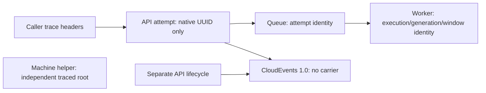
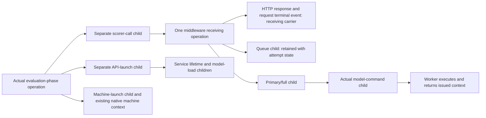

# Scorer API trace propagation

**Last Updated**: 2026-11-07
**Level**: 5 - event-envelope compatibility, HTTP propagation and private process contracts.

## 0. Operating contract

**Table A - Operating contract**

| Id | Field | Value |
| --- | --- | --- |
| A1 | Why this plan exists | Make HHEM and native UniEval APIs continue the caller's trace through their responses, queues, workers and events; adding log fields alone does not provide API tracing. |
| A2 | Hard scope - in | The shared native operation contract and W3C codec; compatible Python event readers; configured evaluator opt-in; incoming and outgoing HTTP carriers; request-local state; real worker/lifecycle propagation; retained comparison callers; focused tests and canonical documentation. |
| A3 | Hard scope - out | Table B prices the exclusions. |
| A4 | Chosen strategy | Reuse the neutral Python host and the existing common operation-metadata authority. Preserve Python event identities and native score bodies rather than adopting the TypeScript UUIDv4-only event profile. |
| A5 | Plan state | Execution active. One nested session owns each outcome PR; reader compatibility lands before API/worker propagation, then retained caller integration. |
| A6 | Source baseline | Isolated checkout: `f0d8d8185999bfe9126e025fd586bada1d38a5cd`, including delivered #1951, #1953 and #1956. Cleanup narrowed live evaluator settings/health and added frozen readers; native HHEM/UniEval scores, worker identities and the missing event carriers remain unchanged. |
| A7 | ESCALATE triggers | 1. The delivered neutral-host contract differs from C1-C3. 2. An overlapping shared file has no reconciled handoff. 3. A public score, health/error body, identity, historical reader or calculation must change beyond Table G. 4. Valid trace metadata requires a capacity increase rather than the derived bounds in G5. 5. A second codec/context model, SDK, exporter, tracing destination or persisted caller trace field is proposed. 6. Cleanup or another proposal would have to be implemented by this plan. |
| A8 | Execution | Execute per docs/how-to/execute-a-plan.md: one maintainer carries the plan and delegates a row where delegation pays; keep parallel N = 1 rows in flight because the outcomes share contracts and have reader-before-writer dependencies; consult a persona only where two answers would lead to different code; AUTO-merge on green gates; honor the ESCALATE triggers in section 0. |
| A9 | Verification | Inspect the shared selector, run the smallest named local checks when needed, and require the complete model-free Linux evaluator/workflow gate on the merge candidate. Do not dispatch a scoring workflow or download weights as a merge oracle. |

**Table B - Exclusions and their cost**

| Id | What is out | Cost of leaving it out | What would bring it in |
| --- | --- | --- | --- |
| B1 | Scorer calculations, models, prompts, window/reduction policies and numeric precision | Existing quality and execution limits remain; this work cannot establish model accuracy. | A separately identified scoring failure and its own oracle. |
| B2 | Rewriting historical events, recordings, result identities or evidence | Old records remain untraced; their UUIDs and actual causal facts remain the available correlation evidence. | A real new execution when trace evidence is needed, not fabricated fields on an old execution. |
| B3 | Coverage retirement, listener separation, caller relocation and CI consolidation | This plan must wait for their shared-file handoffs; it does not accelerate those deliveries. | Reassignment of an exact outcome, with its scope and cost surfaced first. |
| B4 | Text-analysis implementation or extraction of the complete neutral host | Host extraction is active but not delivered on this baseline. Copying it would create competing Python tracing implementations. | A scoped handoff of the neutral trace primitive ahead of the complete extraction, with one package/contract authority and revised dependency ownership. |
| B5 | SDK instrumentation, timing trees, exporters, collectors or a new trace store | Context becomes interoperable, but no external trace viewer or new duration recorder is supplied. Existing native timings and diagnostics remain. | An explicit observability requirement pricing instrumentation, destination control and retention. |
| B6 | Trace fields in score bodies, PhaseEvidence, generation receipts or reports | Saved score/evidence readers stay unchanged; trace correlation depends on real response carriers and retained diagnostic records. | A separate persisted-contract proposal with dated readers before writers. |
| B7 | Cross-job generation-to-evaluation trace reconstruction and `/llama-server` log migration | Existing generation diagnostics cannot be retrospectively joined through a carrier they never recorded. The evaluation phase has its own real operation. | A declared generation/caller trace handoff and compatible native-generation diagnostic readers. |
| B8 | Published-site changes, unrelated APIs, `CLAUDE.md` and `AGENTS.md` | No browser tracing UI, new publication behavior or repository-rule change is supplied. | A separate concrete request. |

**Table C - One native mechanism and boundary contracts**

| Id | Contract or mechanism | Exact declaration and invariant |
| --- | --- | --- |
| C1 | Operation metadata | `packages/common-contracts/src/schemas/operation-metadata.schema.ts` remains the vocabulary authority. The one Python Pydantic copy is `OperationMetadata` in `services/local_api_host/src/local_api_host/propagate_trace_context.py`: nonzero lowercase 32-character hexadecimal `traceId` and 16-character hexadecimal `spanId`; optional non-self `parentSpanId` with the same span format; required `links` containing strict trace/span pairs; optional canonical `traceState`. Native JSON requires `links`; factories supply an empty array by default. Do not introduce a `RequestTrace` alias. |
| C2 | Creation and transport | That neutral module owns `create_root_operation`, `create_child_operation`, `read_trace_context` and `write_trace_context`. Use `opentelemetry-api`'s `TraceContextTextMapPropagator` with explicit contexts and non-recording spans, not another parser or ambient current context. Match the existing TypeScript helpers: children retain the parent's trace, receive a different span, retain valid state, and emit version `00` with unsampled flags `00`. |
| C3 | HTTP receiving operation | The neutral `compose_api.py` middleware places the receiving operation at `request.state.operation_metadata` before guards and handlers. An opted-in handler consumes that operation without creating a second request child. `HostEventSink` lifecycle callbacks in the neutral `create_api_component.py` receive the separate service-lifetime operation. |
| C4 | Python event profile | `serve_http/contracts/server_event.py` remains the single native scorer envelope model. Add reader-optional `traceparent` and `tracestate`; present values must validate, explicit null is invalid, and state without a parent is invalid. Preserve the existing source, type/data agreement, HHEM UUIDv5 occurrence, diagnostic UUIDv4 occurrence and UTC time. Factory context is explicit; emission follows the configured mode, not the reader's optionality. |
| C5 | Configuration | Add one strict `propagate_trace_context` boolean to the authored/effective evaluator API settings and project it to the same-named `HostSettings` field. Row 2 enables it in committed configuration. A supported frozen configuration without the setting resolves to disabled propagation, preserving its external profile. Invalid current values never fall back to a frozen configuration. No environment override or second tracing setting. |
| C6 | Worker packets | Add required `operation_metadata` to each new-version bootstrap, startup outcome, scoring command and progress/final reply. It describes the actual load/model operation. The worker uses the issued context and returns it unchanged; the parent checks exact context equality alongside existing execution/generation/comparison/index identities. |
| C7 | Caller/control boundary | Retained callers allocate an evaluation-phase operation, separate scorer-call children and separate API-launch children. New scorer startup/control packets carry the launch/observed service operations. A separately dated machine-startup wrapper carries the existing startup packet plus `operation_metadata`; its legacy flat packet and existing ready/stopped controls remain readable without changing global `WORKFLOW_VERSION`. |
| C8 | Response observation | Extend the existing bounded HTTPX path with an optional typed trace input and a per-call response observer. Observe the actual response headers, not a fixture-supplied carrier. Keep the existing native result return shape; the observer receives a validated remote operation or a fixed missing/invalid-carrier observation. Keep observations request-local, body-free and independent of score/evidence completion. Do not replace the caller operation with the remote span or invent a parent from HTTP headers. |

**Table D - Required behavior**

| Id | Case | Required result |
| --- | --- | --- |
| D1 | Valid incoming parent | The API retains its trace ID, creates one receiving span and keeps the incoming span as the internal parent. Request-level/terminal events and the connected response use that receiving carrier. |
| D2 | Optional state | Valid state survives the shared codec in canonical form. Absence remains omitted. A valid parent with invalid optional state keeps its identity but never echoes invalid state. |
| D3 | Missing or malformed HTTP parent | In enabled mode, absence starts a fresh root for this actual request. Invalid IDs/version/format, or orphan state, cannot supply a parent. Follow the existing optional-parent policy rather than introducing new scoring HTTP errors; emit a fixed body-free warning for malformed supplied metadata. Keep raw header values and third-party parser warnings out of logs. |
| D4 | Saved event without a carrier | Read it as an untraced structured event. Re-serialization still omits both keys; no factory, root allocation, identifier conversion or history rewrite occurs. The old unwrapped HHEM transport remains rejected. |
| D5 | Saved malformed carrier | Reject the record through the native validator. Do not convert corruption into carrier absence or a new root. |
| D6 | Concurrent requests | Different attempts retain independent receiving spans/state, even with equal caller UUIDs. Queue promotion, cancellation, timeout, worker replacement and interleaved writes must never substitute another attempt's context. |
| D7 | Connected response and read routes | In enabled mode, every actual HTTP response has its receiving carrier, including native scoring errors, Retry-After, health/schema, guard refusals and unknown routes. Preserve status, body, Allow, deadlines and guard behavior. Headers do not turn read routes into invented scoring events. A disconnected request emits its own terminal event but has no HTTP response. |
| D8 | Nested work | Queue and primary/full operations are explicit children of the request; each real model command has a child of its actual enclosing operation. Start/end occurrences share that operation. Reused full scoring creates no fake model command. |
| D9 | Lifecycle and diagnostics | Startup/load/shutdown use the service branch. Request-caused warnings use the causing operation. Replacement work may link to its actual failed request without replacing the service parent. File-mirror warnings retain the causing context; opening/closing failures use the service context. No latest-request variable. |
| D10 | Disabled propagation | Preserve the declared legacy HTTP/event profile. Internal current worker work may use explicitly created local roots, but no incoming parent is adopted or external trace carrier claimed. Never use disabled-mode behavior as fallback for missing state in enabled mode. |
| D11 | Proof boundary | Validated native results and actual API/process/worker receipts remain scoring proof. Trace observations, terminal-log matches and file-mirror availability do not create, erase or relabel a score. |

**Table E - Verified findings and impact**

| Id | Finding / decision | Direct evidence and producer | Impact |
| --- | --- | --- | --- |
| E1 | Correct the premise: untraced records are valid core CloudEvents, not a specversion defect. | Core requires `id`, `source`, `specversion` and `type`; distributed tracing is an extension. See [CloudEvents](https://cloudevents.io/) and [W3C Trace Context](https://www.w3.org/TR/trace-context/). The current Python profile contains those core fields. | Keep `specversion: "1.0"`; fix missing trace continuity, not event-format conformance. |
| E2 | Current scorer serialization excludes tracing fields. | `ServerEvent` at `serve_http/contracts/server_event.py:23-81`; `EventWriter.write/diagnostic` at `serve_http/emit_events.py:97-108`. A read-only probe of the real parent writer emitted HHEM and UniEval records without either field; adding valid fields failed with `extra_forbidden`. | A writer-only change breaks strict readers. |
| E3 | The gap begins at HTTP admission, not only formatting. | HHEM `dispatch_evaluation.py:31-35,76-92,111-115`; UniEval `dispatch_unieval.py:30-37,126-135`; the actual routers delegate there. Both create native UUID attempt state and return native responses without extracting or returning carriers. | The API cannot continue a supplied caller trace even if an envelope factory adds random fields. |
| E4 | Queue/model work has no trace context to retain. | `shared/queue_evaluations.py:12-19`; HHEM `score_windows.py:30-52,133-146` and `contracts/worker_message.py:31-38,89-113`; UniEval `reduce_unieval.py:37-55`, `control_unieval.py:148-181` and `contracts/unieval_worker_message.py:42-55`. | UUID correlation still works, but actual request/worker trace relationships are absent. |
| E5 | Callers drop the other end of continuity. | Current comparison `summary_eval_pipeline/http.py:19-46` sends only content headers and returns status/native data. `evaluation.py:141-191` supplies no context. `services.py:135-155` validates and re-serializes the Python event; `scorer_control.py:29-36` carries UUID/run startup identity only. | Supply real caller context and read real response carriers; preserve relay identity/data/carrier, not recreated events. |
| E6 | Existing machine tracing is a distinct branch. | Current `machine-task.ts:97-118` allocates its own TypeScript root and injects it into native machine calls. `native_log.py` separately declares untraced `/llama-server` diagnostics. | Neither proves HHEM/native UniEval propagation. Reuse the machine API's existing metadata, not its supervision span for scoring. |
| E7 | One Python tracing mechanism is being extracted, not yet delivered on this baseline. | `TODO/20261107-text-analysis-api-plan.md`, row title `Extract the reusable local Python API host`, introduced on main at `32277e60d880f211b32bc54b5073ec31ffa8cd86`. No neutral-host source exists in this baseline. The active extraction confirms C1-C3 and keeps evaluator projection disabled. | Depend on that delivered/refined host or obtain a scoped trace-primitive handoff; do not build a competing service-local model/parser. |
| E8 | A TypeScript event factory is not a Python event migration. | Common `cloud-event.schema.ts:18-38` requires UUIDv4 and `traceparent`; Python preserves HHEM UUIDv5 and native ordered data. Backend telemetry traces describe separate pipeline storage, not this HTTP context. | Reuse operation metadata/codec conventions while retaining the native Python envelope. |

### Before and after





### Minimal event examples

- These illustrate newly emitted occurrences, not a recipe for modifying saved records.
- The UniEval before/after pair isolates envelope additions; its native diagnostic data is unchanged.

```json
{
  "specversion": "1.0",
  "id": "12345678-1234-4234-8234-123456789abc",
  "source": "/fastapi-server",
  "type": "fastapi-server.unieval.started",
  "time": "2026-11-07T22:00:00Z",
  "datacontenttype": "application/json",
  "data": {
    "action": "started",
    "level": "INFO",
    "execution_id": "22222222-3333-4444-8555-666666666666",
    "component": "unieval"
  }
}
```

```json
{
  "specversion": "1.0",
  "id": "12345678-1234-4234-8234-123456789abc",
  "source": "/fastapi-server",
  "type": "fastapi-server.unieval.started",
  "time": "2026-11-07T22:00:00Z",
  "datacontenttype": "application/json",
  "traceparent": "00-4bf92f3577b34da6a3ce929d0e0e4736-2222222222222222-00",
  "tracestate": "sample=value",
  "data": {
    "action": "started",
    "level": "INFO",
    "execution_id": "22222222-3333-4444-8555-666666666666",
    "component": "unieval"
  }
}
```

- The HHEM example preserves its native UUIDv5, ordered payload and occurrence time. Removing only the carrier keys gives the valid before shape; its native event ID was checked through the real UUID/schema implementation.
- A caller carrier ending in span `00f067aa0ba902b7` produces the different receiving span shown below. The span is not the native `operation_id`; concurrently served HHEM/UniEval requests do not share a receiving span.

```json
{
  "specversion": "1.0",
  "id": "97f112d2-e561-5666-bfb6-8f35c81be338",
  "source": "/fastapi-server",
  "type": "fastapi-server.hhem.request.started",
  "time": "2026-11-07T22:00:00Z",
  "datacontenttype": "application/json",
  "traceparent": "00-4bf92f3577b34da6a3ce929d0e0e4736-1111111111111111-00",
  "tracestate": "sample=value",
  "data": {
    "version": "2026-11-02",
    "event_id": "97f112d2-e561-5666-bfb6-8f35c81be338",
    "execution_id": "11111111-2222-4333-8444-555555555555",
    "sequence": 1,
    "request_id": null,
    "correlation_id": null,
    "caused_by_event_id": null,
    "run_id": null,
    "pipeline_name": null,
    "task_name": null,
    "operation_id": "99999999-8888-4777-8666-555555555555",
    "operation": "request",
    "phase": "started",
    "occurred_at": "2026-11-07T22:00:00Z",
    "level": "INFO",
    "details": {}
  }
}
```

**Table F - Reconciled workstreams and exact cutovers**

| Id | Workstream | Current state / protected scope | Dependency for this plan |
| --- | --- | --- | --- |
| F1 | Reusable scorer registration and independent API lifetimes | #1951 and #1953 merged. Native adapters, neutral callbacks and independent processes are delivered; the original eight-outcome API-separation plan is complete. | Use delivered code, not deleted branches or an unfinished interpretation of that plan. |
| F2 | Neutral Python host | #1955 is active on `extract-reusable-api-host`, inspected at `a139683f7a657521cf2acd69a34551fbeeeba822`. It owns the new package, codec, middleware and evaluator wrappers. The actual factory names are recorded in C2; the metadata binding oracle must settle optional-field omission/null rules and native schema metadata before delivery. | Row 1 uses the handed-off host contract and cannot merge before its matching dependency is delivered. No text-analysis implementation or duplicate context model enters this plan. |
| F3 | Legacy coverage cleanup | #1956 is merged at `f0d8d8185999bfe9126e025fd586bada1d38a5cd`. Live settings/health select HHEM and UniEval only. Frozen settings and disabled-coverage health are declared in `serve_http/contracts/previous_api_settings.py`, `previous_api_health.py` and `serve_http/read_api_health.py`. ServerEvent/DiagnosticComponent still accept historical coverage diagnostics. Complete Linux checks run in `ci.yml/model-free` through the retained checker action. | The cleanup prerequisite is delivered. Reuse its strict readers and retained caller changes; do not restore live coverage or reimplement the cleanup. |
| F4 | Planning/machine API separation | #1954 remains open at `8a95bfe49b903e87260f801f1b577517c480a77c`. It changes native machine listener/application evidence and comparison control/readers, including the native server-record union in `.github/scripts/summary-eval-tests/summary_eval_pipeline/phase_result.py`; shared carriers, scorer protocols/evidence readers and global workflow version remain unchanged. | Its actual merge, not passed candidate checks, releases F5's relocation hold. Row 3 preserves the delivered native server-record union when F5 moves the caller. |
| F5 | Script relocation | Current `.github/scripts/summary-eval-tests/` becomes `tools/summary-eval/`; import namespaces remain `summary_eval_pipeline` and `summary_eval_tests`. It carries already merged cleanup changes or hands off its relocation revision when it lands first. | Row 3 waits for final moved/cleaned caller files. Do not invent an additional F3-before-F5 dependency or make tracing a cleanup prerequisite. |
| F6 | Other moves and reviews | Experiment readers move to `tools/ai-pipeline-experiment/`, generator caller to `tools/summary-generator-caller/`; `ai-pipeline.ts` stays put. Native scorer sources/tests/recordings do not move. The earlier event review concerned TypeScript diagnostics, not verified Python propagation. | No edits to those experiment/generator paths; do not inherit a Python finding from that review. |

**Table G - Compatibility cost and reader/writer order**

| Id | Boundary | Change, cost and ordering |
| --- | --- | --- |
| G1 | Scorer envelope | Add validated optional reader fields and an explicit read-compatibility rule to the existing Pydantic model. Give the envelope its own schema-date/changelog metadata rather than changing unrelated health/error dates through the shared base. The envelope still has no new payload `version` key and its CloudEvents version stays unchanged. Expand all installed readers before enabling traced factories. |
| G2 | Shared metadata and public scorer payloads | Common metadata remains version `2026-11-03`; HHEM score/event data remains `2026-11-02`; native UniEval score/recording data remains `2026-11-04`. Keep caller UUID spelling, native execution/operation IDs, HHEM sequence/causes and original recording provenance. The Python copy's named binding tests hold its field set, requiredness, types and codec behavior to the authority. |
| G3 | Authored/effective API settings | Date-stamp only the changed configuration family and log the added C5 control. Keep health/error versions separate. Preserve F3's frozen single/three-listener models; when the current configuration version changes, freeze the delivered two-listener shape separately in `previous_api_settings.py` rather than widening the historical three-listener model. Supported old settings resolve disabled tracing through the declared reader policy. Invalid modern fields never fall back to an old shape. Install readers before writing enabled configuration. |
| G4 | Private process protocols | Give HHEM worker, UniEval worker and changed scorer/machine-startup families separate date stamps/changelogs, not the public score or global workflow aliases. Declare models before logic and upgrade each private producer/consumer together; drain/replace old owned workers before new packets. Unsupported current packets fail safely. No live mixed-version worker compatibility or historical packet rewrite. |
| G5 | Input/record bounds | Include complete serialized metadata, escaping and JSONL newline in existing event/control/worker bounds. Current event cap is 4096 bytes from `config/summary-evals/api.json`; crossing it invokes the existing explicit logging failure, not truncation. HHEM derives maximum command/reply examples; UniEval preserves its configured reply cap and derives command overhead. Test exactly-at-cap and one-byte-over cases; never add guessed padding, silently drop valid state or raise caps without surfacing the measured serialized input. |
| G6 | Dependency and publication cost | The neutral host's existing planned `opentelemetry-api` dependency supplies the standard codec; use its locked path dependency rather than install a second tracing family. Cost is Python package/install/import work and extra bounded carrier bytes, with no model weights, new process, browser bytes, SDK or network collector. |
| G7 | Evidence readers | Keep PhaseEvidence, generation/report contracts and their historical branches unchanged, including F3's `ReadableApiHealth` validation/projection of genuinely disabled coverage. Existing Python event relay accepts and preserves C4; current TypeScript UUIDv4 event readers remain current-only. Trace observations cannot fabricate a receipt or become score-completion gates. |
| G8 | Dispatch baseline | Refresh the named source/dependency PRs and inspect changed files before each row. Where F3/F5 land in the opposite order, use the actual final caller tree and confirmed handoff; do not recreate retired symbols or relocate files here. |

## 1. Status Reckoner

**Table H - PR-shaped delivery tasks**

| Id | # | Row title | Depends-on | Parallel-group | Status | Worktree | PR | Subagent |
| --- | --- | --- | --- | --- | --- | --- | --- | --- |
| H1 | 1 | Accept trace-aware scorer envelopes without changing old records | - | A | DONE | fuzzy-parakeet | - | Trace envelope readers |
| H2 | 2 | Enable actual scorer API and worker trace propagation | 1 | B | PENDING | - | - | - |
| H3 | 3 | Connect retained callers and process diagnostics to scorer traces | 2 | C | PENDING | - | - | - |

## 2. Row #1 - Accept trace-aware scorer envelopes without changing old records

- **Scope:** Ship C4's compatible native reader and the binding tests for the delivered neutral C1/C2 contract; do not enable traced scorer output yet.
- **Files touched:**
  - `services/summary_evaluator/src/summary_evaluator/serve_http/contracts/server_event.py`
  - `services/summary_evaluator/tests/test_contracts.py`
  - `services/summary_evaluator/tests/test_server_events.py`
  - `services/summary_evaluator/tests/test_trace_context.py` (new)
  - `services/summary_evaluator/tests/check_trace_context.ts` (new)
  - `services/local_api_host/src/local_api_host/propagate_trace_context.py`
  - `docs/architecture/local-api-host.md`
  - `docs/architecture/contracts/identity.md`
  - `docs/reference/summary-evaluator-api.md`
  - `docs/concepts/telemetry.md`
  - `TODO/20261107-scorer-trace-propagation-plan.md`
- **Acceptance gates:**
  - Dispatch: matching F2 host outcome or scoped trace-primitive handoff, and F3's envelope-reader shared-file handoff. Record the actual prerequisite revisions; do not build their outcomes here.
  - Local selection: `npm --prefix frontend run test:changed -- --list`; inspect selection without changing the selector.
  - Unit/contract, when local execution is needed: from the service directory, one `uv run --frozen pytest tests/test_contracts.py tests/test_server_events.py tests/test_trace_context.py tests/test_event_ids.py tests/test_recording_compatibility.py` selection. Use the existing CPython environment and actual prepared Bun authority; no network tests or new disk fixtures.
  - Lint/types: the applicable service checks in the gate guide, covering the changed modules/tests.
  - CI: F3's complete Linux `model-free` gate through `.github/actions/check-summary-evaluator/action.yml`; no model/scoring workflow dispatch.
  - Record source/dependency revisions, selected inputs, platform and results. Confirm only intended files changed and original recordings remain byte-identical.
- **Oracle:** `test_trace_context.py` plus the actual Bun bridge accepts valid traced UUIDv5 scorer envelopes, preserves an untraced envelope without creating either carrier key, and rejects malformed/null/orphan carriers while proving C1/C2 field/codec parity; this cannot prove that live HTTP attempts or workers use the context.

**Table I - Row 1 decisions**

| Id | Decision | Authority |
| --- | --- | --- |
| I1 | Follow C1-C4 and G1/G2 rather than replace the native event profile. | Existing identity authority and native occurrence validator. |
| I2 | Reader optionality exists only for real legacy absence and configured external profiles; malformed present fields remain errors. | D4/D5. |
| I3 | Keep historical coverage diagnostic vocabulary independent of live component registration. | F3's preserved reader contract. |
| I4 | The named cross-language bridge reads generated minimal in-memory vectors and the actual schemas/codec; it discovers no repository tree. | G2 and the existing UUID bridge pattern. |
| I5 | Update the owning identity/reference pages and correct stale identity path pointers while keeping backend telemetry's separate span/storage behavior unchanged. | Documentation ownership and E8. |

**Table J - Row 1 rejected alternatives**

| Id | Option | Why rejected | What it would cost to take | Authority |
| --- | --- | --- | --- | --- |
| J1 | Add fields only in the serializer | Current strict readers refuse them and no request context exists. | Add reader compatibility and real request/worker propagation afterwards, with an intervening broken producer. | E2-E5. |
| J2 | Recreate saved events through a traced factory | It invents context and can change occurrence identity/time. | Lose truthful historical provenance; a new actual execution is the valid replacement. | D4 and B2. |
| J3 | Use the common TypeScript CloudEvent factory for Python | It requires a different occurrence-ID profile. | Migrate HHEM IDs, terminal links and historical readers, without fixing admission propagation. | E8. |

## 3. Row #2 - Enable actual scorer API and worker trace propagation

- **Scope:** Enable C5 and wire the middleware receiving operation through real native scorer state, nested work, worker packets and diagnostic factories while preserving score bodies and process policies.
- **Files touched:**
  - `config/summary-evals/api.json`
  - `services/summary_evaluator/src/summary_evaluator/serve_http/api_settings.py`
  - `services/summary_evaluator/src/summary_evaluator/serve_http/contracts/api_settings.py`
  - `services/summary_evaluator/src/summary_evaluator/serve_http/contracts/api_deployment_settings.py`
  - `services/summary_evaluator/src/summary_evaluator/serve_http/contracts/previous_api_settings.py`
  - `services/summary_evaluator/src/summary_evaluator/serve_http/contracts/server_event.py`
  - `services/summary_evaluator/src/summary_evaluator/serve_http/compose_api.py`
  - `services/summary_evaluator/src/summary_evaluator/serve_http/serve_api.py`
  - `services/summary_evaluator/src/summary_evaluator/serve_http/emit_events.py`
  - `services/summary_evaluator/src/summary_evaluator/serve_http/configure_server.py`
  - `services/summary_evaluator/src/summary_evaluator/shared/create_api_component.py`
  - `services/summary_evaluator/src/summary_evaluator/hhem/create_api_component.py`
  - `services/summary_evaluator/src/summary_evaluator/hhem/dispatch_evaluation.py`
  - `services/summary_evaluator/src/summary_evaluator/hhem/control_service.py`
  - `services/summary_evaluator/src/summary_evaluator/hhem/emit_events.py`
  - `services/summary_evaluator/src/summary_evaluator/hhem/score_windows.py`
  - `services/summary_evaluator/src/summary_evaluator/hhem/contracts/worker_message.py`
  - `services/summary_evaluator/src/summary_evaluator/hhem/contracts/worker_contract.py` (new)
  - `services/summary_evaluator/src/summary_evaluator/hhem/exchange_packets.py`
  - `services/summary_evaluator/src/summary_evaluator/hhem/maintain_worker.py`
  - `services/summary_evaluator/src/summary_evaluator/hhem/run_worker.py`
  - `services/summary_evaluator/src/summary_evaluator/unieval/create_api_component.py`
  - `services/summary_evaluator/src/summary_evaluator/unieval/dispatch_unieval.py`
  - `services/summary_evaluator/src/summary_evaluator/unieval/control_unieval.py`
  - `services/summary_evaluator/src/summary_evaluator/unieval/reduce_unieval.py`
  - `services/summary_evaluator/src/summary_evaluator/unieval/contracts/unieval_worker_message.py`
  - `services/summary_evaluator/src/summary_evaluator/unieval/contracts/unieval_worker_contract.py` (new)
  - `services/summary_evaluator/src/summary_evaluator/unieval/maintain_unieval_worker.py`
  - `services/summary_evaluator/src/summary_evaluator/unieval/unieval_worker.py`
  - `services/summary_evaluator/tests/test_contracts.py`
  - `services/summary_evaluator/tests/test_settings.py`
  - `services/summary_evaluator/tests/test_api_deployments.py`
  - `services/summary_evaluator/tests/test_api.py`
  - `services/summary_evaluator/tests/test_unieval_api.py`
  - `services/summary_evaluator/tests/test_server_events.py`
  - `services/summary_evaluator/tests/test_component_registration.py`
  - `services/summary_evaluator/tests/test_worker_lifecycle.py`
  - `services/summary_evaluator/tests/test_unieval_worker.py`
  - `services/summary_evaluator/tests/test_scorer_trace_propagation.py` (new)
  - `docs/architecture/contracts/identity.md`
  - `docs/architecture/evaluation/summary-evaluator.md`
  - `docs/architecture/evaluation/hhem-evaluation-api.md`
  - `docs/architecture/evaluation/unieval-api.md`
  - `docs/reference/summary-evaluator-api.md`
  - `docs/reference/hhem-evaluation-api.md`
  - `docs/reference/unieval-api.md`
  - `TODO/20261107-scorer-trace-propagation-plan.md`
- **Acceptance gates:**
  - Dispatch: row 1 is delivered and the final F2/F3 host/registration wrappers are handed off; keep host mechanics in their native package.
  - Local: inspect the shared selection; use applicable service lint/types. When debugging, combine `tests/test_scorer_trace_propagation.py`, `tests/test_api.py`, `tests/test_unieval_api.py`, `tests/test_server_events.py`, `tests/test_worker_lifecycle.py` and `tests/test_unieval_worker.py` in one focused pytest invocation.
  - Unit/contract: strict setting substitution, missing/invalid incoming metadata, native packet dates/context identities and G5's exact byte thresholds.
  - Integration: real ASGI admission/guards, finite queues, owned byte pipes and existing recorded prediction boundaries. Interleave both scorers, including queued cancellation/replacement and valid native error responses. Do not mock scoring/controllers or open network listeners.
  - CI: complete Linux model-free service/workflow gate, including API isolation and untouched recording/identity regressions. A Windows socket-guard limitation is not Linux evidence.
  - Verify every old writer/adapter callable found by the C4/C6 signature search; update remaining named dependants before dispatch if the host/cleanup handoff changed their paths.
- **Oracle:** `test_scorer_trace_propagation.py` sends actual caller carriers to both real APIs and proves receiving-response/terminal-event equality, correct nested/worker ancestry and isolation across interleaved attempts, while recorded scores, native UUID spelling/causes, partial retention and process ownership remain unchanged; this cannot prove a deployed caller sends or retains those carriers.

**Table K - Row 2 decisions**

| Id | Decision | Authority |
| --- | --- | --- |
| K1 | Consume C3 once; preserve the native attempt UUID allocated before body reading. Missing enabled-mode state is an internal protocol defect, not permission to start a second trace. | D1/D6 and the neutral-host contract. |
| K2 | Carry context as explicit per-attempt/per-operation values through writer callbacks and worker commands; queue entries retain the owning attempt rather than look up a global context. | D6/D8/D9. |
| K3 | Require genuine load/model-command context and exact reply matching without changing predictor inputs, model boundaries or result schemas. | C6, G2/G4. |
| K4 | Preserve existing HTTP responses; C3 supplies carriers at the shared ASGI boundary, including pre-body refusal/error paths and read routes. | D3/D7. |
| K5 | Logging factories receive actual operation metadata and configured emission mode; they never create per-event roots or strip a carrier after validation as a fallback. | C4/C5 and D9/D10. |
| K6 | Preserve required-stderr failure and optional-mirror warning policies; bind each warning to its actual causing/service operation. | D9/D11 and G5. |
| K7 | Keep neutral host mechanics owned by F2; evaluator wrappers remain adapters, not copied middleware or another parser. | C1-C3 and F2. |
| K8 | Record the reader/worker/opt-in rationale on the existing owning pages; the identity page stays one answer because occurrence, native UUID and transport context must be distinguished together. | G1-G4. |

**Table L - Row 2 rejected alternatives**

| Id | Option | Why rejected | What it would cost to take | Authority |
| --- | --- | --- | --- | --- |
| L1 | Copy incoming headers unchanged into every event/response | That describes the caller, not the receiving or nested operation. | Lose actual API/worker parentage and isolation even though fields are present. | D1/D8. |
| L2 | Remove UUID hyphens or hash event IDs into trace IDs | Business/native occurrence identity is not tracing context. | Change identity meaning and manufacture historical continuity. | G2. |
| L3 | Make malformed optional tracing metadata a new scoring refusal | The existing shared codec starts a root or discards invalid state; a new refusal is unnecessary for tracing support. | Add native error codes/status policy and change previously accepted scoring requests. | D3. |
| L4 | Use automatic instrumentation or a mutable current trace | It adds a second lifecycle and allows asynchronous scope leakage. | Add SDK/provider/flush/export behavior and additional isolation obligations. | B5 and C2. |

## 4. Row #3 - Connect retained callers and process diagnostics to scorer traces

- **Scope:** Propagate the actual evaluation-phase/call/startup contexts through the final retained comparison caller and machine bridge, observing response carriers without changing native scores or historical evidence.
- **Files touched:**
  - `tools/summary-eval/summary_eval_pipeline/trace_context.py` (new)
  - `tools/summary-eval/summary_eval_pipeline/http.py`
  - `tools/summary-eval/summary_eval_pipeline/evaluation.py`
  - `tools/summary-eval/summary_eval_pipeline/evaluate_pair.py`
  - `tools/summary-eval/summary_eval_pipeline/phases.py`
  - `tools/summary-eval/summary_eval_pipeline/control.py`
  - `tools/summary-eval/summary_eval_pipeline/scorer_control.py`
  - `tools/summary-eval/summary_eval_pipeline/services.py`
  - `tools/summary-eval/summary_eval_pipeline/serve_api.py`
  - `tools/summary-eval/summary_eval_pipeline/serve_scorer_lifetime.py`
  - `tools/summary-eval/machine-task.ts`
  - `tools/summary-eval/summary_eval_tests/scorer_caller_cases.py`
  - `tools/summary-eval/summary_eval_tests/owned_scorer_child.py`
  - `tools/summary-eval/summary_eval_tests/test_scorer_callers.py`
  - `tools/summary-eval/summary_eval_tests/test_pipeline_control.py`
  - `tools/summary-eval/summary_eval_tests/test_pipeline_lifetime.py`
  - `tools/summary-eval/summary_eval_tests/test_machine_task.py`
  - `tools/summary-eval/summary_eval_tests/test_scorer_trace_continuity.py` (new)
  - `docs/reference/summary-evaluation-workflow.md`
  - `docs/architecture/evaluation/summary-evaluator.md`
  - `TODO/20261107-scorer-trace-propagation-plan.md`
- **Acceptance gates:**
  - Dispatch: row 2 is delivered, F4's machine interface and F5's relocation are delivered, and F3's retained caller cleanup is reconciled at the final moved paths. Do not prescribe which cleanup lands first.
  - Local: inspect the shared selector and the final checker-action paths after F5. Apply the named service/workflow lint/types from the gate guide.
  - Contract: validate the new private startup wrapper against its actual TypeScript reader and C1 authority; legacy flat controls remain unchanged. Reject malformed current metadata, crossed startup contexts, unsupported versions and oversized complete packets.
  - Integration, when needed locally: one selected invocation covering final `summary_eval_tests/test_scorer_trace_continuity.py`, `test_scorer_callers.py`, `test_pipeline_control.py`, `test_pipeline_lifetime.py` and `test_machine_task.py` from the service environment. Use actual ASGI/owned-child boundaries and existing native prediction recordings.
  - CI: complete model-free Linux evaluator/workflow gate at the final action location, including retained workflow/evidence compatibility and native process-isolation cases. Do not dispatch either retained model workflow.
  - Next scheduled/manual observation, not a merge gate: inspect one run's named scorer diagnostic files and existing machine evidence; verify actual HTTP/request/lifecycle trace relationships. If they disagree, retain scores/evidence and report the tracing boundary that failed; do not rewrite or rescore the run.
- **Oracle:** `test_scorer_trace_continuity.py` drives the actual retained caller through both APIs and process controls, proving caller -> receiving -> worker relationships, response observation, unchanged relay identity/carrier/data, and stable native scores/evidence under a sibling failure; this cannot certify live model accuracy, a later runner or cross-job traces never recorded.

**Table M - Row 3 decisions**

| Id | Decision | Authority |
| --- | --- | --- |
| M1 | Use the final F5 paths and F3/F4 handoffs; preserve native namespaces and producer URIs. | Table F. |
| M2 | Create real phase, scorer-call and launch operations before dispatch. Keep sibling request contexts distinct; never use shared correlation UUIDs as trace parents. | C7 and G2. |
| M3 | Native HTTP results remain the existing pure bodies; C8 observes carriers separately and cannot discard a valid partial/complete score or change completion policy. | D11 and G7. |
| M4 | Adopt startup context in the API and worker branches rather than merely add an unused field to the private packet. Preserve startup nonce, PID/start pin, instance and owned-exit checks. | C6/C7 and F1. |
| M5 | Reuse the native machine operation/context interface. New wrapper metadata is transient; do not relax strict Hono run metadata, alter global workflow version or change persisted phase/report shapes. | C7 and G4/G7. |
| M6 | Validated relay re-serialization retains the original occurrence, carrier and native data. Preserve legacy absence, errors and logging limits; no new event factory runs during relay. | D4/D5 and E5. |
| M7 | Update current caller documentation for actual trace propagation only; leave relocation commands and CI consolidation owned by their existing deliveries. | F3/F5 and documentation ownership. |

**Table N - Row 3 rejected alternatives**

| Id | Option | Why rejected | What it would cost to take | Authority |
| --- | --- | --- | --- | --- |
| N1 | Claim trace continuity from run/request UUIDs or terminal log matching | Those identify native work but do not prove propagated parentage. | Keep the present gap behind apparently complete diagnostics. | E3-E6 and D11. |
| N2 | Add trace fields to saved phase/results to make correlation easier | It changes another persisted family and cannot repair old missing context. | Add result/report migrations and dated read compatibility beyond this API proposal. | B6/G7. |
| N3 | Start caller edits at old paths while relocation is active | It duplicates another outcome and can lose either branch's real changes. | Reconcile conflicting caller/test/CI hunks and review their semantic merge. | F5/G8. |

## See also

- [Identity and tracing](../docs/architecture/contracts/identity.md) - authoritative identity distinctions and common metadata.
- [Evaluator composition](../docs/architecture/evaluation/summary-evaluator.md) - native host/worker ownership.
- [HHEM API](../docs/reference/hhem-evaluation-api.md) - unchanged ordered events and score contract.
- [Native UniEval API](../docs/reference/unieval-api.md) - unchanged four-score contract.
- [Evaluation workflow](../docs/reference/summary-evaluation-workflow.md) - retained callers and evidence.
- [Gate commands](../docs/how-to/run-the-gates.md) - local selection and Linux evidence.
- [Plan execution](../docs/how-to/execute-a-plan.md) - dispatch and stop rules.
