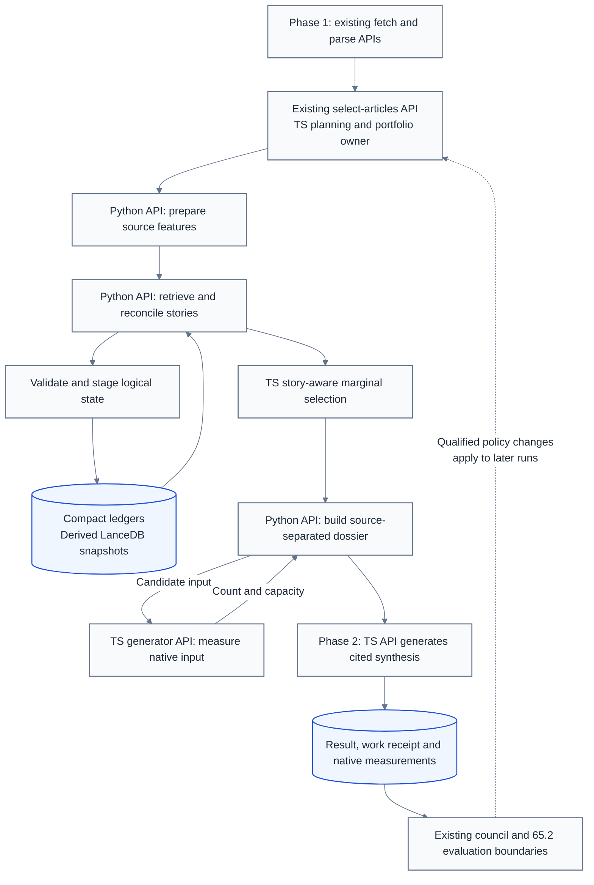

# Multi-document story selection and synthesis

**Last Updated**: 2026-11-12
**Level**: 5 - selection architecture, native APIs and persisted contracts.

## 0. Operating contract

Table A - Intent and boundaries

| Id | Field | Contract |
| --- | --- | --- |
| A1 | Outcome | Phase 1 fetches, parses and selects developing-story dossiers. Phase 2 synthesizes them with source references. Quality takes precedence over a fixed summary length, source count or model size. |
| A2 | Time | Select over 14 elapsed UTC days from first discovery of distinct reporting. Preserve publication and occurrence evidence separately. Older retained context remains retrievable; the selection window is not a deletion deadline or universal merge horizon. |
| A3 | State | Registered project ledgers are authoritative; LanceDB is a derived retrieval representation. Complete current bodies are transient inputs. Compact extracts/features and the separately governed evaluation sample provide retained evidence, not a permanent article archive. |
| A4 | Delivery | Reuse the existing select-articles API and native infrastructure. TypeScript uses Zod/Hono; Python uses Pydantic/FastAPI through local_api_host. APIs own their measurements and events; callers own orchestration, reports and delivery. |
| A5 | Status | Architecture proposal only; no implementation or API activation. The chosen design is API-first, with one existing selection lifecycle. |
| A6 | Stop conditions | Stop before undeclared persisted meanings, changes to CLAUDE.md/AGENTS.md, a different retention/publication policy, unsupported source-to-instruction/path/command/URL flow, or silently reduced content to meet a budget. Price the required change instead. |
| A7 | Execution | Execute per docs/how-to/execute-a-plan.md: one maintainer carries the plan and delegates a row where delegation pays; keep parallel N = 4 rows in flight, refilling a slot as soon as a worker returns and never waiting on a merge; consult a persona only where two answers would lead to different code; AUTO-merge on green gates; honor the ESCALATE triggers in section 0. AUTHOR-AND-STOP until the user authorizes. |
| A8 | Publication boundary | These APIs do not automatically change published item identities, source display or update behavior. Leaving that reader increment out means the public site remains unchanged; adding it requires compatible projections, design review and browser smoke, not a graph server. |

## 1. High-level architecture

Table B - Control flow and responsibilities

| Id | Step | Responsibility |
| --- | --- | --- |
| B1 | Capture once | Fetch/parse retains original observation, language and extraction limits. Sanitize once; keep complete permitted text in bounded run-private captures, not all bodies in memory. Preserve useful code, tables, alerts and qualifications. |
| B2 | Prepare source evidence | Python analyzes available title/body passages, producing source-addressed extracts, compatible vectors, lexical features, entity/time evidence and copy candidates. No generated summary of every candidate is required. |
| B3 | Retrieve and reconcile | Query the joint new pool, stable event references and bounded recent-member representations. Settle same-event membership before linking distinct developments. Similarity proposes candidates; source evidence decides relationships. |
| B4 | Select stories | The existing TS selection operation becomes story-aware. It chooses useful new reporting and complementary context with diminishing redundancy and feed/site exposure penalties. A broad topic is not one event or dossier; valuable singletons remain eligible. |
| B5 | Build a dossier | Python selects a supported sequence plus important branches. It iterates candidate packing against native input measurement, then freezes the matching evidence/budget receipt. Record omissions; do not force unrelated fragments into a path. |
| B6 | Synthesize | The TS generator writes from the frozen dossier only. It emits offered citation aliases; code resolves them. Deterministic reference checks precede independent sampled support/completeness evaluation. Phase 2 never refetches or repairs story membership. |
| B7 | Settle and improve | Persist logical results and per-story checkpoints; commit through the existing delivery owner. The council evaluates compatible evidence and proposes later policy changes. A generation result is not proof of commit, publication or factual truth. |

## 2. Reuse the existing select-articles implementation

Table C - Verified existing behavior and its treatment

| Id | Existing logic | Reuse or change |
| --- | --- | --- |
| C1 | Route validates one completed input link; responses expose metadata rather than article populations. [stages.route.ts](../services/feed-ingest-plan/src/api/routes/stages.route.ts) | Keep the operation and reference-based access. Do not introduce a parallel select-dossiers controller with copied lifecycle logic. |
| C2 | Selection checks ownership, configuration fingerprint, complete global collection and terminal fetch/parse outcomes; it claims input and distinguishes original work from reselection. [selection-operation.ts](../services/feed-ingest-plan/src/api/selection-operation.ts) | Preserve these checks and actual operation/run relationships. A shared trace is not authorization. Partial NLP evidence does not justify selecting an unfinished collection. |
| C3 | Screening uses discovery/published/failure evidence, prepares fresh health, groups losses and keeps request reporting. [select-articles.ts](../services/feed-ingest-plan/src/select-articles.ts) | Reuse accounting and technical evidence. Separate already-published work from reusable evidence and substantive revisions. Adapt age/length/content admission before evidence can disappear. |
| C4 | Fixed authority, recency, technical pass adjustment and substance are computed once. [editorial-selection.ts](../services/feed-ingest-plan/src/curate-article-portfolio/editorial-selection.ts) | Retain transparent components as the baseline. Technical pass rate is not editorial quality. New story terms need declared scales and an instrument identity, not an unexplained multiplier. |
| C5 | The complete numerical pool is rescanned with quadratic feed/site penalties, a first-use bonus, stable ties and explicit losses. [select-diverse-articles.ts](../services/feed-ingest-plan/src/curate-article-portfolio/select-diverse-articles.ts) | Reuse the marginal-selection structure and exposure helpers. Do not pretend a multi-source story is a unique URL. Count each newly represented feed/site group once per dossier, not each mirror; cap the first-use reward rather than summing rewards across citations. |
| C6 | Website keys are recomputed from validated URLs; raw and substance word counts remain distinct. [feed-curation.md](../docs/architecture/sources/feed-curation.md) | Preserve identity/count provenance. Source revision, reporting contribution and story identity are additional concepts, not replacements for article_id, candidate_id or document_id. |
| C7 | Stage timers and per-run reports already exist; selected text travels separately from committed metadata. [planner diagnostics](../docs/architecture/sources/planner-run-diagnostics.md) | Extend native reporting instead of building another report store. Do not consume the private article-entities diagnostic as a ranking database. |
| C8 | Pre-download age/published refusals and parsed word ceilings occur upstream. [operator API](../docs/architecture/sources/feed-operator-api.md) | The dossier profile must not inherit evidence-losing gates unnoticed. Retain complete permitted transient captures or process bounded segments; preserve truncation evidence and sample before destructive shortening. Do not label a prefix full-body analysis. |

## 3. Native APIs delivering the architecture

Table D - Operations, not one endpoint per algorithm

| Id | Surface | Request -> result | Ownership and integration |
| --- | --- | --- | --- |
| D1 | Existing TS POST fetch-document / parse-document | Configured feed or captured offer -> owned source/candidate reference and body-free outcome | Keep native controls and artifact lifetimes. URLs, paths, models and destinations cannot be selected by fetched text. |
| D2 | Existing TS POST select-articles | Completed parsed-batch link -> typed story selection, dispositions and dossier references | Reuse the existing route/controller chain in C1-C3. Add a discriminated story result and update dependent readers before its writer. Do not replace articles with dossiers under an unchanged schema. |
| D3 | Existing TS partition/persist operations | Typed selected work -> assignments and verified artifact/ledger receipts | Add dossier-aware work estimates and manifests. Keep source-capture counts separate from dossier counts; health metrics retain their technical denominator. |
| D4 | New Python POST prepare-story-features | Bounded captured-source batch/segments and committed recipe references -> source packets, copy fingerprints and feature availability | Pydantic/FastAPI. Reuse existing spaCy/GLiNER APIs and ONNX helpers; no per-document generative-summary dependency. |
| D5 | New Python POST reconcile-story-graph | Identified base snapshot, complete input manifest and packet references -> event/story decisions, candidates, corrections and partial-work evidence | Own LanceDB/NetworkX computation, not TS portfolio policy or automatic Git delivery. A snapshot reference resolves through configured storage, never an arbitrary caller path. |
| D6 | New Python POST build-story-dossier | Selected story/developments, source references and committed generation profile -> preflighted evidence, matching budget receipt and omission/conflict manifest | Calls D7 while packing; it does not require a measurement of an unbuilt dossier. Unknown relationships remain outside directed paths. Final output is immutable for generation. |
| D7 | New TS/Hono POST measure-dossier-input | Candidate dossier projection and configured generation profile -> actual rendered token count, usable context, reserve and template/tokenizer identity | Use the generator's native renderer/token counter. It performs no generation and accepts no caller-supplied model destination. |
| D8 | New TS/Hono POST generate-dossier-summary | Frozen dossier plus matching budget/input identity -> cited statements, limitations and native result receipt | Extend the existing summary generator; retain generate-summary's separate single-text contract. Reuse its bounded native model transport and cancellation. |
| D9 | Native health/schema operations | Request -> actual readiness/capabilities or generated schema | Python uses real FastAPI/APIRouter/OpenAPI through local_api_host. TS uses its native Zod version and compatible schema exporter. No hand-maintained schema copy or successful alias for retired routes. |

Table E - Transport and compatibility rules

| Id | Rule | Required behavior |
| --- | --- | --- |
| E1 | Existing standards | Follow [identity](../docs/architecture/contracts/identity.md#4-native-typescript-event-and-operation-metadata), [Python hosting](../docs/architecture/local-api-host.md) and [TS hosting](../docs/reference/serve-pipeline-apis.md). The Python host is already FastAPI-based; no framework migration or new external service is needed. |
| E2 | Native wiring | Add one story-analysis component to the explicit Python application composition. Inherit the existing listener/body/lifespan authority; do not create a port per operation. Add Hono task routes to the existing generator listener without moving generation logic into routers. |
| E3 | Validation | Zod and Pydantic validate requests and results before work/output. Use the existing bounded body reader before Python validation. Refusals contain safe codes/context, never input-bearing validation details, raw exceptions or model replies. |
| E4 | Versions | Current planner root: /api/2026-11-07. Preserve operation names/shared declarations; breaking shapes require a dated protocol change and coordinated caller cutover. New story-analysis operations use fixed /api/2026-11-12 paths, not a request-clock version. |
| E5 | Cross-language ownership | Python owns packets/graph/dossiers; TS owns control receipts/generator products. The story-api-binding test binds the small consumed projection's fields, vocabularies and Unicode spans. Do not mirror the complete graph model or share Zod instances across native major versions. |
| E6 | Resource behavior | Preserve exact path/method refusals, loopback/Host/Origin checks, deadlines, request/response bounds and bounded concurrency. Capacity refusal is explicit; no hidden unbounded executor or model queue. Reuse producer-owned partial/failure meanings and preserve completed sibling work. |

## 4. Native observability and reporting

Table F - One operation, truthful clocks and unchanged evidence

| Id | Concern | Contract |
| --- | --- | --- |
| F1 | Trace propagation | Use the existing W3C codec for traceparent/tracestate. Allocate the receiving operation once before guards/body parsing; missing or invalid optional parents create a root. Preserve parentage versus input links and distinct business resource IDs. Return the actual receiving carrier on success and refusals; never forward it to source hosts. |
| F2 | Producer events | Each API emits typed CloudEvents 1.0 at its actual work/error boundary, with fresh occurrence ID, actual UTC time and local logical producer URI. Preserve existing planner/generator sources; story analysis declares its own. Relays save/forward envelopes unchanged rather than minting replacement events. |
| F3 | JSONL | Emit one validated body-free event per stderr line. Use TS native event helpers and Python standard-library logging with the native typed profile. Keep source text, evidence, prompts, entities, credentials and raw stacks out. Health/schema reads create no invented work events. |
| F4 | API duration | Start monotonic timing before guards; stop after result/error preparation, before transmission. Freeze api_duration_ms for the event and Server-Timing metric api. Reuse [Hono timing/setMetric](https://hono.dev/docs/middleware/builtin/timing) and Python's request-start scope. Cover refusals/cancellation; no caller-inferred server time or cross-origin timing exposure. |
| F5 | Other clocks | Preserve existing stage duration_ms semantics. Record client_elapsed_ms separately. Work, model-load and admission/queue durations are separate optional native measurements. Unknown is null, not zero; a cache hit has current API cost plus a reference to reused work. Continued work after disconnection retains its own outcome and capacity lease. |
| F6 | API receipt | Caller retains operation name, native API operation reference, producing-work reference when distinct, HTTP/functional outcome, timing availability, API/client durations and artifact/result references. Read native response timing; correlate events by actual operation, not arrival order. Never infer network latency by subtracting differently scoped clocks. |
| F7 | Reporting back | Extend existing run receipts, response.json, api_timings/report rendering and artifact upload receipts. Report source captures, independent contributions, events, dossiers, pending work, cache reuse, stage costs and coverage separately. Concurrent durations are work totals, not additive wall time. Failed reporting/delivery cannot erase completed planning. |
| F8 | Gaps to close | Existing helpers do not prove every boundary is covered: planner body-limit/error paths can precede route context, stages do not universally return timing/carriers, and planner_error/close diagnostics include plain JSON records. Fix these target-path gaps with typed producer events, not post-hoc log conversion or duplicate domain failures. |
| F9 | Failure/lifecycle | Reuse native startup/readiness/shutdown and safe failure projections. Logging failures remain visible through the declared service health/failure behavior; never manufacture measurements. Drain owned requests/events before caller cleanup; mark incomplete artifacts and preserve the original failure alongside cleanup errors. No telemetry SDK, exporter or collector is introduced. |

## 5. Data, selection and runtime contracts

Table G - Persist only what later stages need

| Id | Contract | Required meaning |
| --- | --- | --- |
| G1 | SourcePacket - Python | Source address/capture/revision identity, original observation, publication/occurrence evidence, language, retained verbatim spans, passage vectors, packet-derived lexical features, feature recipes and analyzed/retained coverage. Offsets are half-open Unicode code points. A retained generated summary has a different evidence basis from an original excerpt. |
| G2 | StoryGraph - Python | Stable event/story IDs, founding references, membership and reporting contributions, directed typed edges, unresolved associations, reverse adjacency, recent-member cache provenance, aliases/corrections and an identified base. Checkpoints/indexes enable bounded reads without replaying all history. |
| G3 | StorySelection - TS | Selected story references, separately reported utility/exposure terms, original candidate dispositions, typed work assignments and receipts. Define NEW, UPDATE, REHASH and UNRESOLVED from material reporting evidence, not hash changes or new entities alone. REHASH may supply context but does not refresh activity. |
| G4 | StoryDossier - Python; small TS generation projection | Focused developments and current/background roles; ordered source-separated evidence; offered citation aliases; conflicts, coverage limits and known omissions; selected-evidence revision and writer-input/budget identities. A receipt/hash alone cannot reconstruct expired text. Source URLs are rendered from recorded metadata, never model output. |
| G5 | DossierSummary - TS | Dossier/input/instrument identities, actual reported model metadata, cited factual headline/summary statements and explicit completion/limitations. Valid citation IDs are not semantic support; do not expose an uncalibrated model confidence as factual certainty. |
| G6 | State/work ledger | Register family story-analysis: source-packets, story-graph-changes, story-dossiers, story-work; add story-evaluations with its reader in row 6. Python uses the existing ledger door; TS keeps native control records. Register compaction/read compatibility before writers. Deliver a validated snapshot, never merged mutable LanceDB directories or empty history after a cache miss. |
| G7 | Evaluation | Extend 65.2's selected-output sample to multi-source visible-span sets. A pre-selection source audit is a different population with its own draw facts/probabilities, including unselected captures. Sample full sanitized input before destructive cuts where available; record extraction/coverage limits. Neither sample feeds training or production retrieval. |
| G8 | TransientCapture - TS | Parsed batches hold owned capture references; bounded reads/segments feed analysis and packing. Parsing remains network-free. Capture/sample complete permitted sanitized text before word cuts, retain limits, and release only named owned files after settlement/expiry. No permanent body archive or source-selected filesystem path. |

Table H - Selection and budget policy

| Id | Policy | Behavior |
| --- | --- | --- |
| H1 | Marginal selection | Compute fixed story utility on a common declared scale, then choose the strongest remaining marginal development/topic coverage minus redundancy and feed/site exposure. Update selection-dependent terms only. Keep the existing numerical selector as the paired baseline; do not copy its coefficients into differently scaled story scores without validation. |
| H2 | Evidence diversity | Protect consequential corrections, minority accounts and source qualifications. For each new-reporting source group, exposure is charged once; mirrors/background-only citations do not earn another bonus. Missing independence, time or NLP evidence stays unknown, not low quality or false corroboration. |
| H3 | Temporal identity | Distinguish recurring occurrences using supported event evidence. Publication delay or a quiet interval alone cannot veto identity; no universal hard merge timer is selected. Unknown/ambiguous time cannot establish chronological direction or causation. |
| H4 | Exact context | Measure the fully rendered writer request, including framing, metadata, citation aliases and output reserve. No fixed 6k-token assumption, silent encoder truncation or context shifting. Repack or explicitly partition/defer when essential evidence cannot fit. |
| H5 | Incremental work | Cache features by source/recipe; synthesis by story, selected evidence and generation instrument. Exclude run IDs, housekeeping timestamps and unrelated commits; the live ownership fingerprint is not the generation cache key. Reuse checkpoints without renewing reporting observations. |
| H6 | Cadence | Estimate work from actual token bands and measured prefill/decode/non-model costs, naming hardware and uncertainty. Bound admission/shards and report backlog. More parallel work, changed cadence or smaller output scope are priced choices; do not invent throughput or shorten content to fit an unmeasured estimate. |
| H7 | Configuration | Schema owns candidate/packet/graph budgets, thresholds, ranking weights, concurrency, retries, lifecycle and quality criteria. Begin with compatible configured models, exact local search inside LanceDB and the current selector baseline. Add ANN/model changes only when a measured bottleneck or quality comparison justifies them. |

## 6. Treatment of the new review input

Table I - Useful corrections versus fixes not adopted blindly

| Id | Review items | Ruling |
| --- | --- | --- |
| I1 | F1, F4: event/topic separation and different windows | Adopt the separation. Keep discovery-based selection and older context; do not substitute publication-based eligibility, a universal short merge horizon or deletion at the selection boundary. |
| I2 | F2, F15: pioneer anchoring, order and determinism | Keep founding evidence, stable ties and versioned hash/MinHash recipes. Earliest-member hashes churn IDs; no-splits retains false joins. Preserve recorded identities/repairs; fixed LLM seeds or rounded similarities do not prove semantic equivalence. |
| I3 | F3, F7: novelty and repeated work | Adopt explicit novelty states, incremental generation and per-story checkpoints. A member/hash change is not material news; novelty includes changed claims, qualifications and attribution even with identical entities. |
| I4 | F5, F11, F13: score scale and source diversity | Normalize declared ranking terms; keep entity/quantity evidence separate from topic similarity. Reuse existing feed/site mechanisms and count distinct reporting origins, not raw article/domain volume. Corroboration is bounded evidence, not truth by majority. |
| I5 | F6, F10: dossier construction and representation | Keep title/lead channels and contiguous passages, but inspect the available body too. Do not impose four siblings, exemplar-majority tokens, lead-only NLP or blanket removal of code/tables; all can discard the unique information this project seeks. |
| I6 | F8, F17: trends and labels | Use stable entity/topic identities and distinct-event/reporting rates over disjoint, duration-normalized periods with source-availability evidence. Warm-up follows sufficient observed history, not an arbitrary calendar age or epsilon spike. Dynamic display labels are not velocity keys. |
| I7 | F9: exact and near-copy detection | Keep existing resource-address rules and source revisions. Add mature MinHash/LSH candidate detection where useful; verify differences before suppressing contributions. Do not strip arbitrary query/AMP forms or collapse independently added reporting. |
| I8 | F12 and language/extraction edge cases | Brief items and unavailable feature channels are not content rejection. Preserve access/extraction limits. Evergreens may provide context or a useful singleton without invented event semantics. Feed summaries remain separately labelled evidence, not full source text. |
| I9 | F14 and budget estimates | Keep LanceDB; compare flat versus ANN cost rather than importing a universal size cutoff, fp16 choice or CPU rate. The supplied throughput table is illustrative, not a capacity measurement. The six-hour job kill limit still requires a design that shards/resumes. |
| I10 | F16 and verification | Delimit data and constrain IDs, but enforce schemas/sanitization too. Literal number/entity checks and exact quotes detect some errors, not entailment. A bounded repair uses the same frozen evidence; unresolved material failures remain incomplete/deferred. No silent claim dropping or success-shaped extractive fallback. |

## 7. Narrative research coverage and evaluation

Table J - Explicit coverage of the referenced research

| Id | Research contribution | Treatment in this architecture |
| --- | --- | --- |
| J1 | Research A1-A2 / B5: comparative timelines and retained context | Dossier construction compares new evidence with the prior selected explanation and competing branches. Preserve salient context and useful differences, not novelty alone. The paper's full random-walk optimizer is not a prerequisite. |
| J2 | A4-A5 / B1-B3: DAG, main path and parallel developments | Graph API preserves branching/convergence; dossier API chooses a supported sequence plus important alternatives. Each transition is checked from the actual path tail. No exhaustive path/antichain enumeration or one-parent-only story representation. |
| J3 | A9-A10: reference-based links and event threading | Retrieve source-backed references to earlier developments separately from whole-document similarity. Same-event rejection does not prove a follow-up; an unsupported relation stays absent/unresolved. |
| J4 | A6 / B7: temporal chapters | Preserve occurrence intervals, recurring-event distinctions and temporal-coherence tests. Joint segmentation optimization is conditional: adopt only if a bounded story comparison shows better chapters at a priced cost. |
| J5 | A3 / B6: topic-conditioned relations | Keep a versioned shared topic basis and missing/noise handling. UMAP/HDBSCAN and geometric-mean relation scoring remain optional comparisons; their installation/fitting cost and correlated signals need a demonstrated improvement. |
| J6 | Research section 7.3: stable plus recent retrieval | Search stable references, bounded recent admitted members and the joint new pool; refresh changed caches only. Retrieval limits do not waive required whole-group checks: exhausted verification stays unresolved. Distinct linked events never enter each other's centroid. |
| J7 | Sections 7.2/7.4: joins, correction and concurrent runs | Join evidence, membership, relations and integrity explicitly; retain reverse adjacency, correction projections and advanced-base replay. Repairs invalidate affected dossiers. Internal correction alone does not repair an unchanged published reader. |
| J8 | A7-A8/A11 and research D1-D10 | Keep the distinct evaluation populations in Table K. Graph/view errors cannot be hidden inside pair scores or citation-validity counts. |
| J9 | Section 7.6: delayed feedback | Extend the existing tenant with versioned relation/context tasks; preserve pair denominators/histograms. New controls start record-only. Only enabled, bounded controls change later frozen runs, with rollback; live selection never waits for tonight's council. |
| J10 | Section 8: evolution/devolution | Retain the worked behavior below: duplicate reports, distinct developments, convergence, repair, inactivity and cold recovery are separate operations. |
| J11 | Sections 9-10: cost and delivery | Separate semantic work from index maintenance, protect live snapshots and unindexed new rows, compare equivalent inputs and record work versus elapsed time. No inherited 60-second promise or model/encoder choice is assumed. |
| J12 | Search/UI and optional research machinery | The dossier uses graph-assisted context now; a browser graph view, graph neural network and unrestricted graph-edit optimizer are not required. Leaving them out costs visualization/training/optimal-match capability, not the underlying story relationships. Revisit only for a named measured benefit. |

Table K - Measurements with their own populations

| Id | Population / research metric | What it establishes |
| --- | --- | --- |
| K1 | Candidate retrieval; research D1 | Recall of independently labelled same-event and related-development candidates. Exact-neighbor comparison isolates index loss, not semantic truth. |
| K2 | Event groups; D2 | False/missed joins and labelled partition homogeneity/completeness. Singletons or one giant cluster cannot win through one metric alone. |
| K3 | Typed edges; D3/D9 | Supported/missed relations, wrong direction, missing branches, cycles and dangling references. Use aligned small reference graphs before expensive graph matching. |
| K4 | Selected context; D4-D7 | Weakest and mean consecutive-link coherence, important-development/branch coverage, redundancy and useful diversity. Model-derived linked-topic coverage is separate from independently labelled coverage. |
| K5 | Temporal boundaries; D8 | Missing/ambiguous time, recurrence mistakes and chapter stability. A long gap alone is not a wrong relation. |
| K6 | Reader explanation; D10 | Whether the dossier/summary identifies the initial event, material change and important alternative with supporting sources, at the same reading budget. |
| K7 | Source -> packet -> dossier -> summary | Separately attribute source-capture, retrieval, compact-retention, packing and generation loss. Preserve the source audit's own probabilities; do not estimate completeness solely against what the writer was shown. |
| K8 | Claims and judge health; 65.2 | Citation resolution, attributed semantic support and source-level completeness, with planted omissions/swaps/blended claims and independently qualified judges. Keep whole stories/copy families together across fitting and held-out comparisons. |
| K9 | API/run execution | Native request/stage/model costs, cache reuse, missing measurements and backlog with input/model/hardware identity. Compare the existing selector, surrogate-only and new dossier path with controlled inputs; never invent labels or gains. |

Table L - Worked story, not production data

| Id | Evidence arrives | Correct result |
| --- | --- | --- |
| L1 | Several reports cover a bridge-plan filing | One event; verified copies add distribution, not extra reporting votes. |
| L2 | A court challenge and a flood-risk report concern the plan | Separate developments and branches, not one enlarged filing event. |
| L3 | A revised plan explicitly references both | One new development with two supported predecessors. A selected main path must not erase the other important branch. |
| L4 | An airport-road report was wrongly joined | Reassign it, retract unsupported incident edges and invalidate affected dossiers. Preserve valid identities and references; a split is not one blind alias. |
| L5 | Coverage pauses, then a later review names the dispute | Bounded retained-reference lookup recovers context. A fresh report does not require deleting history or reusing an old event identity for a distinct occurrence. |

## 8. Delivery sequence

Table M - Outcome-sized increments

| Id | # | Outcome | Depends-on | Parallel-group | Status | Worktree | PR | Subagent |
| --- | --- | --- | --- | --- | --- | --- | --- | --- |
| M1 | 1 | Declare contracts and native API measurement boundaries | - | A | PENDING | - | - | - |
| M2 | 2 | Deliver the Python source-evidence API | 1 | B | PENDING | - | - | - |
| M3 | 3 | Deliver retrieval, graph reconciliation and correction APIs | 2 | C | PENDING | - | - | - |
| M4 | 4 | Deliver native dossier budgeting and cited generation APIs | 1 | B | PENDING | - | - | - |
| M5 | 5 | Integrate dossier preparation into select-articles | 3, 4 | D | PENDING | - | - | - |
| M6 | 6 | Complete evaluation, native reports and controlled activation | 5 | E | PENDING | - | - | - |

### Row #1 - Declare contracts and native API measurement boundaries

- **Scope:** Declare Tables D-G and make real native request measurements/carriers available before any new work writer.
- **Files touched:**
  - packages/common-contracts/src/schemas/story-selection.schema.ts (new)
  - packages/common-contracts/src/schemas/api-timing.schema.ts (new)
  - packages/common-contracts/src/schemas/planner-stage.schema.ts
  - packages/common-contracts/src/schemas/plan-run.schema.ts
  - packages/common-contracts/src/version.ts
  - packages/common-contracts/src/index.ts
  - packages/common-contracts/test/story-api-binding.test.ts (new)
  - backend/idhazh/contracts/source_packet.py (new)
  - backend/idhazh/contracts/story_graph.py (new)
  - backend/idhazh/contracts/story_dossier.py (new)
  - services/feed-ingest-plan/src/api/observe-api-request.ts (new)
  - services/feed-ingest-plan/src/api/server.ts
  - services/feed-ingest-plan/src/api/operation-context.ts
  - services/local_api_host/src/local_api_host/propagate_trace_context.py
  - services/local_api_host/src/local_api_host/create_api_component.py
  - services/feed-ingest-plan/test/native-api-timing.test.ts (new)
  - services/text_analysis/gliner/tests/test_host_api_timing.py (new)
  - docs/architecture/contracts/identity.md
  - docs/architecture/local-api-host.md
- **Gates:** Local native type/lint checks and shared-selector inspection per [run-the-gates](../docs/how-to/run-the-gates.md); focused tests only when requested/debugging. CI owns the full suite.
- **Oracle:** Real Hono/ASGI handlers retain input-link semantics and valid receiving carriers, emit typed native timing on success/refusal and preserve older stage-time meanings. Cannot establish feature or summary quality.

Table N - Decision

| Id | Decision | Authority |
| --- | --- | --- |
| N1 | Apply F1-F9 without a generic response envelope, second trace allocation or schema-only fake endpoint. Contracts are date-versioned; absent historical measurements remain unavailable. | Native API contracts |

Table O - Rejected alternative

| Id | Option | Reason and cost to take it | Authority |
| --- | --- | --- | --- |
| O1 | Measure server time in the caller | Conflates different clocks and misses native refusals. It can remain labelled client elapsed only; native timing needs producer instrumentation. | Architecture proposal |

### Row #2 - Deliver the Python source-evidence API

- **Scope:** Implement D4 as real FastAPI work over available source captures, including exact-copy/near-copy candidates and truthful feature coverage.
- **Files touched:**
  - services/story_analysis/pyproject.toml (new)
  - services/story_analysis/uv.lock (new)
  - services/story_analysis/src/story_analysis/create_api_component.py (new)
  - services/story_analysis/src/story_analysis/declare_api_contracts.py (new)
  - services/story_analysis/src/story_analysis/emit_events.py (new)
  - services/story_analysis/src/story_analysis/feature_routes.py (new)
  - backend/idhazh/selection/prepare_source_packets.py (new)
  - services/text_analysis/hosting/serve_story_apis.py (new)
  - config/story-analysis/settings.json (new)
  - services/story_analysis/tests/test_source_features.py (new)
  - .github/workflows/ci.yml
  - docs/reference/story-analysis-api.md (new)
- **Gates:** Register the new package's frozen Python 3.12 type/lint/model-free checks in CI from this increment; existing backend tests do not collect it automatically. Reuse provider recordings; no network or new disk fixtures.
- **Oracle:** A long source with a late qualification, a short alert and non-BMP text yields exact source spans, compatible feature identity and explicit omissions; copying cannot erase independently added reporting. Cannot prove bounded packets preserve every fact.

Table P - Decision

| Id | Decision | Authority |
| --- | --- | --- |
| P1 | Keep G1 and I5/I7/I8. Reuse existing NLP/encoder capability; declare direct library cost/beneficiary for any MinHash implementation. No all-document summary or full-body archive. | Compact-retention design; architecture proposal |

Table Q - Rejected alternative

| Id | Option | Reason and cost to take it | Authority |
| --- | --- | --- | --- |
| Q1 | A new CLI bridge or lead-only feature authority | Bypasses the requested native API contract or loses distinguishing body evidence. A smaller representation must demonstrate comparable recall at its measured cost. | API-first design |

### Row #3 - Deliver retrieval, graph reconciliation and correction APIs

- **Scope:** Implement D5 with bounded joint retrieval, stable identities, separate relations and replayable corrections.
- **Files touched:**
  - services/story_analysis/pyproject.toml
  - services/story_analysis/uv.lock
  - services/story_analysis/src/story_analysis/graph_routes.py (new)
  - services/story_analysis/src/story_analysis/create_api_component.py
  - backend/idhazh/selection/retrieve_story_candidates.py (new)
  - backend/idhazh/selection/reconcile_story_graph.py (new)
  - backend/idhazh/selection/persist_story_snapshot.py (new)
  - backend/idhazh/contracts/ledger_name.py
  - backend/idhazh/ledger/keys.py
  - backend/idhazh/ledger/staging.py
  - config/ledgers.json
  - config/gardener/compact-source-packets.json (new)
  - config/gardener/compact-story-graph-changes.json (new)
  - config/gardener/compact-story-dossiers.json (new)
  - config/gardener/compact-story-work.json (new)
  - config/gardener/config/idhazh_gardener.json
  - services/story_analysis/tests/test_story_reconciliation.py (new)
  - docs/reference/story-analysis-api.md
- **Gates:** Native checks and actual local LanceDB/ledger readback/replay checks; CI full suite. Name install/index/restore cost when comparing exact and ANN search.
- **Oracle:** Frozen recorded evidence settles equivalent memberships across shard order and advanced-base replay; a false join can be repaired and a cold reference recovered without creating reporting arrivals. Cannot establish semantic recall on unlabeled history.

Table R - Decision

| Id | Decision | Authority |
| --- | --- | --- |
| R1 | Implement G2/G6 and J2/J3/J6/J7 with mature LanceDB/NetworkX operations. Register each native persisted row and its compaction before writing; no duplicated TS graph store or per-family cross-language maintenance framework. | Architecture proposal |

Table S - Rejected alternative

| Id | Option | Reason and cost to take it | Authority |
| --- | --- | --- | --- |
| S1 | Pioneer-hash IDs, no corrective splits, one growing centroid | Late arrivals and window changes rename events or retain false joins. Repair would require aliases, membership history and independent grouping checks anyway. | Identity/correction design |

### Row #4 - Deliver native dossier budgeting and cited generation APIs

- **Scope:** Implement D7/D8 in the existing generator with real native context measurement and source-constrained output.
- **Files touched:**
  - services/summary-generator/package.json
  - services/summary-generator/bun.lock
  - services/summary-generator/src/schemas/dossier.schema.ts (new)
  - services/summary-generator/src/api/dossier.route.ts (new)
  - services/summary-generator/src/api/api-paths.ts
  - services/summary-generator/src/api/serve-http-api.ts
  - services/summary-generator/src/config/load-generator-config.ts
  - services/summary-generator/src/services/measure-dossier-input.service.ts (new)
  - services/summary-generator/src/services/summarize-dossier.service.ts (new)
  - services/summary-generator/src/services/model-request.service.ts
  - services/summary-generator/test/dossier-api.test.ts (new)
  - config/summary-generator/api.json
  - config/prompts/summarize-dossier.txt (new)
  - docs/reference/summary-generator-api.md
  - docs/architecture/summarize/prompt.md
- **Gates:** Native TS checks and real handler/request-builder tests with recorded native completions; CI full suite. A controlled generation compares measured input with native usage on identical input; no invented performance/model readings.
- **Oracle:** Exact input respects usable context/reserve, unknown citation aliases fail, original quotes resolve and unavailable timing/provenance stays unknown. Cannot establish semantic entailment from citation syntax.

Table T - Decision

| Id | Decision | Authority |
| --- | --- | --- |
| T1 | Preserve the single-text product, transport bounds and Node/Bun adapters. Hono supplies routing/timing, not a second generator. Implement G4/G5 and I10; no automatic fetch, guessed confidence or silent fallback. | Native API reuse; generation design |

Table U - Rejected alternative

| Id | Option | Reason and cost to take it | Authority |
| --- | --- | --- | --- |
| U1 | Fixed context/sibling allowances or dropped failing claims | They turn budgeting/validation into silent content loss. A repair or explicitly degraded result must retain its evidence, omissions and actual extra cost. | Model-quality design |

### Row #5 - Integrate dossier preparation into select-articles

- **Scope:** Complete B1-B7 through the existing TS selection lifecycle and the Python dossier API, preserving source and work accounting.
- **Files touched:**
  - services/feed-ingest-plan/src/api/routes/stages.route.ts
  - services/feed-ingest-plan/src/api/selection-operation.ts
  - services/feed-ingest-plan/src/select-articles.ts
  - services/feed-ingest-plan/src/curate-article-portfolio/editorial-selection.ts
  - services/feed-ingest-plan/src/curate-article-portfolio/select-story-portfolio.ts (new)
  - services/feed-ingest-plan/src/api/story-analysis-client.ts (new)
  - services/feed-ingest-plan/src/harvest-feeds/prepare-article.ts
  - services/feed-ingest-plan/src/api/parse-operation.ts
  - services/feed-ingest-plan/src/api/stage-store.ts
  - services/feed-ingest-plan/src/write-source-capture.ts (new)
  - services/feed-ingest-plan/src/api/partition-operation.ts
  - services/feed-ingest-plan/src/api/persistence-operation.ts
  - services/story_analysis/src/story_analysis/dossier_routes.py (new)
  - services/story_analysis/src/story_analysis/create_api_component.py
  - backend/idhazh/selection/build_story_dossier.py (new)
  - services/feed-ingest-plan/test/story-selection-handoff.test.ts (new)
  - packages/common-contracts/src/declare-feed-api-paths.ts
  - packages/common-contracts/src/schemas/planner-stage.schema.ts
  - config/feed-ingest-plan.json
  - docs/architecture/sources/feed-curation.md
  - docs/architecture/sources/feed-operator-api.md
  - docs/architecture/sources/story-dossiers.md (new)
  - docs/reference/api-routing.md
  - docs/reference/story-analysis-api.md
- **Gates:** Native checks and a composed Hono/ASGI journey using actual serialized outputs, not an independently authored replacement dossier; CI full suite.
- **Oracle:** A new discovery, retained background, copied report, material update and unchanged retry produce correct work/selection state with native timing receipts and preserved claims. Cannot certify the existing public site as a dossier reader.

Table V - Decision

| Id | Decision | Authority |
| --- | --- | --- |
| V1 | Reuse Table C and apply H1-H7. Keep complete source intake checks, but distinguish evidence reuse from publication exclusion. Adapt typed partition/persist consumers before enabling dossier output. | API-first architecture |

Table W - Rejected alternative

| Id | Option | Reason and cost to take it | Authority |
| --- | --- | --- | --- |
| W1 | Add a better selector after old evidence-losing filters | Missing evidence never reaches it. Move/adapt the admission policy and account for capture limits; changing a downstream score cannot repair the loss. | Content-preservation design |

### Row #6 - Complete evaluation, native reports and controlled activation

- **Scope:** Connect K1-K9 to the existing council/sample boundaries and return accurate native execution and quality evidence to the caller.
- **Files touched:**
  - backend/idhazh/contracts/story_evaluation.py (new)
  - backend/idhazh/contracts/evaluation_sample.py (adopt the 65.2 sample boundary if absent)
  - backend/idhazh/contracts/ledger_name.py
  - backend/idhazh/ledger/keys.py
  - backend/idhazh/ledger/staging.py
  - backend/idhazh/selection_evaluation/evaluate_story_pipeline.py (new)
  - backend/idhazh/content_similarity_judge/tenant.py
  - backend/idhazh/content_similarity_judge/run_evaluation.py
  - backend/idhazh/content_similarity_judge/score_evaluation.py
  - config/gardener/compact-story-evaluations.json (new)
  - config/gardener/config/idhazh_gardener.json
  - config/ledgers.json
  - services/feed-ingest-plan/src/reporting/plan-markdown.ts
  - services/feed-ingest-plan/src/run-feed-plan.ts
  - services/feed-ingest-plan/test/report-native-evidence.test.ts
  - backend/tests/selection/test_story_evaluation.py (new)
  - docs/concepts/evaluation.md
  - docs/architecture/publishing/autotune-content-similarity.md
  - docs/reference/feed-planner-ledgers.md
  - TODO/20261012-65.2-summary-fidelity-judge-plan.md (only receiving sample/support/completeness boundaries, by title)
- **Gates:** Native checks and smallest useful sampling/metric/report cases; CI full suite once on the merge candidate. Observe one named controlled two-phase run before activation; retain exact receipts and input/model/hardware identities. Do not dispatch it while authoring this plan.
- **Oracle:** Source omissions, attribution swaps, blended claims, bad graph links, timing gaps and a failed delivery remain distinguishable in samples and reports. Cannot prove universal completeness, publisher truth or recovery of unsampled discarded facts.

Table X - Decision

| Id | Decision | Authority |
| --- | --- | --- |
| X1 | Coordinate with 65.2's sample, sentence-support and key-fact-completeness outcomes, not all its unrelated work. Keep live selection independent of the nightly council and report original/related failures separately. | Evaluation design |

Table Y - Rejected alternative

| Id | Option | Reason and cost to take it | Authority |
| --- | --- | --- | --- |
| Y1 | Validate only the packed text or merge graph metrics into old pair counts | Hides earlier content loss and changes denominator meanings. Separate source audits, typed tasks and compatible instruments are required. | Evaluation design |

## See also

- [Narrative graph research](ghapp://sessions/65469655-a97a-401c-b840-9ab7449806a6) - source ideas and qualifications mapped in J1-J12.
- [Earlier event design](unsupervised-topic-detection-event-clustering.md) - identities, copy contribution and historical-state detail.
- [Plan 65.2](20261012-65.2-summary-fidelity-judge-plan.md) - sampled quality evaluation and improvement.
- [API routing](../docs/reference/api-routing.md) - native operation inventory.
- [Gate guide](../docs/how-to/run-the-gates.md) - applicable native checks.
- [Plan execution](../docs/how-to/execute-a-plan.md) - execution and escalation.
