# Story selection and dossier synthesis architecture

**Last Updated**: 2026-11-12

**Select the story and its evidence before writing its summary.** Phase 1 turns
configured feeds into a diverse selection of article dossiers. A dossier is
an article/evidence manifest, not appended article bodies. Phase 2 receives
only its selected, token-budgeted excerpts and writes a synthesis with article
citations. Topic discovery, event identity, reporting novelty and article
selection are separate decisions, not different uses of one similarity threshold.

**Status:** Level 5 architecture proposal for review, not an implementation plan.
Proposed behavior is distinguished from current code, inspected after merging
remote main at `c2c1ae16491f`. The existing [implementation draft](20261112-multi-document-story-synthesis-plan.md)
is unchanged and must be reconciled only after this architecture is settled.
Nothing here activates an API, changes publication or authorizes implementation.

## 1. Requirements: feeds to selected article dossiers

The workload envelope comes from the original design input, not a production
benchmark. A periodic poll can offer many previously seen addresses; offered
entries, changed article text and new reporting are different populations.
The rolling population is the union of retained contributions, not automatically
fourteen times a per-poll count.

Table A - Requirements and design envelope

| Id | Requirement | Number / range | Architectural consequence |
| --- | --- | --- | --- |
| A1 | Configured feed count F per polling cycle | 150-300+ | Reuse configured feed/publisher policy and TS acquisition. Cadence, concurrency and feed enrollment remain config. |
| A2 | Offered article addresses C per poll, including repeats | 10000-15000 | Normalize to existing canonical URLs/article IDs; do not equate offers with new articles or call the writer for each offer. |
| A3 | Article length W in words; news, domain-expert blogs, engineering posts, research, alerts and explainers | 400-20000 | Preserve short and structured reporting too; the supplied range is not a rejection floor or a model-input allowance. |
| A4 | Coherent story/question per dossier; supporting article count is variable | 1 | Select useful article passages, not a whole topic roundup or a fixed number of siblings. |
| A5 | Selection window in elapsed UTC days since first observing distinct reporting | 14 | Keep older context. Publication date is metadata, not an acquisition refusal. |
| A6 | Useful, nonredundant and diverse reporting | - | Copies do not increase importance; shared topics do not prove the same event. |
| A7 | Replayable article citations and selected evidence | - | Reuse article/candidate identities and save the exact excerpts shown to the model. |
| A8 | CPU-only runner; maximum job duration in hours | 6 | GitHub kills a job at this limit. Bound/shard/resume work; model size and throughput remain measured choices. |
| A9 | Project-local authoritative state | - | Use registered ledgers; LanceDB is derived retrieval, not a replacement identity system or external article archive. |
| A10 | Native APIs, timing and configurable diagnostic logging | - | Reuse Zod/Hono, Pydantic/FastAPI, CloudEvents JSONL, W3C context and native durations. Build explicit DEBUG/INFO/WARNING/ERROR statements into every new operation; config controls their emission. |

### 1.1 The core flow

**Flow - From configured feeds to a summary with article citations**

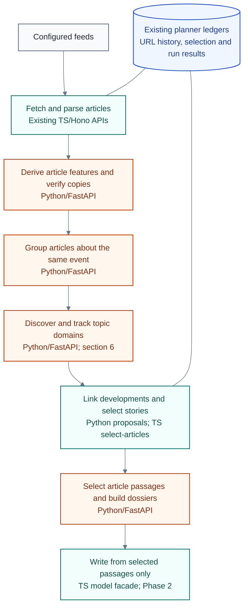

Existing topic signatures can help event retrieval before this flow's topic
update. Discovering new topics runs after copy/event reconciliation so repeated
distribution does not dominate the fit. Section 6 separates discovery from
tracking; neither is an article rejection gate.

## 2. Architectural terms

Reuse [native identities](../docs/architecture/contracts/identity.md),
[planner ledgers](../docs/reference/feed-planner-ledgers.md) and
[taxonomy](../docs/concepts/taxonomy.md). The earlier
[event-clustering design](unsupervised-topic-detection-event-clustering.md#identity-and-replay)
supplies cluster/topic/story names where those records are still proposals.
No new article identity scheme is introduced.

Table B - Shared architectural vocabulary

| Id | Term | Meaning |
| --- | --- | --- |
| B1 | **Raw feed item** | Untrusted feed entry and metadata, often an article address with a title or partial body, before extraction/sanitization. It is an offer, not proof of an article's content or publication time. |
| B2 | **Article** | Editorial content at one admitted address. Articles include news, research, technical posts and explainers; the publisher and configured feed are separate provenance. |
| B3 | **Parsed article** | The existing captured candidate, with candidate_id, url_key and sanitized article_text. Keep that text available during Phase 1 before creating smaller derivatives. |
| B4 | **Article passage** | A contiguous excerpt addressed within an article's exact text. It is not another article or a ledger work unit. |
| B5 | **Article features** | Vectors, lexical counts, entities, frames, time evidence and retained excerpts derived from a parsed article. |
| B6 | **vertical / desk / lenses / events** | Existing public taxonomy fields. Feed placement, publication placement, cross-cutting labels and event types retain their current meanings and vocabularies. |
| B7 | **Reporting contribution** | Distinct reporting, analysis or explanation, separated from its copies. Copies can share a contribution while retaining their separate article, publication and distribution records. |
| B8 | **Verified copy** | An article or passage established by ordinary-code content/origin checks as repeating the same contribution. Similar wording or a model's equivalence label alone is insufficient. |
| B9 | **Topic domain** | The earlier design's broad semantic category, addressed by topic_domain_id. It does not replace the existing vertical, desk, lenses or event-type labels. Private discovery requires review before public promotion. |
| B10 | **Event cluster** | Reports of one real-world occurrence, using the earlier cluster_id ULID. It is distinct from a CloudEvents event occurrence and from taxonomy labels such as release or incident. |
| B11 | **Event joining** | Assigning supported article passages to the same event cluster. This does not declare the articles copies. |
| B12 | **Event threading** | Connecting distinct events through a supported directed story edge. It does not merge them into one occurrence. |
| B13 | **Story edge** | A typed, directed, evidence-backed relationship between distinct events. Chronology, follow-up, context and explicitly reported causation are different meanings; chronology alone proves neither follow-up nor cause. |
| B14 | **Unordered event association** | A supported event relationship whose direction is unknown. Store it separately from directed story edges; it asserts neither chronology nor causation and is excluded from directed reading paths. This remains a provisional design choice to qualify. |
| B15 | **Story DAG** | Supported directed event relationships, addressed by the earlier story_dag_id ULID. It can branch and converge; a linear reading path is only a view. An explainer need not invent an event graph. |
| B16 | **Story scope** | One coherent story/question and its admitted event/context evidence. Graph connectivity or a shared topic does not define the scope by itself. |
| B17 | **Anchor vector** | The founding article's recorded feature vector within a named representation. Changing a representative or centroid does not move it. |
| B18 | **Active centroid** | The normalized mean of the declared distinct semantic contributors to one event cluster at a named snapshot. Copies do not add weight; connected events and context-only articles are excluded. It is a retrieval aid, not an identity verdict. |
| B19 | **Story dossier** | A scoped manifest of selected articles, their roles and selected passage references, with relevant event relationships and known limitations. It is not concatenated articles, a fixed article count or the whole graph. |
| B20 | **Dossier edition** | An immutable version of that manifest and its evidence selection. A generation-ready edition also identifies the exact bounded synthesis input and matching preflight receipt. |
| B21 | **Synthesis input** | The actual model-visible projection: selected verbatim article passages, article/citation labels, indispensable context and task/schema framing. The model receives this measured package, not every article listed in the dossier. |

Several events may share a topic and remain unrelated stories. A story may
cross topics. An article may contain several events. An explainer can support
an event story or form a useful article-led dossier without an invented
occurrence time.

Merging duplicate event clusters consolidates representations of the same
occurrence. A corrective split repairs mixed membership. Branching means one
event has several subsequent developments; convergence means a later event
has several supported predecessors. None of these operations is article deduplication.

**Flow - How articles, topic domains and event clusters differ**

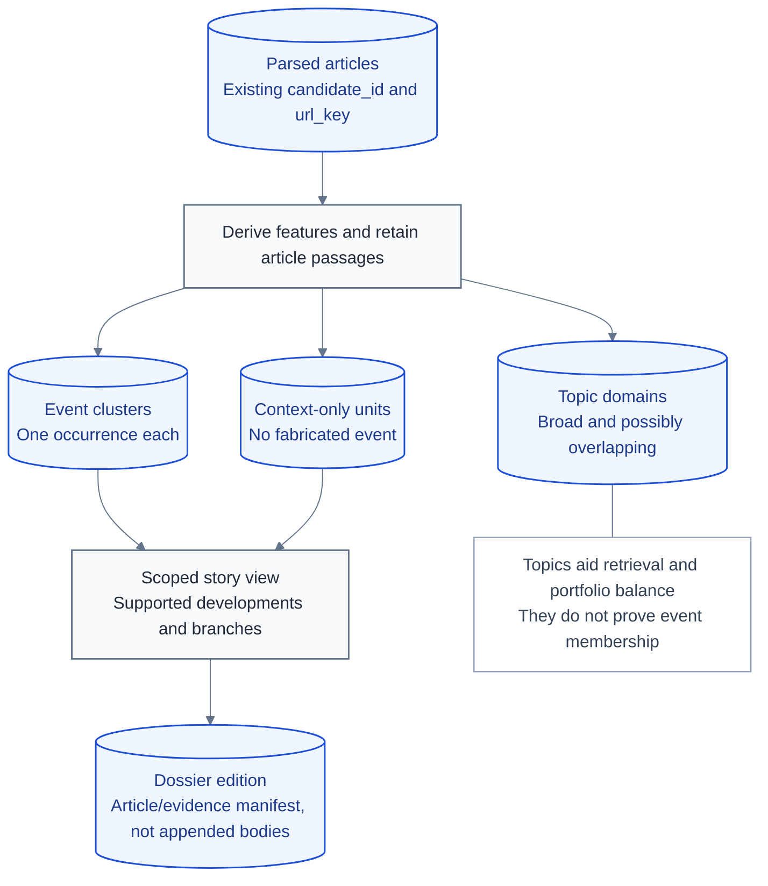

### 2.1 Reuse the existing IDs; distinguish URL, text and work

Table C - Existing fields and the few retained proposal fields

| Id | Field | Status and meaning |
| --- | --- | --- |
| C1 | canonical_url; article_id / url_key | Existing. Native TS hashes the canonical URL into article_id at the API boundary and url_key in its ledgers. Reuse its normalizer; do not substitute a text hash. |
| C2 | candidate_id | Existing. One captured article input, carried through fetch, parse and selection. Another capture of the same address retains the article ID but has another candidate ID. |
| C3 | item_id | Existing publication identity within a vertical. Keep it unchanged; it is not the graph or article-text key. |
| C4 | unit_id / file_id | Existing ledger work/file identities. Reserved for that purpose; article passages do not receive another unit_id. |
| C5 | body_sha256 | Existing fetch digest of the downloaded response body. It is not a digest of sanitized article_text. |
| C6 | content_sha256 | Existing ledger-envelope digest of stored row content. It is not an article ID or article-text version. |
| C7 | text_sha | Retained from the earlier architecture, not an existing candidate/discovery column. Digest exact sanitized article_text using derive_text_digest; retain excerpt text and extraction provenance with it. No content_id or extraction_id namespace is added. |
| C8 | representation_revision | Retained from the earlier architecture. Identifies the saved feature materialization and its recipes, not merely an encoder/model name. |
| C9 | cluster_id; story_dag_id; topic_domain_id | Retained proposal names: event-cluster ULID, story-DAG ULID and validated stable topic slug. Do not rename them event_id/story_id or reuse the native document_id for a semantic representation. |
| C10 | contribution_id / observation_id | Retained proposed reporting/copy records, not replacements for discovered-articles. They distinguish useful reporting from copied distribution at the original observation time. |
| C11 | dossier_revision / generation_work_id | New dossier-specific references. Bind the selected evidence and actual generator input/profile; do not replace planner run, candidate, ledger or operation IDs. |

The same URL can acquire a different body without becoming a different
article address. Record its text_sha and reuse the captured candidate and
existing extractor/sanitizer provenance. Passages use an article reference, exact text
digest and offsets, not a second global ID.

The earlier research's UUIDv5 Document Unit must not replace the native
document_id, which already means a resource URL hash. Likewise, a label edit,
copy, re-embedding or new graph edge is not new reporting.

Carry the validated TS address and candidate identity into Python analysis.
HTTP projections keep article_id; ledger projections keep url_key, using the
existing strict mapping rather than accepting both as aliases. Do not run
canonical_url through the separate legacy Python discovery normalizer.
Existing publication/item-health adapters keep their own item_id rules;
this design does not rename old rows.

### 2.2 Event stores and the retrieval database

Use the [existing registered ledgers](../docs/reference/feed-planner-ledgers.md)
before adding semantic records. Planner schemas, writers and compaction stay
TypeScript-owned; Python consumes the small validated inputs it needs.

Full sanitized article_text remains a run-private working input. Selected text
already has a workflow-artifact handoff; it is not added to committed planner
metadata. Retained excerpts/features for future matching are the proposed
extension. LanceDB indexes those declared records and can be rebuilt.

Table D - Logical record groups

| Id | Record group | What it must retain |
| --- | --- | --- |
| D1 | Existing discovered-articles | url_key, first_seen_at and UTC date. Preserve earliest URL discovery globally across feeds. |
| D2 | Existing selected-articles / rejected-articles | Native article metadata, actual scores/assignments and recorded losses; no article bodies in committed rows. |
| D3 | Existing feed-health-state / plan-runs | Actual run/feed work, reliability, timing, results and artifact references. Do not duplicate them in a new graph-run ledger. |
| D4 | Proposed retained article features | Native article/candidate references, text_sha, representation_revision, selected excerpts, compatible features and analyzed/retained coverage. |
| D5 | Prior proposed topics / event_clusters | topic_domain_id, cluster_id, signatures/anchors, supported memberships, aliases and revisions. Section 6 defines topic discovery/tracking. |
| D6 | Prior proposed story_dags / story_edges / unordered associations | story_dag_id, cluster endpoints, relation evidence, scope, reverse adjacency and corrections. |
| D7 | Prior proposed reporting_contributions / coverage_observations | Copy/origin decisions and first observation of distinct reporting. They supplement URL first_seen_at; they do not rewrite it. |
| D8 | New dossier and generation records | Selected article/passages, exact visible excerpts, input identity, result and delivery state; link to existing native operations/run records. |

These are logical contracts, not a demand for one new service or one
physical ledger per noun. Physical projections and registered compaction
must preserve native schema/version and read-compatibility rules.

LanceDB contains article-passage vectors and retained searchable text,
topic signatures, stable/recent event search representations, and bounded
cold-anchor/reference indexes. Its nearest-neighbor graph is not the event
graph. Its table transactions do not establish atomicity across the logical
record groups.

Do not merge mutable LanceDB directories through Git. A cache miss triggers
restore/rebuild from named checkpoints and deltas; missing or corrupt logical
state is not permission to start with empty history.

## 3. What the TS APIs do today

The current services already perform substantial admission and accounting.
They do **not** resolve every semantic decision in fetch.

Table E - Observed placement and proposed change

| Id | Current place | Observed behavior | Target treatment |
| --- | --- | --- | --- |
| E1 | Offered-article preflight, before download | URL/feed-policy checks, exclusions, published-URL/failure checks, media policy and usable publication-age refusal | Keep technical/access checks. Separate retry eligibility from editorial exclusion; move age and previously-covered reporting decisions out of acquisition. |
| E2 | Article extraction | Full extraction/sanitization and quality measurements; selected quality rejection can prevent candidate capture | Retain actual extraction/access failures, but make short/non-prose/structured form evidence rather than universal newsworthiness decisions. |
| E3 | API candidate preparation | Full extracted text is shortened to harvest.max_input_words before names/candidate capture | Seal the complete permitted capture first. Any prefix becomes a labelled derivative, not the only evidence available to selection. |
| E4 | Content measurement during parse | Link/image-label density, list count and opening press-release markers are measured from chosen Markdown | Preserve measurements and provenance. This cannot generally be decided from the feed URL alone. |
| E5 | Screening inside selection | Published/failure/paywall/category/media/content/minimum-word checks, then age check | Separate hard policy/access refusal from contribution eligibility and soft content signals. A high link density can describe useful technical documentation. |
| E6 | Numerical curation | Cached authority/recency/pass/substance terms, complete-pool rescans, feed/site penalties, first-use bonus, stable ties and losses | Reuse lifecycle, accounting and arithmetic patterns; introduce story-valued inputs explicitly rather than passing dossiers as URLs. |

Code receipts at the inspected revision: the TS age ceiling is 36 hours
and refuses known age above it; screening's raw-word floor is 180 words.
The prepared-text ceiling is 20,000 words and reports its cut.
Extraction separately records a 60-word shortness signal with its configured
rejection flag; signal precedence means that is not identical to the screening
floor. These are current refusal consequences, not target quality thresholds.

The predicates live in
[prepare-article.ts](../services/feed-ingest-plan/src/harvest-feeds/prepare-article.ts),
[triage-gates.ts](../services/feed-ingest-plan/src/screen-article-candidates/triage-gates.ts),
[parse-operation.ts](../services/feed-ingest-plan/src/api/parse-operation.ts)
and [prepare-article-input.ts](../services/feed-ingest-plan/src/api/prepare-article-input.ts).
Link density is produced by
[content-evidence.ts](../services/feed-ingest-plan/src/harvest-feeds/content-evidence.ts),
then acted on by
[content-filters.ts](../services/feed-ingest-plan/src/screen-article-candidates/content-filters.ts).

**Flow - Current TS checks that can remove an article before selection**

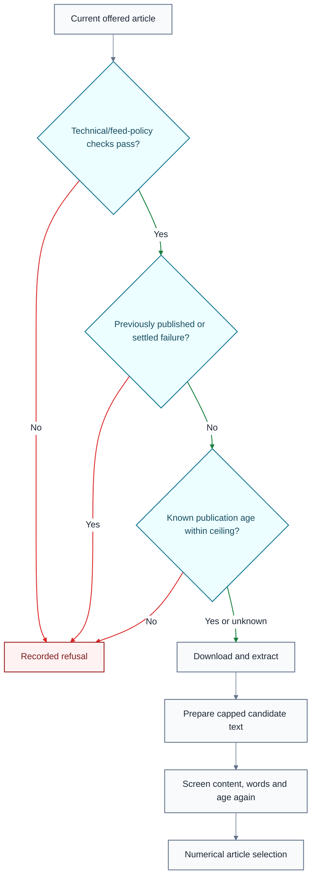

The failure is causal: changing the final ranking cannot recover an article
that acquisition never fetched or a qualification preparation already removed.
The existing selector's complete-input claim, configuration fingerprint,
resource ownership, health evidence and terminal loss accounting remain useful.

## 4. Target acquisition, capture and time decisions

### 4.1 Fetch permitted articles through the existing APIs

Fetch owns **whether this address may be requested and what happened**, not
whether the article is worth a dossier. Keep feed enrollment, target/address
safety, access restrictions, decoded-byte limits, pacing and bounded retry.
An already-known address means inspect/reuse its saved text, not ignore updates.

Content-type/media restrictions that genuinely determine supported acquisition
can run here. A headline, category or path can supply an article-type hint;
it cannot establish content novelty, body link density or event identity.
Do not follow article-body links or model-produced addresses to obtain evidence.
Recovery later uses an already admitted article reference.

**Flow - Fetch permitted articles without rejecting them for publication age**

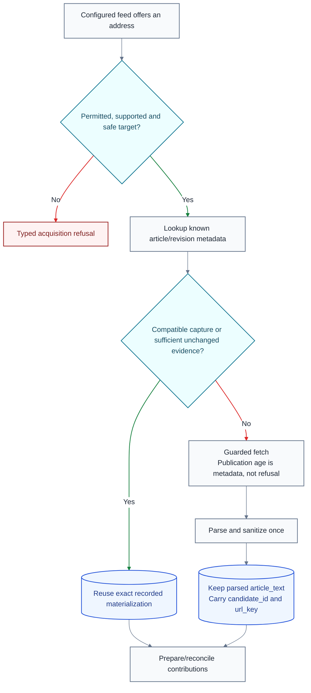

Conditional HTTP validators are an acquisition optimization, not novelty proof.
The current fetch code does not establish a general retained-body/304 recovery
contract; that is proposed here. A 304 plus retained article features can justify
reusing those features, but cannot claim full text is available. If essential text
is missing, Phase 1 performs a bounded recovery request or reports it unavailable.

### 4.2 Keep complete parsed text until Phase 1 finishes

Parsing remains network-free. Keep the existing candidate_id, url_key,
article_text and extraction measurements. The proposed change is to retain
the complete permitted sanitized text during Phase 1 before the current
prepareArticleInput prefix cut. "Saved article text" means that exact parsed
string, not a new kind of article or another identity.

**Flow - Keep parsed article text until its dependent work finishes**

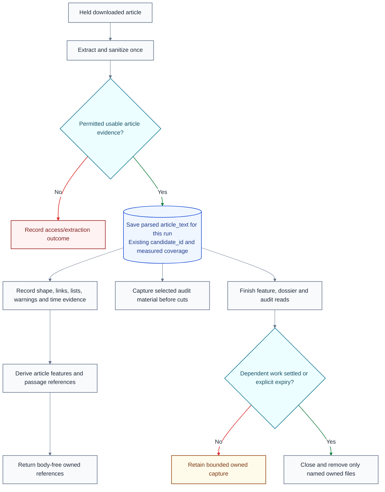

Bound per-article bytes, expansion, concurrent readers and total spool use.
Do not assemble every long body in one in-memory batch. Segments carry global
article coordinates, text_sha and overlap/coverage metadata; they
are not independent articles. Capacity expiry is a named incomplete outcome,
not an empty successful article.

DEBUG records identify the candidate, text digest, measured word/byte limits,
reuse/cut decisions and elapsed work. They never include article_text. INFO
records the typed completion or failure using the same native operation.

### 4.3 Select recent reporting, not merely recent publication dates

Read the [existing discovery history](../docs/reference/feed-planner-ledgers.md#a-discovered-articles)
before deciding whether an article is newly discovered. Preserve that ledger's
meaning: first_seen_at is the first observation of a canonical URL, not every
later update at that address.

Table F - Reuse the right timestamp

| Id | Timestamp | Meaning and use |
| --- | --- | --- |
| F1 | discovered-articles.first_seen_at | Existing first observation of the URL. Keep it unchanged across feeds, retries and later updates. |
| F2 | coverage_observations.observed_at | Earlier proposed first observation of distinct reporting. Reuse it for copies; new material at a known URL uses the earliest captured observation containing that material, not the URL's old first_seen_at or a later classification time. |
| F3 | published_at with published_at_source / timing_basis | Existing publication/selection provenance. Only actual publication evidence is publication age; a selection fallback must not pretend to be it. |
| F4 | Supported occurrence time/interval | Evidence for event identity and ordering; unknown remains unknown. Publication time is not proof of occurrence time. |
| F5 | API UTC instants and monotonic durations | Actual execution and measured cost, not a way to make reporting new. |
| F6 | Retention and search periods | Independent physical/search policies, not the selection window. |

At selection time T, new reporting is eligible when its original observation
is between T minus fourteen elapsed UTC days and T, inclusive. Apply this
after copy/change checks. Older articles remain useful background; an old
publication first discovered now can still qualify with its real date shown.

Missing/incomplete history means timing is unresolved, not newly discovered.
Preserve article-entry publication/update roles; a channel build date does
not date its articles. Invalid/future or ambiguous dates cannot buy recency.

**Flow - Choose reporting within the fourteen-day selection window**

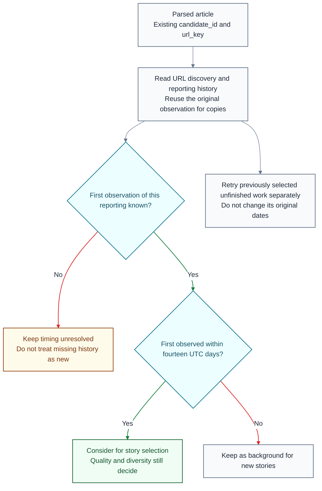

DEBUG records the existing article/candidate IDs, timestamp basis and
eligibility reason. Publication recency, topic alignment, information value
and already-delivered coverage remain separate decisions.

## 5. Article representation and code-owned copy resolution

### 5.1 Derive article features before selecting excerpts

The initial pass sees every permitted article in the complete input manifest.
It preserves sentence/paragraph/table/code coordinates, lexical signals and
article identity before choosing a final article representative.

Use separate title, lead and contiguous body passages. A single vector made
from distant central sentences can omit a result or qualification and make
an incoherent input. Headings improve segmentation where present but are not
required.

Carry candidate_id and url_key through this step. Compute the proposed
text_sha with the existing text-digest helper; retain recipe versions as
representation_revision. Passage references remain scoped to that article text.

**Flow - Derive searchable features from the available parsed article**

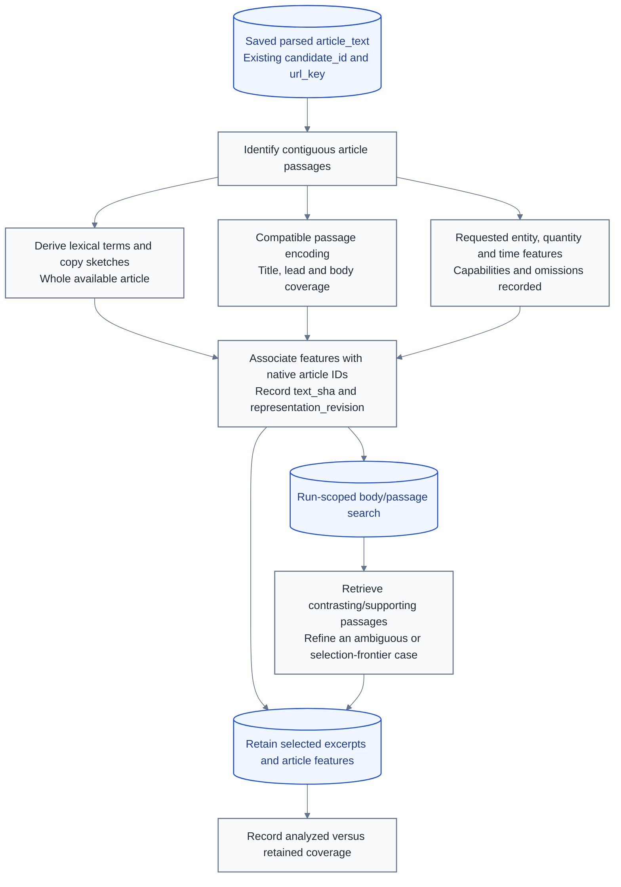

Table G - Feature and evidence roles

| Id | Feature | Role and limit |
| --- | --- | --- |
| G1 | Existing candidate/address IDs plus proposed text_sha/representation_revision | Reuse the right article/text/features; a changed digest does not establish new reporting |
| G2 | BM25 over available article/passages | Names, identifiers and rare technical terms, independently of dense similarity |
| G3 | Passage vectors | Paraphrase/semantic candidate retrieval; encoder tokens differ from writer tokens |
| G4 | Entities, quantities, units and predicate candidates | Event distinctions and claim comparison; preserve binding, negation, modality and attribution |
| G5 | MinHash/LSH | Approximate near-copy candidates; neither exact deduplication nor semantic novelty proof |
| G6 | Article type, link/list/shape signals | Article interpretation and diagnostics; not universal quality gates |
| G7 | Structured evidence assessment | Resolve bounded occurrence/value ambiguity after code copy checks; neither article deduplication nor a summary of every article |

Default retention is article features and the passages needed to substantiate
accepted decisions/dossiers. Full bodies and additional passage matrices are
run-scoped. Historical lexical retrieval searches retained text, not an
imaginary full-body archive.

Selected excerpts are intentionally incomplete. Position/section diversity and rare
distinguishing passages reduce loss; they do not prove full coverage. A
pre-selection article audit samples before this cut, including unselected articles.
Historical missing detail can trigger Phase 1 hydration, never invention.

DEBUG records feature-cache reuse, recipe identity, analyzed/retained counts
and missing capabilities. It does not log the feature matrix, extracted names
or article text.

### 5.2 Duplicate addresses, copies and material additions

Address identity follows the current
[resource-address contract](../docs/architecture/contracts/identity.md#typescript-resource-addresses).
Do not strip arbitrary query parameters or assume every AMP/mirror form is
the same resource. Redirects and permitted alias evidence are distinct from
semantic/event identity.

**Flow - Verify repeated article text in ordinary code**

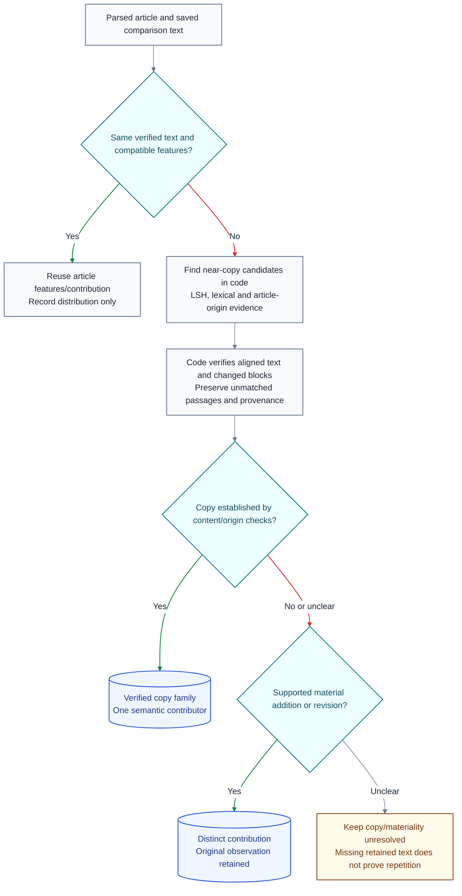

A copied correction can still introduce new material information if the
earlier contribution lacked it. A page may be mostly copied while adding
independently useful reporting. Preserve those distinctions at article-passage/
contribution level instead of collapsing the whole article blindly.

Verified copies remain available as distribution/provenance. They add no
extra active-centroid weight, independent-reporting bonus or activity reset. Unknown
origin does not make the first useful article worthless, but it cannot
establish additional independent corroboration.

Article and passage deduplication are ordinary-code work before model calls.
Use exact content/passage identities first, then MinHash/LSH to propose
bounded comparisons and lexical alignment/content-origin evidence to verify
them. Approximate resemblance does not authorize removal. Keep changed blocks,
negation, numbers, attribution and qualifications unless their equivalence is
actually established; otherwise retain the article or passage as unresolved.
No request concatenates article bodies and asks the LLM to deduplicate them.
Structured semantic labels can inform event identity, information novelty
and value, but cannot create a verified-copy record or delete evidence.

DEBUG records compared article IDs, the exact/copy-check basis and unmatched
block counts. INFO records the saved decision and its original observation.

## 6. Topic identification and the topic store

Reuse the earlier proposal's [Topic Domain record](unsupervised-topic-detection-event-clustering.md#topic-domain-schema)
and [separate counting populations](unsupervised-topic-detection-event-clustering.md#keep-the-populations-separate).
A topic domain is a broad semantic category, not an occurrence, story scope,
vertical, desk, lens or event-type label. Unknown topics never exclude an article.
HDBSCAN/no-UMAP/TF-IDF below is this document's proposed recipe, not an
implemented capability or a method selected in the older proposal.

### 6.1 Prepare topic input

Pin the expected base snapshot and a named input manifest: the complete new
parsed-article batch, the selector's 14-day distinct-reporting eligibility view,
and bounded retained topic signatures/member references, including older context.
There is no archive walk or permanent every-article body store.

Use the available title, lead and body passage features from section 5.
Keep native article_id/url_key and candidate_id references, proposed text_sha
and representation_revision, and exact passage coordinates. No new document
or article identity is allocated. Encoder/normalization and lexical/language
recipes must be compatible; missing channels remain unknown. No generated
summary is required.

Before event membership settles, take one passage medoid per confirmed
reporting contribution. Afterwards replace these with one representative per
cluster_id, plus one per non-event or still-unassigned contribution. Select
event representatives from their supporting passages, not a whole-article
average across unrelated events. Record the population and coverage used.
Verified copies/superseded features add no votes; pending extra contributions
remain searchable but add no fit, IDF or activity votes. An article can support
several events/topics without every passage becoming an independent density vote.

### 6.2 Discover private topic domains

First compare new passage features with existing signatures as soft retrieval
hints. Fit unassigned evidence and explicitly named affected-topic members in
one shared input, not independent per-worker topic spaces.

The proposed default is sklearn HDBSCAN with Euclidean distance on finite,
nonzero L2-normalized compatible vectors, without UMAP. Starting configuration
proposals are min_cluster_size 5, min_samples 3 and a 2,048-representative cap;
they are not accuracy or runner-capacity promises. Choose fit inputs in recorded
oldest-waiting/stable-ID order and queue overflow. Bound fit time and any
settling refits by configuration; record remaining backlog after that budget.

Noise, insufficient support, missing features and overflow stay unassigned or
pending with reasons, not low-quality or rejected articles. A lone low-similarity
article does not establish a durable domain. Preserve the last compatible
snapshot on unavailable fit work. Density/cluster-strength values are not
importance, truth or event-membership scores.

**Flow - Discover topic groups and propose their names**

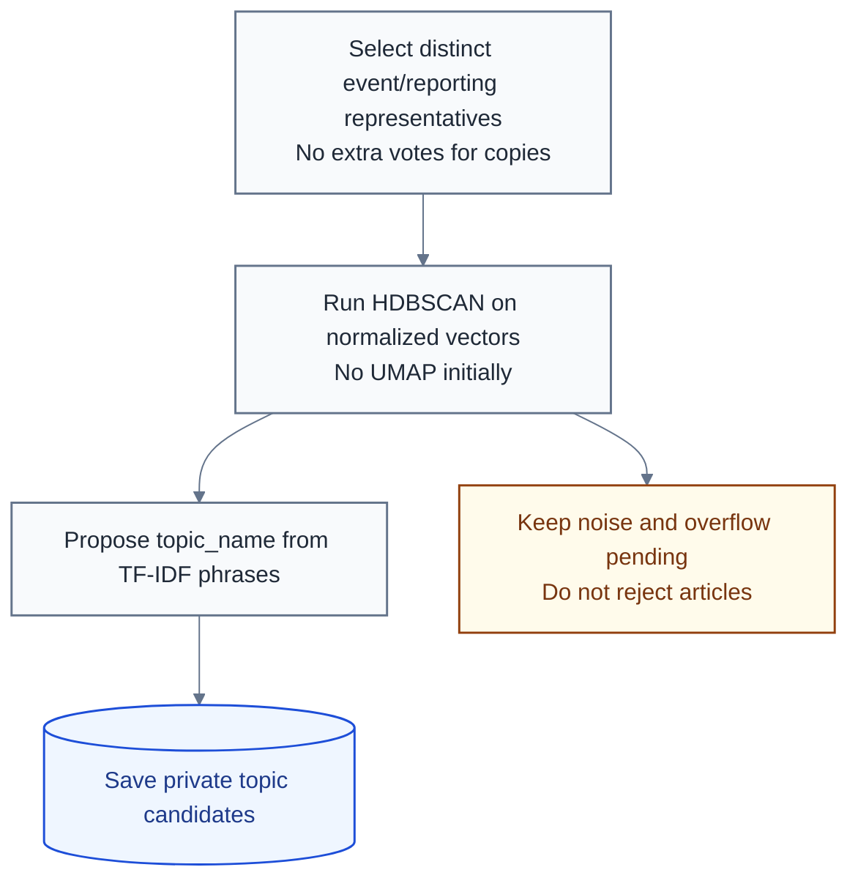

### 6.3 Propose names and allocate stable slugs

Fit TfidfVectorizer over the declared deduplicated representative population,
using configured one-to-three-token phrases and an analyzer preserving technical
identifiers. Average member term weights within each group; choose a configured
small set of highest-weight, nonredundant phrases as its proposed topic_name.
Retain term weights, member/passage references and the statistics/label recipe.
This is ordinary TF-IDF, not BERTopic c-TF-IDF and not a model naming call.

Compare the group with existing domains before allocating an identity.
For a genuinely new candidate, code allocates a unique validated topic_domain_id
slug once, for example candidate.topic-a7f3, and records its creation decision
for replay. It is not the HDBSCAN integer label, a native
ledger unit_id/file_id or a path derived from article text. Existing semantic
slugs such as tech.ai.chips remain valid and unchanged.

A later topic_name change updates record_revision, not topic_domain_id.
Former display names remain in revision history; aliases contain validated
alternative domain slugs, not every changing TF-IDF phrase. Public name,
definition and slug-alias changes require review_record. Discovery creates status
candidate; approved/public promotion is reviewed, never inferred from size.

### 6.4 Track existing domains and reconcile changes

For each new article/event group, compare compatible dense_centroid and retained
representatives with its passage vectors, and weighted keyword overlap under
one named statistics basis. Combine nonnegative cosine and term-overlap
components on a declared 0-to-1 scale with configured weights summing to one.
Apply the configured match floor and runner-up margin; missing evidence is
not a zero score.

Check definition continuity and available membership overlap before reusing
topic_domain_id. New articles may have no old-member overlap; that alone does
not veto a supported match. Several themes may be supported; competing
unsettled assignments retain their alternatives rather than forcing a winner.
Topic assignments never gate cross-domain article/event retrieval.

A fit proposes, rather than proves, splits/merges. Validate affected retained
members and definitions, keeping unexamined members unchanged. A supported
merge records a canonical survivor and aliases. A split records child slugs,
parent/child lineage and explicit assignments; never alias one parent blindly
to one child. Public changes require review; private corrections are versioned.
Update routing_version for changed routing evidence, and settle with the one
expected-base snapshot writer. Article, cluster_id and story_dag_id identities
are not changed by topic regrouping.
Silence/noise does not retire a domain; retirement is a recorded decision,
reviewed for public domains, with older compatible references still retrievable.

**Flow - Keep topic identity stable across later batches**

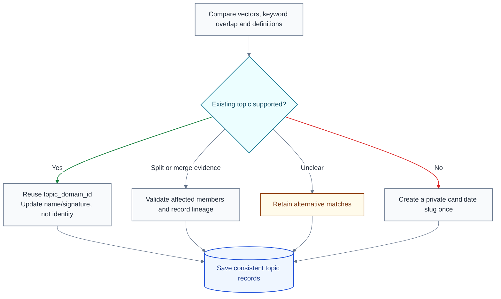

### 6.5 Retain logical records; derive retrieval tables

Table H - Topic record relationships and storage

| Id | Record | Ownership and retained meaning |
| --- | --- | --- |
| H1 | Prior proposed topics | Through the project ledger door: version, record_revision, topic_domain_id, topic_name, definition, status, dense_centroid, supporting_cluster_ids, active_cluster_count, routing_version, review_record, aliases, t_created and t_last_updated. These are the earlier proposal's field names, not existing TS candidate columns. |
| H2 | Proposed topic assignments/signatures | Versioned article/passage and cluster_id references, compatible representation_revision/recipe, keyword weights, representative references, accepted/ambiguous state and supporting decision. Link event_clusters.topic_domain_ids back to topics. Non-event explainers retain article membership without an invented cluster_id. |
| H3 | Proposed fit/change records | Base/input manifest, population/statistics/fit identity, configuration, completed/pending/noise/overflow coverage, and creation/reuse/split/merge evidence. Register native Python contracts and ledger read/compaction rules before writers. |
| H4 | Derived LanceDB views | Topic vectors/terms, article-passage search and member lookup indexes rebuilt from named logical records. Index loss does not erase topics or allocate new identities. Keep discovered-articles, selected-articles, rejected-articles, feed-health-state and plan-runs under native TS ownership. |

Derive active_cluster_count from distinct supported clusters, not article count.
Keep reporting contributions, copied distribution and event breadth separate.
Use stable domain IDs for duration-normalized trends with availability evidence;
zero denominators/inadequate history mean unavailable, not an epsilon spike.
Prominence remains diagnostic, never a singleton veto or eligibility clock reset.

### 6.6 Instrument topic decisions

Build configurable DEBUG records into prepare-topic-input, discover-topic-domains,
propose-topic-name and track-topic-domain, including existing-signature matching.
Record native operation/trace and base/recipe/routing IDs, bounded article/
candidate/cluster/topic IDs, channel availability, score components/floor/margin,
basis and outcome codes, member/contribution/pending/noise/overflow counts, and
actual operation/fit timing. Name generation logs term counts, not terms or names.

Use logging.level and max_event_bytes with DEBUG/INFO/WARNING/ERROR/CRITICAL;
bound ID lists and report omitted counts. Generator/evaluator controls already
exist; severity filtering for planner progress logging is a proposed extension,
not an existing capability. INFO reports batch coverage, WARNING reports missing
or capacity-limited work, and ERROR reports invalid state. Exclude article text,
names/entities, topic_name/keyword strings, prompts, arbitrary URLs and secrets.

## 7. Event-cluster formation

An event cluster identifies **one occurrence**, not all reports with similar
words. Topic matching narrows attention where useful, but cross-topic lexical,
dense and explicit-reference paths remain available.

### 7.1 Retrieve a candidate set, not a verdict

For each article passage, union:

- compatible passage-vector hits from the complete new batch;
- lexical/identifier hits from available current text and retained features;
- stable event founding/identity references;
- bounded recent admitted members of an event; and
- trusted existing reference/alias lookups, including named cold partitions.

Deduplicate candidate event IDs after combining channels. Record which
channel proposed each one. An article from another worker in this batch must
be comparable even if no prior snapshot contains it yet.

An active centroid is a search representation for **that event only**.
Its recipe declares the compatible contributors and active-member snapshot,
with one contribution-level weight rather than extra votes for copies.
The retrieval horizon is separate from the fourteen-day admission window.
Reports about a court challenge do not enter the filing event's centroid
merely because the events share a story. The immutable anchor vector, active
centroid and current display representative serve founding identity evidence,
current retrieval and presentation respectively; none is a sole joining rule.

The candidate budget does not cap away required event-member verification.
If verification cannot finish, the proposed membership remains unresolved.
No exact-search or ANN score is a probability of same occurrence.

Keep the earlier cluster_id ULID for an existing occurrence. Creating a
different occurrence allocates another cluster_id once with the saved
decision; a fresh HTTP request, new article or changed centroid does not.

### 7.2 Verify occurrence and assertion scope

Identity evidence can include a case/instrument identifier, product/version,
location, participants bound to the action, occurrence interval and an article's
explicit description of the same episode. Which fields matter depends on the
event kind; not every earthquake, experiment or advisory has an acting agent
and target.

Compare assertion status and measurement scope. An announcement, a proposed
plan, a denial, a completed action and a response can be different developments.
Conversely, conflicting accounts or revised counts can concern the same event.
Do not use a blanket figure mismatch to split all disagreements.

**Flow - Group article passages describing the same occurrence**

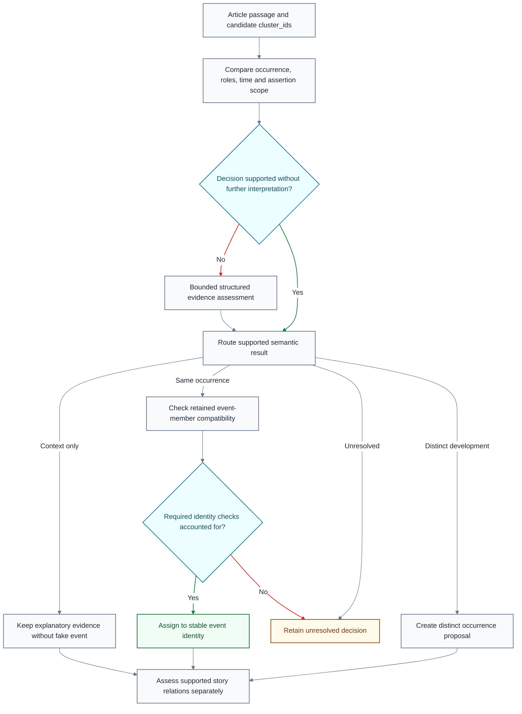

Missing roles/time mean missing evidence, not a zero similarity term or an
automatic rejection. A generic shared organization or place cannot be the
sole reason to join. Existing article-supported identity can outweigh changing
wording; no universal requirement to clear a second cosine against the founding
article is selected.

The current published-day rules are not silently reused here. They compare
the current title/summary representation and have their own fitted line,
headline overrides, numeric veto and across-outlet display meaning.
Multi-passage article matching needs its own task/recipe identity and evaluation.

DEBUG records retrieval channels, compared cluster_ids, score components,
missing evidence and the join/new/unresolved reason. Stable domain IDs remain
separate from the operation's CloudEvents source/id and trace context.

### 7.3 One semantic evidence task, no summary-before-selection

Use the existing secure TS model-task/generator facade for a new
**assess-story-evidence** operation. Python supplies a bounded comparison bundle
and validates the returned labels before creating graph decisions. This is a
task-specific capability on the existing listener, not a new general gateway.

The bundle contains current supporting **and contrasting** passages, relevant
retained member evidence, offered article-passage/cluster/pair references and the configured
reader-interest/rubric definition. Hide outlet authority, technical pass-rate
weights and retrieval scores from semantic judgment.

Table I - Structured assessment result

| Id | Result family | Meaning and control |
| --- | --- | --- |
| I1 | Occurrence labels | Action/participants, time/scope and unknown fields linked to offered article passages |
| I2 | Pair/relationship labels | Same occurrence, distinct development, context-only or unresolved, with supported relation/direction and counter-evidence |
| I3 | Information units | Results, methods, explanation, qualifications and corrections with actual article/passage references |
| I4 | Comparisons | Equivalent, added, revised, conflicting or unknown information relative to supplied prior evidence; not permission to remove articles or establish copy families |
| I5 | Reader-value rubric | Bounded ordinal ratings with supporting evidence, not self-reported factual confidence |
| I6 | Missing evidence | Offered references not sufficient for a decision, enabling bounded expansion/hydration rather than invented facts |

Identifiers and allowed choices are supplied by code. The model cannot create
paths, addresses, fetch instructions or authoritative cluster IDs. A complete
frame is selected or left unresolved; do not combine one extractor's agent
with another extractor's action to manufacture agreement.

Preserve the earlier frame-selection policy where the configured GLiNER
capability provides a complete supported frame: prefer that frame when it
passes validation and use the existing semantic-task frame as cross-check or
fallback. If supported candidates disagree, retain both and leave the disputed
decision unresolved. There is no separate model call merely to arbitrate,
and agreement does not prove that extraction was correct.

This re-scopes the old labels/elements task. The two logical task families
are **assess evidence** and **write the selected synthesis**. That does not
promise two physical requests per story: neighborhood splitting, ambiguous
comparisons, evidence expansion and repairs are separately measured work.
There is no hidden generative summary of every article and no model-owned
article/passage deduplication. The comparison bundle is already bounded and
code-deduplicated before this task sees it.

Use recorded task profiles, schemas and prompt identities. No new sampling
temperature, thinking override or model winner is assumed here. The facade
must preserve committed destination, redirect/proxy, byte-limit and deadline
controls; a pre-existing helper without those controls is not sufficient for
the new API.

## 8. Cluster evolution, merges, splits and story scopes

### 8.1 State changes have different meanings

Table J - Event/story operations

| Id | Operation | Required effect |
| --- | --- | --- |
| J1 | Join article passages | Add supported passages to one occurrence; update distinct contribution/search state, not an extra vote for a copy |
| J2 | Merge duplicate events | Verify compatible memberships, choose a recorded survivor and preserve aliases; do not merge on centroid similarity alone |
| J3 | Create development and thread events | Allocate another event and assess a story edge to prior events; it does not enter the prior event's active centroid |
| J4 | Branch/converge | Preserve distinct events with supported predecessor/related links; a one-parent field cannot represent convergence |
| J5 | Corrective split/reassignment | Partition supported memberships, preserve justified identities, create successors where needed, retract unsupported incident relations and invalidate affected dossiers |
| J6 | Retract relation | Preserve the old decision and reason for supersession; update reverse adjacency and dependent context views |
| J7 | Quiet/inactive | Change ordinary retrieval placement/activity labels without declaring the event dead or deleting identity |
| J8 | Recover older context | Load named retained evidence; reuse identity only if same occurrence is supported, otherwise create a linked development |

**Flow - Correct event membership without confusing it with story branching**

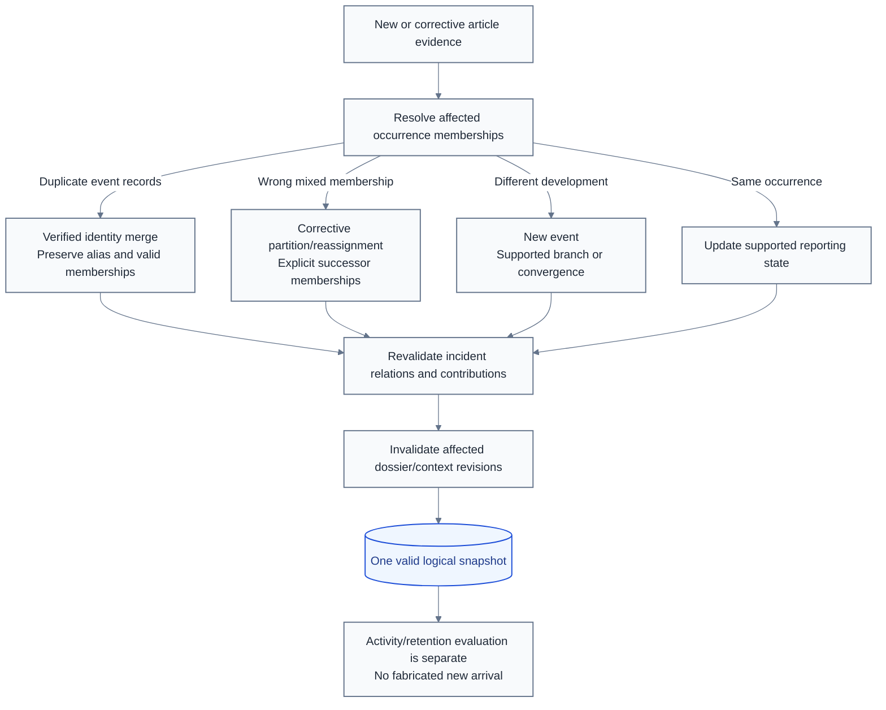

Copy corrections recompute contributor attribution using original observation
times. A merge, split, re-embedding or new edge does not become fresh reporting.
If a founding article assignment was itself wrong, preserve that historical decision
and its named anchor vector; do not move the old anchor to disguise the repair
or force every successor to inherit its mistaken meaning.

### 8.2 A story is not a connected component

Store a coherent scope/question and its admitted developments. Story edges
may cross story scopes. Two stories sharing an event, referencing one another
or converging later do not automatically become one giant story. Duplicate
scope identity is a separate merge decision from event identity.

Keep relatedness, direction and causation separate:

- shared topic/entity alone is not a relation;
- article-backed context/follow-up can be useful without causal proof;
- direction can be supported by explicit text even when an exact date is unknown;
- uncertain direction is retained outside directed narrative paths; and
- chronology alone does not establish a meaningful follow-up or cause.

Event threading creates typed directed story edges. The story DAG is the
acyclic projection of supported edges within this scope, not the whole
association store. A reported causal edge records who made the causal claim;
the system does not promote sequence or correlation to proven causation.

An unordered event association retains supported relatedness when direction
is unknown. It has no directed endpoint order, is stored separately and does
not enter directed reading paths. Keeping it outside the story DAG is the
provisional default; evaluation must establish whether it improves useful
context without encouraging unsupported links.

Check endpoint identity, edge evidence and cycles before installing a story
DAG. A cycle or conflicting direction stays unresolved or triggers correction;
the graph library cannot make an invalid relation true by dropping an
arbitrary edge.

### 8.3 Main sequence plus important branches

Start from the selected focus and retrieve bounded ancestors/context through
allowed relations and reverse adjacency. Choose a supported backbone ending
at that focus; add branches that materially change interpretation, usefulness
or a consequential disagreement.

Check the transition from the actual tail of a chosen path. A new node
similar to an earlier node cannot simply be appended after an unrelated tail.
Return separate labelled fragments when no supported transition exists,
rather than inventing continuity.

Use bounded NetworkX DAG traversal/dynamic selection, not unrestricted
enumeration of paths or antichains. A structurally parallel node is not
automatically an editorially important branch; the evidence assessment and
coverage obligations decide that.

## 9. Reporting novelty, eligibility and unfinished work

Names and numbers can stay unchanged while meaning changes. Compare outcome,
polarity, modality, attribution, method, population/time scope, caveats and
correction status. A new explanation may change what a reader understands
without describing a new occurrence.

Table K - Novelty interpretation

| Id | State | Predicate |
| --- | --- | --- |
| K1 | NEW | A coherent informative focus is not represented in the target explanation; article evidence supports its content |
| K2 | UPDATE | A material addition, revision, correction or unresolved competing account changes what readers may conclude or do |
| K3 | REHASH | Ordinary-code checks establish compatible repeated content or verified copying with all changed blocks accounted for; a model overlap label alone is insufficient |
| K4 | UNRESOLVED | Evidence/coverage cannot establish whether the difference is material; missing retained evidence is not proof of REHASH |

For example, changing "may work" to "does not work", withdrawing an earlier
claim, exposing a methodological limitation or changing who made an allegation
can be an UPDATE with exactly the same entities and figures.

After classifying contribution identity, apply section 4.3's admission window.
Previously published articles remain usable context. Older material outside
new-work eligibility is not deleted or counted as a failed feed.

Keep four state axes independent:

1. **Reporting novelty:** which information is distinct or revised?
2. **Explanation coverage:** what has the configured target actually received?
3. **Generation completion:** is a matching valid generated result available?
4. **Delivery/publication:** was that result delivered or published successfully?

```text
needs_generation = no valid completed result for generation_work_id
needs_delivery = no successful receipt for target and dossier_revision
```

A contribution already in the graph but never successfully summarized is
unfinished work. A generated-but-unpublished result can be reused without
another model call. REHASH never proves either job complete.

Work selected within its original window can resume under its original
as_of and input identity; retry does not renew discovery. Late target delivery
must retain actual dates and follow its target policy. An unadmitted candidate
that ages out remains retained context, with the missed work recorded.

Corrections to an already-delivered explanation are repair obligations, not
ordinary popularity/diversity competition. Graph repair or model-artifact
retraction can require regenerated output without a new reporting observation.
Do not mark old public output repaired merely because internal state changed;
the reader-facing correction projection remains a distinct publication concern.

## 10. Importance and portfolio selection

### 10.1 Value comes from supported information

The current numerical selector remains the comparison baseline and provides
useful complete-pool scanning, stable tie and exposure mechanisms. It does
not become a factual-quality instrument by renaming its substance score.
Keep technical feed/article pass-rate evidence separate from content value.

The proposed semantic value rubric rates material **focus information units**:
results, methods, explanation and consequential qualifications. Necessary
background is packed later but does not dilute the novelty denominator.

Table L - Proposed reader-value rubric

| Id | Component | Interpretation within configured reader interests |
| --- | --- | --- |
| L1 | C - consequence | How significantly the supported result/claim changes understanding or affects the relevant subject; not worldwide reach or raw audience size |
| L2 | U - usefulness | Value to a reader's decision, method, practice or explanation; a technical singleton can score strongly |
| L3 | E - explanatory depth | Article-backed reasons, mechanism, evidence or limitations, not verbosity or named-entity density |

Each component uses an ordinal scale: absent, intermediate, specifically
meaningful, stronger intermediate, decisive. The prototype encodes these as
0 through 4 with evidence references. They are rubric grades, not confidence
probabilities. The rubric, examples and numeric weights are versioned config.

The following is a **proposed scoring profile**, not a measured optimum or
an automatic production setting:

```text
claim_value(c) = (0.5*C(c) + 0.3*U(c) + 0.2*E(c)) / 4
I(d) = max claim_value among the dossier's material focus claims

N(d | S) =
  weight of focus information not yet explained by target or selected portfolio
  / total focus-information weight

T(d | S) = 1 / (1 + selected dossiers in the tracked focus topic)

F(d) =
  sum(claim_value * 2^(-max(0, reporting_age)/recency_half_life))
  / sum(claim_value)

base_gain(d | S) = I(d) * (70*N(d | S) + 20*T(d | S) + 10*F(d))
```

Weights sum to 100 ranking points; the normalized information value and
coverage terms are bounded. Equivalent claims/copies get one weight. The
recency curve is configured and uses trusted article time where available;
backfill does not earn an invented fresh-publication date.
The reporting_age basis is article publication when trusted, otherwise labelled
original discovery. Recency half-life is an independently configured ranking
parameter, not the fourteen-day eligibility window.

Incomplete/no-claim extraction is UNRESOLVED. A complete assessment finding
no material information is context-only. A complete outside-interest zero
value sets I and N to zero with that reason; it is not an implicit division
by zero. Empty denominators are unavailable unless the complete zero case
has been established.

Unknown topic assignment is also explicit. Its T interval remains unknown;
a proposed neutral estimate of 0.5 may order provisional work, but cannot be
reported as measured topic coverage. Refine it when it could change the
selection frontier, or retain provisional-ranking status.

### 10.2 Multi-article feed/site exposure

For each candidate, identify the actual material new-reporting feed/publisher groups
before optional packing. Mirrors and background-only citations do not enlarge
this set. Do not add a first-use bonus for each article in a large citation list.

```text
P_feed(d | S) = lambda_feed * mean(prechoice_feed_count^2)
P_site(d | S) = lambda_site * mean(prechoice_site_count^2)
gain(d | S) = base_gain(d | S) - P_feed(d | S) - P_site(d | S)
```

The means range over distinct material groups represented by the candidate,
not every possible sibling. This retains the current penalty mechanism while
avoiding a cold-start tax just for having several useful independent articles.
Groups are incremented once after acceptance. Weights must be validated on the
new score scale; the current article coefficients are not transplanted blindly.
The accepted dossier's focus claims and charged origin groups must match the
scored evidence plan. If recovery, correction or packing changes them, update
the candidate and rerank before incrementing portfolio counts.

### 10.3 Bounded assessment, not a hidden shortlist gate

Every eligible candidate remains in the pool. Cheap article/lexical features
and the baseline priority help order refinement; they do not prove a candidate
has low semantic value. Use cached compatible judgments or assess bounded
ambiguous/selection-frontier bundles with the task in section 7.3.

Reserve a configured part of production assessment for unassessed rescue,
so unusual topics, brief articles and weaker initial proxies are not permanently
starved. Rescue work receives the same rubric and must compete normally.
It is separate from the independent audit sample.

Unknown semantic terms have uncertainty/upper bounds, not fabricated zeros.
Those bounds can remain too weak to certify a best candidate cheaply.
Therefore budget exhaustion returns the best assessed/provisional portfolio
with unassessed/pending coverage, **not a claim of globally optimal top-K**.
Increasing assessment capacity is a priced quality improvement, not a reason
to quietly call pending work unworthy.

The proposed default admits a dossier to generation only when its required
focus/evidence assessment is complete or validly reused. Its ranking can still
be provisional because competing stories remain unassessed. An unavailable
grader does not become a zero grade or a hidden fallback to successful semantic
selection; the native result reports assessment-unavailable/pending work.

INFO records selected/pending counts and actual work. DEBUG records each
evaluated gain term, the winning/loss reason, uncertainty and accepted
feed/site/topic count changes. Enabling DEBUG does not change the ranking.

**Flow - Select the next supported story and keep pending work visible**

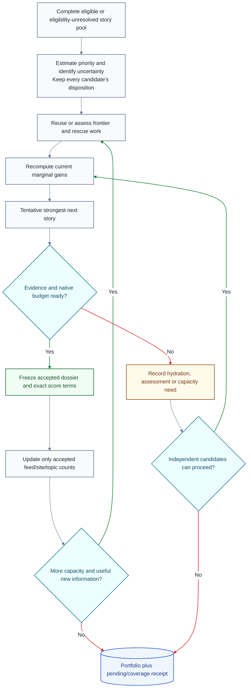

Recompute across the complete represented pool, not only a fixed initial
rank list. A changed semantic judgment can alter membership/scope; return to
reconciliation before freezing its score or feed/publisher exposure.
Selection is at most the configured dossier capacity, not a requirement to
fill empty slots with repetition. Repair obligations are reported separately.

### 10.4 Worked choice

These are illustrative ranking points under the proposed profile, not
production readings or acceptance thresholds. The comparison starts with
no selected dossier and previously unexposed feed/publisher groups.

Table M - Two greedy choices

| Id | Candidate/state | I, N, T, F | Exposure deduction | Marginal value |
| --- | --- | --- | --- | --- |
| M1 | A: bridge development with complementary articles, initial pool | 0.9, 1, 1, 0.9 | 0 points | 89.1 points |
| M2 | B: valuable technical singleton in another topic, initial pool | 0.8, 1, 1, 0.8 | 0 points | 78.4 points |
| M3 | C: overlapping bridge coverage, initial pool | 0.85, 1, 1, 0.9 | 0 points | 84.15 points |
| M4 | C after A explains most overlapping focus information | 0.85, 0.4, 0.5, 0.9 | 10 points in this example | 29.95 points |
| M5 | B after A; its focus and feed/publisher groups remain new | 0.8, 1, 1, 0.8 | 0 points | 78.4 points |

A wins first; B wins the next ordinary slot. Copies cannot increase A's
importance or claim weight. B receives no penalty for being short or supported
by one article. A material correction to delivered misinformation would instead
create repair work, not simply lose to B's diversity advantage.

## 11. Story dossier construction and native input budgeting

The dossier is a structured article list with an evidence selection, not one
large text made by appending its articles. A minimal draft names the story
question, relevant articles, their roles and any known passage references or
gaps. It need not contain a complete event timeline, several articles, every
graph branch or every field needed by a future generation request.

Keep two products distinct:

1. **Dossier manifest:** existing article/candidate references, roles, passage references
   and inclusion/omission reasons. Some entries can be background, verified
   copies or related articles with no text selected for the model.
2. **Synthesis input:** only the selected, article-separated verbatim passages,
   necessary metadata/citation aliases and task framing. Freeze those actual
   excerpts as well as their references so generation remains replayable
   after transient bodies expire.

Listing an article is not evidence that the writer read it. Only passages
actually supplied receive offered citation aliases. Manifest-only entries do
not become extra corroboration or feed/publisher exposure for the accepted
evidence plan. A draft can remain incomplete; only a ready synthesis input
is submitted to generation.

### 11.1 Select salient passages in code

A dossier is not an exemplar with a fixed number of similar siblings.
Its requirements follow the chosen question, not a compulsory checklist of
sections. Start with the passages establishing the material focus. Retain the
method, measurement scope, qualification, correction or opposing account
without which that focus would mislead. Add historical context or parallel
developments only when they materially improve its explanation.

These are **coverage obligations for this focus**, not a requirement to send
the whole story graph. A minority account can create an obligation even when
most articles repeat the other account. Article count does not settle it.

The ordinary-code packer:

1. Uses existing article blocks and sentence boundaries to address contiguous
   passages throughout the available article, not only its title and lead.
   Keep relevant headings, table headers, code context and footnotes with
   the evidence they qualify.
2. Retrieves candidate passages using BM25 and compatible passage vectors,
   guided by the selected focus and identified evidence needs.
3. Removes exact repeated passages and overlapping slices by content/coordinate
   checks. Uses verified copy alignment for proven repetition across articles.
   Retains unmatched blocks and their article-specific attribution; embedding
   similarity alone never establishes a duplicate.
4. Chooses the passages covering the most outstanding obligation weight per
   added rendered token. Ranking optional alternatives is not declaring the
   unchosen article false, copied or permanently unworthy.
5. Measures the exact rendered input, reduces optional repetition/context
   and freezes the smallest sufficient supported package it finds.

Greedy coverage is an approximation, not a promise of a globally smallest
evidence set. The main article gets no automatic entitlement to its full
body; supporting articles contribute only useful distinctive evidence.
A whole article is allowed when it is itself the smallest sufficient block
and fits the measured budget, commonly for brief reporting. There is no
fixed main-article percentage or sibling count.

DEBUG records selected passage references/counts, covered/missing requirements,
rendered-token measurements and each repacking reason. It never writes excerpt
text or prompt bodies to logs.

Table N - Evidence comparison outcomes

| Id | Outcome | Packing behavior |
| --- | --- | --- |
| N1 | Proven repeated text | Code keeps sufficient text once and retains article/copy provenance; repetition does not establish independent corroboration |
| N2 | Complementary | Retain added result, method, explanation or qualification even when entity names do not change |
| N3 | Revised update | Preserve time/status scope and supported supersession rather than mixing old and new values |
| N4 | Conflict | Align the assertion, unit, period/population and attribution first; retain incompatible accounts explicitly |
| N5 | Unknown | Keep the missing-evidence need visible; it is not automatically redundant |

The semantic task may identify important changes/conflicts and their evidence
requirements in bounded passage comparisons. It does not merge article bodies,
create a canonical article or perform deduplication for the packer. All article/
passage duplicate suppression happens in ordinary code before model requests.

### 11.2 Recover missing article evidence only in Phase 1

Use sufficient retained excerpts directly. If necessary detail is missing,
the coordinator resolves an owned admitted article reference and requests
guarded fetch/parse recovery. The model does not supply a target URL.

The same text_sha and compatible recipes allow evidence reuse. A new fetch
keeps article_id/url_key and receives the native new candidate_id. A changed
feature recipe alone updates representation_revision, not the article address.
Re-evaluate affected decisions. Never transplant old offsets into
different text or mutate the completed original collection in place.

**Flow - Recover missing article evidence before generation**

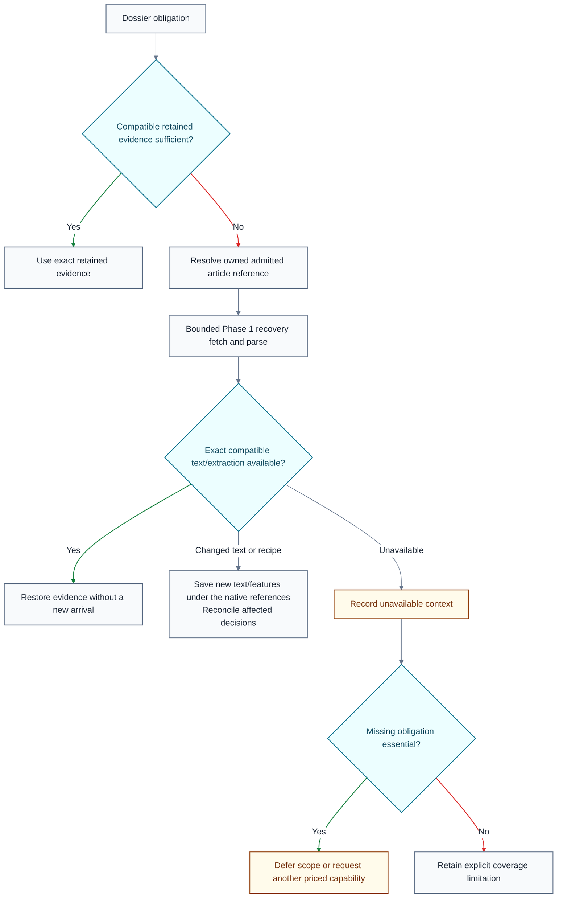

A 304 without required retained text is not restored full-article evidence.
Attempt bounded unconditional recovery where permitted or leave the gap.
Recovery failure need not discard unrelated successful dossiers.

### 11.3 Packing and preflight are one bounded loop

The Python packing operation receives the dossier manifest and a committed
generation-profile reference, not a measurement of input that does not exist
yet. It builds a synthesis-input draft, calls the TS native
**measure-dossier-input** operation and revises that draft if necessary.

```text
effective_input_limit =
  min(configured_task_input_ceiling, usable_native_context - output_reserve)

tokens(exact rendered request) <= effective_input_limit
```

The task input ceiling is a proposed profile setting for per-story work; the
native context is the actual resolved runtime capacity, not the model's
advertised maximum. Output reservation includes the profile's actual decode/
reasoning budget where applicable. These are not a universal 40,000-word or
40,000-token allowance: words and tokens are different quantities.

The measurement includes instructions, selected article metadata and text,
citation aliases, template framing, schema and any carried conversation.
Encoder token counts, article words and HTTP byte limits cannot substitute
for it. Fitting native context does not establish acceptable CPU cost; the
profile's input ceiling, request deadline and recorded work costs address
that separately. Do not fill spare context merely because it exists.

**Flow - Pack selected passages and check the actual model input**

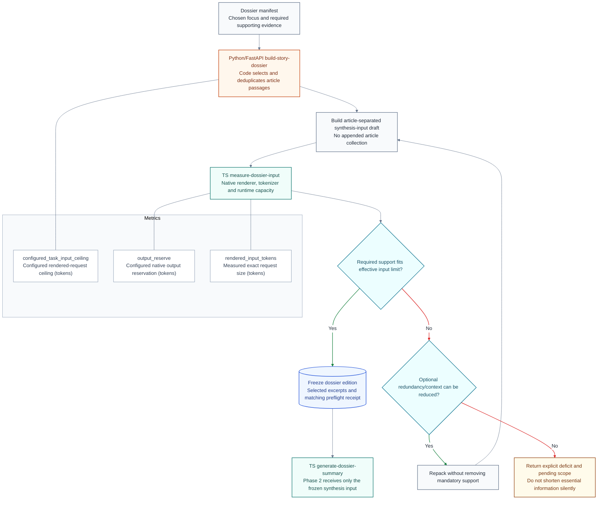

No exemplar percentage, sibling count or token allotment is a content guarantee.
Bounded iterations/deadlines prevent the preflight loop from becoming
another hidden queue. A larger context, another qualified model or a linked
multi-part explanation is a priced alternative when essential evidence cannot
fit, not an automatic scope reduction.

### 11.4 Manifest and synthesis-input fields

Table O - Dossier edition and generation-ready projection

| Id | Field group | Manifest | Generation-ready synthesis input |
| --- | --- | --- | --- |
| O1 | Scope | Story/focus references, base snapshot and intended question; event relationships where useful | The chosen focus and only context needed to explain it |
| O2 | Articles | Existing article_id/url_key and candidate_id, text_sha/representation_revision where retained, publication provenance, evidence role and text-selected status | Metadata/aliases only for the actual supplied evidence |
| O3 | Evidence | Passage references, inclusion/omission reasons and known availability | Frozen ordered verbatim text, article text planes/coordinates, relevant supported labels and offered citation-alias mapping |
| O4 | Coverage | Relevant requirements and unresolved needs; not every graph branch is mandatory | Required support for this focus, known limitations and explicit readiness |
| O5 | Generation contract | Not required for a draft article list | Model/task profile, prompt/schema/template/tokenizer identity, exact input digest, input ceiling, usable native context, output reserve and matching receipt |
| O6 | Work provenance | Actual available assessment/packing operations and state | Native input measurement and compatible work references; completion/delivery remains separate |

All article references resolve to the frozen edition. An excerpt's offsets and
content identity are not useful for future quotation unless the excerpt text
or a compatible body remains available. The retained generated-summary basis
cannot be relabelled as a quotation from the original article.

## 12. Phase 2: synthesis with article citations

The generator takes the frozen synthesis input and matching preflight identity,
not the dossier's whole article list, article bodies or story graph. It does
not deduplicate articles, discover new ones, change groups, fetch missing text
or silently substitute another model/profile after a context refusal.

The ordinary generation output has factual headline/summary statements,
key points where useful, offered evidence aliases, explicit disagreements and
coverage limitations. Code resolves aliases into recorded article references
and renders URLs/titles. The model does not author authoritative addresses.

Use schema-constrained output and request-specific offered identifiers.
Validate completion, parse, article/passage reference membership, exact
quotations and known quantity/time/attribution constraints. These detect errors but do not
prove semantic entailment; paraphrase and compound claims still require the
independent support instrument.

A targeted repair is a separately charged request over the same frozen
evidence. If important unsupported content remains, return an incomplete/
failed/deferred result. Do not silently drop it and claim the story complete.
An explicitly configured extractive product would have its own result kind
and limitations, not impersonate successful synthesis.

Prompt-cache reuse is an optimization, not a correctness dependency. Sharing
model weights or a cache slot does not allow an unmeasured conversation to
exceed context. Sampling, reasoning behavior and model selection remain in
recorded task profiles rather than new hardcoded overrides.

## 13. Native API boundaries

Keep the existing **select-articles** lifecycle as the TS coordinator.
It already checks complete owned input, configuration, expected result kind,
claims, original/reselection context and health/reporting evidence.
Do not copy that logic into a competing selector.

Table P - Coarse operations and native owners

| Id | Operation | Input -> output | Owner |
| --- | --- | --- | --- |
| P1 | Existing fetch-document | Configured/owned article offer -> captured acquisition outcome | TS Zod/Hono |
| P2 | Existing parse-document | Completed fetch reference -> article capture/quality references | TS Zod/Hono, network-free parsing |
| P3 | Existing select-articles | Completed global parsed collection -> typed story selection, dispositions and dossier references | TS Zod/Hono coordinator |
| P4 | derive-article-features | Existing parsed candidates and named article text -> retained excerpts/features, copy-check evidence and coverage | Python Pydantic/FastAPI |
| P5 | reconcile-story-graph | Identified base and article-feature manifest -> topic-domain tracking, cluster/story decisions and evidence needs | Python Pydantic/FastAPI |
| P6 | assess-story-evidence | Already code-deduplicated, article-separated passage bundle and configured task -> bounded semantic/value labels, not article-removal commands | Existing secure TS model-task facade |
| P7 | build-story-dossier | Selected scope, article/passage references and generation profile -> manifest plus bounded frozen synthesis input, or explicit needs | Python Pydantic/FastAPI |
| P8 | measure-dossier-input | Draft synthesis input -> exact native token/context/input identity | TS generator facade |
| P9 | generate-dossier-summary | Frozen compatible synthesis input and matching preflight -> cited synthesis and actual model/work provenance | TS generator facade |
| P10 | Existing partition/persist/delivery | Typed selected work -> assignments, staged data and actual target receipts | Existing native owners, made dossier-aware |

Python owns only the new feature/topic/cluster/dossier contracts, not copies
of native TS planner ledgers. TS owns planner/control/generation products
and a small hand-written projection of the Python fields it consumes.
Bind the projection's fields,
vocabularies and Unicode coordinates with named cross-language tests; do not
copy the entire graph model.

The current planner protocol root is /api/2026-11-07. Logical operation names
stay shared declarations; breaking result-kind changes require a dated
protocol/reader/caller cutover. New story operations use their fixed creation
family, not a route version derived from request time.

Use the existing real FastAPI local_api_host composition and Hono routing.
One explicit story-analysis component can share the configured Python listener;
there is no port per algorithm or new runtime service for the published site.
Health/schema, Host/Origin checks, bounded UTF-8 JSON reading, deadlines,
capacity and shutdown remain native.

Model/output text never chooses filenames, commands, module names or outbound
URLs. Destinations come from committed configuration, including
model_server.base_url; ambient proxies and redirects cannot change the
recipient. Schema/sanitizer controls enforce the boundary, not a prompt's
request to ignore instructions.

### 13.1 Native observability

**Flow - Preserve each API's own timing, trace context and JSONL event**

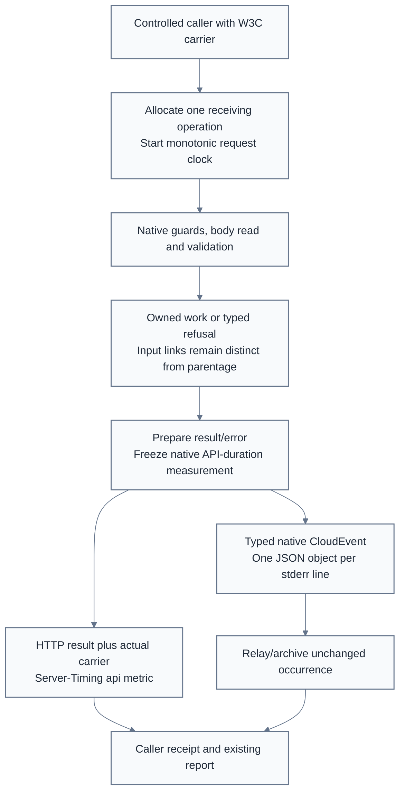

Use the existing W3C codec, fresh API span and actual producer URI.
Return that carrier on normal/refusal responses. Preserve producing-work
references where a resumed/cached/domain operation differs from the HTTP
receiving operation. Trace context is not input authorization.

Native APIs emit strict CloudEvents 1.0 JSONL to stderr. Relays preserve
occurrence ID, time, source, carrier and data; they do not reconstruct events.
Article bodies, prompts, entities, credentials, raw headers and exception text
stay out of observability. Private evaluation/evidence artifacts are separate.

Define native api_duration_ms from before guards to prepared result/error,
before transmission. Use one frozen measurement for the event and the
Server-Timing metric. Record client_elapsed_ms, model-load/work/admission
times separately; missing readings remain unknown rather than zero.
Cache hits record current request cost and reused-work references.

Existing stage duration_ms keeps its meaning. Native timing must cover early
body/method/configuration failures, not only successful work. Health/schema
reads do not create invented model-work events.

Caller reports join actual operation/result identities and show article,
contribution, event, story, dossier, selected-passage and pending counts
separately. Selected-input token measurements do not count manifest-only
articles as model-visible text.
Concurrent task durations are summed work, not elapsed pipeline time.
Reporting/delivery/cleanup failure cannot erase already-completed native work.

### 13.2 Build diagnostic statements in; configure their level

A verbosity setting cannot explain a decision nobody logged. Each new
operation includes explicit INFO, DEBUG, WARNING and ERROR statements at
the decision points described above. New analysis components default to INFO;
changing validated logging.level to DEBUG exposes the extra decision detail
without changing selection, retry or persistence behavior.

Reuse what is already present:

- **Python:** the standard logging module and validated JSONL event writer.
  The evaluator's [LoggingSettings](../services/summary_evaluator/src/summary_evaluator/shared/contracts/service_settings.py)
  already declares level and max_event_bytes, and
  [EventWriter](../services/summary_evaluator/src/summary_evaluator/serve_http/emit_events.py)
  sends validated events through a standard Logger. Use that host pattern,
  rather than print statements or a second JSON formatter.
- **TypeScript/Hono:** Hono routes requests; its access-log middleware does
  not explain selection decisions. Reuse the native structured CloudEvents
  emitter and the generator's existing
  [logging.level/max_event_bytes controls](../services/summary-generator/src/config/load-generator-config.ts).
  Its handler already filters by severity. The planner's
  [createStageLogger](../services/feed-ingest-plan/src/logging/structured-logger.ts)
  currently lacks severity filtering, so extending it and adding typed DEBUG
  decision events is part of this proposal, not an already-shipped capability.

Use level-gated calls such as Python logger.debug/logger.info or an equivalent
typed TS emitDiagnostic(level, data) adapter over the existing emitter.
Do not introduce a logging framework or route DEBUG records to stdout:
all diagnostic levels remain schema-validated CloudEvents JSONL on stderr.

INFO records actual operation outcomes, counts and timings. DEBUG adds the
article/cluster/topic IDs, compared score components, cache/threshold basis,
missing-evidence reason and chosen action. WARNING records degraded/pending
work; ERROR records typed failures. Per-component configuration and bounded
event/detail counts keep a large poll diagnosable without logging whole
collections. max_event_bytes still applies at every level.

Never log article text, extracted names/entities, prompt bodies, credentials
or arbitrary URLs, even at DEBUG. Preserve actual operation/carrier identity;
verbosity does not alter required decision records, counters, returned
measurements, domain outcomes or already-recorded work.

## 14. Snapshot consistency, replay and lifecycle

Workers may prepare independent articles/pairs against one immutable base.
They emit writer-owned facts and proposals. One resolver joins cross-shard
evidence and validates membership, contribution attribution, aliases,
relations, article references and output dependencies before installing state.

DEBUG records the expected/current base, bounded input counts, validation or
replay reason and reused-work references. INFO records the installed result;
an unsuccessful replay remains visible as pending work.

**Flow - Save one consistent state after reconciling shared decisions**

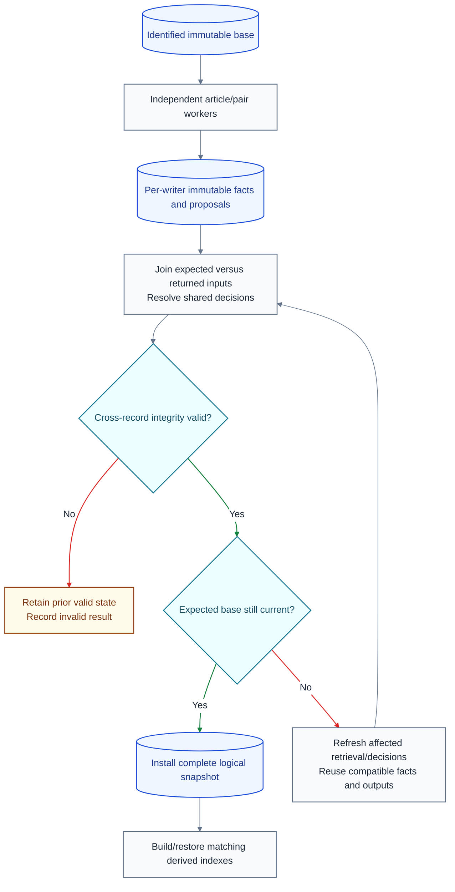

Input completeness and state integrity are different axes. A valid partial
result can identify missing work; invalid references/state cannot be renamed
partial success. A changed base may contain newly possible matches, so replay
cannot simply reuse yesterday's candidate list.

A replay reuses recorded creation IDs and compatible assessments only when
their exact input/task identities still match. It does not require fresh
model output to repeat. Bound replay attempts and expose pending work when
the account is exhausted.

All reads identify one article, run/shard, graph scope, named period or bounded
manifest. No routine operation scans the growing repository. Protect snapshots
used by active work and retained references before cleaning physical versions.
Compaction changes placement, not meaning or observation time.

The 14-day selection window does not authorize deleting logical history.
Full bodies are transient and sample-retained only under their own policy.
Archive packing, snapshot garbage collection, article identity retention and
evaluation retention are separately declared configuration.

## 15. Evaluation and feedback

Use two independent sampling frames:

1. a pre-selection article audit, captured before excerpt/preparation cuts and
   including unselected inputs; and
2. the 65.2 selected-output sample, extended to the ordered multi-article
   evidence actually shown to the writer.

Their inclusion probabilities and denominators are not interchangeable.
Historical bodies missing from retained context make full-article checks
unavailable; they do not turn support for retained excerpts into completeness.

Table Q - Failure measurements and the decisions they inform

| Id | Population / failure | What can change |
| --- | --- | --- |
| Q1 | Independently labelled candidate recall, with approximate/exact comparison | Retrieval channels, search effort, candidate budget and cold routing; exact neighbors are not truth |
| Q2 | False/missed event grouping and whole-set partition quality | Identity evidence/task, member checks and correction behavior |
| Q3 | Typed edge support/direction, missing branches, cycles and dangling references | Relation verification and bounded story context |
| Q4 | Weakest/mean path transition, important-branch coverage and useful diversity | Backbone/branch selection and evidence budgets, not event identity by proxy |
| Q5 | Parsed article -> retained excerpts/features -> synthesis-input retention | Capture/feature/packing recipes; check important results, method, qualifications and conflicts against the pre-cut article sample, not the manifest alone |
| Q6 | Citation resolution versus attributed semantic support | Output schema/reference plumbing versus writer/model/task quality |
| Q7 | Article-level completeness, omissions, changed hedges and blended claims | Obligation construction, writer policy and sampled quality instruments |
| Q8 | Native API/model/run cost, timing gaps, cache reuse and backlog | Work sharding, concurrency/cadence and model/context choices with named hardware |
| Q9 | Topic coherence, assignment continuity, noise and missed new domains | Shared topic-fit/matching recipe, never a content admission gate |

Report assessment coverage at consistent grains: enumerated candidate stories,
fully assessed/cached-compatible stories, partial/unassessed stories and
selected assessed stories. Report article preparation and comparison-bundle
coverage separately. Do not divide a count of passages by a count of article
candidates, or call any ratio proof that every full-article fact was seen.
Empty denominators are unavailable.

**Flow - Measure extraction/selection loss separately from summary support**

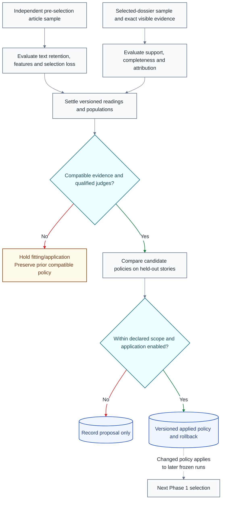

Reuse the content-similarity tenant for separately versioned event/relation/
context assessments. Preserve its existing pair populations, score histogram
and fitted-line meaning. New controls begin record-only and change later
frozen runs only within declared enabled scopes, bounds and rollback.
Daytime selection does not wait for the nightly council.

65.2 informs independent sampled sentence support, key-fact completeness,
judge health, instrument lifecycle and paired candidate comparisons. Selector
value ratings are not their own quality alarm. Different-family judges still
need qualification against planted faults and independent reference checks.

## 16. Technology choices and their costs

Table R - Proposed concrete stack

| Id | Choice | Role | Cost / reason not to substitute blindly |
| --- | --- | --- | --- |
| R1 | Existing Impit, Feedsmith, Defuddle, Linkedom and native TS acquisition controls | Fetch, parse, sanitization and capture provenance | Reuse mature acquisition; changing gate placement is not replacing URL safety or rebuilding HTTP/extraction |
| R2 | Hono/Zod and Pydantic/FastAPI/Uvicorn through local_api_host | Native typed API boundaries, lifecycle and schema | Existing infrastructure; API expansion needs explicit contracts, not another host/registry or shared mutable context |
| R3 | spaCy and configured GLiNER2 capabilities | Segmentation/linguistic/entity/record proposals | Model/CPU cost and language capability remain real; NER labels alone do not prove predicate roles |
| R4 | Configured ONNX encoder and its exact tokenizer | Passage semantic retrieval | More article coverage costs more passes. Keep model/recipe identity; no automatic BGE replacement or inherited summary-vector threshold |
| R5 | LanceDB embedded vector/FTS/scalar queries | Current/compact historical candidate retrieval | Adds native package/index/restore cost. Begin with compatible exact search; ANN is a measured acceleration, not a different news graph |
| R6 | datasketch MinHash/LSH plus ordinary-code content/coordinate comparison | Article/passage copy candidates and verified repetition before model requests | Approximate candidates have false positives/negatives; verify aligned blocks and origin evidence, preserve unmatched/qualified text and never outsource deduplication to the LLM |
| R7 | scikit-learn HDBSCAN, normalized evidence vectors, no UMAP initially | Shared bounded private topic discovery | Compiled-wheel/fitting memory and potentially quadratic work; topic overflow queues topic work, not articles |
| R8 | scikit-learn TF-IDF/phrase labelling | Changing display terms over deduplicated topic evidence | Keep analyzer, population and label recipe explicit; this is not silently the different BERTopic c-TF-IDF formula |
| R9 | NetworkX | Bounded DAG integrity, adjacency and context/path operations | Python graph overhead matters; validate DAG assumptions and avoid exhaustive path/antichain or graph-edit searches |
| R10 | Existing secure local model transport/facade and recorded task profiles | Structured evidence judgment and final synthesis | Physical call/token/load cost is measured separately; no new model, reasoning/sampling override, training or CPU throughput promise |
| R11 | Existing Pydantic/PyArrow/native ledger door and atomic writes | Authoritative logical records and compatible persistence | Declare schema/version/read-side handling and compaction; Arrow/index machinery does not enforce domain foreign keys |

Proposed initial tuning values are a separate profile: HDBSCAN
min_cluster_size 5, min_samples 3, a maximum shared fit of 2,048
representatives, and a production-assessment rescue allocation of 20 percent
are candidates for review, not measured capacity or coverage guarantees.
Their implementation must declare config readers and explicit overflow/
availability outcomes; the proposal does not claim those readers already exist.

Topic fitting processes a named bounded cohort of unassigned/affected
representatives and retained signatures. Overflow is not classified as noise,
deleted membership or low value. A later fit keeps original observations and
lineage; it does not rename topics using HDBSCAN's integer labels.

The scoring weights in section 10 are likewise a reviewable starting
profile. Qualification uses the current numerical baseline, retained-features-only
ablation, new retrieval/context path and a held-out article/story set at matched
writer budgets. Do not trade unsupported precision for a confident-sounding
number.

## 17. Worked example and review decisions

The following is fictional control flow, not measured news or schema-valid
production fixtures.

Table S - A developing story across runs

| Id | Arrival | Result |
| --- | --- | --- |
| S1 | Several articles cover one permit filing | One event; verified copies add distribution; useful independent additions remain separate contributions |
| S2 | A court challenge arrives | New occurrence linked to the filing; it is not absorbed into the filing's centroid |
| S3 | A flood-risk report explicitly concerns the same proposal | Another branch; broad infrastructure topic alone would not have proved the connection |
| S4 | A revision refers to both challenge and report | A convergent development; the story dossier needs both important branches, not just its easiest linear path |
| S5 | A similarly worded road project was mistakenly grouped | Correct the membership, retract unsupported incident links and invalidate affected dossiers while preserving old decisions |
| S6 | Nothing new arrives during a recess | Activity declines; ordinary retrieval placement may change, but identities/context remain |
| S7 | A later review names the dispute | Bounded cold/reference recovery; same-occurrence evidence may reuse an event, while a distinct review gets another event |
| S8 | The summary completed but delivery failed | Reuse the valid matching result; do not need new reporting or another summary call just to retry delivery |

**Flow - Keep separate events connected through a developing story**

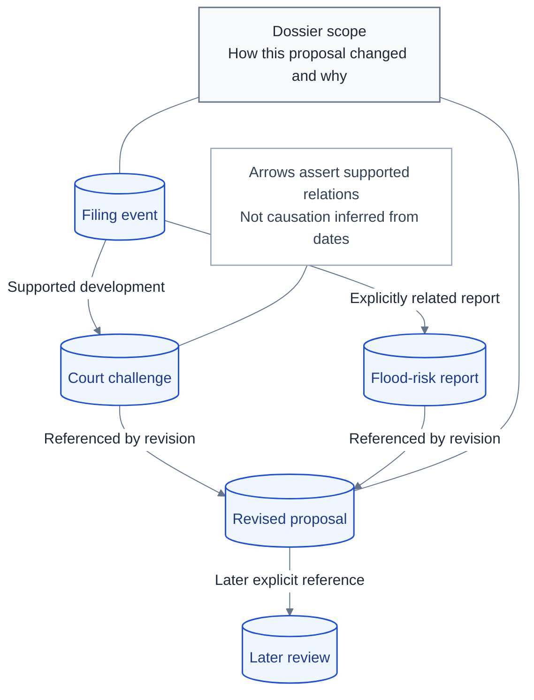

### 17.1 Design rationale and unresolved tuning

The selected architecture separates decisions that fail differently:
acquisition permission, evidence availability, copied distribution, topic,
occurrence, coherent story, reader value and output work. That separation
prevents moving one threshold from silently changing all of them.

The important tradeoffs to review are:

- **Reuse versus changed evidence input:** keep native article/work IDs and
  the earlier cluster/topic/story record names. Replace its summary-only
  matching substrate with available article passages and its active-search
  assumption with this design's fourteen-day selection window. These changes
  preserve useful reporting rather than introducing another ID system.
- **Live structured judgment:** higher semantic cost than pure numerical
  ranking, but supports qualified updates/relations without summarizing every
  article. Every extra bundle/expansion remains visible; semantic labels never
  become article-deduplication commands.
- **Compact retention:** bounded historical evidence and lower repository
  cost, but not arbitrary future full-article re-analysis. Missing detail is a
  measured recovery/instrument limitation, not invented context.
- **Private topic discovery:** enables new themes beyond a closed public
  taxonomy, with fitting/continuity cost and noise. No hard topic gate or
  automatic public category promotion is required.
- **Budgeted refinement:** produces a best-assessed portfolio and disclosed
  unresolved coverage, not a cheap global-optimum guarantee. More capacity
  buys more assessment; no silent quality downgrade is implied.
- **Manifest versus synthesis input:** the article list remains a flexible
  record of relevant evidence; the writer receives only selected passages.
  Code removes verified repetition before requests. The cost is explicit
  passage selection and retention checking, not an LLM deduplication stage.
- **Immutable editions and explicit receipts:** preserve provenance and
  resume work, but require a later reader/publication contract for article
  display, latest-story pointers and correction visibility.

Exact model/profile qualification, rubric weights, article/feature/input budgets,
topic-fit thresholds and target behavior for provisional/late results remain
reviewable parameters. They do not reopen article-fetch safety, manufacture missing
measurements or authorize implementation from this document.

## See also

- [Narrative graph research](ghapp://sessions/65469655-a97a-401c-b840-9ab7449806a6) - comparative context, graph structure, incremental retrieval and measurement populations.
- [Consolidated earlier event design](unsupervised-topic-detection-event-clustering.md) - article identities, clocks, copy contributions and cold recovery.
- [Plan 65](20261011-65-summary-fidelity-judge-plan.md) and [plan 65.2](20261012-65.2-summary-fidelity-judge-plan.md) - independent sampled summary quality and instrument evolution.
- [Classification research](20260911-classification-research-record.md) - earlier labels/summary task boundary; current architecture changes the work unit explicitly.
- [Existing implementation draft](20261112-multi-document-story-synthesis-plan.md) - unchanged until architecture review.
- [Operator APIs](../docs/architecture/sources/feed-operator-api.md), [curation](../docs/architecture/sources/feed-curation.md) and [extraction quality](../docs/architecture/sources/extraction-quality.md) - observed current behavior.
- [Native API identity](../docs/architecture/contracts/identity.md), [Python hosting](../docs/architecture/local-api-host.md) and [model boundary](../docs/architecture/summarize/model-boundary.md) - controls retained by the target.
- [HDBSCAN](https://scikit-learn.org/stable/modules/generated/sklearn.cluster.HDBSCAN.html), [MinHash LSH](https://ekzhu.com/datasketch/lsh.html), [TF-IDF](https://scikit-learn.org/stable/modules/feature_extraction.html#tfidf-term-weighting) and [DAG operations](https://networkx.org/documentation/stable/reference/algorithms/dag.html) - library capabilities and limits.
- [Mermaid notation](../docs/reference/mermaid-diagrams.md) - diagram conventions.
