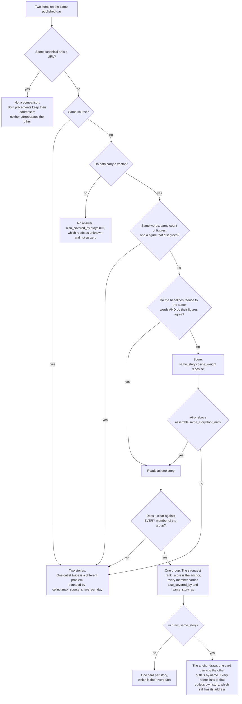

# When two items are one story, and the line that decides it

**Last Updated**: 2026-11-19

Which items on a published day are one story, and what line decides it? This page
owns the grouping that runs at build time and the merge line it applies - the score
two items must reach to be one story, `assemble.same_story.floor_min`: a configured
value that only a person edits. The nightly judge, its draw, its two thresholds, its
ledgers and its known-answer pairs are on
[how-the-content-similarity-judge-follows-its-thresholds.md](how-the-content-similarity-judge-follows-its-thresholds.md);
its thresholds steer which pairs it reads and decide nothing about publication.

The shape the decision is written into, and the addresses a reader gets, are in
[layout.md](layout.md).

A day often runs the same story from more than one of our feeds. The published item says so in four fields, all computed at build time from vectors and titles the published days already hold. The browser never computes this and no encoder is loaded to do it.

| Field | What it says | What it is not |
| --- | --- | --- |
| `also_covered_by` | How many **other outlets** carried the same story today. | Not `carried_by`, which counts syndication of one address and reads 1 when two outlets write their own piece. Not a count across days - an earlier telling is a name, never a number here. |
| `same_story_as` | The item the page draws for this story. | Not a deletion. The story keeps its address, its browse entry and its month search entry. **Not a link to another day**: a fold onto a card this page does not hold is a fold onto nothing. |
| `covered_by` | Which other outlets ran it, **by name**, strongest first, capped at three. | Not on the committed day. The projector derives it, so a day committed before the names existed still serves them. |
| `also_ran_earlier` | Which outlets ran the same story on an **earlier published day**, with the day and the address. | Not derived and not a fold. It is on the committed item, because a projector sees one day and could not look the name up. |

**Two items become one story down this path, and nowhere else.** `collapse_same_story` in [../../../backend/idhazh/assemble.py](../../../backend/idhazh/assemble.py) is the only thing that writes the grouping fields; `covered_by` is derived from what it wrote. Every rule below the diagram is one of its boxes.

Three things the diagram is deliberate about. **The veto is first and nothing below it can overturn it** - a pair of headlines one digit apart is where the score is highest, so a rule that had to outvote the score would lose the case it exists for. **The headline branch sits above the score rather than beside it**: it joins outright, and every other pair is scored. And **the score runs 0 to 1 and its weight is 1.0**, so the floor is a number on the score's own scale and a reader of `config/idhazh.json` can compare the two without arithmetic. Nothing on the diagram deletes: every item keeps its place, its address and its search entry whichever way it exits.

**`also_covered_by` is what a reader sees where no name can be linked.** The item's footer, under the summary, reads `Also covered by N other sources today.` It is a fact about our feed set and never a claim about the world - we know who we read, not who else covered a story. Null prints nothing at all, which is what a day committed before the field existed carries. Where the page has names - a folding card on a reading route - the stack prints instead and this sentence does not, because the names are the more useful answer and printing both would say one thing twice.

**Zero prints nothing either, and that is a decision rather than an oversight.** A sentence saying `Only one of our sources carried this.` would be false about roughly a quarter of the items it sat on. Over the committed days 5,299 items carry a zero against 93 that carry a positive count. A hand read of 2026-09-12 counted about **95 of 356 items - 27 percent - in a cross-source cluster**, where the pass had found 8; so roughly a quarter of the items carrying a zero were on the page more than once. On 2026-09-03 five cards carried a zero about an acquisition that ran thirteen times on the same page, while three other cards on that page said the story was covered twice. **What the reader loses is the genuine signal that a story is an exclusive.** That is a real loss and the trade is deliberate: a signal wrong a quarter of the time is not a signal, and silence is always available. Restoring the sentence requires a measurement of missed same-story pairs; [the recall limitation](#one-headline-two-outlets-and-why-no-threshold-fixes-it) explains why samples found by the current rule cannot establish exclusivity.

**`same_story_as` is drawn, and the fold ships only with three rules that keep every story reachable.** The reading routes reach a story by paging, so a story filtered out of the list is not merely undrawn on the first screen - it becomes unreachable through every reading route while its address still exists. Three rules close that.

- **The anchor's card names the other newsrooms, and every name is a link.** `covered_by` carries the outlet and that outlet's own item id, so a reader who has no link still has a way in. It links to OUR page for that piece - our summary of it, with its own `Read the original` under it - rather than straight out to the publisher: a reader who wanted the publisher's version is one more click away, and a reader who wanted ours has not lost it.
- **A story the reader's own address names is never folded.** `foldedMembers` takes the fragment as an argument and excludes it, so `/<date>/#<item id>` draws that story, pages the stream down to it and focuses it. A publisher name is one of those addresses, which is why pressing one works at all.
- **A story whose anchor is not on this page is never folded either.** A group can straddle two desks, so on a topic route one half of it can be on another page; folding behind a card this page does not draw would take the story off the page with nothing to find it by.

Same-day publisher links include the site prefix and digest date:
`<base>/<YYYY-MM-DD>/#<item-id>`. The home page can omit a folded or paged card
from its initial HTML. A bare fragment would name an absent element and fail
the build. The dated page loads the day and reveals the named story. From the
home page this opens the dated page; from that day's page it changes only the
fragment. The payload and the grouping are unchanged.

**What the reader loses on a false merge, stated.** A story is one click away instead of on the page. That is a real loss and it is the trade the fold makes, on the reasoning at the end of [the headline-rule section](#one-headline-two-outlets-and-why-no-threshold-fixes-it). `ui.draw_same_story` is the revert: default true, and false restores one card per story with no other change. It can be removed once the grouping's false-merge rate has been measured on a published day and found acceptable.

**The card prints names where it has them and a count where it does not**, because the two answer different questions. `covered_by` is capped at three and drops a name this page cannot reach, so it is never the whole of the count; `also_covered_by` is whole, and the card prints the difference as `and N more`. A card that named two newsrooms on a story five outlets ran would be a wrong number, which is the one thing this block exists to avoid.

**The names are derived at read time rather than written onto the committed day**, and that is the reason they work at all. Every committed day already carries `same_story_as` and none of them carries a name list; a new field on `DigestDay` would be empty on every one of them until the day was rebuilt, which never happens. Two readers derive them and both run on every build, so the names are recomputed for every day the site serves: the projector that writes the served copy a browser fetches, and `loadDay`, which reads the committed tree for the stories a prerendered document carries. **Both, or neither** - a document seeded without them would fold a group behind a card with no way out of it until the fetch landed, and `frontend/tests/day-seam.spec.ts` is what holds the two halves to one shape. `coverage_names` in [../../../backend/idhazh/contracts/digest_view.py](../../../backend/idhazh/contracts/digest_view.py) and `coverageOf` in [../../../frontend/src/lib/payload/project.ts](../../../frontend/src/lib/payload/project.ts) are the two implementations, and the same cases are asserted against both so one cannot move without the other going red.

**One entry per outlet, never one per piece.** A group can hold two pieces from one masthead, and `also_covered_by` counts mastheads - so a list counting pieces would print a longer stack than the sentence beside it admits to. The outlet's strongest piece is the one linked. The order is `rank_score`, strongest first, with an unscored piece last and the item id breaking every tie: a total order, so two builds of one day agree and so do two languages.

**The two names cost 1.92 gzipped bytes a story, which is 0.4 percent of what a served story already weighs.** Measured 2026-09-16 on a developer machine / Python 3.14.2 over the 26 committed days and 9,554 stories: `gzip -9` over the staged projection reads 458.56 bytes a story with the two keys and 456.64 without them. Arithmetic over committed payloads, so the spread is zero by construction. It is the same order as `desk` at +1.16, and it is cheap for the reason the fold is worth having: almost every story carries a null and an empty list, because almost no story is in a group.

**The pager's floor comes off when anything is folded.** `Show N more` counts against the day's own published total rather than the list in hand, because on a reading route the list in hand can be a seed. A fold takes cards off the page that the day's total still counts, so leaving the floor alone would offer a reader stories the pager can never draw. A filter and a hide follow the same rule: a list narrowed on purpose IS the promise.

**Nothing is unpublished.** A grouped item keeps its place in the published order, its address, and its entry in the month search index. Measured 2026-09-01 on the committed 2026-08-30 day: **431 items in, 431 items out**, 5 of them marked as the same story as another.

**A comparison requires two distinct canonical article URLs.** `DigestItem.source_url`
holds the canonical URL supplied by the article producer. The shared eligibility
predicate in `assemble._pair_terms` refuses equal URLs before headline or vector
scoring, for same-day and earlier-day placements alike. Different item ids, desks
or source labels do not turn one article into independent coverage. The refusal
also prevents both placements from entering one all-pairs group through a third
article. A valid comparison with that third article still scores normally; every
published placement keeps its id, address and order. The judge's draw asks the
same question before it counts its population, spends its budget or assigns
shards ([which pairs the draw can take](how-the-content-similarity-judge-follows-its-thresholds.md#which-pairs-the-draw-can-take)).
This does not discover URL aliases, rename sources or remove repeated placements.

**A group is always across outlets**, and that is a rule rather than an observation. The sentence a reader gets is about sources, so a group of one source has nothing to say - the survivor's line is the one it already had, and forming it would still cost a story. It is also where the encoder is least trustworthy: two press releases off one desk share their boilerplate and differ only in a date, so a central bank's June minutes and its July minutes score **0.9867** against each other on the committed 2026-08-25 day and are two different documents. One outlet publishing twice is bounded by `collect.max_source_share_per_day` instead.

**The unit is the masthead, not the feed.** `source_id` names a feed, and four of our feeds are one broadcaster's and two are one newspaper's, so comparing `source_id` counts one newsroom as several sources. Measured 2026-09-15 over the twenty-six committed days, that comparison grouped one outlet with itself in **3 of the 43 groups** formed, each printing a corroboration the reader did not have. `outlet_of` returns `source_name`, which is the masthead and separates 143 of our 160 feeds. It deliberately stops there: a newspaper and its business edition are different papers with different desks, so a reader who sees both has two newsrooms rather than one, and folding them would cost a group that is genuinely corroborated.

**Every pair inside a group clears the bar**, not only each item against the one it joined. Single-link grouping chains: A is the same story as B and B as C while A and C are two different stories, and the chain quietly loses one of them. There are two ways to clear the bar rather than one - a matching headline, or the score - which makes this rule matter more rather than less (below).

**The keeper is the strongest by `rank_score`**, and where two items tie the earlier run wins - a returning reader keeps the item they already saw rather than watching the day swap it for a copy. An item published before `rank_score` existed has none, so it ranks below any scored item.

## The score and the figure veto

**The bar is the cosine times a weight, and it lives in `assemble.same_story`.** The score runs 0 to 1, its weight is 1.0 - refused by a validator if it is anything else - and `floor_min` is on that same scale. That rule is what keeps the floor meaning something: let the weight be 1.3 and every pair scores higher against an unchanged floor, silently, and the day publishes a merge nobody chose.

| Knob | Ships at | What it scores |
| --- | ---: | --- |
| `same_story.cosine_weight` | 1.0 | Cosine between the two stored int8 vectors. The whole score, which is why 1.0 is its only legal value. |
| `same_story.floor_min` | 0.94 | What the score has to reach, for **every** pair inside a group. |

**The judge's draw scores its pairs with this same arithmetic** (`assemble.cross_source_pairs`), so the score on a `pair-verdicts` row is the score this floor is applied to. The draw, the thresholds it follows and the rows it leaves are on [the judge page](how-the-content-similarity-judge-follows-its-thresholds.md#what-pair-verdicts-stores).

**A clash of figures is a veto rather than a negative weight.** Two headlines that reduce to the same words, carry the same count of figures, and disagree about one of them are two stories - `Budget 2025` against `Budget 2026`, `25 percent` against `50 percent` - and no similarity anywhere else makes them one. Written as a weight it would sit in a sum, where a high enough score outvotes it, and a pair of headlines differing in one digit is exactly where the score is highest. Over the twenty-six committed days it fires on **1** of 2,317,545 cross-outlet pairs, and that pair scored below the floor anyway.

**One headline carrying a figure the other leaves out is not a clash.** That is two desks choosing differently about a headline, not two desks reporting different facts. On 2026-09-06 one outlet ran `Anak Krakatau eruption suspends flights at Jakarta airport` and another ran the same words with `300 flights` in them; a veto on any unmatched figure refuses that pair, and it is one story. It is the only group over the committed days that the broader rule breaks - 3 such pairs exist and 1 of them clears the floor - so the veto asks for a matching count of figures first. The pair still cannot join at 1.0, because `story_key` refuses an unmatched figure before any value is compared; it is scored like any other pair.

**The veto is read off the same reduced headline the joiner is**, so turning `assemble.group_identical_titles` off takes the veto with it and restores the score-only rule exactly. A revert path that quietly keeps half of what it reverts would be worse than none, so a test asserts both halves.

## What chose 0.94, measured on the cosine alone

`assemble.same_story.floor_min` is set by hand labels, not by taste. Every group the pass forms over the eleven committed days was read from the published titles and summaries and marked same-story or not. The whole score is the cosine, so this is a measurement of the floor as it is applied. Measured 2026-09-01 on a developer machine / Python 3.14.2, 3,978 items:

| Threshold | Groups | Items grouped | Largest group | False merges |
| ---: | ---: | ---: | ---: | ---: |
| 0.93 | 30 | 37, 0.93 percent | 4 | **1** |
| 0.94 | 22 | 24, 0.60 percent | 3 | **0** |
| 0.95 | 14 | 14, 0.35 percent | 2 | 0 |
| 0.96 | 11 | 11, 0.28 percent | 2 | 0 |

The one false merge at 0.93 is on 2026-08-30: Ontario's pushback against the lake renaming, folded into a story about a mapping company carrying the renaming out, at a cosine of **0.9317**. Those are two stories, and merging them means the pushback never ran.

**The rule is the first round hundredth above the highest-scoring pair marked as two stories.** That is how 0.94 was chosen, over the 11 committed days this table covers and the one marked-apart pair they held.

**The margin over the current hand marks is negative, and the Judgement page draws it.** The hand marks made on 2026-09-19 hold 200 pairs, 4 of them marked as two different stories; an agent labelled them from each pair's title and summary. Recomputed from the committed day payloads at the shipped weights - the whole score on the cosine - those four score **0.9407, 0.9374, 0.9352 and 0.9343**. The highest sits **0.0007 above** the 0.94 floor, so that pair clears the floor and the line alone does not keep it apart. One pair of the four is on the wrong side of the line; the other three score below it.

**The way to firm up the margin is more labels, not a higher number.** To clear every two-story mark the line would have to reach 0.941, which leaves 9 more of the 196 one-story marks apart. A line of 0.95 would clear all four marks and fold ten fewer items in the table above (24 grouped at 0.94, 14 at 0.95). A higher line cannot separate the labels because they interleave: a pair at 0.9406 is marked one story, the pair at 0.9407 is marked two, and a pair at 0.9409 is marked one again.

**The line already costs the reader on the other side, and the Judgement page draws that too.** The same marks hold 196 pairs marked as ONE story. Recomputed the same way, **117 of them score below 0.94**, so the vector rule alone leaves those stories on the page twice; the identical-headline joiner catches whichever of them share a headline, and nothing catches the rest. That is not an argument for a lower line - it is the second cost of any line, and a panel reporting only the false merges reports half of what the number does. Measured 2026-09-19 on a developer machine / Node 24.12.0, over the committed day payloads at the shipped weights; deterministic, so no spread.

**Two cautions on the reading itself.** All four two-story marks come from one news cluster - a lake being renamed by two different companies - so the floor rests on one story rather than on a spread of news. And the sheet was stratified by distance from the line when it was drawn, by the pass's own score, which counts a matching headline as 1.0 (50 pairs well below the line, 49 just below, 51 just above and 50 well above), so `1 of the 101 pairs at or above the line is two stories` is a rate over the sample and not over a day's pairs.

**The two errors are not equal, which is why the number leans high.** A missed group costs a reader the same story twice, on a page they can see. A false merge costs them a story that never ran, and they cannot see what is not there.

**`assemble.same_story.floor_min` is not comparable to `assist.similarity_floor`.** That one scores a reader's query against an item and this one scores two items against each other; the two distributions are different shapes, and reading one number against the other is how a threshold gets set from the wrong evidence.

**The line is a configured value, and nothing moves it.** `assemble.same_story.floor_min` is 0.94 in `config/idhazh.json`. A person edits it, and `backend/idhazh/stages/assemble.py` reads `settings.app.assemble.same_story` directly, so the floor on the diagram is that number on every build. Every build writes it onto the run record as `same_story_floor_applied`, so a committed `run.json` says which floor grouped its day after the config has been edited; a run committed before the field existed carries none. No console page reads that field: the Judgement page draws the hand marks against `assemble.same_story.floor_min` in the committed config.

**The judge does not set the line.** Its two thresholds steer which pairs it reads and decide nothing about publication, and the nightly draw follows them rather than the floor a build used ([the thresholds in force](how-the-content-similarity-judge-follows-its-thresholds.md#the-thresholds-in-force)).

## What the Judgement page draws from the hand marks

The Judgement page of the console draws the margin above: the line minus the highest score among the pairs marked as two stories, and how many pairs marked as one story sit below the line. The line is `assemble.same_story.floor_min` from the committed config, and the route's build-time `load` scores every hand-marked pair itself (`frontend/src/routes/console/judgement/`, `frontend/src/lib/console/holdout.ts` and `frontend/src/lib/server/content-similarity-holdout.ts`).

**The page scores the marks because nothing else has.** No run scores these pairs. They are marks rather than judged pairs, and nothing writes a score for them anywhere, so this is the first derivation and not a second opinion about one. A judged pair is the opposite case - its score is already on its row, and recomputing that in a page would be two verdicts about one number.

**The marks are a ledger read over a reach.** A person saves each labelling with `backend/utilities/sample_sheet.py --harvest`, as one file under `state/raw/content-similarity-judge/holdout-pairs/` for the day the marks were made, and the gardener packs it under `state/compact/content-similarity-judge/holdout-pairs/` ([label-the-similarity-holdout.md](../../how-to/label-the-similarity-holdout.md)). The page reads packed days only, `similarity.holdout_reach_days` UTC days back from the day it is about - 730 in `config/idhazh.json` - and no further. So the read stays one size however long the ledger grows (Guardrail #12): a new mark reaches the panel once the gardener has packed its day, and a mark older than the reach stops counting until somebody harvests it again. The marks' compaction may not delete a day inside the reach, and the gardener's loader refuses one that would. **A pair marked again is read once, with its newest mark.** Packing a day keeps one row for each pair of addresses, the one with the newer `marked_on`, and the page applies the same rule across the days of the reach, so a corrected mark replaces the one it corrects rather than counting beside it.

**It measures the line, not the judge.** A mark carries no verdict and no model is called. A pair is joined exactly when its score reaches the line, which is the one branch of the diagram above that the line decides. How well the judge agrees with independent annotations is a different measurement, which [the offline evaluation procedure](../../how-to/evaluate-content-similarity-judge.md) owns. The marks are also not the judge's known-answer pairs: the marks check the line, and [the known-answer pairs](how-the-content-similarity-judge-follows-its-thresholds.md#the-known-answer-pairs) check the judge.

**Counts, and never one rate.** With 196 of the 200 marks on one side, always answering "one story" scores 98 percent and measures nothing. So the panel reports each count beside the population it came from - how many of the pairs marked apart sit at or above the line, and how many of the pairs marked as one story sit below it - and keeps the two directions of a mistake apart: a missed group shows the reader one story twice, and a false merge hides one of them.

**A mark the published days cannot answer for is counted, never drawn as a pass.** Retention deletes published days the marks still name, and a mark can name an article that carries no vector. The panel says how many marks it could not check and why, because a blank dot would say the margin is fine.

**One term is reproduced and two overrides are not.** The panel computes `cosine_weight * cosine`, which is exactly what the floor is applied to. It does not reproduce the two overrides in `_pair_terms`: a matching reduced headline joining at 1.0, and a clash of figures refusing outright. Neither is a function of the line - they fire or they do not whatever the floor is set to - so neither can move the margin the panel measures, and counting them would credit the line with a merge it did not make.

**What that costs the reader, stated.** A pair somebody marked apart whose headlines reduce identically would be merged at 1.0 whatever the line is, and the panel would show it sitting harmlessly below the rule. None of the four marked-apart pairs is such a pair today: all four score below 1.0 on their words, and none of them clashes on a figure either. That is a reading of today's file and not a property of the design, so it is the thing to re-check when a mark is added.

## One headline, two outlets, and why no threshold fixes it

The vector pass alone leaves the same story on the page several times. One obituary headline appeared five times on 2026-08-25 from five different feeds, and on 2026-09-03 one acquisition ran five times under two spellings of its price.

**The cause is what the vector is built over, not the number it is compared against.** `embed.text_for` encodes `f"{title}. {summary}"`, and the summary is our own model's prose about one article. Measured 2026-09-14 with the committed tokenizer over 75 items of the 2026-09-13 day: the headline is a median **16 tokens** and the whole string a median **121**, so the summary is **87 percent of what the encoder reads** and the headline is about one part in eight. The encoder mean-pools over every token, so the event contributes roughly an eighth of the vector. Two outlets writing the same story produce two different articles, so our summariser produces two different summaries, so the comparison is dominated by the one part guaranteed to differ. Coverage is not the problem either: 9,351 of the 9,353 committed items carry a vector.

**No threshold fixes it, and that is measured rather than argued.** Over the 53 cross-source pairs on the committed days whose headlines match once case and spacing are set aside, the stored vectors score: min **0.7298**, median **0.9177**, max **1.0000**. The floor of 0.94 catches 19 of the 53. Dropping the floor to 0.88 would catch 39 of them and admit 730 other-story pairs, and the highest pair marked as two stories in the 2026-09-19 hand marks sits at **0.9407** - above both that median and the floor itself. The two populations overlap, so the number is not the lever. Measured 2026-09-14 on a developer machine / Python 3.14.2, 25 committed days, 9,353 items, 2,300,847 cross-source pairs scored; the counts are deterministic and have no spread.

**So a second joiner runs beside the vector one: two items are the same story when their reduced headlines are identical.** It has no threshold, because a string is equal or it is not. It sits under `assemble.group_identical_titles`, default on, and turning it off restores the vector-only rule exactly.

**The reduction is a source constant and deliberately not a config value.** It defines the key rather than tunes it, and a key rule a config can change would break `build_day`'s promise that rebuilding a day reaches the same groups. `story_key` applies NFKC, case-folds, turns every non-word character into a space and collapses runs of spaces. It does **not** strip accents and does not restrict itself to Latin letters: `[a-z0-9]+` over a lower-cased string - which is what `tag.normalise` does for its own, different job - reduces two unrelated Devanagari headlines to the same empty string and would join them, and an accent-blind reduction finds the same 57 cross-source pairs over the committed days and not one more, so the risk buys nothing. A headline that reduces to nothing, and the `Untitled item` fallback, both refuse to key at all.

**Numbers come out of the words and are compared separately**, because the two need different rules. The words have to match exactly. A number only has to agree to the coarser of the two precisions it was written with, and a scale word is read into the value rather than left among the words. A desk that writes `2 million` is not claiming to know the next six digits; a desk that writes `2,000,035` is. So `$12.9 billion`, `$12.93 billion` and `$13 billion` are one acquisition, and `$12.9bn` is the same headline as `$12.9 billion`. What it refuses is the pair written to the same precision and different inside it: `25 percent` against `50 percent`, `Budget 2025` against `Budget 2026`, `7 dead` against `70 dead`, and `100` against `104` - because a trailing zero is a written digit, so `100` claims three of them.

**That rule is bounded by the words around it, which is why it is safe.** A number is only ever compared against a headline that is otherwise identical word for word, so the question is never "are these two numbers close" - it is "did two desks write one sentence and round one figure differently". Measured 2026-09-14 over the twenty-five committed days, it admits **12 cross-source pairs** the exact-digit rule refused and **every one of them is the same acquisition**. No false merge, and the 42 groups the exact rule already found are unchanged. Two decimal places are not a reason to print one story twice, and the corroboration claim survives because a genuine disagreement - a different figure at the same precision - still refuses.

**A matching headline does not lift the vector gate.** It decides that two items are the same story; it does not decide that an item with no vector may be grouped. That item stays out, as it always did.

**The headline rule and the score are combined all-pairs, and that is load-bearing.** Equality is transitive on its own and a score is not, so their union is not either. Scoring each candidate only against the item it joined would chain a group through whichever of the two happened to fire - A and B share a headline, B and C clear the floor, A and C share neither, and single-link would publish all three as one story. Every pair inside a group clears one of the two against every other pair, and one vetoed pair refuses the whole group for the same reason.

**Two classes of headline would break this, and neither fires on today's evidence.** The first is a headline that names no event - a round-up, a live blog, a branded column - where two outlets can share a title and carry different stories. All 42 cross-source same-headline groups on the committed days were read by hand and every one is a genuine same story; the shortest headline that groups is seven words. The second is a headline that repeats on a schedule. Of 9,333 distinct source-and-headline pairs, **12** repeat across days, and none of them is an editorial slot: they are extraction failures such as `article fails to load due to technical issues`, all within one source, which the across-sources rule already refuses, and empty titles, which the reduction already refuses. Both counts are of the committed days as they stood on 2026-09-14 and are re-measurable rather than permanent.

**What is still unmeasured is recall.** Every number above starts from pairs found *by* matching headlines, so it says nothing about same-story pairs whose headlines differ. The measurement that would settle it is a blind hand-label of same-day cross-source pairs drawn without consulting titles; if a large share of true pairs turn out to have different headlines, a title-only encoder returns as a third rule.

**What the headline rule changes, replayed through the shipped pass over every committed day.** Both cases call `collapse_same_story`; the only difference between them is the flag, so this is a measurement of the code rather than of a description of it. The unit here is a group, not a pair - a group of five is ten pairs - so these counts are not the 53 above. Measured 2026-09-14 on a developer machine / Python 3.14.2, 25 days, 9,353 items, floor 0.94; the pass is deterministic and the counts have no spread.

| | One-headline cross-source groups | Of those, still apart | Groups formed | Items in a group | Largest group |
| --- | ---: | ---: | ---: | ---: | ---: |
| Vectors only | 42 | **27** | 65 | 138 | 4 |
| With the headline rule | 42 | **1** | 84 | 183 | 6 |

Nineteen more groups form and 45 more items sit in one. The obituary that ran five times on 2026-08-25 from five feeds is one group of five with the rule on. The largest group the pass forms is one acquisition at six, and it only reaches six because the rounding rule folds three spellings of its price.

**The one that stays apart is the all-pairs rule refusing, not the headline rule failing**, and it was read. On 2026-08-31 two outlets share a headline about the lake renaming, but one of them had already joined a third item on its vector, and the newcomer does not clear the bar against that third item. The group that exists is correct and the item left out is a story the reader still gets; joining it would mean dropping complete-link, which is the trade `Every pair inside a group clears the bar` above already refused.

**The headline rule adds groups, and three things pay for the risk.** It leans the other way from the floor - it adds groups rather than withholding them - and because the collapse is drawn, a false merge costs a reader a story they cannot see is missing. The names are one: a folded story is behind a pill rather than behind nothing, so the cost is one click and not the story. `ui.draw_same_story` is the second: the revert is a config edit. The third is that the measurement is still owed - the recall of this pass on a published day - and until it is taken this paragraph is the standing statement of what is being risked rather than a claim that it is small.

## What it costs the runner

The pass is one pass over the day's vectors and it is quadratic in the day's item count. Measured 2026-09-01 on a developer machine / Python 3.14.2, over each committed day at 0.94: **10.5 s on the largest day committed then** (2026-08-24, 731 items), 3.6 s on 2026-08-30 (431 items) and 0.5 s on 2026-08-23 (147). The assemble job's timeout is 20 minutes and the month index rebuild beside it takes 88 to 122 milliseconds, so this is the stage's largest single cost and still under one percent of its budget.

It compares int8 vectors directly rather than decoding them. `embed.dequantise` divides by the quantisation scale and then normalises, so the scale cancels and the angle between two stored vectors is the angle between the unit vectors they decode to - a test asserts that rather than leaving it as a claim.

**The headline rule added 0.5 percent and the readings above stand.** It costs one reduction per item before the pass, which is linear, and inside the pass it is a dictionary lookup and a string comparison that runs *instead of* the cosine whenever it matches. Measured 2026-09-14 on a developer machine / Python 3.14.2 as seven alternating rounds inside one process on 2026-08-24, the largest day: **11.601 s with the vector rule alone, 11.664 s with both, a difference of 0.064 s**. Alternating the cases is what makes that number readable - this box's own run-to-run spread on the same day is 10.8 to 17.5 s, so a between-run comparison could not have seen a difference this size, and an A-against-B inside one process cancels the box instead.

**The 36-hour window added 8.1 s on the largest day, which is 55 percent.** Measured 2026-09-16 on a developer machine / Python 3.14.2, five alternating rounds inside one process on 2026-08-24 - 731 items, plus the 147 of 2026-08-23: **median 14.8 s closed against 22.9 s open**, the closed case spanning 12.7 to 18.0 s and the open case 22.4 to 34.2 s. Alternating the two cases is what makes that readable: this box's own run-to-run spread on one day is wider than the difference, so a between-run comparison could not have seen it. Reading the window as squaring the whole population would predict four times the pairs; what it actually adds is today's items times the earlier day's, and the earlier day was a fifth the size. The assemble job's timeout is 20 minutes, so 23 s is **1.9 percent of the budget the stage spends**, and the number to watch is a pair of large days back to back rather than this one.

## The window past midnight

A story that breaks at 23:00 and is picked up at 07:00 is one story, and a day boundary is an accident of the calendar. `assemble.same_story_window_hours`, committed at 36, is how far apart two stories may have appeared and still be one.

| What the window does | What it does not do |
| --- | --- |
| Lets a story on this day pair with one on an earlier published day, on the hours between the two stories' own times. | Group two earlier days with each other. A published day is finished; the pass reads it and never re-decides it. The judge's draw leaves such a pair out too ([why](#design-rationale)). |
| Bound the read. `stages.assemble._earlier_days` opens `ceil(hours / 24)` days by date arithmetic - two at 36 - so the cost is the same on the thousandth day as the third (Guardrail #12). | Bind a pair inside one published day. Those are scored exactly as they were, which is what makes `0` an exact revert rather than an approximate one. |
| Record the match on the NEWER story, as `also_ran_earlier`. | Fold anything. Today's story keeps its card, its place in the order and its anchor. |

**A cross-day match is a name in the stack and never a fold.** `same_story_as` still means this day's own anchor, because folding today's page onto a card it does not hold would leave the reader with nothing to open. What today's story gains is `also_ran_earlier` - up to `EARLIER_OUTLETS_MAX` mastheads, each with the day it ran and the address on that day - and the card prints them as more names in the same `Also covered by` stack, each saying which day and linking to that day's page.

**The masthead is carried on the item rather than looked up.** `covered_by` is derived at projection time because a day's own grouping is in its own payload; an earlier day's is not, and a projector that can see one day would silently drop a name it had to fetch from another. So the three fields a pill needs - the day, the address and the masthead - are on the committed item.

**`also_covered_by` still counts this day's outlets and nothing else.** It is what the card's `and N more` remainder is worked out from, so a count that grew across days would make the remainder lie. The earlier outlet is a name, not a number.

## The grouping runs before the lead block, and that order is fixed

Two passes read the finished day inside `assemble.build_day`: the grouping and the leading stories. The grouping runs first; the leading stories ([../sources/discovery.md](../sources/discovery.md#a-second-order-over-the-same-day-the-leading-stories)) are chosen over what it produced. The reason is that the grouping decides which item of a group a reading surface would draw, so the block is picked over the day as the reader will see it rather than over one that is annotated a line later.

**The order changes nothing today, and that is measured rather than assumed.** The grouping writes `also_covered_by`, `same_story_as` and `also_ran_earlier`. Lead selection reads `also_covered_by` as one weighted term whose weight, `ui.lead_also_covered_weight`, ships at 0.0, and it reads neither of the other two. So the order is invisible while that weight is 0.0, and it becomes a rule the day the weight is raised: a block chosen before the grouping would score every story's corroboration as zero. Rebuilding both passes in each order over the eleven committed days - 4,086 items, 2026-09-01, a developer machine / Python 3.14.2 - gives the identical block on every day. Ten of the eleven produce no block at all, because a lead may only run on the feed's own clock and `time_source` landed on 2026-08-31; the one day that does produce a block holds five leads over eight groups, and **none of the five is a collapsed item and no group holds two of them**.

**What is still not a rule.** Nothing forbids a lead being a story the grouping folded, or two members of one group both leading - the source cap does not catch that, because a group is always across outlets. The first leaves no dead link: the block is resolved against the list the page holds, which is the list after the fold, so a folded lead is not in the block at all. The block is one entry shorter and the story is still behind the anchor's pill, which is the trade the fold makes everywhere else. The second would print one story twice at the top of the page, which is what the block exists to avoid, and it has never fired on a committed day. Both are rules to write when the first day produces one.

## Design rationale

**Saved model identities are open: a reader checks the recorded spelling, never today's model list.** The judge's saved rows (`pair-verdicts`, `threshold-history` and the runner report) record the scorer and the judge model as a slug, the lowercase letters, digits and single separating hyphens that configured model IDs use. A valid new model configuration therefore needs no edit to a saved-data model list, and a row written under retired weights stays readable without being relabelled. A reader never loads today's selected model file to decide whether an older identity is allowed; it keeps each recorded ID and its provenance. What stays required is that a judged pair row's four stamp columns (judge model, prompt, grammar and judge policy) arrive together or not at all, and that rows read by different instruments are not mixed: [the judge page](how-the-content-similarity-judge-follows-its-thresholds.md#the-evidence) says which rows count as evidence. The judge policy version and the three verdict words stay fixed in code. The contract and cross-language checks are in [the schema guide](../contracts/schemas.md).

**The judge's draw meets only pairs that hold one of the day's own stories.** The grouping pass places the day's stories against the window and never weighs two earlier-day stories against each other, so a pair of two of them cannot change what publishes, and it already had its turn the night the later of the two was new. Drawing it again mostly repeats a judgment: over the 14 nights 2026-11-03 to 2026-11-16, counting each pair once a night from the pair rows filed on those nights, 813 of the 1,117 drawn pairs of two earlier-day stories (73 percent) had already been filed on an earlier night of that span, against 0 of the 767 drawn pairs that held one of the day's own stories. The guard sits in `assemble.cross_source_pairs` beside the other refusals, so the grouping pass is untouched and a window of 0 is still the same-day pass. What it gives up: a story added to the day after the council has read it is never drawn against the stories it shared the day with. Remembering judged pairs from the ledger instead would leave in the pool the earlier-day pairs that were never judged. The draw itself is on [the judge page](how-the-content-similarity-judge-follows-its-thresholds.md#which-pairs-the-draw-can-take).

## See also

- [how-the-content-similarity-judge-follows-its-thresholds.md](how-the-content-similarity-judge-follows-its-thresholds.md) - the nightly judge: its draw, thresholds, ledgers and known-answer pairs.
- [llm-council.md](llm-council.md) - the venue that hosts the judge, and the tenant list it is registered in.
- [layout.md](layout.md) - the published shape this decision is written into, and the addresses a reader gets.
- [../../how-to/label-the-similarity-holdout.md](../../how-to/label-the-similarity-holdout.md) - how a hand mark is drawn, read and harvested, and why it is read off the summaries rather than the headlines.
- [../../concepts/placement.md](../../concepts/placement.md) - the one order a day publishes, and the frame a person set over its head.
- [../../concepts/digest.md](../../concepts/digest.md) - what a reader is told about a folded story.
- [../sources/freshness.md](../sources/freshness.md) - where an item's id comes from, which is what lets a later run recognise what an earlier one published.
- [../contracts/schemas.md](../contracts/schemas.md) - the saved shapes of the judge's rows and the hand marks.
- [../../../CLAUDE.md](../../../CLAUDE.md) - Guardrail #10, which is why every number here carries its conditions.
