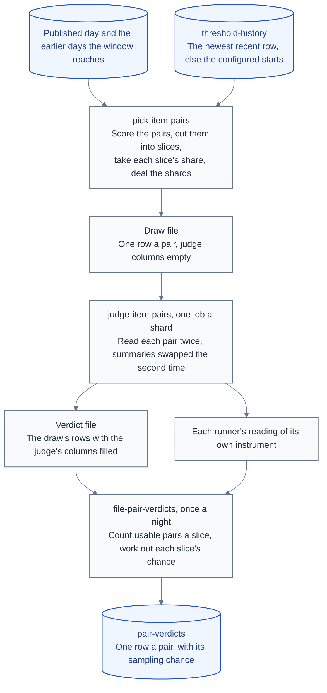

# How the content-similarity judge follows its thresholds

**Last Updated**: 2026-11-19

Which pairs of stories does the nightly judge read, what does it keep about each, and
where do its two thresholds sit? This page owns the nightly draw, the rows it leaves in
`pair-verdicts`, and the words they use. What a threshold decides about publication is
in [autotune-content-similarity.md](autotune-content-similarity.md); the council that
hosts the judge is in [llm-council.md](llm-council.md).

The judge reads a small, deliberate sample of the night's pairs, never all of them.
Where it looks hardest is where its answer decides something: around the two scores
that mark the edges of the doubtful range. Everywhere else it looks lightly, as a
check. Because the sample is uneven on purpose, every pair carries the chance it had of
being read, so a night's totals can be rebuilt from the rows alone.

## Words this page uses

| Word | Meaning |
| --- | --- |
| Pair | Two stories from different outlets, at least one of them from the night's own published day, scored by the same arithmetic the grouping pass uses. A pair of addresses is one pair, however many item ids carry them |
| Usable pair | A judged pair whose two readings, in file order and swapped, agree. Two agreed UNCLEAR readings are usable |
| Lower bound threshold | A score. Below it pairs are fully dissimilar: the judge almost never calls them the same story |
| Upper bound threshold | A score. Above it pairs are fully similar: the judge almost always calls them the same story |
| Ambiguous range | The scores between the two thresholds, where the judge's answers are mixed |
| Slice | A narrow range of scores that has its own sampling chance. The score range from -1 to 1 is cut into slices every night |
| Bucket | A group of slices: `fully_dissimilar`, `lower_thin`, `middle_coarse`, `upper_thin`, `fully_similar` |
| Thin slices | The run of narrow slices that starts at the lower threshold, and the run that ends at the upper one |
| Coarse slices | The wider slices that fill the range between the two thin runs |
| Lightly sampled ends | The two buckets beyond the thresholds, sampled lightly as live checks on the judge |
| Sampling chance | Usable pairs over available pairs, for one slice on one night: the chance a pair of that slice was both taken and usable |
| Weight | One over the sampling chance. A usable pair stands for that many pairs of its slice |
| Thresholds in force | The two thresholds a night's draw followed |

## The nightly flow



Three stages, each a module that takes a file in and leaves a file out, run from
[the tenant](../../../backend/idhazh/content_similarity_judge/tenant.py).

- **Pick** ([pick_item_pairs.py](../../../backend/idhazh/stages/pick_item_pairs.py))
  runs once a night in the planning job. It calls no model. It writes the draw file.
- **Judge** ([judge_item_pairs.py](../../../backend/idhazh/stages/judge_item_pairs.py))
  runs on each shard. It reads the rows its shard owns, writes the verdict file as it
  goes, and ships a reading of its own instrument. A shard that stops on its clock
  leaves the rows it had finished.
- **File** ([file_pair_verdicts.py](../../../backend/idhazh/stages/file_pair_verdicts.py))
  runs once a night in the collecting job. It files the rows through the ledger door
  and logs what the runners reported. A night with a lost runner files the rows the
  others returned.

The draw file and the verdict file are one shape. The draw leaves every judge column,
the usable count and the sampling chance empty; a shard fills the judge columns; the
collecting job fills the other two once every reading is in, because no draw can know
which pairs will agree. The ledger door files the same shape as parquet, so the file a
stage reads is the row a reader later reads.

## Which pairs the draw can take

The night's pairs are every comparison the same-story pass would weigh that holds at
least one story of the night's own day. A pair of two earlier-day stories is left out:
the pass never joins them, so a verdict on it changes nothing, and it was drawn the
night the later of the two was new. A pair of addresses is kept once: a story
republished on a later day keeps its address and takes a new item id, so one pair of
addresses can arrive as two pairs of items, and the copy made of the night's own items
is the one kept, because the judge reads the night's own copy of an address.

On 2026-11-09 to 2026-11-16 a night held 209,602 to 244,963 pairs. Of those, 97.2 to 99.8
percent scored below the lower start of 0.70, the ambiguous range held 330 to 6,208 and
the fully similar end 8 to 22.

## The thresholds in force

The draw follows two thresholds. It reads the days of `thresholds_lookback_days` before
the night from `threshold-history` and takes the `threshold_after` columns of the newest
row dated before the night. With no row in that window it follows the configured starts
in `thresholds.lower_start` and `thresholds.upper_start`. A row of the night itself is
never followed, so a re-run starts from where the first run started.

[`thresholds_in_force.py`](../../../backend/idhazh/similarity/thresholds_in_force.py)
holds the rule, and names the days to read, so a reader of the ledger and the draw that
follows it cannot disagree. Each pair row carries both thresholds in force, unrounded.

## The slices

The two thresholds are rounded onto a grid of `draw.slice_width`, the lower one down and
the upper one up, so the range between them is never narrower than they say and a
lightly sampled end never reaches past the threshold it lies beyond. The grid is counted
in whole slices, because `floor(0.58 / 0.01)` is 57 in floating point.

At the committed starts of 0.70 and 0.93, the range from -1 to 1 is 17 slices:

| Bucket | Slices | Edges |
| --- | ---: | --- |
| `fully_dissimilar` | 1 | -1.00 to 0.70 |
| `lower_thin` | 6 | six slices of 0.01 from 0.70 to 0.76 |
| `middle_coarse` | 3 | 0.76 to 0.80, 0.80 to 0.84, 0.84 to 0.87 |
| `upper_thin` | 6 | six slices of 0.01 from 0.87 to 0.93 |
| `fully_similar` | 1 | 0.93 to 1.00 |

A score on an edge belongs to the slice above it, and the top slice holds 1.0, which a
shared headline scores outright. The last coarse slice is the remainder when the middle
does not divide by `draw.coarse_slice_width`.

## How many pairs each slice gives

[`draw_allocation.py`](../../../backend/idhazh/similarity/draw_allocation.py) takes the
night's pairs in each slice and the budget, and gives each slice a whole number.

1. **The two ends go first.** Each takes its weight's share of `draw.pair_budget`,
   raised to its minimum, lowered to its maximum and never past what it holds. At 150
   pairs the similar end's share is 9 and its maximum is 6, and the dissimilar end's is
   6 and its maximum is 4, so the two maxima bind and the ends take 6 and 4.
2. **What is left is split by weight** among `lower_thin`, `upper_thin` and
   `middle_coarse`, at 40, 30 and 20. 140 pairs is 62.2, 46.7 and 31.1, and the pair the
   fractions leave over goes to the largest fraction: 62, 47 and 31.
3. **Inside a bucket every slice gets an equal share**, at least one pair when it holds
   any. A slice that holds fewer pairs than its share takes them all and the others
   split what it leaves.
4. **A bucket that cannot spend its share hands the rest on**, heaviest weight first. A
   night judges fewer pairs than its budget only when every slice between the thresholds
   is spent.

At the committed settings, on a night where every slice but the similar end holds more
than its share, the 150 pairs fall like this:

| Bucket | Pairs a slice, lowest slice first | Pairs |
| --- | --- | ---: |
| `fully_dissimilar` | 4 | 4 |
| `lower_thin` | 11, 11, 10, 10, 10, 10 | 62 |
| `middle_coarse` | 11, 10, 10 | 31 |
| `upper_thin` | 8, 8, 8, 8, 8, 7 | 47 |
| `fully_similar` | 6 | 6 |

A budget too small to give every slice that holds a pair one pair of its own is refused
by name, before anything is written: a slice that quietly took none would be filed under
no chance. The refusal is a setting to raise, and cannot arise at 150.

Within a slice the pairs go in a fixed order: a hash of the night's date, the scorer's
stamp and the pair's two ids, with no seed. A seed is a knob somebody can turn until the
answer looks nice, and this order decides which evidence the thresholds are eventually
found from.

## The order of the file and the shards

The deal and the file are ordered separately, for two different failures.

- **The shards are dealt slice by slice**, one pair at a time round the shards, so each
  slice reaches every shard and one lost runner takes a share of each slice, never a
  whole slice of two pairs or more.
- **The file is ordered by how far down its slice's list a pair stands**, then by the
  hash. A shard that stops on its clock loses the end of its file. Ordered by the hash
  alone, the file would put the small slices last, because a large pool gives the pairs
  with the smallest hashes. Ordered this way, the loss is a similar share of every slice.

## The sampling chance

For one slice on one night, with `m` pairs held and `u` usable pairs among the rows that
came back:

```text
chance = u / m        weight = 1 / chance = m / u
```

Every row of a slice carries the same two numbers, including a row whose own readings
disagreed. A pair that left no row - a lost runner, an item that had aged out of the
window, the end of a file cut off by a deadline - was not usable, so it lowers the
chance, and the heavier weight of the usable pairs makes up for it. A slice with no
usable pair has a chance of zero, which is a fact about the night and not a missing
value.

A slice holds 31 pairs, the draw takes 6, and 5 come back usable: the chance is
5 / 31 = 0.161, each usable pair stands for 6.2 pairs, and the 5 of them stand for the
31. The chance is worked out when the night is filed, because only then are the usable
pairs known.

## What `pair-verdicts` stores

One row for each pair put to the judge, filed under the judged date. Its columns are
declared in
[story_similarity_pair_verdict.py](../../../backend/idhazh/contracts/story_similarity_pair_verdict.py).

| Part | Columns |
| --- | --- |
| Identity | `date`, `run_id`, `work_part_index`, `pair_key`, `left_url_key`, `right_url_key` |
| The score | `similarity_score`, `cosine`, `headline`, `scorer_model`, `cosine_weight`. Both scores run from -1 to 1 |
| The slice | `bucket`, `slice_low`, `slice_high`, `slice_pairs_available`, `slice_pairs_judged`, `slice_pairs_usable`, `sampling_chance` |
| The thresholds in force | `lower_threshold_in_force`, `upper_threshold_in_force`, unrounded |
| The judge | `verdict`, `verdict_swapped`, `readings_agree`, `first_token_margin`, `judge_model`, `prompt_digest`, `grammar_digest`, `decode_seconds`, `judge_temperature`, `grammar_applied`, `first_token_probabilities`, `thinking_spans`, `judge_policy_version` |
| The tuning | `config_versions`: one JSON text naming each config file the night read and its revision date |

`slice_pairs_judged` is what the draw took and is never recounted: a pair that left no
row still counts there. `slice_pairs_usable` and `sampling_chance` are filled together,
by the collecting job.

The runners' readings of their own instruments are not filed. The collecting job logs
their totals: pairs dealt, read, agreed, unreadable, refused and abandoned.

## Which nights the judge is behind on

The judge names a night when `pair-verdicts` holds no row for it. The council hands it a
window of tonight and a few earlier nights, so the read is the same few days on the
thousandth night as on the third. Any one row settles a night: a night that lost a
runner is not named again, because a repeat judges the whole night over. A night that
drew nothing files no row, so it stays named until it leaves the window. A judge that
has filed nothing is behind on every night of its window, and the council's repair
budget lets one older night through a night.

## Settings

The numbers live in
[config/judges/content-similarity-judge.json](../../../config/judges/content-similarity-judge.json),
declared and checked by
[the knobs contract](../../../backend/idhazh/contracts/knobs/content_similarity_judge.py),
and changed only by an edit that bumps the file's `version` to the UTC date of the
edit. The defaults are labelled estimates: a replay of the eight nights from 2026-11-09
to 2026-11-16 showed each one spends its whole budget of 150, and only real nights show
how much evidence each threshold needs.

| Key | Default | What it sets |
| --- | ---: | --- |
| `draw.pair_budget` | 150 | Live pairs a night. The judge refuses a draw its shards cannot finish inside the council's window |
| `draw.slice_width` | 0.01 | Thin slice width, and the grid every edge sits on |
| `draw.thin_slices_each_end` | 6 | Thin slices at each threshold |
| `draw.coarse_slice_width` | 0.04 | Coarse slice width, a whole number of thin slices |
| `draw.bucket_weights` | 40, 30, 20 | Lower thin, upper thin and coarse shares of what the ends leave |
| `draw.fully_similar`, `draw.fully_dissimilar` | weight 6, 4; minimum 2, 1; maximum 6, 4 | The two lightly sampled ends |
| `draw.thresholds_lookback_days` | 14 | How old the newest threshold-history row may be |
| `thresholds.lower_start`, `thresholds.upper_start` | 0.70, 0.93 | The thresholds when no recent row sets them |

## Design rationale

**Slices, because the judge's answer changes where it is read.** A single sample of the
night would spend most of its pairs far below the lower threshold, where the answer is
almost always NO and tells nothing. Cutting the range into slices lets the draw spend
its pairs where the answer is mixed, and the sampling chance lets the lightly sampled
rest still count for what it holds.

**The grid rounds outward.** A threshold between two grid lines would otherwise split a
slice, and a slice that straddles a threshold belongs to neither bucket. Rounding the
lower threshold down and the upper one up keeps the ambiguous range at least as wide as
the thresholds say, and each lightly sampled end stops at its threshold, which the
contract checks.

**The chance is worked out when the night is filed.** A draw cannot know which pairs will
agree, and a count taken from what was dealt would credit a lost runner's pairs as usable.
Usable over available is true of the rows that exist.

**A partly judged night is filed, not held.** The chance already absorbs a lost runner,
and holding the night back would delete the evidence of the units that did run to record
the one that did not. The collecting job refuses only a row that is not the night's own,
because the ledger door would file a foreign row under its own date and let its own run
id stand, and a foreign row would skew its slice's chance unseen.

**The deal and the file are ordered apart.** One order cannot serve both failures: a deal
by the hash can leave a small slice entirely on one runner, and a file by the hash puts
the small slices at its end.

**The runner's reading is logged and not filed.** The totals are the night's, not the
runner's, and the next stage that reads them folds them into one row a night.

**No second record runs beside the draw.** The cumulative record and the fit it fed
assume the old draw, so beside this one they would be wrong from the first night.

## See also

- [autotune-content-similarity.md](autotune-content-similarity.md) - what a similarity threshold decides, and the loop it replaced.
- [llm-council.md](llm-council.md) - the venue that hosts the judge and what it asks of a tenant.
- [../contracts/ledger-registry.md](../contracts/ledger-registry.md) - how `pair-verdicts` and `threshold-history` are registered.
- [../../concepts/growing-reads.md](../../concepts/growing-reads.md) - why each read here names its days.
- [../../concepts/glossary.md](../../concepts/glossary.md) - the shared vocabulary.
