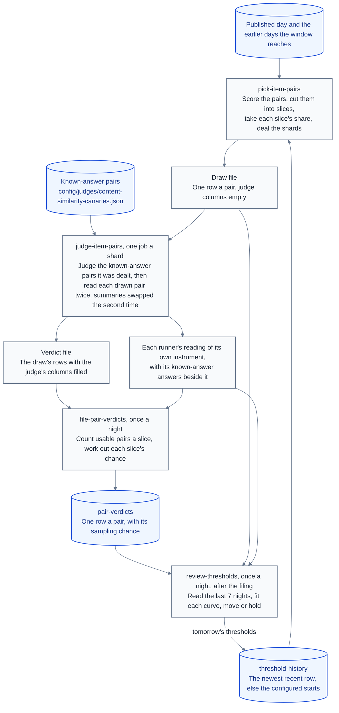

# How the content-similarity judge follows its thresholds

**Last Updated**: 2026-11-19

Which pairs of stories does the nightly judge read, what does it keep about each, and
where do its two thresholds sit and move? This page owns the nightly draw, the rows it
leaves in `pair-verdicts`, the review that finds where each threshold belongs and the row
it leaves in `threshold-history`, the known-answer pairs the judge is checked against, the
words they use, what to read once real nights exist, and what the design leaves out. What
makes two items one story on the published day, and the fixed
line that decides it, is in [autotune-content-similarity.md](autotune-content-similarity.md);
nothing this judge writes moves that line. The
council that hosts the judge is in [llm-council.md](llm-council.md). The page stays whole
because it answers one question end to end: the draw follows the thresholds, and the
review moves them from what the draw brought back, so the two halves share their words,
their slices and their rows. The known-answer pairs ride the same runners, the same
reading of the instrument and the same night's row, so they stay here too. The first-nights
readings and the leave-outs each point at a setting or a column defined here, so they stay
too.

The judge reads a small, deliberate sample of the night's pairs, never all of them.
Where it looks hardest is where its answer decides something: around the two scores
that mark the edges of the doubtful range. Everywhere else it looks lightly, as a
check. Because the sample is uneven on purpose, every pair carries the chance it had of
being read, so a night's totals can be rebuilt from the rows alone.

The same rows then say where the thresholds belong. Each night the judge reads its own
answers from the last seven nights that scored near each threshold, fits a curve through
them, and moves the threshold toward the score where the curve says the same-story share
reaches the threshold's level: out quickly, in slowly, a step at a time, with every
number behind the move written down.

## Words this page uses

| Word | Meaning |
| --- | --- |
| Pair | Two stories from different outlets, at least one of them from the night's own published day, scored by the same arithmetic the grouping pass uses. A pair of addresses is one pair, however many item ids carry them |
| Usable pair | A judged pair whose two readings, in file order and swapped, agree. Two agreed UNCLEAR readings are usable |
| Lower bound threshold | A score. Below it pairs are fully dissimilar: the judge almost never calls them the same story |
| Upper bound threshold | A score. Above it pairs are fully similar: the judge almost always calls them the same story |
| Ambiguous range | The scores between the two thresholds, where the judge's answers are mixed |
| Slice | A narrow range of scores that has its own sampling chance. The score range from -1 to 1 is cut into slices every night |
| Bucket | A group of slices: `fully_dissimilar`, `lower_thin`, `middle_coarse`, `upper_thin`, `fully_similar` |
| Thin slices | The run of narrow slices that starts at the lower threshold, and the run that ends at the upper one |
| Coarse slices | The wider slices that fill the range between the two thin runs |
| Lightly sampled ends | The two buckets beyond the thresholds, sampled lightly as live checks on the judge |
| Sampling chance | Usable pairs over available pairs, for one slice on one night: the chance a pair of that slice was both taken and usable |
| Weight | One over the sampling chance. A usable pair stands for that many pairs of its slice |
| Thresholds in force | The two thresholds a night's draw followed |
| Share level | The same-story share that defines a threshold: 0.05 for the lower one and 0.90 for the upper one. A threshold is the score where the fitted curve reaches it |
| Evidence | The usable pairs that scored within 0.06 of a threshold in the last seven nights, read the way tonight's were |
| Curve | The rise of the same-story share with the score, fitted to the evidence as a logistic curve with an intercept and a steepness |
| Pull | A soft tug that keeps the curve's steepness near its recent median, so thin evidence can shift the curve and cannot tilt it |
| Estimate | The score where the curve reaches the threshold's share level |
| Gap | The estimate less where the threshold stood. A negative gap says the evidence puts the threshold lower |
| Ignore range | A gap this small or smaller is not acted on |
| Widening, narrowing | Moving a threshold out (the lower one down, the upper one up), which makes the ambiguous range larger, or in |
| Hold | A night that leaves a threshold where it stood. The row says why in one word |
| Meaning stamp | The six values that decide what a pair's answer means: judge model, prompt, grammar, scorer, cosine weight and judge policy |
| Known-answer pair | Also called a canary pair. Two summaries whose right answer was decided before the judge saw them, put to the judge once a run on top of the night's own pairs. Unrelated to the planted injection example the glossary also calls a canary |
| Runner index | Which place in the council's matrix judged a pair, from 0 to one less than the runners. A place and not a particular machine |

## The nightly flow



Four stages, each a module that takes a file in and leaves a file out, run from
[the tenant](../../../backend/idhazh/content_similarity_judge/tenant.py). A fifth,
[judge_canary_pairs.py](../../../backend/idhazh/stages/judge_canary_pairs.py), is called
by the judging stage and is described under [the known-answer pairs](#the-known-answer-pairs).

- **Pick** ([pick_item_pairs.py](../../../backend/idhazh/stages/pick_item_pairs.py))
  runs once a night in the planning job. It calls no model. It writes the draw file.
- **Judge** ([judge_item_pairs.py](../../../backend/idhazh/stages/judge_item_pairs.py))
  runs on each shard. It judges the known-answer pairs its shard was dealt, reads the rows
  its shard owns, writes the verdict file as it goes, and ships a reading of its own
  instrument ([`StorySimilarityRunnerReport`](../../../backend/idhazh/contracts/story_similarity_runner_report.py))
  with the known-answer answers beside it. A shard that stops on its clock
  leaves the rows it had finished.
- **File** ([file_pair_verdicts.py](../../../backend/idhazh/stages/file_pair_verdicts.py))
  runs once a night in the collecting job. It files the rows through the ledger door
  and counts the readings the runners shipped. A night with a lost runner files the
  rows the others returned.
- **Review** ([review_thresholds.py](../../../backend/idhazh/stages/review_thresholds.py))
  runs in the collecting job right after the filing. It calls no model. It reads the
  last seven nights of `pair-verdicts`, the draw file and the runners' readings, decides
  what each threshold does, and files one row in `threshold-history`.

If the review fails, the night keeps its pair rows and has no threshold row. The
scheduler reads `pair-verdicts` only, so it does not name the night again; the runners'
readings that would have gone onto the row are artifacts that expire, and only the
threshold columns can be worked out again from the ledger.

The draw file and the verdict file are one shape. The draw leaves every judge column,
the usable count and the sampling chance empty; a shard fills the judge columns; the
collecting job fills the other two once every reading is in, because no draw can know
which pairs will agree. The ledger door files the same shape as parquet, so the file a
stage reads is the row a reader later reads.

## Which pairs the draw can take

The night's pairs are every comparison the same-story pass would weigh that holds at
least one story of the night's own day. A pair of two earlier-day stories is left out:
the pass never joins them, so a verdict on it changes nothing, and it was drawn the
night the later of the two was new. A pair of addresses is kept once: a story
republished on a later day keeps its address and takes a new item id, so one pair of
addresses can arrive as two pairs of items, and the copy made of the night's own items
is the one kept, because the judge reads the night's own copy of an address.

On 2026-11-09 to 2026-11-16 a night held 209,602 to 244,963 pairs. Of those, 97.2 to 99.8
percent scored below the lower start of 0.70, the ambiguous range held 330 to 6,208 and
the fully similar end 8 to 22.

## The thresholds in force

The draw follows two thresholds. It reads the days of `thresholds_lookback_days` before
the night from `threshold-history` and takes the `threshold_after` columns of the newest
row dated before the night. With no row in that window it follows the configured starts
in `thresholds.lower_start` and `thresholds.upper_start`. A row of the night itself is
never followed, so a re-run starts from where the first run started.

[`thresholds_in_force.py`](../../../backend/idhazh/similarity/thresholds_in_force.py)
holds the rule, and names the days to read, so a reader of the ledger and the draw that
follows it cannot disagree. Each pair row carries both thresholds in force, unrounded.
The review files the row the next night follows, one a night, and it also uses the rule:
it works out the thresholds the night should have followed and refuses to file when a
night's rows name others, which is what a checkout that was not handed the history looks
like ([why](#design-rationale)).

## The slices

The two thresholds are rounded onto a grid of `draw.slice_width`, the lower one down and
the upper one up, so the range between them is never narrower than they say and a
lightly sampled end never reaches past the threshold it lies beyond. The grid is counted
in whole slices, because `floor(0.58 / 0.01)` is 57 in floating point. Starts that leave
no room for both thin runs, or for a lightly sampled end, are refused when the file is
read, by the same rounding the draw uses.

At the committed starts of 0.70 and 0.93, the range from -1 to 1 is 17 slices:

| Bucket | Slices | Edges |
| --- | ---: | --- |
| `fully_dissimilar` | 1 | -1.00 to 0.70 |
| `lower_thin` | 6 | six slices of 0.01 from 0.70 to 0.76 |
| `middle_coarse` | 3 | 0.76 to 0.80, 0.80 to 0.84, 0.84 to 0.87 |
| `upper_thin` | 6 | six slices of 0.01 from 0.87 to 0.93 |
| `fully_similar` | 1 | 0.93 to 1.00 |

A score on an edge belongs to the slice above it, and the top slice holds 1.0, which a
shared headline scores outright. The last coarse slice is the remainder when the middle
does not divide by `draw.coarse_slice_width`.

## How many pairs each slice gives

[`draw_allocation.py`](../../../backend/idhazh/similarity/draw_allocation.py) takes the
night's pairs in each slice and the budget, and gives each slice a whole number.

1. **The two ends go first.** Each takes its weight's share of `draw.pair_budget`,
   raised to its minimum, lowered to its maximum and never past what it holds. At 150
   pairs the similar end's share is 9 and its maximum is 6, and the dissimilar end's is
   6 and its maximum is 4, so the two maxima bind and the ends take 6 and 4.
2. **What is left is split by weight** among `lower_thin`, `upper_thin` and
   `middle_coarse`, at 40, 30 and 20. 140 pairs is 62.2, 46.7 and 31.1, and the pair the
   fractions leave over goes to the largest fraction: 62, 47 and 31.
3. **Inside a bucket every slice gets an equal share**, at least one pair when it holds
   any. A slice that holds fewer pairs than its share takes them all and the others
   split what it leaves.
4. **A bucket that cannot spend its share hands the rest on**, heaviest weight first. A
   night judges fewer pairs than its budget only when every slice between the thresholds
   is spent.

At the committed settings, on a night where every slice but the similar end holds more
than its share, the 150 pairs fall like this:

| Bucket | Pairs a slice, lowest slice first | Pairs |
| --- | --- | ---: |
| `fully_dissimilar` | 4 | 4 |
| `lower_thin` | 11, 11, 10, 10, 10, 10 | 62 |
| `middle_coarse` | 11, 10, 10 | 31 |
| `upper_thin` | 8, 8, 8, 8, 8, 7 | 47 |
| `fully_similar` | 6 | 6 |

A budget too small to give every slice that holds a pair one pair of its own is refused
by name, before anything is written: a slice that quietly took none would be filed under
no chance. The refusal is a setting to raise, and cannot arise at 150.

Within a slice the pairs go in a fixed order: a hash of the night's date, the scorer's
stamp and the pair's two ids, with no seed. A seed is a knob somebody can turn until the
answer looks nice, and this order decides which evidence the thresholds are eventually
found from.

## The order of the file and the shards

The deal and the file are ordered separately, for two different failures.

- **The shards are dealt slice by slice**, one pair at a time round the shards, so each
  slice reaches every shard and one lost runner takes a share of each slice, never a
  whole slice of two pairs or more.
- **The file is ordered by how far down its slice's list a pair stands**, then by the
  hash. A shard that stops on its clock loses the end of its file. Ordered by the hash
  alone, the file would put the small slices last, because a large pool gives the pairs
  with the smallest hashes. Ordered this way, the loss is a similar share of every slice.

## The sampling chance

For one slice on one night, with `m` pairs held and `u` usable pairs among the rows that
came back:

```text
chance = u / m        weight = 1 / chance = m / u
```

Every row of a slice carries the same two numbers, including a row whose own readings
disagreed. A pair that left no row - a lost runner, an item that had aged out of the
window, the end of a file cut off by a deadline - was not usable, so it lowers the
chance, and the heavier weight of the usable pairs makes up for it. A slice with no
usable pair has a chance of zero, which is a fact about the night and not a missing
value.

A slice holds 31 pairs, the draw takes 6, and 5 come back usable: the chance is
5 / 31 = 0.161, each usable pair stands for 6.2 pairs, and the 5 of them stand for the
31. The chance is worked out when the night is filed, because only then are the usable
pairs known.

## What `pair-verdicts` stores

One row for each pair put to the judge, filed under the judged date. Its columns are
declared in
[story_similarity_pair_verdict.py](../../../backend/idhazh/contracts/story_similarity_pair_verdict.py).

| Part | Columns |
| --- | --- |
| Identity | `date`, `run_id`, `work_part_index`, `pair_key`, `left_url_key`, `right_url_key` |
| The score | `similarity_score`, `cosine`, `headline`, `scorer_model`, `cosine_weight`. Both scores run from -1 to 1 |
| The slice | `bucket`, `slice_low`, `slice_high`, `slice_pairs_available`, `slice_pairs_judged`, `slice_pairs_usable`, `sampling_chance` |
| The thresholds in force | `lower_threshold_in_force`, `upper_threshold_in_force`, unrounded |
| The judge | `verdict`, `verdict_swapped`, `readings_agree`, `first_token_margin`, `judge_model`, `prompt_digest`, `grammar_digest`, `decode_seconds`, `judge_temperature`, `grammar_applied`, `first_token_probabilities`, `thinking_spans`, `judge_policy_version` |
| The tuning | `config_versions`: one JSON text naming each config file the night read and its revision date |

`slice_pairs_judged` is what the draw took and is never recounted: a pair that left no
row still counts there. `slice_pairs_usable` and `sampling_chance` are filled together,
by the collecting job.

The runners' readings of their own instruments are not a ledger of their own: the
review sums them onto the night's `threshold-history` row.

## How the judge reads a pair

The judge answers one closed question about two summaries, in one of three words, under a
grammar: do these two report on the exact same event, YES, NO or UNCLEAR. It is never asked
whether a summary is good. A quality verdict has no place to go on a row filed by the pair's
score, and mixing the two would put one model's opinion about writing inside the answers that
place a threshold. How a published summary is judged is a different loop with a different
ledger ([evaluation.md](../../concepts/evaluation.md)).

**The judge is handed the two summaries and nothing else.** Not the score, which would hand
it the number its answers are used to place a threshold against. Not the source names, which
invite a verdict about publishers rather than about events. Not the publication times, which
answer the question by proxy. `render_user_turn` in
[prompt.py](../../../backend/idhazh/similarity/prompt.py) is the only place the ask is laid
out: a published item reaches it through `user_turn` and a known-answer pair through its own
summaries, so no pair has a second way to reach the model, and the digest of the prompt
describes the layout the model reads. Each summary goes in fenced as untrusted data, like
every other piece of text that came off the open web
([trust-boundary.md](../sources/trust-boundary.md)), and the ask is repeated after both, so
the last words the model reads before it answers are ours.

**Every pair is read twice, and a pair the two readings disagree about is not usable.** The
second read puts the summaries the other way round. A model that answers one way on a pair and
the other way on the same pair reversed has told us about itself and not about the pair. It
is never read a third time, because a third reading with no rule for breaking the tie would be
a coin toss wearing a number. The row is still filed with both verdicts, so a disagreement is
a fact somebody can count: the night's `disagreement_rate` does.

**A reading is valid only with the literal answer and the decoder's own emission.** The
literal is exactly YES, NO or UNCLEAR, optionally preceded by one space. The selected token
ids, text and bytes come from each native probability position and not from the ranked
`top_logprobs` alternatives, and selected prefixes are consumed until they identify the
literal verdict. Missing, malformed, empty, ambiguous or contradictory emission evidence
refuses that reading, with one closed reason on the reading and in its log line:
`invalid_literal`, `missing_emission`, `invalid_emission`, `ambiguous_emission` or
`mismatched_emission`. There is no ranking fallback, no retokenisation and no retry. Both
orders still run and keep their costs, even when the first is refused.

**A refused reading is evidence, not an absent pair.** The runner records each order's verdict
independently, leaves a refused order null, sets `grammar_applied` and `readings_agree` false
for the pair, and reads the next pair. One valid order survives beside a refusal in the other,
and two refusals never become agreement. The shared
[model reader](../../../backend/idhazh/content_similarity_judge/model_reader.py) keeps
production endpoint resolution, template checks and tokenizer checks, and replay supplies
concrete responses at that same boundary.

**`first_token_margin` is the gap between the two likeliest verdicts, over the mass the
grammar admits.** The judge asks the decoder what else it could have written where the verdict
opens, and the window is the 25 non-empty prefixes the grammar admits. A token is the opening
of a legal reply and not a legal reply, so `NO` and ` NO` are one verdict said twice, and
subtracting the top two entries would report a near-zero gap on a reply the model was certain
about. So each token is summed into the verdict its text opens; a token that opens none or
several (a lone space, an empty token) is dropped; and the rest is divided by the legal mass,
because the window is the model's own distribution and not the grammar's (18 of 25 returned
tokens were illegal in the measurement). The margin is empty where fewer than two verdicts got
any mass: 1.0 would read as full agreement with the grammar and 0.0 as the one thing the
column exists to catch. The window is stored as `first_token_probabilities`, each log
probability as the server reported it, so the margin can be recomputed from any row. The
measurement is in
[what-the-margin-rule-changes.md](../../reference/benchmarks/what-the-margin-rule-changes.md).

**What an answer means has its own identity, apart from the prompt.** `JUDGE_POLICY_VERSION`
in [the pair contract](../../../backend/idhazh/contracts/story_similarity_pair_verdict.py) is
a protocol date for how a reading becomes evidence, and not a setting. Judged pair rows and
the night's row carry it as `judge_policy_version`; a draw row nothing has judged carries
null. It is one of the six values of the meaning stamp, so a change to it leaves older pairs
out of the evidence and the window restarts by itself. No prompt edit is used to reset the
evidence.

**The judge may take a model entry of its own, and no committed file gives it one.** The one
thing this judge could want from a second entry is a reasoning span in front of its verdict,
and the committed entry that offers one also moves the summariser's answer budget, cache types
and batch size, which would change the words a reader gets with no instrument watching. So
`models.judge` is optional and null everywhere. A second entry that names weights nobody
serves is refused when the config loads: no server is started for it, so it would decode on
the summariser's weights while every verdict was recorded under a model that never saw the
pair. What it may move is the decode. It is filled the day a replay says a reasoned verdict is
a better verdict, and that replay is priced and unrun.

**Three risks in how the judge reads its first answer token were checked against the code on
2026-10-12, and one is still open.**

- **A prompt that ends in a space - open.** A rendered prompt that ends in a space starts the
  answer from a position the model rarely sees, so the first-token probabilities move and the
  reply still parses. The prompt ends on the reply opening read off the model's own template
  (`render_prompt` in [server.py](../../../backend/idhazh/llm/server.py)), and nothing
  refuses an opening that ends in a space. The grammar's optional leading space and the prefix
  bucketing decide which verdict a token counts for; they do not undo the shift. The smallest
  fix is to refuse such an opening when the markers are derived, before any pair is judged.
- **Token ids built from a string - closed.** The margin credits each returned token to a
  verdict by its text, and no token id is built, so a vocabulary that splits a word
  differently changes nothing the margin reads.
- **Thinking left on - closed by the design.** The judge sends its own prompt bytes, and the
  reply opening is read off the template rendered with the thinking keyword off, so a template
  cannot turn reasoning on behind it. Reasoning runs only through the declared two-span path,
  and the verdict is read off the answer. Closing that path for every judge call was proposed
  and not taken, because it would remove the second model entry above.

## The known-answer pairs

The judge is checked against six pairs whose right answer was decided before it saw them,
once a run and on top of the night's own pairs. The check is narrow on purpose. A wrong
model, a runtime change that breaks the constrained answer, or an edited prompt or grammar
shows as an answer that is not the expected one, and it shows before a runner's first drawn
pair, because each runner judges its share of them first. It cannot show decay late in a run,
and it cannot say whether the judge is right on pairs unlike these six.

The pairs live in
[config/judges/content-similarity-canaries.json](../../../config/judges/content-similarity-canaries.json),
declared and checked by
[the canary contract](../../../backend/idhazh/contracts/knobs/content_similarity_canaries.py).
The file holds at most 12 pairs and at least one of each kind, with the summary text copied
into it so that a published day that retires cannot orphan a pair. It changes only by a
reviewed edit that bumps its `version`. Nothing refreshes it from the published days, because
that would put fetched text into the reference set unreviewed.

| Kind | Expected answer | What the pair is |
| --- | --- | --- |
| same | YES | One event: the same actors, action and occasion |
| different | NO | Two events with no actor, place or topic in common |
| unclear | UNCLEAR | At least one summary too vague to name what happened, the judge prompt's own definition |

The six committed pairs are real published summaries, two of each kind, found and labelled by
an agent from the summaries alone; no person marked them. Each pair records who labelled it, a
one-line basis, and the day and item each summary was copied from. A summary is copied as
published, with an accent folded to its plain letter because the file is ASCII (one accent in
one summary today). A pair written by hand is allowed and says so: its id starts with
`synthetic-` and its origin is `synthetic`.

How a run uses them:

- **Each pair is judged once a run, on one runner.** The pair at position `i` of the file
  goes to runner `(i + the date's ordinal) mod the runners`. Six pairs on four runners is two,
  two, one and one, and the pairs move one runner a night, so over four nights each has run on
  every runner. A night with no draw runs no runner and judges none.
- **The request is a drawn pair's.** The same prompt, fence, grammar and sampler, with nothing
  marking the pair, so the judge cannot tell it from the night's own. It is never presented as
  an instruction, and the comparison with the expected answer is made by code and never by
  the model.
- **A wrong answer is a reading.** The expected word in both orders is right. The other word, a
  split between the two orders and a reading outside the grammar are wrong: each is logged as a
  warning naming the pair and stored as the judge gave it. Nothing holds, re-runs or stops the
  night.
- **A call that raises stores nothing for its pair.** It is logged as an error naming the pair,
  and the runner goes on to its next known-answer pair and then to its own.
- **They are in no count or clock.** A known-answer pair is never a `pair-verdicts` row, and it
  is in no funnel count (`pairs_dealt` and the rest), no curve evidence and neither decode figure
  of the night's row. Its calls do count in the venue's own cost cells, because they are model
  time the runner spent.
- **The answers are stored once, as text on the night's row**
  ([`canary_answers`](#what-threshold-history-stores)). Each runner ships its own pairs'
  answers in its reading, and the review gathers them.

The plan-time guard counts them. The busiest runner judges
`ceil(draw / runners) + ceil(known-answer pairs / runners)` pairs at the measured 110.98 seconds
a pair: at the committed 4 runners that is 38 + 2 = 40 pairs, 4,439 seconds against the 10,500 a
runner has to work in. The cost a pair was measured at is from 2026-09-18 on another model file,
so the figure is an estimate. A file that does not load stops the night in the planning job,
before any runner restores its weights.

The judge had never answered UNCLEAR on a real pair when the six were chosen (2026-11-17), so
the two unclear pairs may be answered NO every night. That is a finding about the judge and not
a fault in the check, and a change in those two answers is the signal.

## Finding where each threshold belongs

After a night's pairs are filed, the review asks of each threshold where the judge's
answers say the same-story share reaches the threshold's level, and whether to move
toward that score. The arithmetic is four small pure modules, which read no file, no
config file and no clock, and one stage that joins them:

| Question | Module |
| --- | --- |
| Which pairs are evidence? | [`threshold_evidence.py`](../../../backend/idhazh/similarity/threshold_evidence.py) |
| Where does the curve through them reach a level? | [`threshold_curve.py`](../../../backend/idhazh/similarity/threshold_curve.py) |
| What does the gap let the night do? | [`threshold_move.py`](../../../backend/idhazh/similarity/threshold_move.py) |
| What do the night's lightly sampled ends and runners add up to? | [`night_totals.py`](../../../backend/idhazh/similarity/night_totals.py) |
| Which rows does a night read, and what does it file? | [`review_thresholds.py`](../../../backend/idhazh/stages/review_thresholds.py) |

`build_threshold_row` in the stage is the whole of the joining and takes rows already
read, so a night can be worked again from its row and `pair-verdicts` alone.

### The evidence

The evidence for a threshold is the usable pairs from the last `window_nights` nights
(seven, ending on the night) that scored within `near_threshold_width` (0.06) of where
the threshold stood that night, on either side and edges included. Three rules decide
which rows count:

- **Each pair counts once, by its newest row.** A re-run judges the same pairs again and
  both runs keep their rows. The row filed last counts, whatever it says, and it is
  chosen before anyone asks whether it is usable: a newer reading that disagreed with
  itself is the pair's reading now, and the older agreeing one is not kept beside it.
- **Only pairs read the way tonight's were count.** A different judge model, prompt,
  grammar, scorer, cosine weight or judge policy changes what an answer means, so
  such pairs are left out and the window restarts by itself the next night. A night
  nothing was judged on has no meaning stamp and so no evidence.
- **Only usable pairs count.** An answer is "the same story" for a YES, and not for a NO
  or an UNCLEAR.

A window with fewer than seven nights holds the nights there are, and `nights_used` on the
row says how many. The review of a night reads only the days up to that night, so the
council can settle an older night after a newer one and the older night is worked out as
if the newer one did not exist.

### The curve

The share of pairs called the same story is fitted as a logistic curve, with `s` a score:

```text
P(same story | s) = 1 / (1 + exp(-(a + b * s)))
```

The intercept `a` and the steepness `b` are the pair that maximises

```text
sum over the evidence of ln P(answer | score)  -  (b - b0)^2 / (2 * sigma^2)
```

The first term is how well the curve explains the answers. The second is the pull: it
keeps `b` near `b0`, the median steepness this threshold's fit stored on the previous 28
nights (the configured 24.6 until seven nights of it exist), as loosely as `sigma` of 8.0
allows. Nothing pulls the intercept, so the curve can shift while its slope stays steady,
and a shift is what the evidence has to be able to show.

**The fit is unweighted.** How many pairs the draw took at a score depends on the score
alone, so weights change how much evidence there is at a score and not what share it
shows. They would also hand the few pairs from the lightly sampled ends the loudest voice
in a fit about the scores beside a threshold. Weights are used only for the totals of the
two lightly sampled ends below.

The fit is Newton's method with the step halved until the surface does not fall: two
parameters, a concave surface, at most 50 steps, in pure Python with no added dependency.
A window whose answers are all alike has no maximum, because the curve keeps sliding
away, and a steepness that is not above zero says nothing about where a share is crossed.
Both are reported as no curve, and the threshold is held as `fit_failed` with its curve,
estimate and gap left empty.

### The estimate and the gap

```text
estimate = (ln(p / (1 - p)) - a) / b        p is the threshold's share level
gap      = estimate - threshold_before
```

At the default share levels `ln(p / (1 - p))` is -2.944 for the lower threshold and 2.197
for the upper one.

### The move

A night holds a threshold for the first of these reasons that applies, in this order, and
`held_because` names it:

| Order | `held_because` | The threshold is held when |
| ---: | --- | --- |
| 1 | `not_enough_evidence` | Fewer than `minimum_usable_pairs` (240) usable pairs were near it |
| 2 | `fit_failed` | No curve was fitted |
| 3 | `within_ignore_range` | The gap is no more than `ignore_range` (0.01) |
| 4 | `waiting_for_second_night` | The gap has stood beyond the ignore range, on the same side, for fewer than `nights_running_required` (2) nights in a row |

"In a row" counts consecutive nights, read from the previous night's stored gap. A
night with no row breaks the run, whether the judge lost the night or nothing ran, so a
hole in the history delays a move by a night and never brings one forward. A move does
not reset the count: after a move the gap is measured from the new threshold, and a gap
still beyond the range on the same side is still a night in a row.

Otherwise the threshold moves by the gap, cut to a step: `widening_step` (0.02) when
moving out, `narrowing_step` (0.005) when moving in, and `far_gap_step` (0.02) either
way when the gap is over `far_gap` (0.06). A gap smaller than its step is taken whole.

Three limits come after the step: the lower threshold stops at `lowest_lower_threshold`
(0.50), the upper at `highest_upper_threshold` (0.99), and neither comes closer to the
other than `smallest_gap` (0.12), which is what keeps tomorrow's draw drawable. The lower
threshold is limited by where the upper one stands now and the upper one by where the
lower one ends up, so the lower threshold has first claim on the room between them.
**A limit only ever shortens a move.** A threshold that already stands outside a limit,
because a setting changed under it, is not pushed back: it does not move that way, and
the move is cut to nothing. `move_limited_by` names the last limit that changed the move.

A held threshold keeps its score to the last digit, and its estimate is still stored.

### A worked night

A synthetic night from the tests, which is not a real one: six nights of a judge whose
curve reaches 5 percent at 0.70 and 90 percent at 0.93, then two nights of a judge whose
curve sits 0.05 lower, with 40 pairs a night beside each threshold. This is the second
night of the change.

| | Lower threshold | Upper threshold |
| --- | ---: | ---: |
| `threshold_before` | 0.7000 | 0.9300 |
| Evidence: usable pairs from 7 nights | 280 (enough: 240) | 280 (enough: 240) |
| Curve intercept `a`, steepness `b` | -19.4104, 24.2073 | -21.4800, 25.6885 |
| Pull centre `b0` | 25.7618 | 26.1293 |
| Estimate | (-2.9444 + 19.4104) / 24.2073 = 0.6802 | (2.1972 + 21.4800) / 25.6885 = 0.9217 |
| Gap | 0.6802 - 0.7000 = -0.0198 | 0.9217 - 0.9300 = -0.0083 |
| Against the ignore range of 0.01 | beyond; the night before was -0.0118, also beyond on the same side, so 2 nights in a row | within |
| `held_because` | none | `within_ignore_range` |
| Move | -0.0198: out, so the step is 0.02, and the gap is smaller, so it is taken whole | 0 |
| `threshold_after` | 0.6802 | 0.9300 |

The lower threshold moves only now, on the second night it saw the gap, and by what the
evidence shows rather than by a full step. The upper threshold's gap is smaller than the
ignore range, so it stays exactly where it was and its estimate is still stored.

## What `threshold-history` stores

One row for each run, filed under the judged date and declared in
[story_similarity_threshold_history_row.py](../../../backend/idhazh/contracts/story_similarity_threshold_history_row.py).
A night that dealt pairs files a row even when none came back judged: the evidence is
empty, both thresholds are held for want of it, and the row says how many runners
reported. A night that dealt no pair, with no draw rows and no judged rows, files none, so
a missing row is how a reader tells a night nothing ran from one that ran and lost
everything.

| Part | Columns |
| --- | --- |
| Identity and meaning | `date`, `run_id`, `scorer_model`, `cosine_weight`, `judge_model`, `judge_policy_version`, `config_versions` |
| Each threshold, once for `lower_` and once for `upper_` | `threshold_before`, `share_level`, `nights_used`, `usable_pairs_used`, `window_first_date`, `curve_intercept`, `curve_steepness`, `pull_centre`, `pull_spread`, `estimate`, `gap`, `nights_beyond_ignore_range`, `move`, `move_limited_by`, `held_because`, `threshold_after` |
| The lightly sampled ends | `above_upper_pairs_available`, `above_upper_pairs_usable`, `above_upper_same_story_estimated`, `below_lower_pairs_available`, `below_lower_pairs_usable`, `below_lower_different_story_estimated` |
| The runners | `runners_expected`, `runners_reported`, `pairs_dealt`, `pairs_valid`, `pairs_agreed`, `pairs_unreadable`, `pairs_refused`, `pairs_abandoned`, `disagreement_rate`, `unclear_rate`, `decode_seconds_total`, `decode_seconds_slowest_runner`, `canary_answers` |

- **The curve columns, `estimate` and `gap` are empty together** when no curve was
  fitted, and `window_first_date` is empty when no usable pair was near.
- **`move_limited_by` is one of** none, widening_step, narrowing_step, far_gap_step,
  lowest_allowed, highest_allowed and smallest_gap. **`held_because` is one of** none,
  not_enough_evidence, fit_failed, within_ignore_range and waiting_for_second_night. `none`
  means the threshold moved, or that nothing cut the move.
- **The lightly sampled ends** take their pool, the pairs the draw found there, from the
  draw file, because an end whose rows were all lost leaves none in `pair-verdicts`. The
  estimated totals weight each usable pair by one over its sampling chance:
  `above_upper_same_story_estimated` adds the weights of the YES pairs above the upper
  threshold, and `below_lower_different_story_estimated` the weights of the pairs below
  the lower one that were not YES. Each is empty when no pair there was usable. With a
  handful of pairs a night they are an alarm and never move a threshold.
- **The runner columns are sums over the runners that reported.** A runner that never
  reported is in no sum, so the four endings still add up to `pairs_dealt` on a night that
  lost one, and `runners_reported` against `runners_expected` says it was lost. The two
  rates come from the summed counts and never from averaging the runners' own rates.
  `canary_answers` holds the known-answer pairs' answers as one compact JSON text keyed by
  pair id, for example `{"same-1":["YES","YES",0.981023,0.993412,812,2]}`: the answer in
  file order, the answer swapped, the two first-token margins, the file-order call's prompt
  tokens and the runner index, with null for a reading that was refused or missing. An id
  that is absent was never judged. It is empty, which means no known-answer pair was judged,
  and is never an empty object. The margins are the judge's own figures and are not rounded.
  For one pair the file-order prompt token count is the same on every runner and every night
  until the prompt, the chat template or the tokenizer moves, so a change in it is the sign.
- **Every figure that follows from another is recomputed when the row is read:** `move` is
  `threshold_after - threshold_before` and `gap` is `estimate - threshold_before`, each
  within one millionth, so a writer rounds none of them below six decimal places.

## Which nights the judge is behind on

The judge names a night when `pair-verdicts` holds no row for it. The council hands it a
window of tonight and a few earlier nights, so the read is the same few days on the
thousandth night as on the third. Any one row settles a night: a night that lost a
runner is not named again, because a repeat judges the whole night over. A night the
gardener recorded as quiet and the judge has repaired since counts as filed too, because
the read opens each window day's raw files as well as the compact index. A night that
drew nothing files no row, so it stays named until it leaves the window. A judge that
has filed nothing is behind on every night of its window (7 at the committed council
settings), and the council's repair budget lets one older night through a night, newest
first. So a night that drew nothing can take that slot while an older night the judge
lost waits, and the older night can leave the window first.

## Settings

The numbers live in
[config/judges/content-similarity-judge.json](../../../config/judges/content-similarity-judge.json),
declared and checked by
[the knobs contract](../../../backend/idhazh/contracts/knobs/content_similarity_judge.py),
and changed only by an edit that bumps the file's `version` to the UTC date of the
edit. The `draw` defaults are labelled estimates: a replay of the eight nights from
2026-11-09 to 2026-11-16 showed each one spends its whole budget of 150, and only real
nights show how much evidence each threshold needs. The `thresholds` defaults beyond the
starts come from a simulation over the replayed pools of those nights, when nothing
below 0.88 had been judged, so they are provisional until the first seven real nights.

| Key | Default | What it sets |
| --- | ---: | --- |
| `draw.pair_budget` | 150 | Live pairs a night. The judge refuses a draw its shards cannot finish inside the council's window |
| `draw.slice_width` | 0.01 | Thin slice width, and the grid every edge sits on |
| `draw.thin_slices_each_end` | 6 | Thin slices at each threshold |
| `draw.coarse_slice_width` | 0.04 | Coarse slice width, a whole number of thin slices |
| `draw.bucket_weights` | 40, 30, 20 | Lower thin, upper thin and coarse shares of what the ends leave |
| `draw.fully_similar`, `draw.fully_dissimilar` | weight 6, 4; minimum 2, 1; maximum 6, 4 | The two lightly sampled ends |
| `draw.thresholds_lookback_days` | 14 | How old the newest threshold-history row may be |
| `thresholds.lower_start`, `thresholds.upper_start` | 0.70, 0.93 | The thresholds when no recent row sets them |
| `thresholds.lower_share_level`, `thresholds.upper_share_level` | 0.05, 0.90 | The same-story share that defines each threshold |
| `thresholds.window_nights` | 7 | Nights of `pair-verdicts` the evidence reads, ending on the night |
| `thresholds.near_threshold_width` | 0.06 | How far either side of a threshold a pair may score and still be evidence for it |
| `thresholds.minimum_usable_pairs` | 240 | The fewest usable pairs near a threshold a night may act on |
| `thresholds.ignore_range` | 0.01 | A gap this small or smaller is not acted on |
| `thresholds.nights_running_required` | 2 | Nights in a row a gap must stand before a threshold moves |
| `thresholds.widening_step`, `thresholds.narrowing_step` | 0.02, 0.005 | The most a threshold moves in a night, out and in |
| `thresholds.far_gap`, `thresholds.far_gap_step` | 0.06, 0.02 | A gap over the first takes the second, in either direction |
| `thresholds.lowest_lower_threshold`, `thresholds.highest_upper_threshold` | 0.50, 0.99 | The furthest each threshold may go |
| `thresholds.smallest_gap` | 0.12 | The least distance between the thresholds: two runs of six thin slices of 0.01 |
| `thresholds.pull_start_steepness`, `thresholds.pull_spread` | 24.6, 8.0 | Where the curve's steepness is pulled until history exists, and how loosely |
| `thresholds.pull_window_nights`, `thresholds.pull_minimum_nights` | 28, 7 | The nights of steepness the pull centre is the median of, and the fewest it needs |

The file is refused when its settings contradict each other, because a draw cut from them
would fail every night. The lower share level must be below the upper; the pull needs no
more nights than its window holds; the far gap must be above the ignore range and its step
no smaller than either near step; each limit must leave the draw room for a thin slice of
the lightly sampled end beyond it; the smallest gap must hold both thin runs; and the starts
must sit inside the limits and at least the smallest gap apart.

The known-answer pairs have a file of their own,
[config/judges/content-similarity-canaries.json](../../../config/judges/content-similarity-canaries.json),
with its own `version`, bumped by the same rule, and `config_versions` on every row of a night
names both files. It holds no tunable number. Its contract fixes the most pairs at 12 and
refuses a set missing a kind, a repeated id, an expected answer that does not match its kind,
an empty or non-ASCII summary, and a hand-written pair whose id does not start with
`synthetic-`.

## What to read after the first nights

The first real nights settle the `draw` settings, which rest on one replay of eight nights,
and the `thresholds` settings, which rest on a simulation. Each row is one reading, when to
take it, and what to change if it is wrong. Nothing here runs by itself: a person reads the
rows, and a setting changes by an edit that bumps its file's `version`
([settings](#settings)).

| When | What to read | If it is wrong |
| --- | --- | --- |
| First council run | The night's draw rows carry the slice columns, `pair-verdicts` holds the night's rows each with a `sampling_chance`, and `threshold-history` holds the night's row | The stage that writes the first missing item did not run: the pick writes the draw rows, the filing `pair-verdicts`, the review `threshold-history` |
| First council run | Every drawn pair names at least one item of the night's published day | Revert the guard in `assemble.cross_source_pairs`. [What the guard gives up](autotune-content-similarity.md#design-rationale) is a story added to the day after the council read it |
| First council run | `canary_answers` on the night's `threshold-history` row holds all six ids once, and a lost runner's ids are absent. Read each answer against its expected one. The two `unclear` pairs may answer NO: that is a predicted finding about the judge, and not a fault | A wrong answer on a `same` or `different` pair points at the model, runtime, prompt, grammar or label (an agent wrote the labels). Nothing holds or re-runs the night, so a person reads it. A missing id while every runner reported means its call raised, which the log names ([the check](#the-known-answer-pairs)) |
| First council run | Older nights with no `pair-verdicts` row are named one a night, newest first, until the 7-night window has slid past the rest | A night that has rows and is named again is a fault in the scheduler's read ([which nights](#which-nights-the-judge-is-behind-on)) |
| First gardener run | Three compaction tasks for this judge: `pair-verdicts`, `threshold-history` and `holdout-pairs` | A ledger missing from the list is never packed: its compaction declaration or its name in the gardener's task list is missing ([adding a ledger](../contracts/ledger-registry.md#onboarding-and-offboarding)) |
| First 7 real nights | Per threshold, whether `usable_pairs_used` reached `minimum_usable_pairs` (240), and where `estimate` sits against the configured start (0.70 and 0.93) | Short of 240: raise `draw.pair_budget` (the guard has [room](#the-known-answer-pairs)) or reweight `draw.bucket_weights`. Far from its start: nothing to edit, because the threshold walks to the estimate and a start is read only while no row is in the last 14 days. A `thresholds` setting the rows contradict is re-derived from them |
| First week | The share of usable `fully_dissimilar` pairs answered YES: at most 28 pairs, 4 a night | More than 1 in 20 (2 of 28 is 7 percent, 1 of 28 is 3.6 percent): move `lower_share_level` from 0.05 to 0.10 ([why](#design-rationale)) |
| First 14 real nights | Per threshold, the nights held as `fit_failed` with `usable_pairs_used` of at least 240 | Three in a row on one threshold: the window cannot place it, so price a rule ([why none is added](#design-rationale)) |
| First 14 real nights | Nights that have pair rows and no history row | Each is a failed review: it is not named again, and the next night follows the newest earlier row. The collecting job's log has the error |
| First 14 real nights | By `run_id`, the share of a night's pair rows that a later run filed again for the same night. It was 24 percent over the old design's 14 nights | Above 10 percent: build a re-run that judges only what it lacks ([why not yet](#design-rationale)) |
| First 14 real nights | Moves that a later night takes back (false moves) | None in 14 nights: set `nights_running_required` to 1, so a move waits one night less ([why 2](#design-rationale)) |

## What this design leaves out, and what would bring each in

Each is left out on purpose. None is a gap to fill unasked.

| Left out | What leaving it out costs | What would bring it in |
| --- | --- | --- |
| Using a judge threshold to decide what publishes | The site groups stories at its [separate configured floor](autotune-content-similarity.md#the-score-and-the-figure-veto) while the judge tracks the evidence, so the two can disagree | A request naming which threshold the site follows and which mistake costs more, merging two stories or publishing a duplicate; then a plan |
| A Judgement-page panel for threshold history or known-answer answers | Both are read in the Data explorer and not drawn ([why](console.md#judgement-draws-the-published-merges-and-the-holdout-labels)) | A request naming the question the panel answers; then a design consult |
| Remembering judged pairs from earlier nights | A pair drawn again is judged again. In the old design's 14 nights, none of the 767 pairs that held a story of the night's own day had been judged on an earlier night | Repeats counted by `pair_key` over the first 10 nights of `pair-verdicts`. A bounded read of two nights plus a match on the meaning stamp prices it ([the reason](autotune-content-similarity.md#design-rationale)) |
| Re-measuring the seconds a pair is budgeted at (`SECONDS_A_JUDGED_PAIR`, 110.98 s) | The guard stays conservative: at 150 pairs it expects 4,439 s of a runner's 10,500 s (42 percent), from a figure measured on 2026-09-18 on another model file | 14 nights of `decode_seconds_total` in `threshold-history` ([the reading](../../reference/benchmarks/what-a-judge-pair-costs.md#how-to-take-this-reading-again)) |
| Dating the other config files | A night's rows name the judge's own two files and no other tuning | A plan that gives every config file a `version` and a bump rule ([the rule so far](../../concepts/config.md#judge-config-files-carry-a-revision-date)) |

Three more are stated with their reasons under [Design rationale](#design-rationale): reacting
to a wrong known answer, accuracy evidence from people, and a re-run that judges only what it
lacks.

## Design rationale

**Slices, because the judge's answer changes where it is read.** A single sample of the
night would spend most of its pairs far below the lower threshold, where the answer is
almost always NO and tells nothing. Cutting the range into slices lets the draw spend
its pairs where the answer is mixed, and the sampling chance lets the lightly sampled
rest still count for what it holds.

**The grid rounds outward.** A threshold between two grid lines would otherwise split a
slice, and a slice that straddles a threshold belongs to neither bucket. Rounding the
lower threshold down and the upper one up keeps the ambiguous range at least as wide as
the thresholds say, and each lightly sampled end stops at its threshold, which the
contract checks.

**The chance is worked out when the night is filed.** A draw cannot know which pairs will
agree, and a count taken from what was dealt would credit a lost runner's pairs as usable.
Usable over available is true of the rows that exist.

**A partly judged night is filed, not held.** The chance already absorbs a lost runner,
and holding the night back would delete the evidence of the units that did run to record
the one that did not. The collecting job refuses only a row that is not the night's own,
because the ledger door would file a foreign row under its own date and let its own run
id stand, and a foreign row would skew its slice's chance unseen.

**A re-run judges the whole night again, and a re-run that judges only what it lacks is not
built.** A second run of a night draws the same pairs and puts all of them to the judge
again: 150 pairs and the six known-answer pairs, shared over four runners.
[The guard](#the-known-answer-pairs) prices the busiest runner's share, 40 pairs (38 drawn
and 2 known-answer), at 4,439 s of its 10,500 s. The thresholds are not harmed, because the
evidence counts each pair once, by its newest row; what a re-run costs is model time.
Resuming would save the share of a night's rows that a later run files again. That share was
24 percent over the old design's 14 nights, at a budget of 200 pairs, and the budget is now
150. It is measured from `pair-verdicts` by `run_id`, and resuming is built when the share is
above 10 percent.

**The deal and the file are ordered apart.** One order cannot serve both failures: a deal
by the hash can leave a small slice entirely on one runner, and a file by the hash puts
the small slices at its end.

**The shards are CI jobs, not processes on one runner.** The runner is 2 physical cores
behind 4 logical CPUs, and one `llama-server` on the configured weights plus the shard's
Python held at most 10.04 to 11.62 GiB at once, 64 to 74 percent of the runner's 15.61 GiB
(measured 2026-11-16 over the eight digest work shards of run 2026-11-16-43901478491;
[model-file.md](../../concepts/config/model-file.md) has how the server uses memory). The
shards also commit nothing: one job downloads every shard's verdicts and makes one push, so
there is no merge driver to trust, no union stacking to census afterwards, and no shard that
can die having pushed half its rows.

**The runners' readings are summed onto the night's row.** The totals are the night's,
not the runner's, so the review folds them into one row a night, and a reading stays a
scratch file shipped between jobs and never a ledger of its own.

**One curve for each threshold, pooled over seven nights.** One night's pairs near a
threshold are too few to place it. In a simulation over the replayed nights, a single
night's estimate was off by more than 0.02 on about a third of nights (32 percent at the
lower threshold and 28 at the upper), and the seven-night pool on 6 and 2 percent. These
are estimates from replayed pools and not measurements of the real judge.

**Weights stay out of the curve.** A pair's chance depends on its score alone, so the
curve needs none. In a simulation over the same replayed pools, the share of
lower-threshold estimates off by more than 0.02 rose from 4 percent to 42 percent with
weights, and to 8 percent with weights capped at three times the median.

**The curve is pulled on its steepness and free in its intercept.** A fit to a few hundred
pairs can trade steepness against position along a long, narrow ridge, so a night of thin
evidence could move a threshold by tilting the curve. Holding the steepness near its
recent median leaves the curve free to shift, which is the only move the evidence is there
to show.

**The curve is fitted by this repository's own code, because the library that has a fit is
not installed.** `scikit-learn` and `scipy` are in the development extra only, so using
either in a night's run would put a new dependency in the default install. `scikit-learn`'s
logistic regression also pulls the steepness toward zero, where this fit pulls it toward its
recent median. Two parameters and at most 1,050 points (150 pairs a night over 7 nights)
need no library: Newton's method with the step halved takes at most 50 steps.

**Out is fast and in is slow.** A threshold sitting too far inside the doubtful range
leaves wrong answers in a bucket the draw barely checks, while one sitting too far out
only spends some pairs on near-certain ones. The merge line that decides what publishes is
a fixed value a person sets and is not touched here. The speed is
per move and not per night: each move out pushes about a third of the older pairs out of
the 0.06 window, so the usable pairs fall under 240 and the next move waits for the window
to refill. A gap of 0.12 takes 6 moves out and 13 in (3 at the far step, then 10 at the
narrowing step), and a gap of 0.075 takes 4 and 10. A night is at least a move, plus the
night that confirms the gap, plus the waits. On the tests' synthetic nights, a threshold
came within 0.02 of a point 0.05 away in 6 to 7 nights moving out and 9 to 10 moving in,
and not four times as fast as the steps of 0.02 and 0.005 suggest.

**A limit only shortens a move.** A setting can change under a standing threshold, such as
a lowest score raised above where the lower threshold already stands. A limit that jumped
the threshold to it would be a move nobody asked for, so the threshold stays where it is,
cannot go further that way, and can still come in by a step.

**A gap must stand two nights before a threshold moves.** One night's gap can be noise. In a
simulation of steady nights, asking for a second night cut false moves from 17 to 14 in every
100 nights, which is 3 fewer for a delay of one night on every real move. It stays at 2 until
real nights show whether that gain exists: if the first 14 show no false moves,
`nights_running_required` goes to 1.

**The previous night counts only when it is the day before.** "Nights in a row" means
consecutive nights, and counting across a hole would confirm a gap on evidence a week
apart. The rule assumes the council runs every UTC day. A hole costs one more night of
waiting and never brings a move forward.

**A night that dealt pairs files a row, and a night that dealt none files none.** When every
runner is lost the evidence is empty, but the row still says so, and the sizes of the
lightly sampled ends come from the draw file. A missing row is then the one way to tell a
night nothing ran from a night that ran and lost everything.

**Tonight's pairs are read as raw files.** The collecting job has just filed them, and the
ledger door serves a day the gardener already recorded as quiet from that record, without
opening the raw files filed after it. A night the judge repairs is such a day. The nights
before it are read through the door, and the scheduler opens each window day's raw files
too, so a repaired night is not named again.

**The review checks the history it read against the thresholds the draw followed.** The
collecting job reads from a sparse checkout, and the loaders read the days they find: a
day the checkout was not told about is a shorter window and no error. A silently short
history would put both thresholds back at the configured starts and file the night as if
that were where they stood. Every row of a draw names the thresholds it followed, so the
review refuses to file when the rule, applied to the history it read, gives others. The
declaration the sparse checkout is handed is built from the same days the loaders read,
by one function, and a test reads the review's input from a copy that holds only the
declared files.

**A held night still files its row.** The newest row inside the lookback sets the
thresholds, so a night that holds files one, and the thresholds never fall back to the
configured starts while nights keep running. Two things follow. Editing `lower_start` or
`upper_start` changes nothing for a judge with a row in the last 14 days. And a change to
`thin_slices_each_end` or `smallest_gap` that leaves the draw less room than the
thresholds already in the history take makes the draw refuse every night until the history
is cleared, which an operator does by pruning the newest 14 days of `threshold-history`
with [the named prune](../../how-to/prune-a-collection.md#prune-a-range-of-days-out-of-a-ledger).

**A window whose answers are all alike holds as `fit_failed`, and nothing else is invented
for it.** When the lower threshold starts too far below the true point, every pair beside
it is answered NO and the curve has no maximum, so the threshold cannot move. In a
simulation of that start, the first move came on a median night 9 when the start was 0.15
below the true point, night 15 at 0.20 (5 of 60 runs had not moved by night 80) and night
41 at 0.30 (43 of 60 had not). A rule that widened after a few held nights walked the
lower threshold to 0.26 instead of 0.69 in 100 of 100 simulated runs on thin evidence, so
none is added.

**Known-answer pairs are judged once a run and dealt one runner a pair.** Six pairs on each
of four runners is 24 judgments a night, and it would show that the runners agree with each
other and not that the judge is right. Dealt one runner a pair and moved one runner a night,
six judgments cover every pair on every runner within four nights.

**Their answers are one text on the night's row and no ledger of their own.** A row for each
pair for each run would be the easiest to query, and it would be a third ledger: a registry
entry, a contract, a loader, a compaction declaration and explorer consent for six values a
night. One text keyed by pair id reads down the nights of `threshold-history`, which is why
an id is never reused for different text or a different expected answer: a corrected pair
gets a new id.

**A wrong known answer changes nothing.** It is logged and stored. Holding, re-running or
stopping a night over it is not built: a held night costs the thresholds the evidence of
every pair that did come back, and nothing yet says what a failure should do. It takes a
request that names what a failure should do and what a wrongly held night costs.

**The pairs are judged before the night's own, and a fault in them is caught for that pair.**
A wrong model or a broken constrained answer then shows before the first drawn pair. Because
this stage runs first, an error in one pair's call would otherwise cost the night every pair
behind it, so it is logged for that pair and the runner goes on.

**What the known-answer pairs do not settle.** Whether the labels are right: an agent wrote
them and no person marked them, so an accuracy rate against people needs a person or a
labelling resource, run through [the offline evaluation](../../how-to/evaluate-content-similarity-judge.md).
And whether the judge is right on pairs unlike these six.

**What none of this settles.** Whether the real judge's answers follow a logistic curve
below 0.88, because no pair there has been judged yet. And a judge that answers YES on
about 3 percent of clearly different pairs, which raises the lower estimate by about 0.014
and which no test here can see. The lower share level is a setting for that reason: it moves
from 0.05 to 0.10 if, in the first week, the fully dissimilar end shows YES on more than 1 in
20 of its usable pairs, which is a rate above the 0.05 the lower threshold is defined at.

**No cumulative record runs beside the draw.** A running total of every pair ever judged
would assume one sampling chance for the whole history, and the draw's chances change every
night, so a total kept beside it would be wrong from the first night. The rows of
`pair-verdicts` carry each pair's own chance, which is why a night's totals can be rebuilt
from them.

**The merge line is a fixed number.** Nothing here moves `assemble.same_story.floor_min`: the
thresholds steer which pairs the judge reads and decide nothing about what publishes, so a
night of the judge being wrong, down or absent changes no published day. The run's record
names the line it grouped at.

**Nothing from an earlier design is migrated or read.** The ledgers, the score record and the
archive that came before the weighted draw are deleted with their folders, and no reader of
`pair-verdicts` or `threshold-history` carries a shim for their columns. A checkout of an older
commit reads the state it wrote, because git keeps the two together.

## See also

- [autotune-content-similarity.md](autotune-content-similarity.md) - what makes two items one story, and the fixed line that decides it.
- [llm-council.md](llm-council.md) - the venue that hosts the judge and what it asks of a tenant.
- [../contracts/ledger-registry.md](../contracts/ledger-registry.md) - how `pair-verdicts` and `threshold-history` are registered.
- [../../concepts/growing-reads.md](../../concepts/growing-reads.md) - why each read here names its days.
- [../../concepts/glossary.md](../../concepts/glossary.md) - the shared vocabulary.
