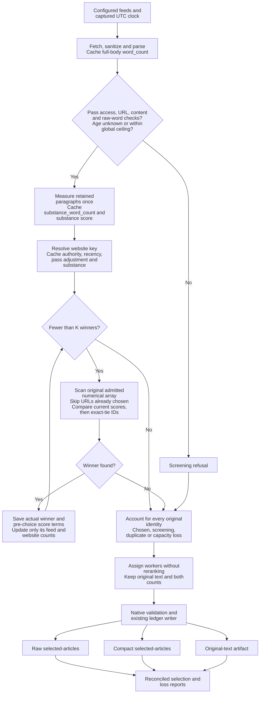

# Selecting an editorial portfolio

**Last Updated**: 2026-11-02

How does the isolated planner choose articles from the admitted batch?
It prepares one fixed score per eligible candidate, then chooses each next
article by scanning the complete numerical pool with the current feed and
website counts. The article limit is a maximum unique-URL count, not a source
allocation.

## Inputs and independent evidence

A **feed ID** identifies one configured feed, `sources[].id` in
`config/sources.json`. A **candidate ID** identifies one offered article in
one run. Several candidates can carry the same canonical URL. They remain
separate until one wins; the chosen candidate supplies the actual content.

Curation receives screened candidates, the effective global policy, the
captured UTC age clock and measured technical article-pass history. Source
authority uses only the configured `source.weight`. Feed lifecycle still
controls enrollment. Taxonomy, publisher exposure, topic labels and source
allocations are not selection inputs.

Resolve each candidate's website group from its validated canonical URL with
the configured private-suffix policy: use the registrable domain, otherwise
the lowercase hostname without a trailing DNS dot. Recompute this key
consistently; supplied hints cannot split or bypass its penalty. Every
eligible URL has a nonempty key. Curated `publisher_id` stays nullable metadata;
it is neither the feed nor the website count key.

The parser's required `word_count` counts the complete sanitized body.
Screening's required `substance_word_count` counts retained paragraphs only,
including measured zero, and must not exceed the raw count. Screening caches
the signed substance score once. The original body, raw count, extraction
evidence and full-body worker estimate stay unchanged. Neither count is
recalculated downstream. Paragraph and lexical rules belong to
[article substance scoring](article-substance-scoring.md).

## Complete selection flow



Cheap gates run before paragraph analysis. The admitted count is the complete
surviving pool, not a configured multiple of the requested limit. Unknown
age and measured zero retained words add no refusal.
[Harvest preflight](feed-harvesting.md) applies the same known-age policy
before article download when timing is available; [screening](feed-screening.md)
also checks independently parsed input.

## Fixed score preparation

Let `T` be the parsed batch's captured UTC evaluation instant in milliseconds.
Use trusted entry-level publication within `collect.max_future_hours`;
otherwise use recorded discovery `first_seen_at`. A trusted publication needs
no first-sight record. With usable timing instant `t`:

```text
age_hours = (T - t) / 3,600,000
eligible_age = age_hours == null OR age_hours <= age_ceiling_hours
freshness_cutoff_at = T - age_ceiling_hours * 3,600,000
```

There are 3,600,000 milliseconds per hour. The default global ceiling is
36 hours; equality passes. A run can supply one positive finite hours override,
resolved before fetching and reported with its origin. With no usable time,
`timing_at` and `age_hours` are null and timing is unknown. Do not use
`fetched_at`, `T` or selection time to manufacture age. Malformed timestamps
fail native validation. Preserve signed near-future ages.

The selected row keeps the same known/unknown age evidence and the UTC policy
cutoff for either case. The cutoff states the rule, not proof of freshness.
The separate selected `published_at` fallback uses selection start only after
admission; it never becomes age evidence or earns recency points.

For candidate `d`, fixed authority `A`, recency `R`, technical pass adjustment
`D` and substance `Q` give the base score:

```text
A = alpha * source.weight
R = age_hours == null ? 0 : recency_weight * (0.5 ** (max(0, age_hours) / half_life_hours))
p = passed / (passed + refused)                  # only complete measured history
D = !pass_enabled OR p == null ? 0 : -A * (1 - max(reliability_floor, p))
base = ((A + R) + D) + Q
```

`alpha` defaults to 1.0 score-point scaling of feed weight. Feed weights are
in the unit interval; equal configured weights use this same path.
Authority and recency coefficients are finite and nonnegative; the recency
half-life and global ceiling are finite positive hours. Reliability's floor
is a fraction from zero through one, and its adjustment is enabled by default.
Recency defaults to at most 0.6 points with an 18-hour half-life. Near-future,
zero-hour, 18-hour, 36-hour and unknown ages earn respectively 0.6, 0.6, 0.3,
0.15 and 0.0 recency points. Unknown age can win on other terms; it is not
proof that the article is recent.

`p` is the technical article-pass fraction over the configured 30-day window.
It counts original captures passing access, extraction, required fields and
the raw technical word check against those captures plus known
source-attributed technical refusals. Publication, age, category,
content-policy and selection losses do not enter the denominator.
Missing or incomplete coverage, a null fraction or a zero denominator gives
unavailable `p`, not a measured zero. Its numeric adjustment is 0.0, while
observed evidence stays null. With authority 1.0 and the default floor 0.5,
measured pass fractions 1.0, 0.8 and 0.0 give adjustments 0.0, -0.2 and
-0.5 points. Disabled adjustment gives 0.0 points.

RSS feed-read reliability measures productive feed reads, not article passes,
and does not enter this score. Failure streaks and lifecycle evidence govern
feed rest separately; see [feed history](planner-feed-history.md).

`Q` is retained length plus retained name/number density minus bounded
headline deductions. It is evidence of article shape, not factual
verification. Its lexical rules and configured curve are defined once on
the [substance page](article-substance-scoring.md#soft-length-and-density-points).
Cache `base` once from this evidence. No fixed component changes during
selection.

## Current score and exact choice

Let `n_website` and `n_feed` count prior winners for the candidate's resolved
website and feed across the complete selection. Missing counts mean zero:

```text
P_website = lambda_domain * (n_website ** 2)
P_feed = lambda_feed * (n_feed ** 2)
B_feed = n_feed == 0 ? novelty_bonus : 0
marginal = ((base - P_website) - P_feed) + B_feed
```

Defaults are `lambda_domain = 0.04`, `lambda_feed = 0.02` and
`novelty_bonus = 0.15`, all in score points. The bonus means first use of a
feed in this selection, not a historically new feed or a new story. A feed
can span websites, and a website can contain several feeds; the counters
are independent, not paired.
All three coefficients are finite and nonnegative. The positive integer
article limit `K` defaults to 100. [Policy settings](feed-ingest-policies.md)
name the configuration paths; none is a fixed source-share guarantee.

Table A - Pre-choice count effects

| Id | Article from the same key | Prior count | Signed website adjustment | Signed feed adjustment | First-use feed bonus |
| --- | --- | --- | --- | --- | --- |
| A1 | First | 0 | 0.0 points | 0.0 points | 0.15 points |
| A2 | Second | 1 | -0.04 points | -0.02 points | 0.0 points |
| A3 | Third | 2 | -0.16 points | -0.08 points | 0.0 points |
| A4 | Fourth | 3 | -0.36 points | -0.18 points | 0.0 points |
| A5 | Fifth | 4 | -0.64 points | -0.32 points | 0.0 points |
| A6 | Sixth | 5 | -1.00 points | -0.50 points | 0.0 points |

Keep the original admitted array unchanged. Each numerical record contains
only `candidate_id`, `url_key`, `feed_id`, `website_group` and finite
`base_score`. Start with empty chosen IDs, chosen URLs and count maps.
For each next winner:

1. Scan every original numerical record, skipping URLs already chosen.
2. Calculate the current score in the order above. Refuse non-finite results.
3. Keep the greater numeric score. If scores are exactly equal, keep the
   smaller candidate ID under direct ASCII comparison.
4. Finish the sweep, then commit that saved best record, its exact score and
   its pre-choice terms. Increment only its feed and website counts.
5. Repeat until `K` winners or no unseen URL remains.

There is no sorting, shortlist, heap, filtered array per choice or text
analysis in this loop. No tolerance, display rounding or locale rule defines
a tie. Do not clamp negative scores or stop at zero. Unequal bases can
produce exactly equal current scores: with shared prior feed/site counts of
ten and bases 1.0 and 1.0000000000000002, the specified native arithmetic
gives -5.0 for both. The smaller ID wins even if it has the lower base.

For `M` admitted records and `K'` winners, the scan inspects at most
`(K' + 1) * M` records, including a possible exhaustion sweep, and evaluates
at most `K' * M` scores. For 100 winners from 1,500 records, that is at most
150,000 numerical evaluations, not a measured runtime or admission cap.
Greedy choice proves the best next record under this rule, not the globally
best set or guaranteed topic/publisher shares.

## Worked choices and capacity

Suppose five unique candidates share feed/site A with weight 1.0 and one
unique candidate comes from feed/site B with weight 0.99. Set recency to
0.6 points and substance to 1.0 points for all, with reliability disabled.

Table B - Two choices from this pool

| Id | Step and candidate | Cached base | Website/feed deductions | First-use bonus | Current score |
| --- | --- | --- | --- | --- | --- |
| B1 | First: any A candidate | 2.6 points | 0.0 / 0.0 points | 0.15 points | 2.75 points |
| B2 | First: B candidate | 2.59 points | 0.0 / 0.0 points | 0.15 points | 2.74 points |
| B3 | After A wins: next A candidate | 2.6 points | 0.04 / 0.02 points | 0.0 points | 2.54 points |
| B4 | After A wins: B candidate | 2.59 points | 0.0 / 0.0 points | 0.15 points | 2.74 points |

An A candidate wins first; exact ties among A use candidate ID. The next
complete sweep chooses B, not the next record in initial base order.
The displayed decimals explain the choice; ranking preserves native values.

Let `U` be the number of distinct canonical URL keys among admitted records:

```text
chosen_count = min(K, U)
```

- **Full capacity:** with `K = 100` and at least 100 eligible distinct URLs
  from one feed and one website, choose 100, even after repeat penalties make
  scores negative. Soft diversity changes order, not eligibility or capacity.
- **Exhausted capacity:** with `K = 100`, 95 admitted identities and only
  90 distinct URLs, choose 90. The five other carriers lose as duplicates.
  Ten unused slots mean exhausted distinct eligible supply, not a source
  reservation, quality threshold or partition failure.
- **Duplicate carriers:** if the five A candidates in Table B instead share
  one URL, only the actual winning carrier changes counts. B still fills
  the second slot; the other four A identities remain for duplicate losses.

## Persistence and verification

One final pass over the original admitted population assigns each unchosen
identity a terminal loss. A URL already chosen gives
`REJECTED_DUPLICATE_CANONICAL_CARRIER`; otherwise it gives
`REJECTED_GLOBAL_CAPACITY_REACHED`. Duplicate loss takes precedence over
capacity loss. Screening keeps its own safety/content/raw-word causes and
`REJECTED_SCREENING_AGE_CEILING` for known age above the global ceiling.
Unknown age and measured zero retained words have no refusal cause.

```text
parsed_count = screening_rejections + chosen_count + duplicate_losses + capacity_losses
```

Join winners back by candidate identity, not the first matching URL.
The same winners supply metadata and the unchanged original-text artifact,
including both required counts. Partition only assigns workers; it cannot
backfill or rerank. The native writer validates and writes raw and compact
selected metadata. Reports reconcile original populations and complete losses.

Write the five finite signed adjustments in this order:
`article_pass_rate`, `substance_quality_score`, `domain_diversity_penalty`,
`feed_diversity_penalty`, `novelty_bonus`. Preserve numeric zero, including
unmeasured/disabled history; no domain adjustment is null.
Reconstruct the saved scores in this exact order:

```text
base_article_score = ((feed_authority_score + recency_score) + article_pass_rate) + substance_quality_score
marginal_score = ((base_article_score + domain_diversity_penalty) + feed_diversity_penalty) + novelty_bonus
```

The static adjustments already belong to base; adding all five adjustments
to it would count substance and reliability twice.
[Selected field definitions](../../reference/feed-planner-ledgers.md#b-selected-articles)
own output formats and current-format refusal.

## Design rationale

One global eligible pool fills every available unique-URL slot without
source reservations. Cached fixed evidence separates text measurement from
selection; the complete numerical scan avoids stale scores and extra queue
state. Soft absolute count penalties favor breadth without blocking a scarce
pool. Exact IDs settle ties independently of input order. Keeping every
original identity makes losses and selected content auditable without a
second selector or scoring ledger.

## See also

- [Screening](feed-screening.md)
- [Substance measurement](article-substance-scoring.md)
- [Policy settings](feed-ingest-policies.md)
- [Feed history](planner-feed-history.md)
- [Partitioning](feed-partitioning.md)
- [Planning completion](feed-ingest-audit.md)
