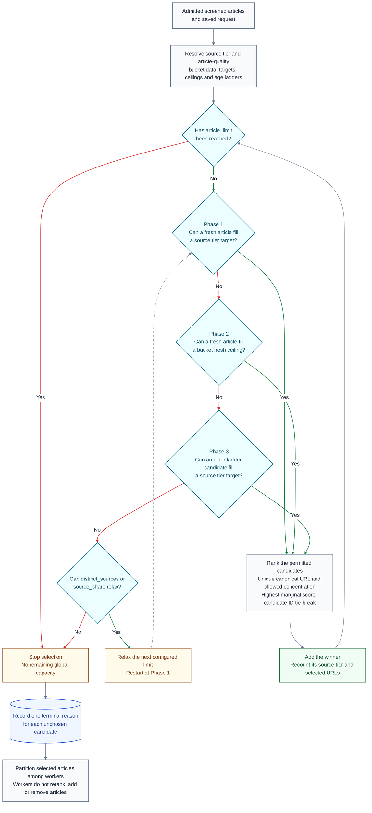

# Selecting an editorial portfolio

**Last Updated**: 2026-10-29

How does the isolated planner choose articles from the admitted batch?
It uses configured numeric rules and explicit factual evidence, not a model
or an inferred subject classification.

These rules supersede the earlier proposal to reuse Python ranking choices;
that proposal is not a separate unfinished selection requirement. The
production Python ranking path is unchanged, and further numeric priority
terms still need their own approval.

### Feed IDs, source kinds, source tiers and article-quality buckets

A **feed ID** is the stable name used in code for one configured feed. It is
the `sources[].id` value in `config/sources.json`, such as `abc-au-world`, and
is named `feed_id` in candidates, observations, health and selected rows. It
identifies one feed, not its quality, article-count target or age window.

A **candidate ID** is a transient identity for one offered article in one run.
It is not the feed identity and remains `candidate_id` throughout the planner.

The project uses four distinct concepts with related identifiers:

1. A **source kind** describes the publisher's role, such as Reporting,
   Announcement or Community. It comes from `source_kinds` in
   `config/taxonomy.json` and does not set a feed's authority weight or curation
   bucket.
2. A **source tier** identifies authority within the source registry. It comes
   from `source_tiers` in `config/taxonomy.json`. Current authority tiers are
   Institution, Trade press and Community, with weights 1.0, 0.6 and 0.3.
   A numeric source-tier ID is a stable key, not an authority rank or bucket
   priority.
3. An **article-quality bucket** assigns a share of the article limit and an
   age window policy. The documentation name is `article_quality_buckets`.
   The inner entry field `tier` uses the matching source-tier ID.
4. A **feed ID** identifies one feed entry. It is separate from the
   source kind, source tier and article-quality bucket.

This is why "Tier 1" is ambiguous. A 60-percent share and the source-tier
weight 1.0 belong to different calculations. High, Medium and Low are only
examples of article-quality bucket names; they are not current config labels.
The current implementation maps each numeric source-tier ID to a same-number
bucket entry, but that correspondence is an implementation detail. A bucket
does not change a source's tier or kind.

#### Table A - Current source tiers and matching article-quality buckets

| Id | Source-tier ID and registry name | Authority weight | Count target | Fresh ceiling | Allowed age steps |
| --- | --- | ---: | ---: | ---: | --- |
| A1 | 1 - Institution | 1.0 | 60% | 70% | 24, 36, 48 hours |
| A2 | 2 - Trade press | 0.6 | 30% | 35% | 24, 30 hours |
| A3 | 3 - Community | 0.3 | 10% | 15% | 24 hours |

## Inputs and independent evidence

Curation receives admitted candidates, their global effective policy,
publication or first-sight timing and current feed history. Publisher IDs
come only from the curated catalog. Parent domains, primary-document
identities and work estimates must be supplied as explicit evidence.
Unknown stays null; source titles and article prose do not fill it.

For article `i`, configured feed authority is multiplied by its feed weight and
applied source-tier weight:

$$
A_i = \alpha \, w_{\mathrm{feed},i} \, w_{\mathrm{tier},i}
$$

`alpha` is `curate_articles.source_authority_weight`; the other two values are
the configured feed weight and applied source-tier weight. The selected row
keeps the legacy field name `applied_tier_weight`.

The source's technical article-pass rate is:

$$
p_s = \frac{P_s}{P_s + F_s}
$$

`P_s` counts original captures from source `s` that pass access, extraction,
required fields and the minimum word count. `F_s` counts known,
source-attributed technical refusals: fetch failure, HTTP failure, extraction
failure, missing required fields, blocked or paywall content and minimum-word
failure. Publication, age, category, content-policy and selection losses do not
enter either count. When the configured adjustment is enabled and the rate is
known, it reduces only feed authority:

$$
\Delta_{\mathrm{pass},i} = -A_i \left(1 - \max(f, p_s)\right)
$$

Here `f` is the configured reliability floor. Incomplete evidence or a zero
denominator leaves the adjustment unavailable and does not change the score;
disabling it gives a zero adjustment. RSS feed-read reliability is separate.
Feed rest decisions use failure streak evidence. It is not a substitute for
`p_s` and does not add a second ranking penalty.

Publisher exposure is the known published count plus the current chosen count
for that publisher, divided by `L` and capped at one. If published linkage is
unavailable, only the current chosen count is used; an unknown publisher keeps
the term unavailable. Website-group exposure is the share of `S` already in
the candidate's group; an unknown group keeps that term unavailable. Their
weights are the configured `lambda_source` and `lambda_website_group`.

The marginal score for article `i` against the full selected set `S` is:

$$
M(i,S) = R_i + A_i + \Delta_{\mathrm{pass},i}
         - \lambda_{\mathrm{source}} E_{\mathrm{publisher}}(i,S)
         - \lambda_{\mathrm{website\_group}} E_{\mathrm{website}}(i,S)
$$

The recency contribution uses the original age in hours. A missing age gives
zero recency; near-future ages do not increase the bonus:

$$
R_i =
\begin{cases}
0 & \text{if age is unknown} \\
w_r \left(\frac{1}{2}\right)^{\frac{\max(0,a_i)}{h}}
& \text{otherwise}
\end{cases}
$$

`w_r` is the configured recency weight, `a_i` is the original age in
hours, and `h` is the configured recency half-life in hours.

The age is the trusted publication time, or first sight when that source date
is unavailable or outside the future-date tolerance. Unknown age contributes
zero. With the current values of 0.6 points and an 18-hour half-life, a
new article has 0.6 recency points, one 18 hours old has 0.3, and one 36 hours
old has 0.15. Near-future publication times get no bonus above age zero.

The two exposure values are:

$$
E_{\mathrm{publisher}}(i,S) =
\min\left(1,\frac{B_p + N_p(S)}{L}\right),
\qquad
E_{\mathrm{website}}(i,S) =
\begin{cases}
0 & \text{if } |S| = 0 \\
\frac{N_g(S)}{|S|} & \text{otherwise}
\end{cases}
$$

`B_p` is the known published count for publisher `p` on the current UTC day;
use zero when that history is unavailable, so only current selection
contributes. `N_p(S)` counts selected articles for `p`, and `N_g(S)` counts
selected articles in the candidate's website group `g`. An unknown publisher
or website group keeps its adjustment unavailable. These weights are
configured as `lambda_source` and `lambda_website_group`. The score chooses among permitted
candidates in the active article-quality bucket and age window; it does not
override article-quality bucket order.

## Article-quality bucket targets, fresh buffers and older deficits

The saved request's `article_limit`, or the configured default, is a positive
finite safe integer. `curate_articles.article_quality_buckets` declares each
article-quality bucket's share, additional fresh buffer and increasing age
steps. Configured list order sets bucket priority; numeric IDs do not. Shares and
source-tier weights have different jobs: shares set count targets, while the
applied source-tier weight multiplies feed authority in the score above. A
measured article-pass rate can change ranking inside a source tier; it never
moves a feed into another source tier.

For requested limit `L`, article-quality bucket `t` has an unrounded target and a fresh
ceiling:

$$
q_t = L \, \frac{\mathrm{share\_pct}_t}{100},
\qquad
T_t = \lfloor q_t \rfloor + I_t,
\qquad
C_t = \max\left(T_t,\left\lceil
L \, \frac{\mathrm{share\_pct}_t + \mathrm{buffer\_pct}_t}{100}
\right\rceil\right)
$$

`I_t` is one for each article-quality bucket receiving a remaining place: assign those
places to the largest fractional remainders of `q_t`, with configured
bucket order breaking ties. This makes the integer targets sum to `L`.
The ceiling adds the buffer as percentage points; it is not a guaranteed lower
bound. Older articles may fill `T_t`, but not the fresh buffer above it. Counts
come from `L`, not candidate supply. Shares sum to 100 percent, and each share
plus its buffer is at most 100 percent. The current percentages live in
[`config/feed-ingest-plan.json`](../../../config/feed-ingest-plan.json).
No fixed feed allowance or shortlist trims the complete input.

Choose fresh articles up to each target first, then remaining fresh articles up
to each ceiling. Only then open older steps for buckets below target. Older
articles fill targets, never buffers. Re-enter phase priority after each winner
or permitted relaxation, using the same full selected set and exposure counts.
Shortages do not authorize exceeding ceilings.

`article_limit` is a hard maximum, not a promise to produce that many articles.
An article-quality bucket deficit is the number of selected articles missing
from that bucket's target. It is not the difference between the total selected
count and `article_limit`. Fresh buffer articles can fill the global limit
while another bucket remains below target. A bucket cannot use older
articles after it reaches its own target.

The saved `freshness_hours` value is a run-level age override. It clamps every
configured age step to that value and removes repeated steps. It does not
replace a count target, buffer or ranking rule. With the current configuration,
24 hours leaves Institution at `[24]`, Trade press at `[24]`, and Community at
`[24]`. Institution cannot reach 36 or 48 hours; Trade press cannot reach 30
hours; Community has no older step. A larger override never widens a configured
step. Unknown-age candidates remain eligible in the base selection phase.

The `Feed ingest plan test` workflow defaults `freshness_hours` to `24`.
Leaving that default applies a fresh-only test run. Clearing the input or
omitting it in the API or CLI removes the override and uses the configured age
steps. The blank form value is not a request for the number zero.

The same workflow defaults `article_limit` to `100`, four workers, and
`bin-pack`. Its worker controls affect only partitioning after article
selection. The separate legacy feed collection input named `feed_max_age_hours`
has a 24-hour default too, but it belongs to the older feed collection script.
It does not change the TypeScript planner's configured count ladders.

The current implementation has no percentage-point margin such as plus or minus
five percent. It calculates exact integer targets and fresh ceilings. Actual
supply, duplicates, source limits and website-group limits can make the final
counts differ from those targets.

Article-quality bucket shares set article counts. They are separate from
ranking weights. The current TypeScript implementation uses each feed's
configured weight, its source-tier weight, recency, the technical article-pass
history and exposure penalties. Feed-read reliability and technical
article-pass reliability are separate measurements.

Canonical URL carriers stay available until one actually wins. A capped carrier
cannot remove a viable carrier from another feed. Identity breaks score ties;
labels and primary-document evidence buy no additional capacity.

The current configuration can be read in a concrete example. With an article
limit of 100, the count targets are Institution 60, Trade press 30, Community
10, and the fresh ceilings are 70, 35 and 15.

Suppose 55 fresh Institution articles, 30 fresh Trade press articles and 10
fresh Community articles are eligible. Phase 1 selects 95 articles in total,
so the Institution count is 55 and its deficit is five. Phase 2 finds no fresh
Trade press or Community buffer candidate. Phase 3 opens the Institution 36-hour
step. Five permitted Institution articles at 25 to 36 hours fill the remaining
five places, for a final 60 / 30 / 10 result.

With the 24-hour run override, the Institution 36-hour and 48-hour steps are
removed. The same fresh supply stops at 95. This is the expected result for
that run-level age restriction, not a failure to fill the bucket targets
available within the allowed window.

Suppose instead that five fresh Trade press buffer articles are available in
the last example. Phase 2 can select them, raising Trade press from 30 to 35.
Selection then stops at 100 because the global limit is reached. Institution
remains at 55 with a five-article deficit, but Phase 3 cannot use its older
window after the global limit is reached.

For a hypothetical policy labeled High / Medium / Low, a 70 / 20 / 10 share
means 70 / 20 / 10 targets out of 100. A five-point fresh buffer means fresh
ceilings of 75 / 25 / 15. This is an example, not current configuration.
Suppose 65 High, 20 Medium and 10 Low fresh articles are eligible. Phase 1
selects 95 articles and leaves High with a five-article deficit. If five Medium
fresh buffer articles are available, Phase 2 selects them and selection stops
at 100 with 65 / 25 / 10. If no fresh buffer exists but five permitted High
articles from the older window are available, Phase 3 selects them, leaving
the final count at 70 / 20 / 10.

### Selection flow

Screening first removes candidates that fail access, content, word-count,
publication-history or age checks. The selector below receives the admitted
batch, not a fixed shortlist.

Selection starts at Phase 1. Phase 1 fills fresh articles to article-quality
bucket targets keyed by source-tier ID. Phase 2 adds fresh articles up to the
buckets' fresh ceilings. Phase 3 uses permitted older ladder steps only to
fill a target, never a bucket's fresh ceiling. Phase order follows configured
bucket list order. Within a bucket and age window, the highest marginal score
wins, with `candidate_id` breaking score ties. Each permitted winner or cap
relaxation restarts selection at Phase 1. Duplicate URLs remain enforced.
The `distinct_sources` and `source_share` limits can relax in configured order;
the website-group cap does not relax. Selection stops at the global limit or
when no phase yields a permitted candidate.

An underfilled result is therefore not proof of missing backfill. Check the
saved age override, the deficient bucket's remaining age steps, eligible supply,
duplicate winners and concentration refusals. Worker count and `bin-pack`
only assign the already selected articles; they cannot fill a missing place.
The [implementation](../../../services/feed-ingest-plan/src/curate-article-portfolio/editorial-selection.ts)
owns this loop; [age and budget calculation](../../../services/feed-ingest-plan/src/article-freshness-policy.ts)
owns window clamping and count rounding.

## Marginal choices and concentration

Each choice recomputes remaining candidates against the actual chosen set.
The retained numeric adjustments cover article technical admission, publisher exposure
and website-group exposure. Website groups are recomputed from canonical URLs
using the configured private-suffix rule; supplied hints cannot override
them. Feed kind, form and other classification labels do not affect admission,
authority or ranking. An unavailable group or publisher produces a null
component, not a fabricated no-overlap measurement.

Configured source and website-group shares bound the planned count.
The minimum-distinct-source preference and source-share cap relax only in
their configured order. The website-group cap does not silently disappear.
Exploration reserves its configured final share, rounded down, for viable
feeds not yet represented. It bypasses no admission or cap.

The current TypeScript implementation uses two reliability measurements for
different jobs. They are measured at different levels. Feed-read reliability
measures the feed request result. Technical article-pass reliability measures
what happened to original article captures after fetch and extraction. They
are not interchangeable.

#### Table B - Reliability measurements

| Id | Measurement | Inputs and calculation | Persisted output | Current ranking use |
| --- | --- | --- | --- | --- |
| B1 | RSS feed-read reliability | A logical feed check counts once per feed and settled UTC day. A productive read has an `ok` outcome and at least one distinct offered URL. Skipped and robots-denied reads are excluded. `success_fraction = productive / attempted`. The RSS production factor is `max(reliability_floor, success_fraction)`. | In the `feed-health-state` ledger, under `reliability`: `productive`, `attempted`, `success_fraction`, `from_day`, `through_day`, `production_factor` and `complete`. The row also stores `feed_reads`, `items`, `outcome`, `availability`, `strikes` and `rested_runs`. | None for article ranking. Failure streaks and lifecycle state decide whether a feed is resting. The RSS success fraction and production factor are not article score terms. |
| B2 | Technical article-pass reliability | Original article captures and source-attributed technical refusals in the represented 30-day window. For one source, `article_pass_rate = admitted / (admitted + source_refused)`. Admission requires technical checks to pass. Publication, age, category, content-policy and article selection losses do not enter this denominator. The window, counters and article-capture records must be complete. | No separate raw `article_pass_rate` field is stored. The `feed-health-state` ledger stores the inputs in `article_candidates` and source-attributed article rows in `rejection_counts[]`. It is derived during selection. The selected-article ledger stores the resulting adjustment in `ratings.adjustments[]` with term `article_pass_rate`. | Enabled today. It reduces authority by `-authority * (1 - max(floor, pass_rate))`. The current floor is 0.5, window is 30 days and penalty switch is enabled. |

For example, one source has 80 percent technical article pass and another has
25 percent. With authority equal to 1.0 and the 0.5 floor, the first gets a
`-0.20` article-pass adjustment and the second gets `-0.50`. The 80 percent and
25 percent values are raw pass measurements. The negative values are the score
effect stored on each selected article; they do not replace the raw inputs or
the raw pass percentage.

The technical pass rate is derived on every relevant selection from stored
history. It is not updated from the selected article population itself after
selection. If it is incomplete, unknown or has a zero denominator, the
`article_pass_rate` adjustment is unavailable or `null`, not fabricated zero.
The `plan-runs` ledger records the reliability floor, penalty switch and 30-day
window used by that run.

### Publisher exposure adjustment

Genuine published and item-health evidence may link actual publisher
exposure for the current UTC day. Selected rows are never publication
evidence. Missing linkage uses the explicit current-selection fallback,
with a distinct recorded adjustment term. Unknown publisher IDs remain null.

## Persistence and verification

One chosen content population supplies compact metadata and the selected
text artifact. Each article retains its rank, actual base and marginal
scores, signed adjustments, source tier/weight, work estimate, timing and
the quota or exploration exceptions used. No full policy, assessment or
losing-score tree is copied.

`feed_limit` records the per-feed share limit computed from requested output.
`freshness_cutoff_at` records the admitted age window against the saved age
clock; unknown age has no invented cutoff. Every unchosen parsed candidate
receives one terminal metadata row in `rejected-articles`, after all permitted
phase changes and relaxations. Screening refusals precede numeric selection;
winning duplicates precede closed older windows, global capacity, distinct-feed,
feed-share, website-share and fresh-ceiling refusals, in that order.

Only the declared metadata projection is committed. Article text remains
in the separate artifact. [Table B](../../reference/feed-planner-ledgers.md#b-selected-articles)
owns the complete field list. Partitioning adds assignments without
reranking or replacing this selection.

## Design rationale

Compact contributions explain why a chosen article ranked where it did
without preserving a second classification or audit system. Known zero
and unavailable evidence remain distinct through JSON and Parquet readback.

### Configured priority review

**Adopted behavior, unchanged:** Keep the numeric selection described above,
including separate article-pass and publisher-exposure adjustments. This
review adds no score term, matcher, config default or persisted field.

Maintainers write watchlist aliases in
[`config/watchlist.json`](../../../config/watchlist.json), theme keywords and
weights in [`config/taxonomy.json`](../../../config/taxonomy.json), and Python
bonus amounts in [`config/idhazh.json`](../../../config/idhazh.json).
The Python [planning stage](../../../backend/idhazh/stages/plan.py) matches
whole-word phrases against feed headlines through
[`tag.py`](../../../backend/idhazh/tag.py), not article bodies. A configured
theme is called a lens in that configuration.

#### Table C - Compared priorities, not approved additions

| Id | Priority | Python behavior | Current TypeScript finding |
| --- | --- | --- | --- |
| C1 | Watchlist attention | Add 0.5 score points once when an alias of any non-retired entity matches; multiple matching entities do not add more. | The retained title is available, but no watchlist match is recorded or scored. An alias hit would show configured attention, not article quality. |
| C2 | Configured theme | Add only the largest positive weight among matched non-retired themes, not their sum. | Original feed categories are retained strings, not recorded matches to curated themes. No theme bonus or inferred classification is present. |
| C3 | Repeated canonical URL | Add 0.25 score points once when multiple carriers supply the same canonical URL; further carriers add nothing. | Feed IDs and URL identities are available before duplicate removal, but no carrier witness or bonus is retained. Repeated carriage measures syndication of one address, not independent reporting or story agreement. |

The [Python score](../../../backend/idhazh/rank.py) applies those rules.
The [current TypeScript selection](../../../services/feed-ingest-plan/src/curate-article-portfolio/editorial-selection.ts)
does not. Its [maintainer-authored config](../../../config/feed-ingest-plan.json)
sets the authority coefficient to 1.0 and the maximum recency contribution to
0.6 score points. Copying Python's 0.5 or 0.25 points can change selection;
those amounts are not neutral or approved TypeScript defaults.

The [candidate](../../../packages/common-contracts/src/schemas/candidate.schema.ts)
retains title, categories, article text and feed facts.
[Additional article evidence](../../../packages/common-contracts/src/schemas/planner-stage.schema.ts)
contains only parent domain, primary-evidence identities and estimated work.
Missing matches or carrier witnesses are not measured zeroes.
[Selected metadata](../../reference/feed-planner-ledgers.md#b-selected-articles)
records actual adjustments as `term` and `value`; accepting a term name does
not approve its meaning.

**Decision:** The priority review is closed with current ranking unchanged.
Watchlist, theme and repeated-URL inputs receive no extra priority. No new
term, matcher or default is approved or pending under this review.
Any future addition needs separate approval for its exact input and matching rule,
independent meaning, config maintainer and default, no-double-counting rule,
score evidence and current-reader-before-writer sequence. Front-page votes, inferred
classifications and a wholesale Python-ranking port are not authorized by
this comparison.

## See also

- [Screening](feed-screening.md)
- [Feed history](planner-feed-history.md)
- [Operator APIs](feed-operator-api.md)
- [Partitioning](feed-partitioning.md)
- [Planning completion](feed-ingest-audit.md)
