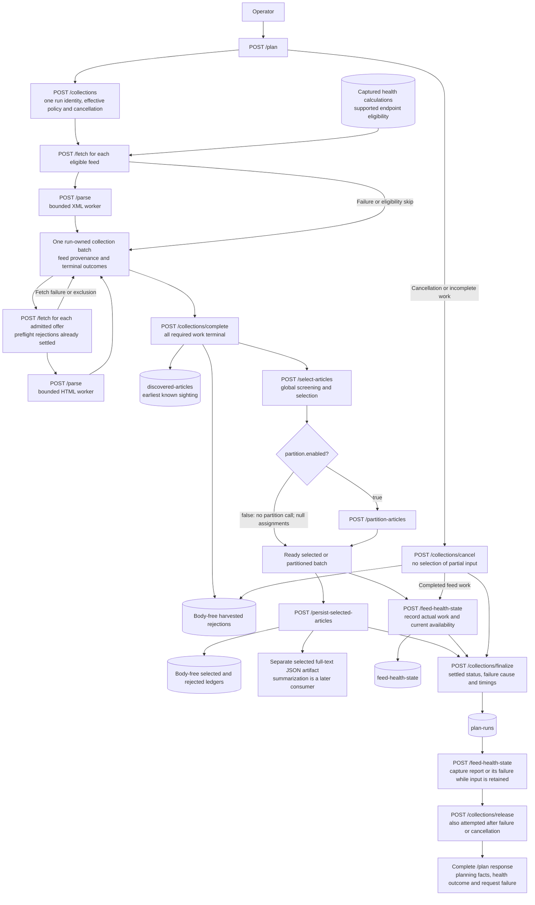

# Feed planning operator APIs

**Last Updated**: 2026-11-05

How do local requests fetch, parse, select, partition and persist content?
These are build-time operator APIs, not a server for the static site.
The sections below define each operation and its current request and response.
The feed workflow serves them with machine routes through the
[shared pipeline API server](../../reference/serve-pipeline-apis.md);
the delivery task restarts that application with its private delivery group.

## Independent fetch and parse endpoints

`POST /api/2026-11-05/fetch` accepts an active configured `feed_id` and
`fetch_item_type` (`feed` or `article`). A feed request uses its configured
URL. A direct article request also supplies its permitted operator URL.
These requests may name their owning collection with `traceId`.
An offered article instead supplies its captured `candidate_id` and exactly one
producing feed-parse reference in `links`; it supplies neither a URL nor a copied feed
identity. A direct request cannot choose a candidate ID. There is no
`offer_id` or `source_id` alias or caller-supplied file path.

The source fetcher uses native Impit with URL/name/literal-address checks,
redirect, retry, deadline, pacing and decoded-byte controls. It fetches only
feed and article targets, with no automatic robots retrieval or enforcement.
Its strict response
contains a reference and body-free outcome, not fetched bytes. A failed
fetch remains a typed failure. Article fetch responses include `article_id`
and the captured `candidate_id`. Feed responses include configured `feed_id`
and `document_id`, with no article or candidate field.

`POST /api/2026-11-05/parse` accepts
`links: [{ traceId, spanId }]`, naming exactly one completed fetch operation.
It claims that live input and checks its expected kind, configuration,
URL hash, byte limit and business ownership, then parses without any network call.
Missing or consumed references return HTTP 404. A reference already owned by
another parser returns HTTP 409. Malformed controls and invalid documents fail
explicitly. Parsing releases the original downloaded body on success or failure.

Feed parsing returns sanitized, body-free entries in the existing `offers`
array, each with `article_id` and its captured `candidate_id`, and its actual
operation reference. The feed result also includes configured `feed_id` and
`document_id`. Article parsing returns its own operation reference, `article_id`
and that same candidate, including on an extraction refusal. It does not depend
on feed classification labels. Returning these values does not let a caller
parse by copied article ID, candidate ID or URL instead of its held-fetch link.
Article parse responses include a body-free `warnings` array. The saved
observation retains actual extraction warnings, quality measurements, fetch
evidence and typed parse failures; successful parsing does not erase them.
Fetch each offer through its producing feed parse, then parse each captured
article. Concurrent article parses atomically update owned work and claims.
Each parse retains its own addressable result. Selection refuses incomplete
input, including a feed with pending offers. A completed collection produces
one global parsed result; a separate operator article URL can produce its
own parsed result. Unrelated documents are not silently combined.

Collection-owned feed parses return only pending admitted offers to the
planner. Preflight refusals remain in the completed collection's grouped
health counts; no article HTTP call is needed to settle them. Only terminal
download or extraction failures enter the article rejection ledger at this
stage. Standalone feed parses retain their existing public offer flow.

Combined planning and standalone document work prepare the same required
health fields before fetching. They do not read extra request-report days or
calculate historical spend during fetch/parse setup. Report-only evidence
cannot block those operations; current-run request recording remains active.
Selection and explicit health summaries calculate reports when their response
needs them, under the
[field-read contract](../../reference/feed-planner-ledgers.md#field-based-health-history).

## Identity and causes

Each live result is addressed by the execution identifier `traceId` and
operation identifier `spanId` of the work that produced it. A completed input
is passed in `links`; `parentSpanId` names enclosing work, not an earlier input.
The [shared identity contract](../contracts/identity.md#4-native-typescript-event-and-operation-metadata)
defines their encodings and standard trace headers. The listener captures an
incoming caller context and allocates its actual receiving operation.
Those headers are sent only to controlled listeners, never source hosts.

Combined planning keeps its captured run number. An independent document chain
derives its numeric run number from its execution trace; it does not reuse the
listener's planning run.

Retry attempts are children of their actual fetch. Parsing links that completed
fetch; an offered article fetch links its producing feed parse. A parser worker
executes and returns the parse context allocated before dispatch, without a
second message identity. Shared trace context does not grant permission:
expected result kind, active or consumed state, configuration, offer membership
and claim, run and writer attempt are checked separately.

The [resource identity contract](../contracts/identity.md#typescript-resource-addresses)
defines `article_id`, generic `document_id` and the retained storage key.
`candidate_id` names a
[captured article input](../contracts/identity.md#typescript-captured-article-inputs),
not that address. Feed inputs retain their original ordinal; direct inputs
use null. Held article documents, their observations and private diagnostics
carry the same captured candidate; feed documents carry null. Publisher IDs
remain curated or null.

Article and feed-document hashes use the
[native resource address rule](../contracts/identity.md#typescript-resource-addresses).
Canonical addresses keep their query bytes and omit fragments. The initial
request uses the hashed address; checked redirect destinations do not replace
that identity. Source-address safety and live-reference ownership remain
separate checks.

Transient work facts retain actual UTC operation times and request attempts.
They feed grouped health counters, not a committed per-operation history.
Public responses, progress and commit manifests contain no article bodies.
The downloaded body remains private in memory for its one parse operation.
Extracted article text continues through selection and its separate artifact.

Unexpected failures retain one shared
[safe execution projection](planner-run-diagnostics.md#safe-execution-context)
through API refusals, logs and the run report. Missing source locations stay
unavailable; later cancellation or cleanup cannot replace the original cause.
Article parsing also prepares the separate
[private entity file](planner-run-diagnostics.md#recognized-article-names)
without adding names to HTTP responses or progress logs.

## Structured operation logs

Standalone fetch, parse and persistence use the same structured publisher
as `/plan`. Progress uses a shared event envelope with a fresh occurrence ID
and application fields under `data`; reading a saved event preserves its
original occurrence and operation. The configured planner source is loaded
explicitly from `config/typescript-event-sources.json`.
Invalid controls that
cannot resolve a document do not log caller-supplied addresses.
The [runner](feed-plan-runner.md#first-sight-and-retained-output) owns event
fields, failure-only article addresses and elapsed-time meaning.

Terminal article diagnostics use
[`ArticleFailureDiagnosticSchema`](../../../packages/common-contracts/src/schemas/article-failure-diagnostic.schema.ts).
The existing `planner.progress` envelope retains its event version and configured
source. Failed `fetch`, `parse` or `quality` data contains the actual run;
details contain its positive attempt, feed, captured candidate, address hash,
`harvest-feeds` stage, native reason and complete `HarvestDiagnosticsSchema`.
The publisher validates this subtype before generic detail cleaning and quality
subset checks. It adds neither a publisher identity nor a duplicate quality
object.

The diagnostic retains native failure codes, extraction warnings and versions,
timings, pacing, byte-limit facts and all measured quality fields. Unmeasured
facts stay null; measured zero stays zero. Available response evidence keeps
only the MIME type without parameters, byte counts and request profile.
Selected headers and truncated-header names are empty. No article text, HTML,
title, address, header value, arbitrary exception message or stack enters this
projection. Standalone parse retains these available fetch facts from its held
document without inventing a fetch duration. Native HTTP results are unchanged.

## Live document lifetime

The listener holds current fetched documents under their producing
`traceId` and `spanId` pair.
It claims each reference before parsing and removes it when parsing ends.
Failed fetches release their raw input when fetch handling ends. Active
references are never evicted; configured capacity bounds concurrent handoffs,
not the offered article population.

Collection admission reserves one retained-stage slot for its parsed input.
Its parse references share immutable candidate and offer versions, while each
reference keeps its captured membership, work counts and operation metadata.
Reading a reference assembles the same native parsed payload; later collection
work cannot change that captured result. Completion and cancellation use the
same reservation, so neither needs a free slot for another copy of the input.
Standalone parsed results and materialized selection or partition results
still consume their own slots.

Admission refuses a new collection before loading its input when all slots
belong to active work. Release makes the collection's parsed references
eligible to expire together, never as another run's results. An outstanding
fetched document continues to protect its own run from expiry.

Run state keeps body-free work facts, source outcomes and original UTC
observations. Health and selection read this live state and retained ledgers.
Releasing a body does not erase warnings, partial request counts, rejected rows
or grouped causes, and later parsing cannot move earlier fetch work to its own
UTC day.

There is no request journal, completed fetch/parse/plan response cache, reopening
loader or automatic re-execution. A new process cannot recover old references.
Submitting a URL again creates new work with another candidate, even when its
address hash is unchanged. The UUID does not reopen a consumed reference.
Reusing an owned live operation returns HTTP 409. `Idempotency-Key` on plan,
fetch or parse is unsupported and returns HTTP 400 before work.
Selection still creates a fresh result that can continue through partitioning
and persistence.

## Failure-only raw document artifact

The optional diagnostic contains body-free metadata for a failed input,
with its recorded fetch facts. It contains neither downloaded bytes nor
extracted article text.
`dump_raw_document_contents` in `config/feed-ingest-plan-service.json` defaults
to false. When enabled, the planner appends validated failed-document metadata to
`inputs.artifact_root/<run_id>/<attempt>/raw-document-contents-<UTC-day>-<numeric-run-id>-<attempt>.jsonl`.
The run and attempt determine the path, never downloaded text.

Each compact JSONL record uses
[`RawDocumentFailureSchema`](../../../packages/common-contracts/src/schemas/raw-document-failure.schema.ts):
`schema_version`, `document_kind` (`feed` or `article`), native operation metadata, the
observing `operation` (`fetch` or `parse`), actual UTC `failed_at`, the reported
`failure_reason`, and the validated metadata `document`. The body field,
text samples and repeated run identity are absent, not null placeholders.
The filename carries UTC day, numeric run and attempt; observations keep hashes,
operation relationships and complete ordered attempts without nested `run_id`.
The outer metadata identifies the actual failed fetch or parse, not a copied
input operation. Article document metadata and its observations retain the
captured candidate; the corresponding feed fields are null. Both document kinds
use `document_id`, with matching fetch and attempt observations. The original
input is validated before diagnostic URL redaction; a redacted address is not
a replacement hash input.
Response evidence and addresses follow the
[diagnostic contract](feed-failure-diagnostics.md). An unresolved request has only its existing body-free
error handling.

One live writer serializes appends and creates the file only on the first
failure. It is drained and closed before the completed file goes separately to
the artifact-directory delivery destination. Only that exact diagnostic target
is permitted. No expected file checksum is supplied.
The [manual workflow](../../how-to/run-feed-ingest-plan-test.md#manual-controls)
uploads it separately only when enabled and present, including after failed
collection, and waits for upload confirmation before cleanup.

No raw document is archived or retained to diagnose a later failure.
There is no refetch, replay, extracted-text substitute or diagnostic reader for
execution. Raw content never enters normal HTTP responses, logs, Git delivery,
selected metadata or public pages. Request headers and credentials are not
record fields. Append, close, preparation and upload errors remain explicit;
they do not erase the document failure or completed normal output.

## Selection, partition and persistence APIs

Each stage input contains exactly one producing-operation reference in `links`.
The listener resolves that pair against the required result kind. The configured article limit bounds
output, never the number of input candidates.
Selected HTTP metadata exposes `article_id`, not storage `url_key`, and never
includes article text. Other metadata is unchanged, including `canonical_url`;
the combined summary's optional URL setting does not remove existing stage
metadata. Selected metadata includes `published_at_source`. A trusted source time uses
`source`; otherwise the actual saved selection-start UTC instant uses
`selection`. This fallback is output metadata, not a new age or admission
input. The [ledger reference](../../reference/feed-planner-ledgers.md#b-selected-articles)
owns the [current-format refusal rule](../../reference/feed-planner-ledgers.md#typescript-current-format-refusal).

Table A

| Id | Operation | Input and result |
| --- | --- | --- |
| A1 | `select-articles` | Accepts a complete global parsed result; returns its own operation metadata, metadata-only articles, grouped exclusions, request report and exact `selection_started_at_utc` and `evaluated_at` UTC timestamps. No fetch, model call or automatic health write. |
| A2 | `partition-articles` | Accepts a selected result and optional configured strategy/count; returns its own operation metadata, assignments and estimated work without reranking. |
| A3 | `feed-health-state` | Accepts a live document or stage reference and explicit `summarize` or `record` action, defaulting to record; returns its own operation metadata, saved and updated health calculations, partial evidence, request spend, `reliability.window_days` and actual receipts when saved. No availability state file or new addressable health result kind. |
| A4 | `persist-selected-articles` | Accepts a partitioned result, or a selected result when partitioning is disabled; writes selected and rejected metadata plus the selected text artifact, returning its own operation metadata, exact relative paths, `rejected_files` receipts even for zero-selected results, and a standalone run outcome where applicable. |
| A5 | `collections` | Starts one collection per caller-preallocated execution trace with validated planning controls. Returns its actual operation metadata, captured UTC business context and configured feed IDs, not article text. |
| A6 | `collections/complete` | Accepts `traceId`; refuses until every required feed and offered article has a terminal outcome. Drains owned work, saves discovery and harvested-rejection evidence and exposes a complete global parsed result under the actual completion operation. Its links name the contributing parses. Repeating completion reuses that completed result. |
| A7 | `collections/cancel` | Accepts `traceId`; cancels and drains owned work and prevents selection. Returns harvested-rejection receipts and the actual cancellation reference for explicit partial-health recording. |
| A8 | `collections/finalize` | Accepts `traceId`, measured collection timing and safe orchestration failure context after stage writes settle. Drains owned work and both private diagnostics, then returns state-based status, retained failure context and timing snapshot. |
| A9 | `collections/release` | Accepts `run_id` and `attempt`; releases a finalized collection after dependent live reads finish. This does not erase written files. |
| A10 | `collections/exists` | Accepts the preallocated `traceId`; reports whether that collection is held after an ambiguous startup response. Existence alone does not grant ownership. |

Orchestration consumes the validated selection and partition response metadata,
not their text-bearing batches. Selection returns its saved timestamps without
creating new instants. Partition returns metadata with worker assignments,
strategy, dispatch count and work estimates. The selected text stays private
through these stages and reaches only its existing separate artifact writer.
The [runner controls](feed-plan-runner.md#entry-points-and-controls) define the
combined `/plan` request, selected identities and optional readable URLs in HTTP,
CLI and saved summaries. They do not add another selection or persistence path.

Each finalized execution is immutable. A fresh result must not overwrite a
prior artifact or double-count its HTTP work. Repeating the same finalized
result returns its existing business receipt under the actual persistence
operation's metadata; it does not invent another write.
The removed `persist-dispatches`
endpoint has no alias and returns ordinary HTTP 404.

## Safe-persist HTTP delivery

`POST /api/2026-11-05/safe-persist-data` calls the existing verified metadata
adapter and `safe_persist_data`, not another Git implementation. Its strict
request contains `runNumber`, `attempt` and `paths`, the exact completed paths
relative to the run's state directory. The response retains the existing
`status`, `commit`, `files` and `paths` receipt without changing its saved shape.
No article body, credential or delivery setting enters the request.

The runner checkout and private startup pipe supply the repository and temporary
output directory. The existing adapter still checks execution identity and
completed files, reads registered paths, and loads the committer and retry
settings from committed configuration. HTTP adds no permission or identity
system.

Always-run finalization owns a separate delivery child because collection has
already closed its planner child. The delivery child needs no live planner batch
or collection inputs; completed partial metadata remains deliverable after
planner failure. It reuses the configured listener and supervision limits,
checks owned-child readiness through `/health`, and closes and reaps that child
after success, failure or cancellation. Cancellation known before finalization
skips new Git delivery.

After native result validation, `safe_persist_http_completed` records the
request's run number, attempt, native status, nullable commit and file count,
plus its complete receiving-operation `context`. The handler emits the same
context it allocated from the incoming trace headers; it does not allocate
another operation for logging or use the server's supervision operation.
The [shared identity contract](../contracts/identity.md#4-native-typescript-event-and-operation-metadata)
defines that context and its carrier.

[`SafePersistHttpDiagnosticSchema`](../../../services/feed-ingest-plan/scripts/safe-persist-http-diagnostic.ts)
owns this strict current-only relay shape and derives request/result field
validators from their native authorities. Paths, process IDs and arbitrary
fields are not diagnostic fields. The
[server writer](../../reference/serve-pipeline-apis.md#diagnostics-and-current-task-evidence)
retains these facts and context in a separate completion event, not a lifecycle
payload. The native HTTP result and saved `delivery-result.json`, including
their exact paths, remain unchanged and remain the delivery authority.
The API and client use the existing `writeJsonLine` helper to write one JSON
object per stderr line.
`safe_persist_http_failed` and
`safe_persist_http_client_failed` identify server and transport failures without
article bodies. An unconfirmed response or failed child shutdown records a failed
receipt, not a successful one. Report generation and artifact preparation still
run independently; [the workflow guide](../../how-to/run-feed-ingest-plan-test.md#saved-output-and-failures)
defines recovery and upload behavior.

## Markdown rendering API

TypeScript callers can render a validated planner result without starting an
HTTP request. Import `renderPlanMarkdown` from
`@idhazh/feed-ingest-plan/markdown`; it accepts the complete Plan response
including its required `health` outcome, an optional captured article maximum, a pre-rendered policy fold
and host table rows, then returns Markdown and actionable warning notices.
Run outcome and Needs attention remain visible; detailed evidence is folded.
It performs no network or file access and is a
package API, not an HTTP route.
Callers supply captured failure evidence explicitly. Only the file-reading
adapter can establish whether a named log is missing; a pure renderer cannot
infer log availability from the HTTP result.

The manual workflow uses an adapter to write that Markdown to its job summary
and turn warnings into workflow annotations. Its finalization task first calls
the safe-persist HTTP endpoint, then renders the report before the artifact
upload. The delivery receipt stays separate from the rendered report; the pure
renderer does not commit or upload files. This workflow presentation is not
the production digest renderer; production can choose a reader-facing format
without changing the planner API.
The adapter appends per-feed exclusion diagnostics to the existing Markdown
artifact only; they do not return to the main summary.
Rendering, exclusion diagnostics and earlier paused-feed evidence all use the
successful report in `response.health`. A missing or unwritable separate
`health.json` does not replace that saved report. Failed health and unavailable
health remain distinct from a successful empty report.

The adapter also reads terminal article diagnostics from only the distinct
filenames returned by the existing named server-evidence reader. It checks the
explicit or saved run and attempt, plus the captured execution trace when
available. Captured candidate, feed, address hash and reason must agree with
saved rejection evidence. Identical repeated records count once; conflicting
records fail explicitly.

Needs attention names each available typed cause. A folded detail block retains
the complete safe events. Missing identity, missing or partial mirrors and
malformed lines produce evidence-gap notices; complete valid records from a
partial log remain usable. Evidence is collected before error-response returns
and also with explicit run and attempt when no response was saved. Missing
planning or health is never presented as success. Health remains the aggregate
authority; log-only missing-title evidence is not an extra health failure.

Planner transport tests may open an
ephemeral loopback-only listener and call its HTTP APIs. This proves actual
transport without allowing external network access; source responses remain
recorded fixtures. The exception does not permit live source fetching in tests.

## Request flow

The diagram shows every stage HTTP call made by
`POST /api/2026-11-05/plan` on its trusted local listener. Every stage call
uses actual loopback HTTP; no in-process transport substitutes for it. Selection
uses the run's captured calculations and actual completed work but does not
write health. The
`feed-health-state` request can summarize or record a held operation result.
The workflow HTTP client checks `/health`, then calls `/plan`. That one planning
request captures the actual health summary and releases its collection before
replying. It uses the selected result when available, otherwise the completed
global parsed result. Cancelled-only partial work is not a completed report
input. The
[workflow entry](feed-plan-runner.md#entry-points-and-controls) supervises a
separate server child. Parsed, selected and partitioned results remain in memory
until the request finishes its report attempt and release. A restart does not
restore those references. The workflow
checks health against its expected child and run identity before sending work;
ordinary `--serve` health remains an availability and enablement check.
Startup controls pass only through the private process pipe, never HTTP paths.

`/collections/finalize` does not release the collection. Cancellation first
aborts and drains every owned document request before it snapshots rejection
and health evidence. Raw-document diagnostics also finish before final status
and timings are returned. The status is `completed` without a failure cause;
with a cause, it is `partial` only when a work row has a feed check, otherwise
it is `failed`. The request's final release makes completed and cancelled collections eligible
for the existing bounded capacity rules. Direct stage callers still release
their own finalized collections explicitly.

The HTTP body, direct CLI output and saved `response.json` use the same model.
Required `health` is the actual successful summary, an explicit report failure,
or null when no completed input exists. A report failure makes the whole request
fail. A later report or release failure does not change planning counts,
assignments, receipts, measurements or the saved run row.
HTTP 200 requires completed planning and no request failure; an available
business result with a request failure uses HTTP 500 in that same model.
Validation or an error before a business result exists uses the safe error
response. Both CLIs fail for request failure even if planning completed.
Release does not reuse an aborted caller signal. The terminal plan event and
response follow the report and release attempts, including their failures.

Article fetch and parse requests can overlap and update the same batch.
Parsing retains earliest first-sighting facts in `discovered-articles`.
Selection uses the discovery evidence in the parsed batch and reads current
feed, publication and settled item-health evidence. The
[ledger reference](../../reference/feed-planner-ledgers.md) defines each saved
ledger. A completed `/plan` run writes the same ledger and artifact families;
a partial run records only the work it finished.

## Design rationale

Server-owned offer references preserve a complete public feed-to-article
flow without granting fetched prose authority over paths or later requests.
Shared bounded parsing capacity keeps the listener responsive while real
HTML extraction runs. A live claim protects each fetched reference without
serializing all runs. Removing that reference after parsing avoids retaining
successful downloads as hidden execution state.
Charging each collection parse as another retained full batch would turn the
storage limit into an article ceiling. Shared immutable input with captured
per-operation work preserves addressable results without making collection
completion compete with its own articles for storage.
The Plan API does not collect per-document CPU or RAM profiles. These samples
do not change fetch, parse, selection or persistence results; host fingerprints
remain separate ledger records.
The Markdown renderer is a pure package function, not another HTTP route:
formatting needs no service call, workflow annotations stay in the workflow
adapter, and production can choose a separate reader-facing presentation.
Current-only diagnostic readers and writers change together. Same-run logs
explain a saved failure without extending native responses, retained ledgers
or the population eligible for publication.
A single complete response keeps report capture and live input release inside
the request that owns them. Saved operation metadata explains where output
came from; it cannot reopen input or require a later client continuation.
Final delivery gets its own short-lived child so a stopped or failed planner
cannot prevent completed metadata from reaching the unchanged Git engine.
Both children use the same private-pipe shutdown and exact-process reaping code.

## See also

- [Runner](feed-plan-runner.md)
- [Harvesting and trust checks](feed-harvesting.md)
- [Article selection](feed-curation.md)
- [Planning completion](feed-ingest-audit.md)
- [Host probe APIs](../../reference/host-probe-api.md)
