# Feed planning operator APIs

**Last Updated**: 2026-10-24

How do local operator requests fetch, parse, select, partition and persist
content? These are local build-time APIs, not site services.
The existing [runner](feed-plan-runner.md) owns listener setup and enablement.

## Independent fetch and parse endpoints

`POST /api/2026-10-20/fetch` accepts a JSON object with `request_id` and
`correlation_id` as UUIDv4 strings, `source_id` naming an active configured
source, and `kind` as `feed` or `article`. A feed fetch uses that source's
committed URL and refuses a supplied URL. An article fetch requires `url`,
an operator-owned HTTP or HTTPS control. It optionally accepts
`caused_by_event_id`, a UUIDv5 observation that caused this request.
Unknown controls fail. No request field names a filesystem path.

The fetch uses the same DNS validation, pinned sockets, robots permission,
redirect checks, byte limit and retries as `/plan`. Its response includes
`fetch_request_id`, the canonical URL, `article_id`, body digest, fetch status,
attempt evidence and observations. It never returns the raw body. A failed
fetch is a recorded outcome, not successful content.

`POST /api/2026-10-20/parse` accepts only `request_id`, `fetch_request_id`,
`article_id` and `correlation_id`. It reads that one completed fetched
document from the configured output root. It checks URL identity, body
digest, byte bounds, source, run and correlation before parsing.
Missing receipts return HTTP 404. Failed fetches return HTTP 409.
Mismatched identities return HTTP 400. Damaged receipts fail explicitly.
The response contains `kind`, `parsed`, `failure`, its fetch request identity
and its new observation. RSS and Atom produce sanitized discovery entries;
HTML produces sanitized article prose, title, author and paywall evidence.
Malformed content remains a typed failure with no invented parsed result.
Parsing makes no network request.

The parser and permitted fetch stage are shared with the existing `/plan`
and CLI composition. Parsed feed links remain discovery data: the existing
validated discovery flow, or an explicit operator request, must authorize a
later fetch. Page content, canonical tags and extraction results never select
a destination. The listener has no authentication; keep it loopback or in an
operator-protected build environment.

## Identity and causes

`article_id` is the existing canonical URL hash, called `url_key` on later
candidates, selections and dispatches. It stays unchanged through fetch,
parse and later stages. The existing run/source/ordinal `candidate_id`
identifies an offered entry, not a different article identity.
`correlation_id` connects observations from the same work. Parse inherits
the fetched run ID even when requested on a later UTC day.

Each fetch, parse and network/DNS attempt has a distinct UUIDv5 `event_id`.
Parse's `caused_by_event_id` names its fetch observation; each attempt names
its containing fetch observation. A fetch may name an earlier observation.
Event IDs derive from correlation, request key, operation and attempt sequence,
not response text. Replaying a completed request returns the same IDs.
`/plan` emits the same document and attempt observations in live progress;
its existing audit and progress IDs retain their own separate namespaces.
Each actual feed parse emits exactly one parse observation, including empty
and malformed feeds. A refused fetch does not claim a parse attempt.
All recorded instant strings use UTC with `Z`.

## Durable replay and interrupted requests

The operator APIs write `planner-operations.sqlite` under `outputRoot`, the
same operator-configured root that holds native planner output.
Pydantic's `PlannerOperation` and `FetchedDocument` declarations own the
stored records; small Zod copies are bound by the existing native contract
comparison. Original date-only receipts remain readable with their original
version and exact response bytes. Missing retry wait measurements read as
null, not zero; new receipts carry the dated compatible revision.
The SQLite table and fixed filename are storage protocol constants.

The indexed request key is global across fetch, parse and keyed plans.
The input fingerprint hashes validated JSON in schema field order. The
configuration fingerprint hashes the effective harvest fingerprint, service
settings, UTC/history settings, ledger settings, registrations and checkout
commit. Reusing a key with different input, operation or configuration returns
HTTP 409. A parse also refuses a fetch made with different configuration.
No runtime environment variable selects an artifact path or destination.

SQLite's full synchronous commits retain the captured run, correlation and
UTC start before work, then atomically commit the private artifact and exact
HTTP response together. Completed requests replay after listener or process
restart without fetching, parsing or writing more ledgers. One write
transaction owns work at a time across processes. Concurrent callers receive
HTTP 409 `REQUEST_BUSY` and retry the same key; they do not start duplicate
work. SQLite recovers an interrupted transaction on reopen.
After the captured-identity commit, the next write lock re-reads and validates
the request before doing work. If another process completed it between locks,
the second caller returns that completed response instead of repeating work.

A fetch or parse interrupted before its final commit resumes with its original
captured identity. An external fetch can therefore occur again after a crash,
but no completed artifact or response is duplicated. Exactly-once network I/O
cannot be promised across a process crash. Completed failed fetches replay
their failure; a deliberate fresh observation needs a new request key.

`POST /plan` remains compatible without a key. An optional UUIDv4
`Idempotency-Key` header adds the same completed-response replay. A keyed plan
interrupted after starting returns HTTP 409 `REQUEST_INCOMPLETE`, rather than
silently repeating potentially durable ledger writes. Inspect that recorded
run and its receipts before submitting new work. The CLI remains unchanged.

Records have no automatic expiry: retention lasts until the operator removes
the named store while the listener is stopped. Keep it for as long as request
keys or fetch receipts may be reused. Removing it deliberately ends replay
protection and makes its fetch references unavailable; do not reuse old keys.
No history walk, empty-day fabrication or receipt restamping occurs.

## Optional task profiles

The separate [whole-task instrument](../../reference/host-metrics.md#whole-task-typescript-samples)
can profile actual fetch and parse work. The ordinary listener loads
`config/host-probes.json`; the task instrument, PID RAM and machine RAM switches
all default off. PID RAM and machine RAM are independent when the instrument
is enabled. The canonical poll requests one observation each second throughout
actual work, not a one-second profiling cutoff. Embedded callers
can pass `PlanRuntime.task_profiling` with validated controls and a report
callback. An absent callback configuration leaves profiling out. The ordinary
listener writes enabled profiles as structured stderr records, never into the
HTTP response, fetched artifact or SQLite record.
The separate [host-probe task API](../../reference/host-probe-api.md)
provides operator-owned HTTP start and stop controls for explicitly pinned
processes. Its standalone `GET /sample` remains independent. These controls
belong to the host probe, not these fetch/parse routes or their replay rules.

Fetch starts measurement only after the active source and operator URL pass
validation. Parse starts only after its completed fetch, configuration,
article identity, correlation, body digest, body bounds and source pass their
checks. Completed replay, key conflicts and these input refusals create no
actual-work profile. A transport, safety or parser failure after work starts
can create an error profile. Typed fetch and parse failures still keep their
existing response behavior.

The profile uses the journal's captured run, correlation and request identity;
its observation clock is real UTC, not the captured planning clock. A report
callback receives only the locally validated resource metadata. Profile
controls stay outside the durable configuration fingerprint, so changing these
runtime controls does not invalidate a completed response or create a new
request. No ranking, selection, article text or source-status rule changes.
Unexpected collection or callback errors fail explicitly and do not commit a
successful response. As with any interrupted fetch, retry can repeat unfinished
external work.

## Conditional requests are excluded

This API keeps ordinary feed fetching. It does not send validators, cache feed
bodies for reuse or handle `304` responses. Repeated polls can transfer the
same body again, using more network bytes and time. Reducing that cost needs a
separate owner-approved design and replay contract.

## Selection, partition and persistence APIs

All routes use the existing `/api/2026-10-20` prefix. `/plan` is the full-flow
trigger. Its orchestrator calls the same operations as the standalone routes;
it does not issue HTTP requests to its own listener.

1. `/fetch` retrieves one configured feed or an explicitly authorized article.
   It returns its fetch identity and outcome, not the body.
2. `/parse` parses one completed fetch. In the full planner, the shared harvest
   operations finish all permitted fetch/parse work before writing one complete
   parsed-batch snapshot. This includes the original candidates and rejection
   evidence for failed items. Standalone `/parse` remains per-document; it does
   not guess when unrelated requests form a complete batch.
3. `/select-articles` accepts `{"batch_id": "<parsed-batch UUID>"}`. It screens
   eligibility and ranks eligible articles within this one API. It reads the
   complete saved batch, without article lists, caller paths or a separate
   input-count limit. It returns the new selected `batch_id`, `parsed_batch_id`,
   run and correlation IDs, existing selection rows, typed `exclusions`, and
   the selection/rejection write results. `publisher_history` records the UTC
   day, availability and named evidence gaps, including for an empty selection.
   The [publisher preference](feed-curation.md#publisher-exposure-adjustment)
   uses confirmed recorded identities and keeps missing publication history
   explicit. It does not fetch or call a model.
4. `/partition-articles` accepts `{"batch_id": "<selected-batch UUID>"}` with
   optional `strategy` and `shards`. Strategies are `bin-pack`, `round-robin`
   and `none`; omitted controls use the committed partition configuration.
   Worker counts must meet its existing bounds; `none` requires one worker.
   The result contains a new `batch_id`, `selection_batch_id`, run/correlation,
   strategy, worker count, per-worker estimated work and unchanged selected
   content with worker assignments. It does not rerank articles.
5. `/persist-dispatches` accepts `{"batch_id": "<partitioned-batch UUID>"}`.
   It checks the saved assignments against the original selection and content,
   then uses the registered Parquet writer. The response contains `batch_id`
   and `files`, with explicit `written` or `empty` status. Each written file
   names its relative path, file/unit identities, UTC period, row count and
   content digest. A failed write is an error, not an empty success.

The configured `article_limit`, currently 100 articles, bounds selected
output only. It does not cap the number of candidates read from a batch.
Selection has no idempotency key or request replay: another selection call
creates another result identity, even when its selected rows are unchanged.
Existing fetch/parse replay is unchanged.

### Numbered API flow

The arrows below carry validated payloads between the operations that `/plan`
shares with the HTTP routes. The planner seals the complete parsed batch after
harvesting; `/parse` itself remains a per-document API.

```mermaid
%%{init: {"theme": "base", "themeVariables": {"fontFamily": "sans-serif", "primaryColor": "#f8fafc", "primaryTextColor": "#1f2937", "primaryBorderColor": "#64748b", "lineColor": "#64748b", "textColor": "#1f2937", "clusterBkg": "#f8fafc", "clusterBorder": "#94a3b8", "edgeLabelBackground": "#ffffff"}}}%%
flowchart TD
  PLAN["POST /plan<br/>Input: run controls and committed configuration"]
  FETCH["1. POST /fetch<br/>Fetch configured feeds and permitted articles"]
  PARSE["2. POST /parse<br/>Parse one fetched document; retain failures"]
  BATCH[("Complete parsed batch<br/>Candidates, observations and failures")]
  SELECT["3. POST /select-articles<br/>Screen eligibility, then rank and select"]
  PARTITION["4. POST /partition-articles<br/>Assign selected articles to workers"]
  PERSIST["5. POST /persist-dispatches<br/>Validate and write registered dispatch rows"]
  FILES[("Dispatch Parquet files")]
  RESULT["Planning response<br/>Batch IDs, named files, row counts and digests"]

  PLAN -->|"Configured source IDs and run context"| FETCH
  FETCH -->|"Fetch reference and document identity"| PARSE
  PARSE -->|"Planner completes all permitted document work"| BATCH
  BATCH -->|"Parsed batch_id; all candidates and failures"| SELECT
  SELECT -->|"Selected batch_id; selections and exclusions"| PARTITION
  PARTITION -->|"Partitioned batch_id; dispatch rows and assignments"| PERSIST
  PERSIST -->|"Registered Parquet writer"| FILES
  FILES -->|"Validated write result"| RESULT

  classDef stage fill:#f8fafc,stroke:#64748b,stroke-width:1.5px,color:#1f2937;
  classDef ledger fill:#eff6ff,stroke:#1d4ed8,stroke-width:1.5px,color:#1e3a8a;
  classDef yes fill:#f0fdf4,stroke:#166534,stroke-width:1.5px,color:#14532d;

  class PLAN,FETCH,PARSE,SELECT,PARTITION,PERSIST stage;
  class BATCH,FILES ledger;
  class RESULT yes;
```

### Saved batch identity and completion

The native contracts in `backend/idhazh/contracts/planner_stage.py` own parsed,
selected and partitioned snapshots. Their TypeScript copies have native
field/type/vocabulary binding tests. Request/response and error schemas validate
the HTTP boundaries. Snapshots retain the captured UTC clock, writer identity,
effective request and configuration fingerprint so later calls do not silently
use another run's settings or a newer clock.

Each stage creates a UUIDv4 `batch_id`. The server stores its validated snapshot
at `planner-batches/<stage>/<batch_id>.json` beneath the configured output root.
The directory and suffix define the storage protocol, not a tunable destination.
It writes a temporary file and renames it only after serialization finishes.
An unfinished batch has no readable final snapshot. Reads name one stage and
one UUID; no directory scan or correlation-based lookup is used.

`correlation_id` only groups observations. `run_id` names the planning run.
`batch_id` names the exact saved stage output; repeated calls in the same run
can produce different batches. The UUID is not the final Parquet `file_id`:
the existing ledger writer creates those file identities independently.

The `/plan` response exposes `batches.parsed_batch_id`,
`batches.selection_batch_id` and `batches.partition_batch_id`. These references
remain usable after listener restart with the same configuration and checkout.
Stored batches remain until the operator removes them with the listener
stopped; deleting a snapshot makes that reference unavailable.

Malformed or unknown request controls return HTTP 400; a disabled planner
returns 503; a missing batch or wrong stage returns 404; a different current
configuration returns 409. Invalid stored snapshots or failed writes return
500. Existing configured HTTP body-byte limits remain in force; they are not
an article-count cap.

Worker parity and integration with `digest.yml` and `work.py` are deferred,
not gates for this flow. Today, `work.py` still reads the Python run-plan
ledger and assigns work by position. A valid dispatch Parquet file does not
by itself prove that the production worker can consume it. Existing native
contract binding checks remain required.

## Design rationale

Separate endpoints let an operator inspect a real fetch before parsing it.
Owner direction, 2026-10-24 UTC: screening and ranking share `/select-articles`;
partitioning and persistence are separate APIs. The full planner uses the same
operations to avoid HTTP loopback and duplicate algorithms. A saved batch gets
its own identity because a run can have several independently selected or
partitioned outputs; tracing identity cannot select a file. The server resolves
that batch reference, so callers cannot select arbitrary paths.
A parse failure remains attached to its own
article; usable articles in the same batch can continue.

A separate collector event loop is necessary because the actual parser can
block its own thread. Runtime reporting stays outside durable response bytes
so measurement cannot restamp a completed request or expose private content.

## See also

- [Planner execution](feed-plan-runner.md)
- [Harvesting](feed-harvesting.md)
- [Contract schemas](../contracts/schemas.md)
- [Isolated checks](../../how-to/run-feed-ingest-plan-test.md)
