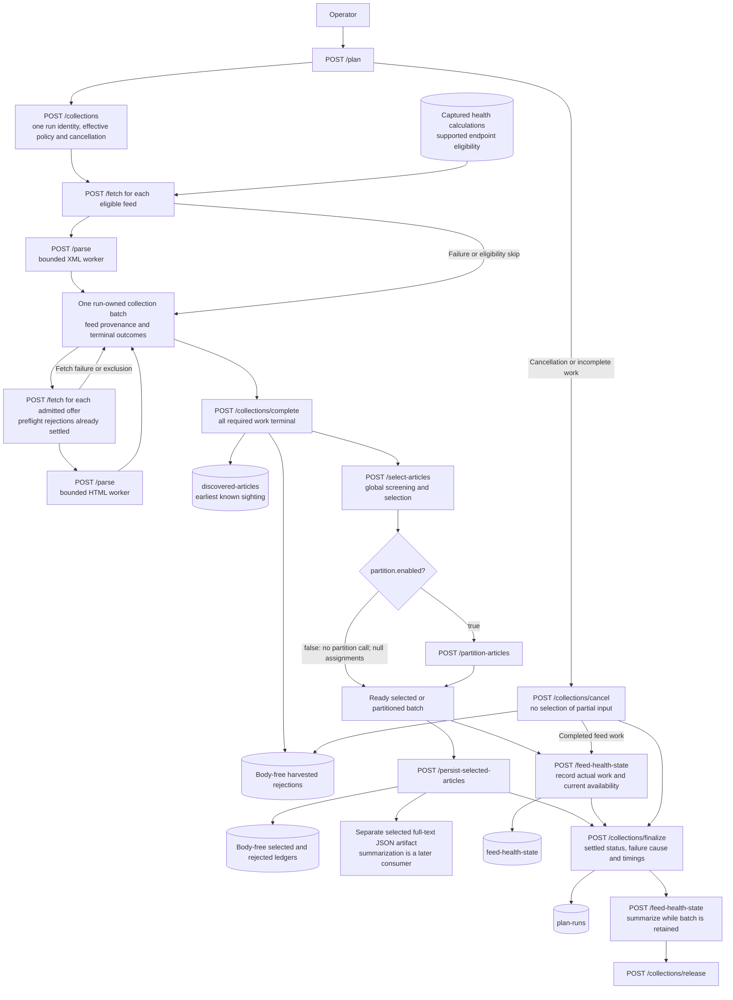

# Feed planning operator APIs

**Last Updated**: 2026-11-01

How do local requests fetch, parse, select, partition and persist content?
These are build-time operator APIs, not a server for the static site.
[Table K](../../reference/feed-planner-ledgers.md#k-api-inventory)
is the complete versioned route inventory.

## Independent fetch and parse endpoints

`POST /api/2026-10-31/fetch` requires UUIDv4 `request_id` and
`correlation_id`, an active configured `feed_id`, and `fetch_item_type`
(`feed` or `article`).
There is no public `source_id` alias. A feed request uses the configured
URL. An article request uses either an explicit permitted operator URL or
the complete server-owned `batch_id` and `offer_id` pair, not both.
No caller supplies a file path.

The permitted fetcher retains DNS/address validation, pinned sockets, robots,
redirect, retry, deadline and decoded-byte controls. Its strict response
contains a reference and body-free outcome, not fetched bytes. A failed
fetch remains a typed failure.

`POST /api/2026-10-31/parse` accepts `request_id`, `fetch_request_id`,
`article_id` and `correlation_id`. It claims the live fetched reference and checks configuration,
URL hash, byte limit and identities, then parses without any network call.
Missing or consumed references return HTTP 404. A reference already owned by
another parser returns HTTP 409. Malformed controls and invalid documents fail
explicitly. Parsing releases the original downloaded body on success or failure.

Feed parsing returns sanitized, body-free offers, discovery evidence and one
parsed `batch_id`. Article parsing completes that same batch without depending
on feed classification labels.
Article parse responses include a body-free `warnings` array. The saved
observation retains actual extraction warnings, quality measurements, fetch
evidence and typed parse failures; successful parsing does not erase them.
Fetch each offer by its server-owned reference, then parse each fetched
article. Concurrent article parses atomically update the same complete feed
batch. Selection refuses while any offer is still pending. A separate
operator article URL can produce its own batch; unrelated documents are
not silently combined.

Collection-owned feed parses return only pending admitted offers to the
planner. Preflight rejections remain in the completed collection and its
rejection ledger; no article HTTP call is needed to settle them. Standalone
feed parses retain their existing public offer flow.

Combined planning and standalone document work prepare the same required
health fields before fetching. They do not read extra request-report days or
calculate historical spend during fetch/parse setup. Report-only evidence
cannot block those operations; current-run request recording remains active.
Selection and explicit health summaries calculate reports when their response
needs them, under the
[field-read contract](../../reference/feed-planner-ledgers.md#field-based-health-history).

## Identity and causes

`article_id` is the canonical URL hash called `url_key` in the retained
ledgers. Internal candidate identity uses the supplying run, feed and
original entry ordinal. It is not another committed article identity.
Publisher IDs remain curated or null.

Transient work facts retain actual UTC operation times and request attempts.
They feed grouped health counters, not a committed per-operation history.
Public responses, progress and commit manifests contain no article bodies.
The downloaded body remains private in memory for its one parse operation.
Extracted article text continues through selection and its separate artifact.

## Structured operation logs

Standalone fetch, parse and persistence use the same structured publisher
as `/plan`. Invalid controls that
cannot resolve a document do not log caller-supplied addresses.
The [runner](feed-plan-runner.md#first-sight-and-retained-output) owns event
fields, failure-only article addresses and elapsed-time meaning.

## Live document lifetime

The listener holds current fetched documents under server-owned request IDs.
It claims each reference before parsing and removes it when parsing ends.
Failed fetches release their raw input when fetch handling ends. Active
references are never evicted; configured capacity bounds concurrent handoffs,
not the offered article population.

Run state keeps body-free work facts, source outcomes and original UTC
observations. Health and selection read this live state and retained ledgers.
Releasing a body does not erase warnings, partial request counts, rejected rows
or grouped causes, and later parsing cannot move earlier fetch work to its own
UTC day.

There is no request journal, completed fetch/parse/plan response cache, reopening
loader or automatic re-execution. A new process cannot recover old references.
Reusing an owned live request ID returns HTTP 409. `Idempotency-Key` on plan,
fetch or parse is unsupported and returns HTTP 400 before work.
Selection still creates a fresh result that can continue through partitioning
and persistence.

## Failure-only raw document artifact

The optional diagnostic contains a failed input document as downloaded, with
its recorded fetch facts. It is not extracted article text.
`dump_raw_document_contents` in `config/feed-ingest-plan-service.json` defaults
to false. When enabled, the planner appends failed native document JSON to
`inputs.artifact_root/<run_id>/<attempt>/raw-document-contents.jsonl`.
The run and attempt determine the path, never downloaded text.

Each compact JSONL record uses
[`RawDocumentFailureSchema`](../../../packages/common-contracts/src/schemas/raw-document-failure.schema.ts):
`schema_version`, `document_kind` (`feed` or `article`), `request_id`, the
observing `operation` (`fetch` or `parse`), actual UTC `failed_at`, the reported
`failure_reason`, and the validated raw `document`. Its body remains null when
no body was obtained. An unresolved request has only its existing body-free
error handling.

One live writer serializes appends and creates the file only on the first
failure. It is drained and closed before the completed file goes separately to
the artifact-directory delivery destination. Only that exact diagnostic target
is permitted. No expected file checksum is supplied.
The [manual workflow](../../how-to/run-feed-ingest-plan-test.md#manual-controls)
uploads it separately only when enabled and present, including after failed
collection, and waits for upload confirmation before cleanup.

No successful raw document is archived or retained to diagnose a later failure.
There is no refetch, replay, extracted-text substitute or diagnostic reader for
execution. Raw content never enters normal HTTP responses, logs, Git delivery,
selected metadata or public pages. Request headers and credentials are not
record fields. Append, close, preparation and upload errors remain explicit;
they do not erase the document failure or completed normal output.

## Selection, partition and persistence APIs

All stage inputs are server-owned IDs. The configured article limit bounds
output, never the number of input candidates.
Selected metadata includes `published_at_source`. A trusted source time uses
`source`; otherwise the actual saved selection-start UTC instant uses
`selection`. This fallback is output metadata, not a new age or admission
input. The [ledger reference](../../reference/feed-planner-ledgers.md#b-selected-articles)
owns the [current-format refusal rule](../../reference/feed-planner-ledgers.md#typescript-current-format-refusal).

Table A

| Id | Operation | Input and result |
| --- | --- | --- |
| A1 | `select-articles` | Accepts the complete parsed `batch_id`; returns a fresh selected ID, metadata-only articles, grouped exclusions, request report and the batch's exact `selection_started_at_utc` and `evaluated_at` UTC timestamps. No fetch, model call or automatic health write. |
| A2 | `partition-articles` | Accepts a selected ID and optional configured strategy/count; returns assignments and estimated work without reranking. |
| A3 | `feed-health-state` | Accepts a batch ID and explicit `summarize` or `record` action, defaulting to record; returns saved and updated health calculations, partial evidence, request spend, `reliability.window_days` and actual receipts when saved. No availability state file or state revision. |
| A4 | `persist-selected-articles` | Accepts a partitioned ID, or a selected ID when partitioning is disabled; writes selected and rejected metadata plus the selected text artifact, returning exact relative paths, `rejected_files` receipts even for zero-selected results, and a standalone run outcome where applicable. |
| A5 | `collections` | Starts one run-owned collection with a UUIDv4 `collection_id` and validated planning controls. Returns the captured UTC context and configured feed IDs, not article text. |
| A6 | `collections/complete` | Accepts `collection_id`; refuses until every required feed and offered article has a terminal outcome. Saves discovery and harvested-rejection evidence and exposes the complete global batch for selection. |
| A7 | `collections/cancel` | Accepts `collection_id`; cancels owned work and prevents selection. Returns harvested-rejection receipts and a batch reference for explicit partial-health recording. |
| A8 | `collections/finalize` | Accepts measured collection timing and the orchestration failure cause after stage writes settle. Drains owned work and raw diagnostics, then returns state-based status, failure cause and timing snapshot. |
| A9 | `collections/release` | Accepts `run_id` and `attempt`; releases a finalized collection after its later health-summary attempt. This does not erase written files. |
| A10 | `collections/exists` | Accepts `collection_id`; reports whether the owner still holds that collection after an ambiguous startup response. |

Orchestration consumes the validated selection and partition response metadata,
not their text-bearing batches. Selection returns its saved timestamps without
creating new instants. Partition returns metadata with worker assignments,
strategy, dispatch count and work estimates. The selected text stays private
through these stages and reaches only its existing separate artifact writer.

Each finalized execution is immutable. A fresh result must not overwrite a
prior artifact or double-count its HTTP work. Repeating the same finalized
result returns its existing receipt. The removed `persist-dispatches`
endpoint has no alias and returns ordinary HTTP 404.

## Safe-persist HTTP delivery

`POST /api/2026-10-31/safe-persist-data` calls the existing verified metadata
adapter and `safe_persist_data`, not another Git implementation. Its strict
request contains `runNumber`, `attempt` and `paths`, the exact completed paths
relative to the run's state directory. The response retains the existing
`status`, `commit`, `files` and `paths` receipt without changing its saved shape.
No article body, credential or delivery setting enters the request.

The runner checkout and private startup pipe supply the repository and temporary
output directory. The existing adapter still checks execution identity and
completed files, reads registered paths, and loads the committer and retry
settings from committed configuration. HTTP adds no permission or identity
system.

Always-run finalization owns a separate delivery child because collection has
already closed its planner child. The delivery child needs no live planner batch
or collection inputs; completed partial metadata remains deliverable after
planner failure. It reuses the configured listener and supervision limits,
checks owned-child readiness through `/health`, and closes and reaps that child
after success, failure or cancellation. Cancellation known before finalization
skips new Git delivery.

`safe_persist_http_completed` records the run number, attempt, confirmed status,
commit and file count in the workflow log. The API and client use the existing
`writeJsonLine` helper to write one JSON object per stderr line.
`safe_persist_http_failed` and
`safe_persist_http_client_failed` identify server and transport failures without
article bodies. An unconfirmed response or failed child shutdown records a failed
receipt, not a successful one. Report generation and artifact preparation still
run independently; [the workflow guide](../../how-to/run-feed-ingest-plan-test.md#saved-output-and-failures)
defines recovery and upload behavior.

## Markdown rendering API

TypeScript callers can render a validated planner result without starting an
HTTP request. Import `renderPlanMarkdown` from
`@idhazh/feed-ingest-plan/markdown`; it accepts a Plan response, optional feed
health data, an optional captured article maximum, a pre-rendered policy fold
and host table rows, then returns Markdown and actionable warning notices.
Run outcome and Needs attention remain visible; detailed evidence is folded.
It performs no network or file access and is a
package API, not an HTTP route.

The manual workflow uses an adapter to write that Markdown to its job summary
and turn warnings into workflow annotations. Its finalization task first calls
the safe-persist HTTP endpoint, then renders the report before the artifact
upload. The delivery receipt stays separate from the rendered report; the pure
renderer does not commit or upload files. This workflow presentation is not
the production digest renderer; production can choose a reader-facing format
without changing the planner API.
The adapter appends per-feed exclusion diagnostics to the existing Markdown
artifact only; they do not return to the main summary.

User-approved exception, 2026-10-30 UTC: planner transport tests may open an
ephemeral loopback-only listener and call its HTTP APIs. This proves actual
transport without allowing external network access; source responses remain
recorded fixtures. The exception does not permit live source fetching in tests.

## Request flow

The diagram shows every stage HTTP call made by
`POST /api/2026-10-31/plan` on its trusted local listener. Every stage call
uses actual loopback HTTP; no in-process transport substitutes for it. Selection
uses the run's captured calculations and actual completed work but does not
write health. The separate
`feed-health-state` request can summarize or record a batch.
The workflow HTTP client calls `/health`, `/plan`, then
`/feed-health-state` with `action: summarize` when a batch exists, and releases
the finalized collection after that attempt. Final accounting does not release
its batch; the summary must be read while the child still owns that in-memory
batch. The
[workflow entry](feed-plan-runner.md#entry-points-and-controls) supervises a
separate server child and keeps that same listener alive for all three calls
because parsed, selected and partitioned batches are in memory. A restart
does not restore those references. The workflow
checks health against its expected child and run identity before sending work;
ordinary `--serve` health remains an availability and enablement check.
Startup controls pass only through the private process pipe, never HTTP paths.

`/collections/finalize` does not release the collection. Cancellation first
aborts and drains every owned document request before it snapshots rejection
and health evidence. Raw-document diagnostics also finish before final status
and timings are returned. The status is `completed` without a failure cause;
with a cause, it is `partial` only when a work row has a feed check, otherwise
it is `failed`. The separate release call makes completed and cancelled
collections eligible for the existing bounded capacity rules.

Article fetch and parse requests can overlap and update the same batch.
Parsing retains earliest first-sighting facts in `discovered-articles`.
Selection uses the discovery evidence in the parsed batch and reads current
feed, publication and settled item-health evidence. The
[ledger reference](../../reference/feed-planner-ledgers.md) defines each saved
ledger. A completed `/plan` run writes the same ledger and artifact families;
a partial run records only the work it finished.

## Design rationale

Server-owned offer references preserve a complete public feed-to-article
flow without granting fetched prose authority over paths or later requests.
Shared bounded parsing capacity keeps the listener responsive while real
HTML extraction runs. A live claim protects each fetched reference without
serializing all runs. Removing that reference after parsing avoids retaining
successful downloads as hidden execution state.
The Plan API does not collect per-document CPU or RAM profiles. These samples
do not change fetch, parse, selection or persistence results; host fingerprints
remain separate ledger records.
The Markdown renderer is a pure package function, not another HTTP route:
formatting needs no service call, workflow annotations stay in the workflow
adapter, and production can choose a separate reader-facing presentation.
Final delivery gets its own short-lived child so a stopped or failed planner
cannot prevent completed metadata from reaching the unchanged Git engine.
Both children use the same private-pipe shutdown and exact-process reaping code.

## See also

- [Runner](feed-plan-runner.md)
- [Harvesting and trust checks](feed-harvesting.md)
- [Article selection](feed-curation.md)
- [Planning completion](feed-ingest-audit.md)
- [Host probe APIs](../../reference/host-probe-api.md)
