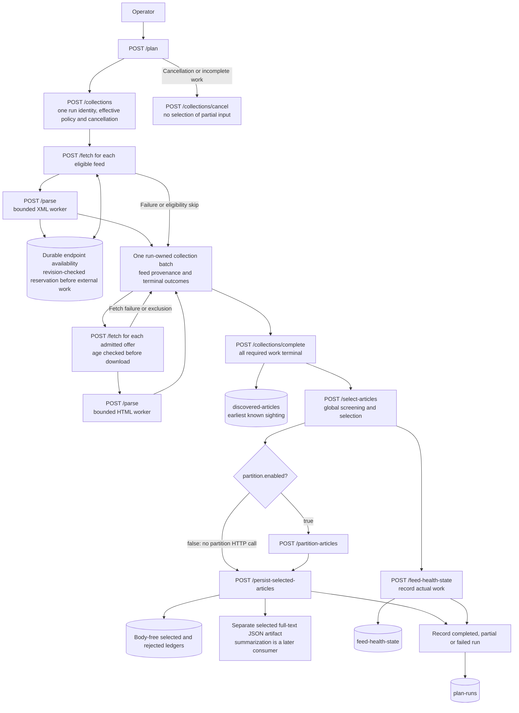

# Feed planning operator APIs

**Last Updated**: 2026-10-30

How do local requests fetch, parse, select, partition and persist content?
These are build-time operator APIs, not a server for the static site.
[Table K](../../reference/feed-planner-ledgers.md#k-api-inventory)
is the complete versioned route inventory.

## Independent fetch and parse endpoints

`POST /api/2026-10-20/fetch` requires UUIDv4 `request_id` and
`correlation_id`, an active configured `feed_id`, and `fetch_item_type`
(`feed` or `article`).
There is no public `source_id` alias. A feed request uses the configured
URL. An article request uses either an explicit permitted operator URL or
the complete server-owned `batch_id` and `offer_id` pair, not both.
No caller supplies a file path.

The permitted fetcher retains DNS/address validation, pinned sockets, robots,
redirect, retry, deadline and decoded-byte controls. Its strict response
contains a reference and body-free outcome, not fetched bytes. A failed
fetch remains a typed failure.

`POST /api/2026-10-20/parse` accepts `request_id`, `fetch_request_id`,
`article_id` and `correlation_id`. It checks the saved receipt, configuration,
URL hash, byte limit and identities, then parses without any network call.
Missing receipts return HTTP 404; unavailable fetch content returns HTTP 409.
Malformed controls and damaged receipts fail explicitly.

Feed parsing returns sanitized, body-free offers, discovery evidence and one
parsed `batch_id`. Article parsing completes that same batch without depending
on feed classification labels.
Article parse responses include a body-free `warnings` array. The saved
observation retains actual extraction warnings, quality measurements, fetch
evidence and typed parse failures; successful parsing does not erase them.
Fetch each offer by its server-owned reference, then parse each fetched
article. Concurrent article parses atomically update the same complete feed
batch. Selection refuses while any offer is still pending. A separate
operator article URL can produce its own batch; unrelated documents are
not silently combined.

Combined planning and standalone document work prepare the same required
health fields before fetching. They do not read extra request-report days or
calculate historical spend during fetch/parse setup. Report-only evidence
cannot block those operations; current-run request recording remains active.
Selection and explicit health summaries calculate reports when their response
needs them, under the
[field-read contract](../../reference/feed-planner-ledgers.md#field-based-health-history).

## Identity and causes

`article_id` is the canonical URL hash called `url_key` in the retained
ledgers. Internal candidate identity uses the supplying run, feed and
original entry ordinal. It is not another committed article identity.
Publisher IDs remain curated or null.

Transient work facts retain actual UTC operation times and request attempts.
They feed grouped health counters, not a committed per-operation history.
Public responses, progress and commit manifests contain no article bodies.
The body-bearing fetch receipt remains private for the parse operation.

## Structured operation logs

Standalone fetch, parse and persistence use the same structured publisher
as `/plan`. Completed replays emit no new work events. Invalid controls that
cannot resolve a document do not log caller-supplied addresses.
The [runner](feed-plan-runner.md#first-sight-and-retained-output) owns event
fields, failure-only article addresses and elapsed-time meaning.

## Durable replay and interrupted requests

`planner-operations.sqlite` lives under the configured output root.
TypeScript contracts declare its private `PlannerOperation` and
`FetchedDocument` records. Reads use one indexed request key, never a history
walk.

The key is shared across fetch, parse and keyed plans. Reuse with different
input, operation or configuration returns HTTP 409. A short transaction
claims the request before asynchronous work; a second short transaction
saves its validated result. No SQLite write lock spans network or worker
parsing work, and independent requests can overlap.

Completed keys replay their saved response without repeating work.
A started or interrupted key returns `REQUEST_INCOMPLETE`; it is not
silently retried. An expired in-memory parsed batch cannot replay a dead
successful stage reference. Inspection or a new execution is required.
This does not promise exactly-once external HTTP work across a hard crash.

Saved fetch receipts retain their original work date. On restart, known
attempt evidence restores real request spend on that date; incomplete
accounting remains unknown. A later parse cannot relabel earlier fetches
as complete zero requests on its own API day.

The optional UUIDv4 `Idempotency-Key` on `/plan` uses this same replay
boundary. Selection has no idempotency key: another call creates a fresh
result that can continue through partitioning and persistence.

## Selection, partition and persistence APIs

All stage inputs are server-owned IDs. The configured article limit bounds
output, never the number of input candidates.
Selected metadata includes `published_at_source`. A trusted source time uses
`source`; otherwise the actual saved selection-start UTC instant uses
`selection`. This fallback is output metadata, not a new age or admission
input. The [ledger reference](../../reference/feed-planner-ledgers.md#b-selected-articles)
owns the [current-format refusal rule](../../reference/feed-planner-ledgers.md#typescript-current-format-refusal).

Table A

| Id | Operation | Input and result |
| --- | --- | --- |
| A1 | `select-articles` | Accepts the complete parsed `batch_id`; returns a fresh selected ID, metadata-only articles, grouped exclusions and request report. No fetch, model call or automatic health write. |
| A2 | `partition-articles` | Accepts a selected ID and optional configured strategy/count; returns assignments and estimated work without reranking. |
| A3 | `feed-health-state` | Accepts a batch ID and explicit `summarize` or `record` action, defaulting to record; returns current health, request spend, `reliability.window_days` and actual receipts when saved. |
| A4 | `persist-selected-articles` | Accepts a partitioned ID, or a selected ID when partitioning is disabled; writes selected and rejected metadata plus the selected text artifact, returning exact relative paths, `rejected_files` receipts even for zero-selected results, and a standalone run outcome where applicable. |
| A5 | `collections` | Starts one run-owned collection with a UUIDv4 `collection_id` and validated planning controls. Returns the captured UTC context and configured feed IDs, not article text. |
| A6 | `collections/complete` | Accepts `collection_id`; refuses until every required feed and offered article has a terminal outcome. Saves discovery evidence and exposes the complete global batch for selection. |
| A7 | `collections/cancel` | Accepts `collection_id`; cancels owned work and prevents selection of the incomplete collection. |

Each finalized execution is immutable. A fresh result must not overwrite a
prior artifact or double-count its HTTP work. Replaying the same finalized
result returns its existing receipt. The removed `persist-dispatches`
endpoint has no alias and returns ordinary HTTP 404.

## Markdown rendering API

TypeScript callers can render a validated planner result without starting an
HTTP request. Import `renderPlanMarkdown` from
`@idhazh/feed-ingest-plan/markdown`; it accepts a Plan response, optional feed
health data and optional pre-rendered policy and host sections, then returns
Markdown and semantic notices. It performs no network or file access and is a
package API, not an HTTP route.

The manual workflow uses an adapter to write that Markdown to its job summary
and turn notices into workflow annotations. Its finalization task first calls
the separate safe Git delivery API, then renders the report before the artifact
upload. The delivery receipt stays separate from the rendered report; the pure
renderer does not commit or upload files. This workflow presentation is not
the production digest renderer; production can choose a reader-facing format
without changing the planner API.

User-approved exception, 2026-10-30 UTC: planner transport tests may open an
ephemeral loopback-only listener and call its HTTP APIs. This proves actual
transport without allowing external network access; source responses remain
recorded fixtures. The exception does not permit live source fetching in tests.

## Request flow

The diagram shows every stage HTTP call made by
`POST /api/2026-10-20/plan` on its trusted local listener. Selection
captures health for its own decision but does not write it. The separate
`feed-health-state` request can summarize or record a batch.
The workflow HTTP client calls `/health`, `/plan`, then
`/feed-health-state` with `action: summarize` when a batch exists. The
[workflow entry](feed-plan-runner.md#entry-points-and-controls) supervises a
separate server child and keeps that same listener alive for all three calls
because parsed, selected and partitioned batches are in memory. The private
SQLite journal does not restore those references after a restart. The workflow
checks health against its expected child and run identity before sending work;
ordinary `--serve` health remains an availability and enablement check.
Startup controls pass only through the private process pipe, never HTTP paths.

Article fetch and parse requests can overlap and update the same batch.
Parsing retains earliest first-sighting facts in `discovered-articles`.
Selection uses the discovery evidence in the parsed batch and reads current
feed, publication and settled item-health evidence. The
[ledger reference](../../reference/feed-planner-ledgers.md) defines each saved
ledger. A completed `/plan` run writes the same ledger and artifact families;
a partial run records only the work it finished.

## Design rationale

Server-owned offer references preserve a complete public feed-to-article
flow without granting fetched prose authority over paths or later requests.
Shared bounded parsing capacity keeps the listener responsive while real
HTML extraction runs. Short private-journal transactions protect request
identity without restoring a listener-wide run queue.
The Plan API does not collect per-document CPU or RAM profiles. These samples
do not change fetch, parse, selection or persistence results; host fingerprints
remain separate ledger records.
The Markdown renderer is a pure package function, not another HTTP route:
formatting needs no service call, workflow annotations stay in the workflow
adapter, and production can choose a separate reader-facing presentation.

## See also

- [Runner](feed-plan-runner.md)
- [Harvesting and trust checks](feed-harvesting.md)
- [Article selection](feed-curation.md)
- [Planning completion](feed-ingest-audit.md)
- [Host probe APIs](../../reference/host-probe-api.md)
